# Architecture and Design

<details>
<summary>Relevant source files</summary>

The following files were used as context for generating this wiki page:

- [openfe/protocols/openmm_afe/base.py](openfe/protocols/openmm_afe/base.py)
- [openfe/protocols/openmm_afe/equil_afe_settings.py](openfe/protocols/openmm_afe/equil_afe_settings.py)
- [openfe/protocols/openmm_afe/equil_solvation_afe_method.py](openfe/protocols/openmm_afe/equil_solvation_afe_method.py)
- [openfe/protocols/openmm_md/plain_md_methods.py](openfe/protocols/openmm_md/plain_md_methods.py)
- [openfe/protocols/openmm_md/plain_md_settings.py](openfe/protocols/openmm_md/plain_md_settings.py)
- [openfe/protocols/openmm_rfe/equil_rfe_methods.py](openfe/protocols/openmm_rfe/equil_rfe_methods.py)
- [openfe/protocols/openmm_rfe/equil_rfe_settings.py](openfe/protocols/openmm_rfe/equil_rfe_settings.py)
- [openfe/protocols/openmm_utils/omm_settings.py](openfe/protocols/openmm_utils/omm_settings.py)
- [openfe/tests/protocols/conftest.py](openfe/tests/protocols/conftest.py)

</details>


## Purpose and Scope

This document explains the core architecture of OpenFE, focusing on the protocol execution model, data flow patterns, and how major components interact to perform free energy calculations. For installation procedures, see [Installation and Setup](#1.1). For details on specific protocol implementations, see [Core Protocols](#2).

## System Overview

OpenFE implements a **protocol-based architecture** where all computational workflows (relative free energy, absolute solvation, molecular dynamics) follow a common execution pattern. The system is organized into distinct layers that transform user inputs into simulation results:

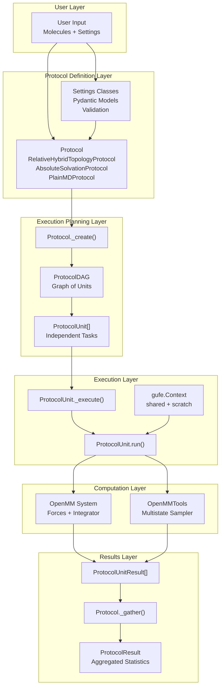

**Key Architectural Principles:**
- **Separation of Concerns**: Protocol definition is separate from execution mechanics
- **Reproducibility**: All parameters are serializable and tracked via `repeat_id` and `generation`
- **Parallelization**: Units execute independently, enabling embarrassingly parallel workflows
- **Type Safety**: Pydantic models enforce validation at the settings level

Sources: [openfe/protocols/openmm_rfe/equil_rfe_methods.py:496-681](), [openfe/protocols/openmm_md/plain_md_methods.py:118-237]()

## Core Abstractions

### Protocol Class Hierarchy

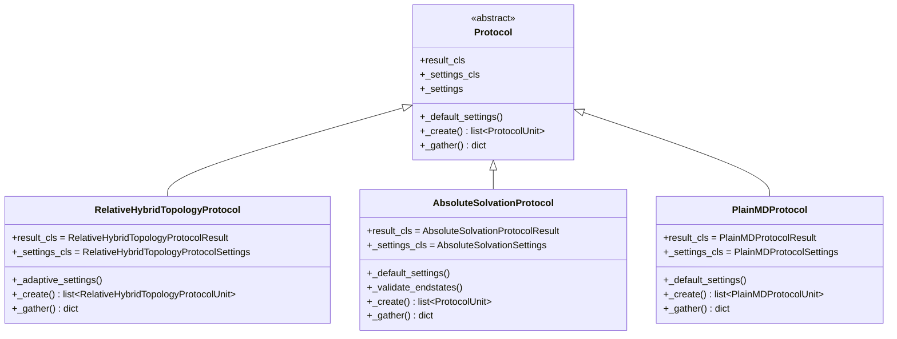

All protocols inherit from `gufe.Protocol` and must implement:
- `_create()`: Generates `ProtocolUnit` instances for execution
- `_gather()`: Aggregates results from completed units
- `result_cls`: The result container class
- `_settings_cls`: The settings model class

Sources: [openfe/protocols/openmm_rfe/equil_rfe_methods.py:496-546](), [openfe/protocols/openmm_afe/equil_solvation_afe_method.py:405-503](), [openfe/protocols/openmm_md/plain_md_methods.py:118-165]()

### Settings Architecture

```mermaid
graph TB
    subgraph "Base Settings"
        SettingsBaseModel["SettingsBaseModel<br/>Pydantic BaseModel"]
        Settings["Settings<br/>Protocol Container"]
    end
    
    subgraph "Shared Settings Modules"
        FFSettings["OpenMMSystemGeneratorFFSettings<br/>Force field configuration"]
        ThermoSettings["ThermoSettings<br/>Temperature + Pressure"]
        SolvationSettings["OpenMMSolvationSettings<br/>Solvent padding, box shape"]
        ChargeSettings["OpenFFPartialChargeSettings<br/>AM1-BCC, NAGL, Espaloma"]
        IntegratorSettings["IntegratorSettings<br/>Timestep, collision rate"]
        EngineSettings["OpenMMEngineSettings<br/>Platform selection"]
    end
    
    subgraph "Protocol-Specific Settings"
        RFESettings["RelativeHybridTopologyProtocolSettings<br/>Lambda schedule, alchemical"]
        AFESettings["AbsoluteSolvationSettings<br/>Vacuum + Solvent legs"]
        MDSettings["PlainMDProtocolSettings<br/>Equilibration + Production"]
    end
    
    subgraph "Simulation Control"
        SimSettings["MultiStateSimulationSettings<br/>Replicas, sampler method"]
        MDSimSettings["MDSimulationSettings<br/>NVT + NPT lengths"]
        OutputSettings["OutputSettings<br/>Checkpoint, trajectory"]
    end
    
    SettingsBaseModel --> FFSettings
    SettingsBaseModel --> ThermoSettings
    SettingsBaseModel --> SolvationSettings
    SettingsBaseModel --> ChargeSettings
    SettingsBaseModel --> IntegratorSettings
    SettingsBaseModel --> EngineSettings
    SettingsBaseModel --> SimSettings
    SettingsBaseModel --> MDSimSettings
    SettingsBaseModel --> OutputSettings
    
    Settings --> RFESettings
    Settings --> AFESettings
    Settings --> MDSettings
    
    RFESettings --> FFSettings
    RFESettings --> ThermoSettings
    RFESettings --> SolvationSettings
    RFESettings --> ChargeSettings
    RFESettings --> IntegratorSettings
    RFESettings --> EngineSettings
    RFESettings --> SimSettings
    RFESettings --> OutputSettings
    
    AFESettings --> FFSettings
    AFESettings --> ThermoSettings
    AFESettings --> SolvationSettings
    AFESettings --> ChargeSettings
    AFESettings --> IntegratorSettings
    AFESettings --> EngineSettings
    AFESettings --> MDSimSettings
    AFESettings --> OutputSettings
    
    MDSettings --> FFSettings
    MDSettings --> ThermoSettings
    MDSettings --> SolvationSettings
    MDSettings --> ChargeSettings
    MDSettings --> IntegratorSettings
    MDSettings --> EngineSettings
    MDSettings --> MDSimSettings
    MDSettings --> OutputSettings
```

Settings objects are **immutable Pydantic models** with built-in validation. All settings classes inherit from `SettingsBaseModel` and use field validators to enforce constraints.

**Common Settings Patterns:**
| Setting Type | Location | Key Parameters |
|-------------|----------|----------------|
| Force Field | `OpenMMSystemGeneratorFFSettings` | `nonbonded_method`, `hydrogen_mass`, `small_molecule_forcefield` |
| Solvation | `OpenMMSolvationSettings` | `solvent_padding`, `box_shape`, `solvent_model` |
| Partial Charges | `OpenFFPartialChargeSettings` | `partial_charge_method`, `off_toolkit_backend`, `nagl_model` |
| Integrator | `IntegratorSettings` | `timestep`, `langevin_collision_rate`, `barostat_frequency` |
| Multistate | `MultiStateSimulationSettings` | `n_replicas`, `sampler_method`, `equilibration_length`, `production_length` |

Sources: [openfe/protocols/openmm_utils/omm_settings.py:1-710](), [openfe/protocols/openmm_rfe/equil_rfe_settings.py:1-158](), [openfe/protocols/openmm_afe/equil_afe_settings.py:1-406]()

## Protocol Execution Model

### ProtocolDAG Structure

The **ProtocolDAG** is the fundamental execution abstraction. When a protocol's `_create()` method is called, it returns a list of `ProtocolUnit` instances that form a directed acyclic graph (DAG) of dependencies.

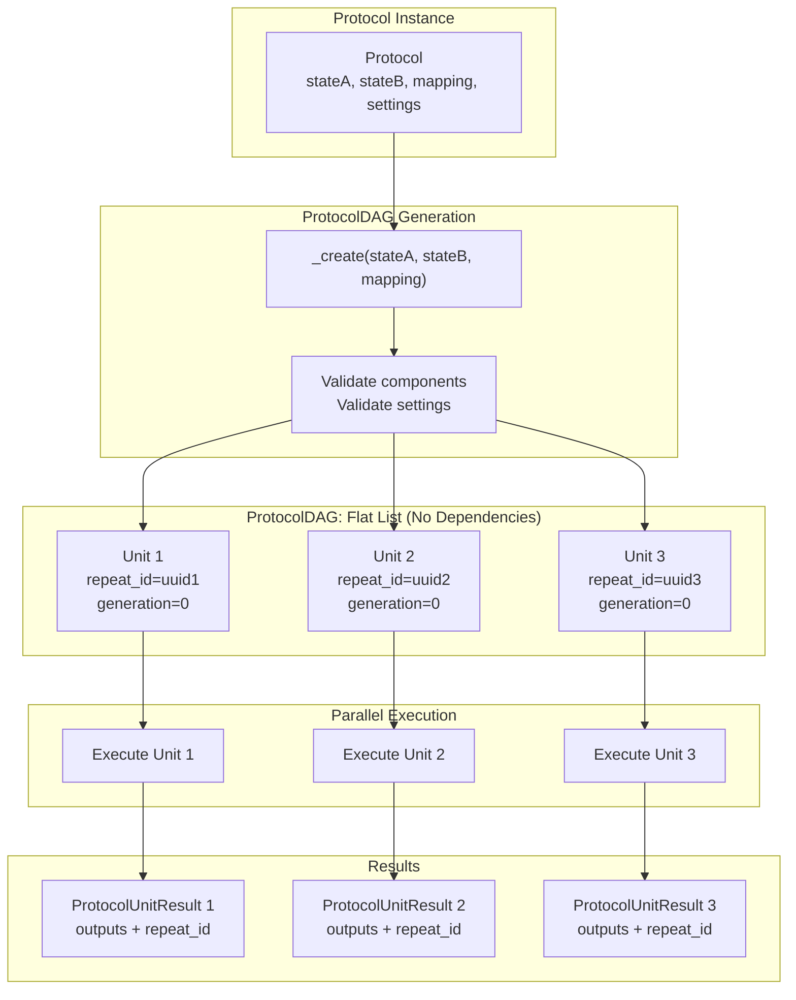

**Current Implementation Notes:**
- OpenFE protocols currently create **flat DAGs** (no dependencies between units)
- Each unit represents one complete independent repeat of the simulation
- Default `protocol_repeats=3` creates 3 independent units
- Future versions may support extensions (generation > 0) for adaptive sampling

Sources: [openfe/protocols/openmm_rfe/equil_rfe_methods.py:616-660](), [openfe/protocols/openmm_md/plain_md_methods.py:166-215]()

### ProtocolUnit Lifecycle

Each `ProtocolUnit` follows a standard execution lifecycle:

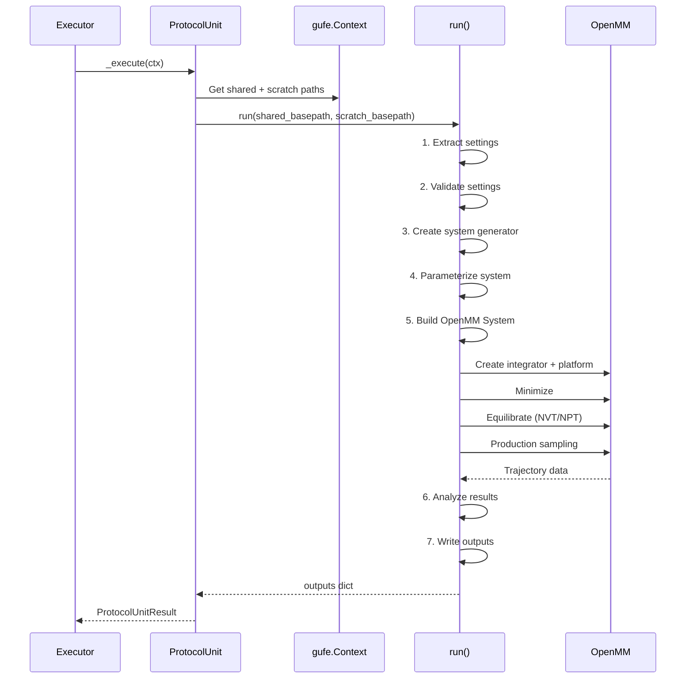

**ProtocolUnit Initialization Parameters:**

| Parameter | Type | Purpose |
|-----------|------|---------|
| `protocol` | Protocol | Reference to parent protocol (contains settings) |
| `stateA` | ChemicalSystem | Initial state of transformation |
| `stateB` | ChemicalSystem | Final state of transformation (optional for MD) |
| `repeat_id` | int | Unique identifier for this independent repeat |
| `generation` | int | Counter for extensions (0 for initial run) |
| `name` | str | Human-readable identifier |

For RFE protocols, additional parameters include:
- `ligandmapping`: `LigandAtomMapping` defining atom correspondences

Sources: [openfe/protocols/openmm_rfe/equil_rfe_methods.py:683-731](), [openfe/protocols/openmm_md/plain_md_methods.py:239-279]()

### Execution Flow: RelativeHybridTopologyProtocolUnit

**Detailed execution steps for RFE calculations:**

```mermaid
flowchart TD
    Start["run() called"] --> Extract["Extract settings from protocol"]
    Extract --> ValidateTS["Validate timestep vs hydrogen_mass"]
    ValidateTS --> ConvertSteps["Convert time lengths to steps"]
    
    ConvertSteps --> GetComps["Get system components<br/>solvent, protein, small_mols"]
    GetComps --> CheckCharge["Check alchemical charge difference"]
    
    CheckCharge --> CreateOffMols["Create OpenFF molecules<br/>stateA, stateB, both"]
    CreateOffMols --> AssignCharges["Assign partial charges<br/>assign_offmol_partial_charges()"]
    
    AssignCharges --> SysGen["Create system generator<br/>get_system_generator()"]
    SysGen --> ForceTemplates["Force template registration"]
    
    ForceTemplates --> Modeller["Create OpenMM Modeller<br/>get_omm_modeller()"]
    Modeller --> StateASystem["Create stateA System<br/>system_generator.create_system()"]
    
    StateASystem --> StateBTop["Create stateB topology<br/>combined_topology()"]
    StateBTop --> StateBSys["Create stateB System"]
    StateBSys --> Mappings["Define system mappings<br/>get_system_mappings()"]
    
    Mappings --> ChargeCorr{Charge correction?}
    ChargeCorr -->|Yes| AlchemWater["Transform water to ion<br/>get_alchemical_waters()"]
    ChargeCorr -->|No| Hybrid
    AlchemWater --> Hybrid["Create hybrid topology<br/>HybridTopologyFactory"]
    
    Hybrid --> Lambda["Generate lambda schedule<br/>lambda_protocol()"]
    Lambda --> Thermo["Create thermodynamic states<br/>SamplerState + ThermodynamicState"]
    
    Thermo --> Sampler["Create multistate sampler<br/>RepexSampler/SAMSSampler"]
    Sampler --> Minimize["Minimize energy"]
    Minimize --> Equil["Equilibrate system"]
    Equil --> Production["Run production sampling"]
    
    Production --> Analysis["Analyze with MBAR<br/>equilibration detection"]
    Analysis --> Write["Write outputs<br/>nc, checkpoint, analysis"]
    Write --> Return["Return outputs dict"]
```

**Key Methods Called:**
- `_assign_partial_charges()`: [openfe/protocols/openmm_rfe/equil_rfe_methods.py:732-759]()
- `get_system_generator()`: Used via `system_creation` module
- `get_omm_modeller()`: Used via `system_creation` module
- `combined_topology()`: Via `_rfe_utils.topologyhelpers`
- Hybrid topology creation: [openfe/protocols/openmm_rfe/equil_rfe_methods.py:972-1054]()
- Multistate setup: [openfe/protocols/openmm_rfe/equil_rfe_methods.py:1126-1245]()

Sources: [openfe/protocols/openmm_rfe/equil_rfe_methods.py:760-1489]()

### Execution Flow: PlainMDProtocolUnit

**Simplified flow for standard MD:**

```mermaid
flowchart TD
    Start["run() called"] --> Extract["Extract settings"]
    Extract --> ValidateTS["Validate timestep"]
    ValidateTS --> ConvertSteps["Convert time to steps<br/>NVT, NPT, Production"]
    
    ConvertSteps --> GetComps["Get components<br/>solvent, protein, small_mols"]
    GetComps --> OffMols["Create OpenFF molecules"]
    OffMols --> AssignCharges["Assign partial charges"]
    
    AssignCharges --> SysGen["Create system generator"]
    SysGen --> ForceTemplates["Force template registration"]
    ForceTemplates --> Modeller["Create OpenMM Modeller"]
    
    Modeller --> System["Create OpenMM System<br/>system_generator.create_system()"]
    System --> SavePDB["Save preminimized PDB"]
    SavePDB --> Platform["Get OpenMM platform"]
    
    Platform --> Integrator["Create LangevinMiddleIntegrator"]
    Integrator --> Simulation["Create Simulation object"]
    
    Simulation --> Minimize["Minimize energy<br/>minimizeEnergy()"]
    Minimize --> NVT{NVT equilibration?}
    NVT -->|Yes| RunNVT["Run NVT<br/>simulation.step()"]
    NVT -->|No| NPT
    RunNVT --> SaveNVT["Save NVT structure"]
    SaveNVT --> NPT["Run NPT equilibration<br/>simulation.step()"]
    
    NPT --> SaveNPT["Save NPT structure"]
    SaveNPT --> Reporters["Setup reporters<br/>XTC, Checkpoint, Log"]
    Reporters --> Prod["Run production<br/>simulation.step()"]
    
    Prod --> Return["Return outputs dict<br/>trajectories, pdbs"]
```

**Key Differences from RFE:**
- No hybrid topology creation
- No alchemical transformations or lambda schedules
- Simpler three-phase protocol: minimize → equilibrate → produce
- Direct trajectory output (XTC format) instead of NetCDF multistate
- Static method `_run_MD()` handles simulation phases: [openfe/protocols/openmm_md/plain_md_methods.py:281-483]()

Sources: [openfe/protocols/openmm_md/plain_md_methods.py:510-712]()

## Result Aggregation

### Gathering Results

After all units complete, the protocol's `_gather()` method aggregates results by `repeat_id`:

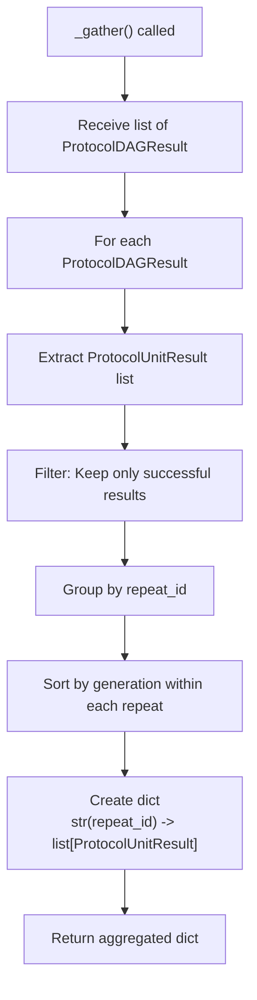

**Data Structure:**
```python
{
    "repeat_id_1": [ProtocolUnitResult(generation=0), ...],
    "repeat_id_2": [ProtocolUnitResult(generation=0), ...],
    "repeat_id_3": [ProtocolUnitResult(generation=0), ...]
}
```

**For Absolute Solvation:**
```python
{
    "solvent": {
        "repeat_id_1": [ProtocolUnitResult, ...],
        ...
    },
    "vacuum": {
        "repeat_id_1": [ProtocolUnitResult, ...],
        ...
    }
}
```

Sources: [openfe/protocols/openmm_rfe/equil_rfe_methods.py:662-680](), [openfe/protocols/openmm_afe/equil_solvation_afe_method.py:667-724]()

### ProtocolResult Structure

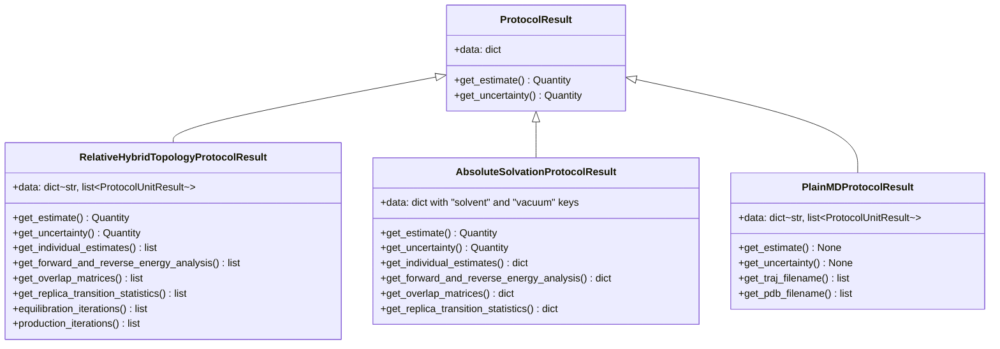

**Key Methods:**

| Method | RFE | AFE | MD | Purpose |
|--------|-----|-----|----|---------|
| `get_estimate()` | ✓ | ✓ | ✗ | Mean ΔG across repeats |
| `get_uncertainty()` | ✓ | ✓ | ✗ | Std dev across repeats |
| `get_individual_estimates()` | ✓ | ✓ | ✗ | Per-repeat ΔG + MBAR error |
| `get_overlap_matrices()` | ✓ | ✓ | ✗ | MBAR overlap statistics |
| `get_replica_transition_statistics()` | ✓ | ✓ | ✗ | Replica exchange mixing |
| `equilibration_iterations()` | ✓ | ✓ | ✗ | Detected equilibration length |
| `production_iterations()` | ✓ | ✓ | ✗ | Uncorrelated samples count |
| `get_traj_filename()` | ✗ | ✗ | ✓ | Path to trajectory files |

Sources: [openfe/protocols/openmm_rfe/equil_rfe_methods.py:276-494](), [openfe/protocols/openmm_afe/equil_solvation_afe_method.py:106-403](), [openfe/protocols/openmm_md/plain_md_methods.py:62-116]()

## Storage and Serialization

### File Organization

Each `ProtocolUnit` execution produces outputs in a structured directory:

**For RFE and AFE (Multistate):**
```
shared_basepath/
├── db.json                              # Force field cache
├── simulation.nc                        # Multistate trajectory (NetCDF)
├── checkpoint.nc                        # Checkpoint file
├── hybrid_system.pdb                    # Hybrid topology structure
└── simulation_real_time_analysis.yaml  # Real-time convergence data
```

**For MD:**
```
shared_basepath/
├── db.json                    # Force field cache
├── system.pdb                 # Pre-minimized structure
├── minimized.pdb              # Post-minimization structure
├── equil_nvt.pdb              # Post-NVT equilibration (optional)
├── equil_npt.pdb              # Post-NPT equilibration
├── simulation.xtc             # Production trajectory
├── checkpoint.chk             # Checkpoint file
└── simulation.log             # Energy/performance log
```

**Context Paths:**
- `shared_basepath`: Persistent storage, accessible across workers
- `scratch_basepath`: Temporary storage, may be node-local

Sources: [openfe/protocols/openmm_utils/omm_settings.py:423-507](), [openfe/protocols/openmm_utils/omm_settings.py:681-710]()

### Serialization via GufeTokenizable

All OpenFE protocols, settings, and results inherit from `gufe.GufeTokenizable`, enabling JSON serialization:

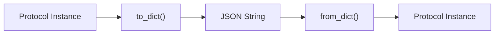

**Key Serializable Objects:**
- `Protocol` instances (with settings)
- `ProtocolUnit` instances (with inputs)
- `ProtocolResult` instances (with data)
- `ChemicalSystem` instances (with components)
- `LigandAtomMapping` instances

This enables:
- Saving transformation definitions for later execution
- Distributing work to remote workers
- Archiving complete computational provenance

Sources: Referenced implicitly through gufe inheritance

## Component Interaction Patterns

### System Creation Pipeline

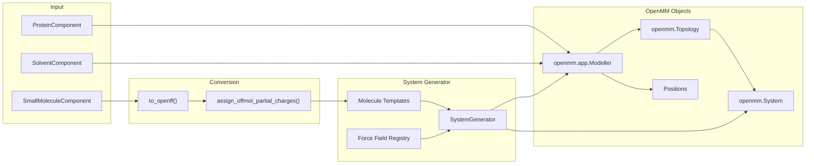

**Key Utilities:**
- `get_components()`: Extracts and validates components from `ChemicalSystem`
- `get_system_generator()`: Creates `SystemGenerator` with force field settings
- `get_omm_modeller()`: Builds OpenMM Modeller with solvation
- `assign_offmol_partial_charges()`: Handles AM1-BCC, NAGL, or Espaloma charges

Sources: System creation utilities are in `openfe/protocols/openmm_utils/` directory

### Settings Validation Chain

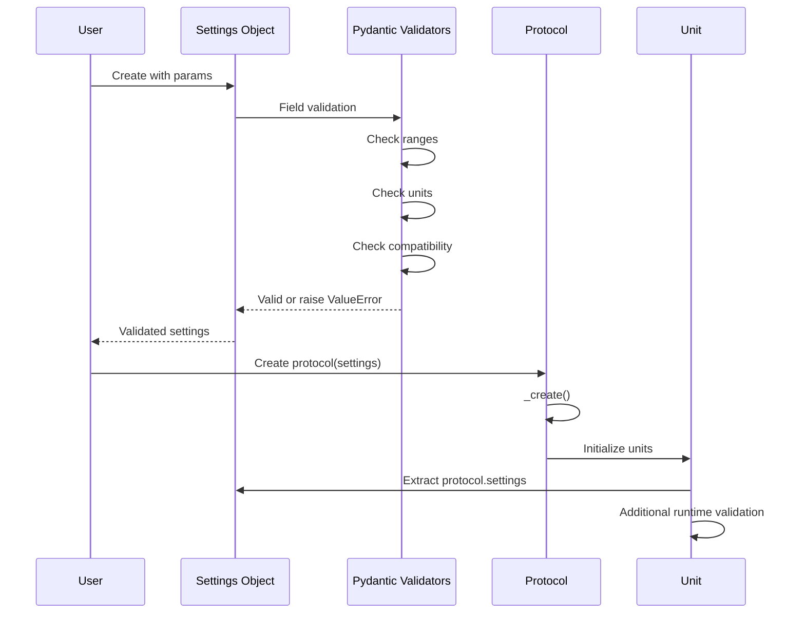

**Validation Examples:**

| Validation | Implementation | Purpose |
|------------|----------------|---------|
| Timestep vs hydrogen mass | `validate_timestep()` | Ensure stability with HMR |
| Time unit compatibility | `@field_validator` | Reject non-time quantities |
| Positive values | `@field_validator` | Physical constraint enforcement |
| Box vector format | `supported_vectors()` | Ensure OpenMM reduced form |
| Lambda monotonicity | `must_be_monotonic()` | Prevent invalid schedules |

Sources: [openfe/protocols/openmm_utils/omm_settings.py:186-220](), [openfe/protocols/openmm_afe/equil_afe_settings.py:108-130]()

## Key Design Patterns

### Immutable Settings Pattern

Settings objects are **immutable** once created. To modify settings:

```python
# Get default settings
settings = Protocol.default_settings()

# Create modified copy
new_settings = settings.copy(deep=True)
new_settings.simulation_settings.production_length = 20 * unit.nanosecond

# Create protocol with new settings
protocol = Protocol(settings=new_settings)
```

This ensures:
- Settings cannot be accidentally modified during execution
- Full reproducibility of calculations
- Thread-safe execution in parallel environments

### Repeat and Generation Tracking

Each `ProtocolUnit` carries:
- **`repeat_id`**: UUID identifying independent statistical repeat
- **`generation`**: Counter for extensions (0 = initial, 1+ = continuation)

This enables:
- Statistical analysis across repeats
- Adaptive sampling (future feature)
- Provenance tracking

Sources: [openfe/protocols/openmm_rfe/equil_rfe_methods.py:648-657]()

### Shared vs Scratch Storage

Protocols distinguish between two storage locations:

| Location | Purpose | Lifetime | Accessibility |
|----------|---------|----------|---------------|
| `shared_basepath` | Results, force field cache | Persistent | All workers |
| `scratch_basepath` | Temporary files | Ephemeral | Node-local |

This supports:
- Efficient HPC execution with node-local scratch
- Shared force field template caching
- Result collection from distributed workers

Sources: [openfe/protocols/openmm_rfe/equil_rfe_methods.py:760-796]()

### Factory Pattern for Alchemical Systems

RFE protocols use the **factory pattern** for hybrid topology creation:

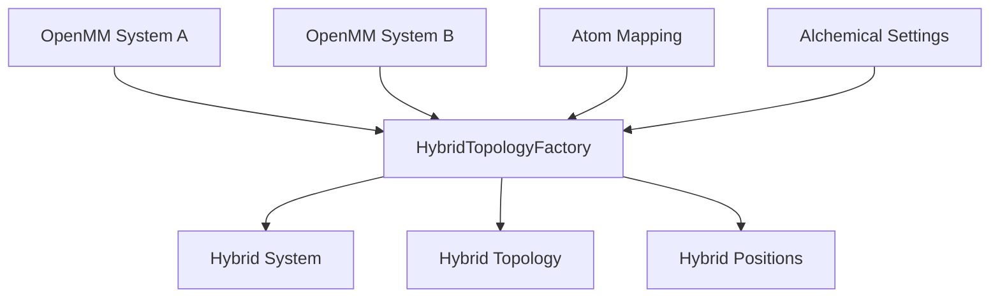

The factory encapsulates:
- Core/unique atom identification
- Softcore potential creation
- Exception handling
- Charge correction (if needed)

Sources: [openfe/protocols/openmm_rfe/equil_rfe_methods.py:972-1054]()

## Testing Infrastructure

OpenFE protocols are tested using a **three-tier strategy**:

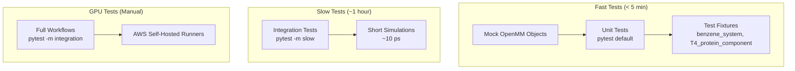

**Test Fixtures:**
- `benzene_system`: Simple solvated system
- `benzene_complex_system`: Protein-ligand complex
- `benzene_to_toluene_mapping`: Common transformation
- `get_available_openmm_platforms()`: Platform detection

Sources: [openfe/tests/protocols/conftest.py:1-375]()

---