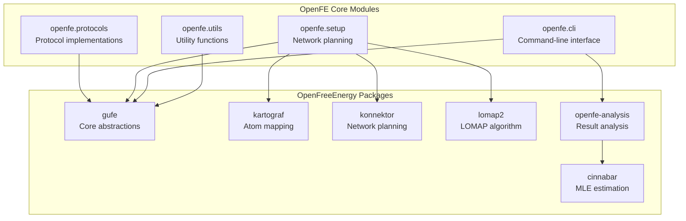
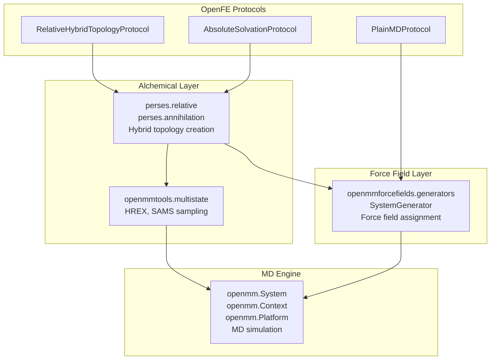
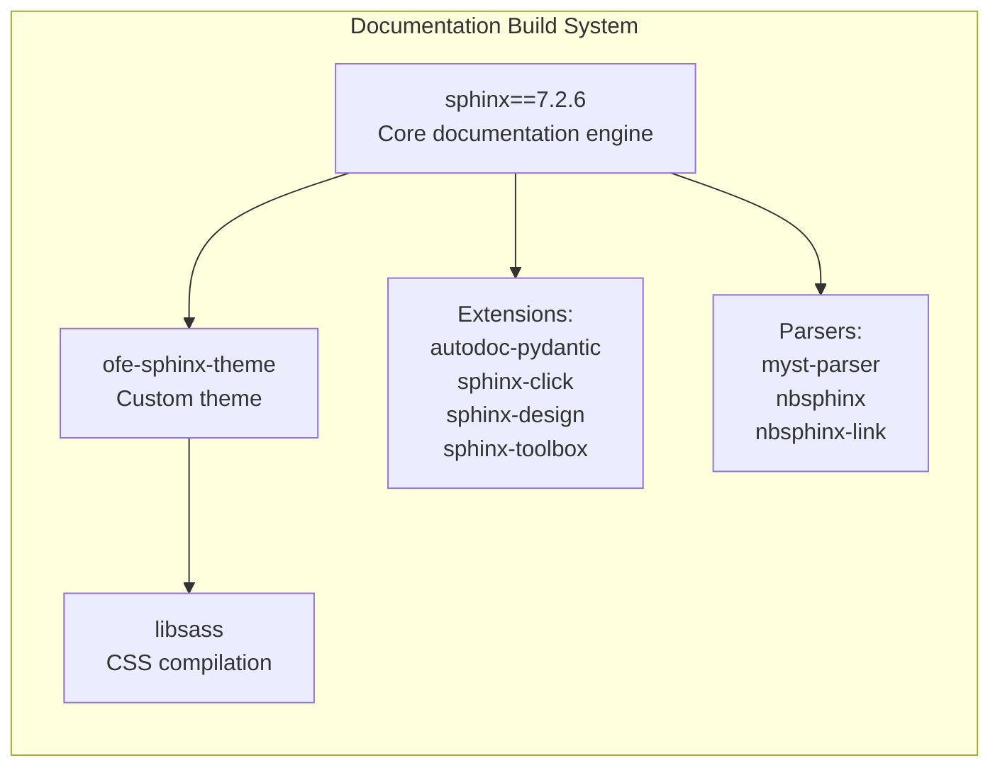
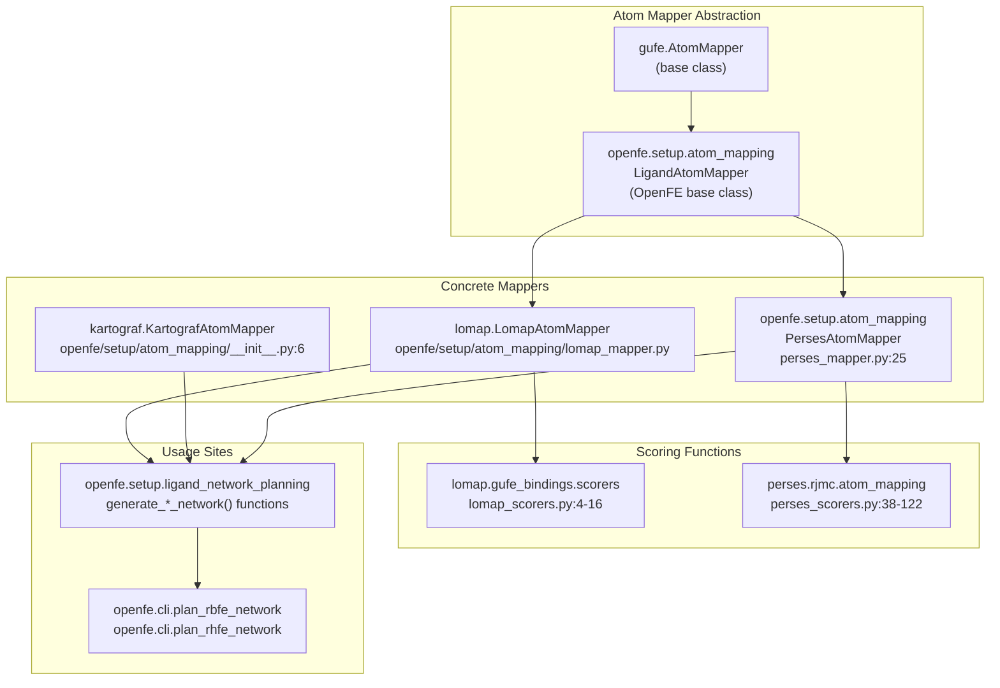
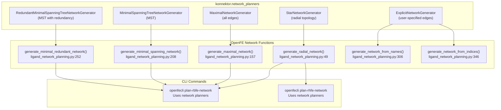
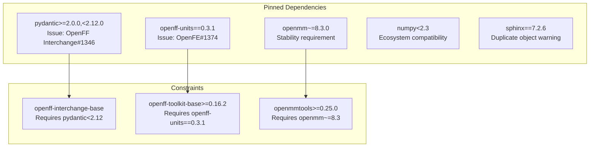

# Dependency Ecosystem

<details>
<summary>Relevant source files</summary>

The following files were used as context for generating this wiki page:

- [docs/conf.py](docs/conf.py)
- [docs/environment.yaml](docs/environment.yaml)
- [environment.yml](environment.yml)
- [openfe/setup/atom_mapping/__init__.py](openfe/setup/atom_mapping/__init__.py)
- [openfe/setup/atom_mapping/ligandatommapper.py](openfe/setup/atom_mapping/ligandatommapper.py)
- [openfe/setup/atom_mapping/lomap_mapper.py](openfe/setup/atom_mapping/lomap_mapper.py)
- [openfe/setup/atom_mapping/lomap_scorers.py](openfe/setup/atom_mapping/lomap_scorers.py)
- [openfe/setup/atom_mapping/perses_mapper.py](openfe/setup/atom_mapping/perses_mapper.py)
- [openfe/setup/atom_mapping/perses_scorers.py](openfe/setup/atom_mapping/perses_scorers.py)
- [openfe/setup/ligand_network_planning.py](openfe/setup/ligand_network_planning.py)
- [openfe/utils/silence_root_logging.py](openfe/utils/silence_root_logging.py)

</details>


## Purpose and Scope

This page documents the external libraries and packages that OpenFE depends on, organized by functional domain. It covers version requirements, the role each dependency plays in the system, and where dependencies are imported and used in the codebase. This information is essential for understanding OpenFE's position within the broader scientific computing ecosystem and for troubleshooting dependency-related issues.

For installation instructions and environment setup procedures, see [Installation and Setup](#1.1). For development environment management including conda-lock and dependency constraints, see [Environment Management](#6.4).

---

## Dependency Categories

OpenFE's dependencies fall into five major categories:

1. **OpenFreeEnergy Ecosystem** - Core abstractions and specialized algorithms developed by the OpenFreeEnergy project
2. **Simulation and Force Field Stack** - Molecular dynamics engines and alchemical transformation tools
3. **Cheminformatics Libraries** - Molecular representation, parameterization, and charge generation
4. **Analysis and Statistics** - Free energy estimation and trajectory analysis
5. **Utility and Infrastructure** - CLI frameworks, data validation, serialization, and testing

Each category represents a distinct layer in OpenFE's architecture, with clear separation of concerns.

---

## OpenFreeEnergy Ecosystem

The OpenFreeEnergy project maintains a suite of specialized packages that OpenFE builds upon. These packages provide core abstractions and domain-specific algorithms.



### gufe - Core Abstractions

**Version requirement:** Installed from `main` branch (development version)

**Role:** Provides the foundational abstractions used throughout OpenFE:
- `ChemicalSystem` - Container for molecular components (ligands, proteins, solvents, cofactors)
- `SmallMoleculeComponent` - Representation of small molecules
- `ProteinComponent` - Representation of proteins
- `SolventComponent` - Representation of explicit solvent
- `Protocol` and `ProtocolUnit` - Base classes for simulation protocols
- `AtomMapper` - Base class for atom mapping algorithms
- `LigandAtomMapping` - Representation of atom correspondences between molecules
- `GufeTokenizable` - Serialization interface for all gufe objects

**Import locations:**
- [openfe/setup/ligand_network_planning.py:9]() - `SmallMoleculeComponent`, `AtomMapper`
- [openfe/setup/atom_mapping/__init__.py:1]() - `LigandAtomMapping`
- Throughout protocol implementations in `openfe/protocols/`

Sources: [openfe/setup/ligand_network_planning.py:9](), [openfe/setup/atom_mapping/__init__.py:1](), [environment.yml:54]()

### kartograf - Atom Mapping

**Version requirement:** `>=1.2.0`

**Role:** Provides the `KartografAtomMapper` algorithm for suggesting atom-to-atom correspondences between small molecules. Kartograf uses a graph-based approach with customizable scoring functions.

**Import locations:**
- [openfe/setup/atom_mapping/__init__.py:6]() - `KartografAtomMapper`
- Used in network planning commands via the atom mapper interface

**Key features:**
- Graph-based MCS (Maximum Common Substructure) finding
- Handles ring systems and stereochemistry
- Customizable scoring functions

Sources: [openfe/setup/atom_mapping/__init__.py:6](), [environment.yml:9](), [docs/environment.yaml:32]()

### konnektor - Network Planning

**Version requirement:** `~=0.2.0`

**Role:** Provides network planning algorithms that determine which molecular transformations to compute. Implements various network topologies (star, MST, redundant MST, maximal, explicit).

**Import locations:**
- [openfe/setup/ligand_network_planning.py:17-24]() - Network generator classes:
  - `StarNetworkGenerator` (radial/hub-and-spoke)
  - `MaximalNetworkGenerator` (all possible edges)
  - `MinimalSpanningTreeNetworkGenerator` (MST)
  - `RedundantMinimalSpanningTreeNetworkGenerator` (MST with redundancy)
  - `ExplicitNetworkGenerator` (user-specified edges)

**Key algorithms:**
- `generate_radial_network()` - Hub-and-spoke topology
- `generate_maximal_network()` - All pairwise transformations
- `generate_minimal_spanning_network()` - MST optimization
- `generate_minimal_redundant_network()` - MST with statistical redundancy

Sources: [openfe/setup/ligand_network_planning.py:17-24](), [environment.yml:10](), [docs/environment.yaml:33]()

### lomap2 - LOMAP Algorithm

**Version requirement:** `>=3.2.1`

**Role:** Provides the `LomapAtomMapper` and the original LOMAP network generation algorithm. LOMAP (Lead Optimization Mapper) is a well-established method for planning alchemical free energy calculations.

**Import locations:**
- [openfe/setup/ligand_network_planning.py:14-16]() - `generate_lomap_network`, `LomapAtomMapper`, `_find_common_core`
- [openfe/setup/atom_mapping/__init__.py:4]() - `LomapAtomMapper`
- [openfe/setup/atom_mapping/lomap_scorers.py:4-16]() - Scoring functions

**Key features:**
- Fast MCS-based atom mapping
- Element change tracking
- 3D coordinate-aware mapping options
- Common core acceleration via `_find_common_core` [openfe/setup/ligand_network_planning.py:33-38]()

Sources: [openfe/setup/ligand_network_planning.py:14-16](), [openfe/setup/atom_mapping/lomap_mapper.py:9](), [openfe/setup/atom_mapping/lomap_scorers.py:4-16](), [environment.yml:11]()

### openfe-analysis - Result Analysis

**Version requirement:** `>=0.3.1`

**Role:** Provides post-simulation analysis tools for processing OpenFE results, including visualization, convergence checking, and result aggregation.

**Import locations:**
- Used via CLI in `gather` command for result processing
- Referenced in documentation build [docs/conf.py:108]()

**Key features:**
- DDG (ΔΔG) calculation and reporting
- MLE (Maximum Likelihood Estimation) via cinnabar integration
- Convergence analysis and visualization

Sources: [environment.yml:14](), [docs/conf.py:108]()

### cinnabar - MLE Estimation

**Version requirement:** `~=0.5.0`

**Role:** Provides Maximum Likelihood Estimation (MLE) for combining free energy estimates across a network. Cinnabar uses statistical methods to optimally combine cycle-dependent estimates into cycle-independent predictions.

**Import locations:**
- Used indirectly through `openfe-analysis`
- Integrated in network-wide free energy predictions

**Key features:**
- Cycle closure optimization
- Statistical uncertainty propagation
- Network-wide ΔΔG predictions

Sources: [environment.yml:5]()

---

## Simulation and Force Field Stack

OpenFE relies on a sophisticated stack of molecular simulation tools for alchemical transformations.



### OpenMM - Molecular Dynamics Engine

**Version requirement:** `~=8.3.0`

**Role:** Core molecular dynamics simulation engine. OpenMM provides GPU-accelerated MD with a flexible Python API.

**Import locations:**
- Throughout protocol implementations in `openfe/protocols/`
- Platform detection and validation in `openfe/utils/`
- System creation and minimization utilities

**Key components used:**
- `openmm.System` - Container for particles and forces
- `openmm.Context` - Execution context with state information
- `openmm.Platform` - Hardware abstraction (CPU, CUDA, OpenCL)
- `openmm.Integrator` - Time integration schemes
- `openmm.State` - System state (positions, velocities, energies)

**Version notes:**
- Version 8.3.0 recommended for stability
- Compatible with versions 8.0-8.2 but 8.3 preferred
- GPU support requires CUDA toolkit

Sources: [environment.yml:20](), [docs/environment.yaml:16](), [docs/conf.py:64]()

### OpenMMTools - Enhanced Sampling

**Version requirement:** `>=0.25.0`

**Role:** Provides advanced sampling methods for free energy calculations, particularly multistate sampling algorithms.

**Import locations:**
- Used in protocol implementations for multistate sampling
- HREX (Hamiltonian Replica Exchange) configuration
- SAMS (Self-Adjusted Mixture Sampling) integration

**Key features:**
- `openmmtools.multistate.MultiStateSampler` - Multistate sampling framework
- `openmmtools.multistate.ReplicaExchangeSampler` - HREX implementation
- `openmmtools.multistate.SAMSSampler` - SAMS implementation
- Alchemical state management

Sources: [environment.yml:22]()

### OpenMMForceFields - Force Field Assignment

**Version requirement:** No explicit version constraint

**Role:** Provides the `SystemGenerator` class for automated force field assignment to molecular systems. Bridges OpenFF force fields and traditional force fields with OpenMM.

**Import locations:**
- Used in system creation utilities
- Referenced in documentation [docs/conf.py:109, 113]()

**Key components:**
- `SystemGenerator` - Automated force field assignment
- Support for AMBER, CHARMM, and OpenFF force fields
- Small molecule parameterization with GAFF/OpenFF

Sources: [environment.yml:21](), [docs/conf.py:109, 113]()

### Perses - Alchemical Transformations

**Version requirement:** `>=0.10.3`

**Role:** Core library for alchemical free energy calculations. Provides hybrid topology construction and atom mapping algorithms.

**Import locations:**
- [openfe/setup/atom_mapping/perses_mapper.py:18]() - `AtomMapper`, `InvalidMappingException`
- [openfe/setup/atom_mapping/perses_scorers.py:12]() - `AtomMapper`, `AtomMapping`
- Used in `RelativeHybridTopologyProtocol` for hybrid system creation

**Key features:**
- `perses.rjmc.atom_mapping.AtomMapper` - Perses atom mapping algorithm
- `perses.rjmc.topology_proposal.TopologyProposal` - Hybrid topology generation
- Integration with OpenMMTools for multistate sampling
- Silence root logging with context manager [openfe/utils/silence_root_logging.py:1-24]()

**Import pattern:**
```python
with silence_root_logging():
    from perses.rjmc.atom_mapping import AtomMapper, InvalidMappingException
```

The `silence_root_logging()` context manager is required because Perses uses `basicConfig()` during import, which would otherwise pollute OpenFE's logging output.

Sources: [openfe/setup/atom_mapping/perses_mapper.py:16-20](), [openfe/setup/atom_mapping/perses_scorers.py:10-14](), [openfe/utils/silence_root_logging.py:1-24](), [environment.yml:25]()

---

## Cheminformatics Libraries

OpenFE uses multiple cheminformatics libraries for molecular representation, parameterization, and charge generation.

### RDKit - Core Cheminformatics

**Version requirement:** No explicit version constraint (conda-forge latest)

**Role:** Primary library for molecular structure representation, manipulation, and 2D/3D operations.

**Import locations:**
- Implicit throughout codebase via `SmallMoleculeComponent.to_rdkit()`
- Used in atom mapping algorithms for MCS finding
- Molecular property calculations

**Key features:**
- Molecular graph representation
- SMARTS pattern matching
- 3D conformer generation
- Molecular descriptors

**Documentation integration:**
- [docs/conf.py:65]() - Intersphinx mapping to RDKit docs
- [docs/conf.py:163]() - RST macro for `rdkit.Chem.rdchem.Mol`

Sources: [environment.yml:39](), [docs/conf.py:65, 163]()

### OpenFF Toolkit - Force Field Infrastructure

**Version requirement:** `>=0.16.2` (base installation without optional backends)

**Role:** Provides the OpenFF force field ecosystem for small molecule parameterization.

**Import locations:**
- Used via `SmallMoleculeComponent.to_openff()` conversion
- Molecule parameterization in force field assignment
- Integration with Perses mapper [openfe/setup/atom_mapping/perses_mapper.py:93-94]()

**Key components:**
- `openff.toolkit.topology.Molecule` - OpenFF molecule representation
- Force field parameter assignment
- SMIRKS-based parameter matching

**Related packages:**
- `openff-interchange-base` - System interchange format [environment.yml:15]()
- Backend for force field parameter storage

Sources: [environment.yml:18](), [docs/environment.yaml:14](), [docs/conf.py:112]()

### OpenFF Units - Unit System

**Version requirement:** `==0.3.1` (pinned due to compatibility issues)

**Role:** Provides dimensional unit handling with Pint integration. Critical for ensuring dimensional consistency across OpenFE.

**Import locations:**
- [openfe/setup/atom_mapping/perses_mapper.py:11-12]() - `unit`, `Quantity`, `to_openmm`
- Throughout protocols for unit conversion and validation

**Key features:**
- Pint-based quantity system
- OpenMM unit interoperability via `to_openmm()`
- Type hints for dimensional quantities

**Pinning rationale:**
- Pin enforced by [environment.yml:19]() referencing issue #1374
- Compatibility with OpenFF Interchange

**Documentation integration:**
- [docs/conf.py:68]() - Intersphinx mapping

Sources: [environment.yml:19](), [docs/environment.yaml:15](), [openfe/setup/atom_mapping/perses_mapper.py:11-12](), [docs/conf.py:68]()

### OpenFF NAGL - Neural Network Charges

**Version requirement:** `>=0.3.3` (base), models `>=0.1.2`

**Role:** Graph Convolutional Network (GCN) based partial charge assignment. Provides ML-based alternative to semi-empirical charge methods.

**Import locations:**
- Used in charge generation workflows
- Alternative to AM1-BCC charges

**Key features:**
- Neural network charge prediction
- Pre-trained models via `openff-nagl-models`
- Fast charge assignment without quantum chemistry

Sources: [environment.yml:16-17]()

### Espaloma - ML Force Field

**Version requirement:** No explicit version (optional dependency)

**Role:** Machine learning-based force field and charge model. Provides end-to-end ML parameterization.

**Import locations:**
- Optional backend for charge generation
- Alternative parameterization method

Sources: [environment.yml:43]() (implied in comments)

### OpenEye Toolkits - Commercial Option

**Version requirement:** No version specified (optional)

**Role:** Commercial cheminformatics toolkit providing high-quality charge methods (AM1-BCC) and molecular operations.

**Import locations:**
- Optional backend for charge generation
- Used when license is available

**Key features:**
- AM1-BCC charge calculation
- Enhanced molecular operations
- Requires commercial license

**Documentation integration:**
- [docs/conf.py:66]() - Intersphinx mapping (for users with licenses)

Sources: [docs/conf.py:66]()

---

## Analysis and Statistics

### PyMBAR - Free Energy Estimation

**Version requirement:** `>4.0`

**Role:** Multistate Bennett Acceptance Ratio (MBAR) implementation for optimal free energy estimation from simulation data.

**Import locations:**
- Core analysis in protocol result gathering
- Uncertainty quantification
- Referenced in mocked imports [docs/conf.py:111]()

**Key features:**
- MBAR estimator for free energy differences
- Uncertainty estimation via asymptotic covariance
- Overlap matrix computation
- Forward/reverse convergence analysis

**Version notes:**
- Version 4.0+ required for API compatibility
- Constraint documented in [environment.yml:45]() referencing issue #443

Sources: [environment.yml:45](), [docs/conf.py:111]()

### NetworkX - Graph Operations

**Version requirement:** No explicit version constraint

**Role:** Graph algorithms and network analysis. Used extensively in ligand network planning and validation.

**Import locations:**
- [openfe/setup/ligand_network_planning.py:7]() - `networkx as nx`
- Network connectivity checking [openfe/setup/ligand_network_planning.py:144]()
- Graph algorithms for network planning

**Key usage:**
- `nx.weakly_connected_components()` - Find disconnected subgraphs
- Network topology validation
- Graph-based algorithms in `konnektor`

Sources: [openfe/setup/ligand_network_planning.py:7](), [environment.yml:12]()

### MDAnalysis - Trajectory Analysis

**Version requirement:** No explicit version (mocked for docs)

**Role:** Trajectory reading and atom selection. Used in structural analysis tools.

**Import locations:**
- Mocked in documentation [docs/conf.py:105]()
- Used in analysis utilities for trajectory processing

**Key features:**
- Universal trajectory reader
- Atom selection language
- RMSD and structural analysis

Sources: [docs/conf.py:67, 105]()

### Pandas - Data Management

**Version requirement:** No explicit version constraint

**Role:** Data structures for result aggregation and tabular output.

**Import locations:**
- Result gathering and reporting
- DDG table generation

Sources: [environment.yml:24]()

---

## Utility and Infrastructure

### Pydantic - Data Validation

**Version requirement:** `>=2.0.0, <2.12.0` (constrained by OpenFF Interchange)

**Role:** Runtime data validation and settings management using type-annotated Python classes.

**Import locations:**
- Throughout `openfe.protocols.openmm_utils.omm_settings` for settings classes
- All protocol settings inherit from `BaseModel`

**Key features:**
- Type validation at runtime
- Settings serialization to JSON/YAML
- Autodoc integration [docs/conf.py:47]()

**Version constraint:**
- Upper bound due to OpenFF Interchange compatibility [environment.yml:31]()
- Issue tracked: openforcefield/openff-interchange#1346

Sources: [environment.yml:31](), [docs/environment.yaml:21](), [docs/conf.py:47]()

### Click - CLI Framework

**Version requirement:** `>=8.2.0`

**Role:** Command-line interface framework. OpenFE uses `plugcli` (a Click extension) for the CLI.

**Import locations:**
- CLI implementation in `openfe/cli/`
- Plugin-based command registration

**Related packages:**
- `plugcli` - Plugin system for Click [environment.yml:26]()
- `sphinx-click` - CLI documentation generation [docs/conf.py:45]()

Sources: [environment.yml:6, 26](), [docs/conf.py:45, 49]()

### Pooch - Data Fetching

**Version requirement:** No explicit version constraint

**Role:** Downloads and caches test data and tutorial datasets from remote sources (typically Zenodo).

**Import locations:**
- Test data management in `openfe/tests/`
- Tutorial data fetching via CLI

**Key features:**
- Automatic data downloading
- Local caching with checksums
- Zenodo integration

Sources: [environment.yml:29]()

### Other Infrastructure Dependencies

| Package | Version | Role | Source |
|---------|---------|------|--------|
| `pyyaml` | None | YAML configuration parsing | [environment.yml:38]() |
| `rich` | None | Terminal output formatting | [environment.yml:40]() |
| `tqdm` | None | Progress bar display | [environment.yml:41]() |
| `py3dmol` | None | 3D molecular visualization | [environment.yml:30]() |
| `pygraphviz` | None | Network visualization (GraphML) | [environment.yml:32]() |
| `packaging` | None | Version parsing and comparison | [environment.yml:23]() |
| `zstandard` | None | Compression for storage | [environment.yml:43]() |
| `threadpoolctl` | None | BLAS/OpenMP thread control | [environment.yml:52]() |

Sources: [environment.yml:23-52]()

---

## Testing Dependencies

OpenFE includes several testing-specific dependencies in its main environment:

| Package | Version | Role | Source |
|---------|---------|------|--------|
| `pytest` | None | Test framework | [environment.yml:33]() |
| `pytest-xdist` | None | Parallel test execution | [environment.yml:34]() |
| `pytest-cov` | None | Coverage reporting | [environment.yml:35]() |
| `pytest-regressions` | None | Regression test data | [environment.yml:36]() |
| `pytest-rerunfailures` | None | Flaky test handling | [environment.yml:37]() |
| `coverage` | None | Coverage measurement | [environment.yml:7]() |
| `duecredit` | `<0.10` | Citation tracking | [environment.yml:8]() |

For details on the testing framework and CI/CD pipeline, see [Testing Framework](#6.1) and [CI/CD Pipeline](#6.2).

Sources: [environment.yml:7-8, 33-37]()

---

## Documentation Dependencies

Documentation builds require an additional set of dependencies defined in [docs/environment.yaml:1-42]():



**Key documentation packages:**
- `sphinx==7.2.6` - Documentation generator (pinned to avoid duplicate object warnings)
- `autodoc-pydantic>=2.1` - Pydantic model documentation
- `myst-parser` - Markdown parsing with MyST extensions
- `nbsphinx` / `nbsphinx-link` - Jupyter notebook integration
- `sphinx-click` - CLI documentation from Click commands
- `ofe-sphinx-theme` - Custom OpenFE theme

**Integration packages:**
- `gitpython` - Git repository access for example notebooks
- `libsass` - Compile SCSS to CSS [docs/conf.py:177-178]()

Sources: [docs/environment.yaml:1-42](), [docs/conf.py:1-250]()

---

## Import Pattern: Atom Mappers

The following diagram shows how different atom mapper implementations are imported and used throughout OpenFE:



**Key import locations:**

1. **LOMAP imports:**
   - [openfe/setup/atom_mapping/lomap_mapper.py:9]() - `from lomap import LomapAtomMapper`
   - [openfe/setup/ligand_network_planning.py:14-16]() - `generate_lomap_network`, `LomapAtomMapper`, `_find_common_core`
   - [openfe/setup/atom_mapping/lomap_scorers.py:4-16]() - All LOMAP scoring functions

2. **Kartograf imports:**
   - [openfe/setup/atom_mapping/__init__.py:6]() - `from kartograf import KartografAtomMapper`

3. **Perses imports:**
   - [openfe/setup/atom_mapping/perses_mapper.py:18]() - `from perses.rjmc.atom_mapping import AtomMapper, InvalidMappingException`
   - [openfe/setup/atom_mapping/perses_scorers.py:12]() - `from perses.rjmc.atom_mapping import AtomMapper, AtomMapping`

4. **Network planning usage:**
   - [openfe/setup/ligand_network_planning.py:98-103]() - Mapper handling in `generate_radial_network()`
   - [openfe/setup/ligand_network_planning.py:27-46]() - LOMAP acceleration via `_hasten_lomap()`

Sources: [openfe/setup/atom_mapping/__init__.py:1-10](), [openfe/setup/atom_mapping/lomap_mapper.py:9](), [openfe/setup/atom_mapping/perses_mapper.py:16-20](), [openfe/setup/ligand_network_planning.py:9-46]()

---

## Import Pattern: Network Planners

Network planning functionality is primarily provided by the `konnektor` package:



**Import statement:** [openfe/setup/ligand_network_planning.py:17-24]()
```python
from konnektor.network_planners import (
    StarNetworkGenerator,
    MaximalNetworkGenerator,
    RedundantMinimalSpanningTreeNetworkGenerator,
    MinimalSpanningTreeNetworkGenerator,
    ExplicitNetworkGenerator,
)
```

**Function-to-class mapping:**

| OpenFE Function | Konnektor Class | Lines |
|----------------|-----------------|-------|
| `generate_radial_network()` | `StarNetworkGenerator` | [49-154]() |
| `generate_maximal_network()` | `MaximalNetworkGenerator` | [157-205]() |
| `generate_minimal_spanning_network()` | `MinimalSpanningTreeNetworkGenerator` | [208-249]() |
| `generate_minimal_redundant_network()` | `RedundantMinimalSpanningTreeNetworkGenerator` | [252-303]() |
| `generate_network_from_names()` | `ExplicitNetworkGenerator` | [306-343]() |
| `generate_network_from_indices()` | `ExplicitNetworkGenerator` | [346-378]() |

Sources: [openfe/setup/ligand_network_planning.py:17-378]()

---

## Version Constraints and Compatibility

### Critical Version Pins

OpenFE includes several critical version constraints that must be maintained for compatibility:



**Pin rationale table:**

| Package | Constraint | Reason | Source |
|---------|-----------|--------|--------|
| `openff-units` | `==0.3.1` | OpenFE issue #1374 - compatibility with OpenFF Toolkit | [environment.yml:19]() |
| `pydantic` | `>=2.0.0, <2.12.0` | OpenFF Interchange issue #1346 | [environment.yml:31]() |
| `openmm` | `~=8.3.0` | Stability and feature completeness | [environment.yml:20]() |
| `pymbar` | `>4.0` | API compatibility, issue #443 | [environment.yml:45]() |
| `sphinx` | `==7.2.6` | Avoid duplicate object warnings | [docs/environment.yaml:22]() |
| `numpy` | `<2.3` | Ecosystem-wide compatibility | [environment.yml:13]() |

Sources: [environment.yml:13-45](), [docs/environment.yaml:22]()

### Minimum Version Requirements

| Package | Minimum Version | Reason |
|---------|----------------|--------|
| `kartograf` | `>=1.2.0` | Required features for atom mapping |
| `konnektor` | `~=0.2.0` | Network planner API |
| `lomap2` | `>=3.2.1` | Bug fixes and performance |
| `openfe-analysis` | `>=0.3.1` | Result analysis features |
| `openff-toolkit-base` | `>=0.16.2` | Force field features |
| `openff-nagl-base` | `>=0.3.3` | NAGL model compatibility |
| `openmmtools` | `>=0.25.0` | Multistate sampling API |
| `perses` | `>=0.10.3` | Alchemical transformation features |
| `click` | `>=8.2.0` | CLI features |
| `pint` | `>=0.24.0` | Unit system features |

Sources: [environment.yml:5-45]()

---

## Optional Dependencies

OpenFE supports optional dependencies that enhance functionality but are not required for core operations:

### OpenEye Toolkits

**Status:** Optional (commercial license required)

**Features enabled:**
- AM1-BCC charge calculation (higher quality than NAGL/Espaloma)
- Enhanced molecular operations
- Improved conformer generation

**Availability:** Users with OpenEye licenses can install separately

### MDAnalysis

**Status:** Optional (mocked in documentation)

**Features enabled:**
- Advanced trajectory analysis
- Atom selection language
- Additional structural analysis tools

**Note:** Listed in [docs/conf.py:105]() as mocked import, suggesting it's optional for core functionality

Sources: [docs/conf.py:66, 105]()

---

## Development-Only Dependencies

The following dependencies are only needed for development, not for using OpenFE:

**Documentation build:**
- `gitpython` - Clone example notebooks
- `libsass` - SCSS compilation
- `autodoc-pydantic` - Pydantic model docs
- `pydata-sphinx-theme` / `ofe-sphinx-theme` - Documentation theme

**Type checking:**
- Type checking performed in CI (mypy implied but not in environment.yml)

**Environment validation:**
- Daily conda environment validation in CI

For complete development environment setup, see [Environment Management](#6.4).

Sources: [docs/environment.yaml:1-42](), [docs/conf.py:1-250]()

---