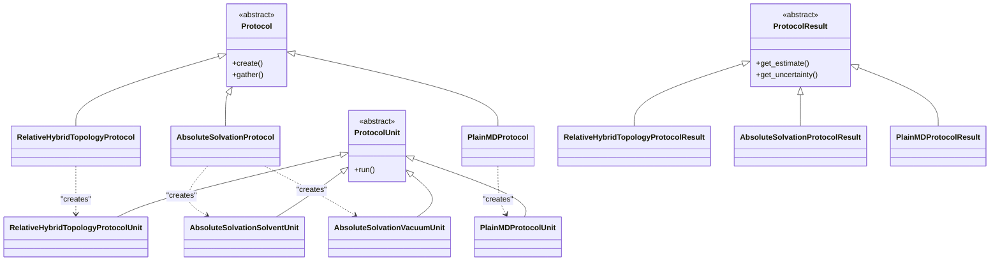
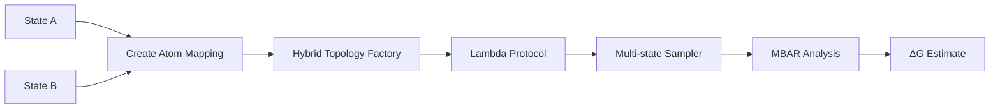
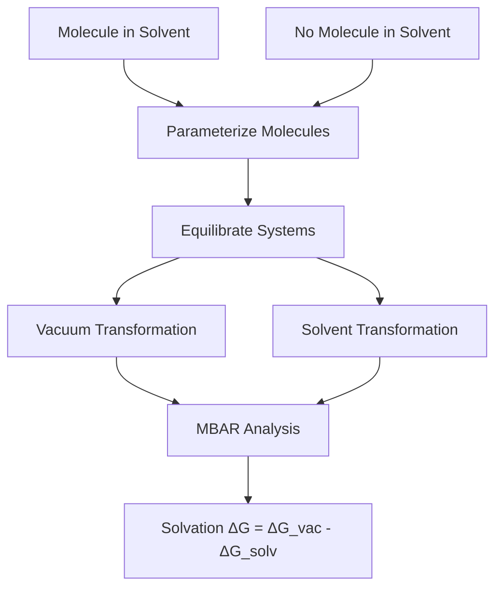
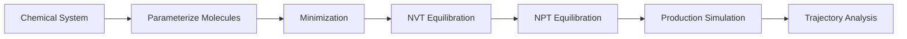
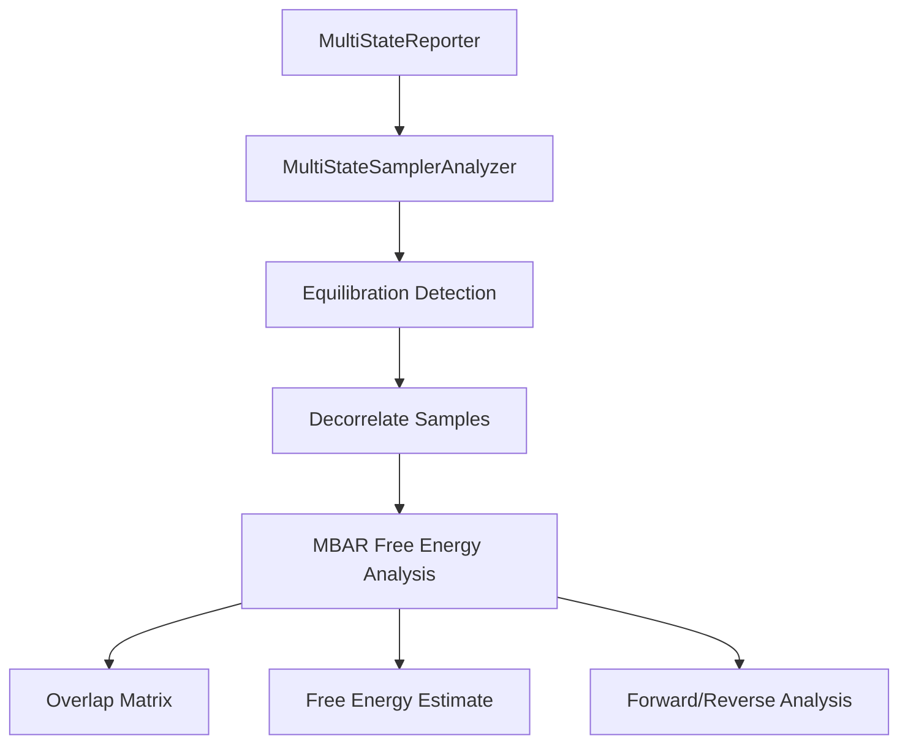
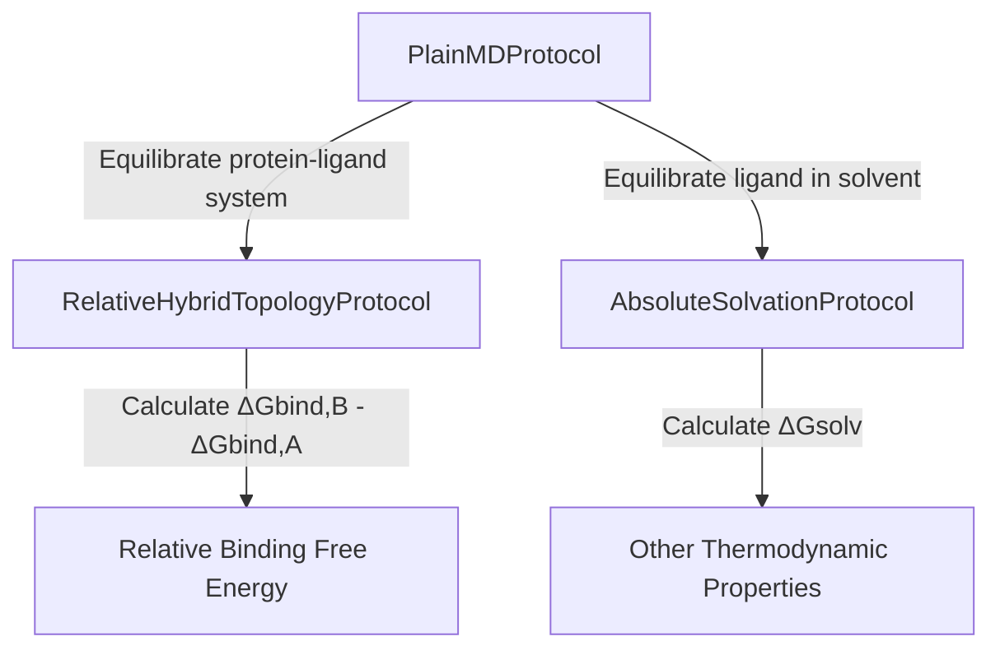

# Core Protocols

Relevant source files

The following files were used as context for generating this wiki page:

- [docs/guide/protocols/absolutesolvation.rst](docs/guide/protocols/absolutesolvation.rst)
- [docs/guide/protocols/img/ahfe_thermocycle.png](docs/guide/protocols/img/ahfe_thermocycle.png)
- [docs/guide/protocols/plainmd.rst](docs/guide/protocols/plainmd.rst)
- [docs/guide/protocols/relativehybridtopology.rst](docs/guide/protocols/relativehybridtopology.rst)
- [openfe/protocols/openmm_afe/base.py](openfe/protocols/openmm_afe/base.py)
- [openfe/protocols/openmm_afe/equil_afe_settings.py](openfe/protocols/openmm_afe/equil_afe_settings.py)
- [openfe/protocols/openmm_afe/equil_solvation_afe_method.py](openfe/protocols/openmm_afe/equil_solvation_afe_method.py)
- [openfe/protocols/openmm_md/plain_md_methods.py](openfe/protocols/openmm_md/plain_md_methods.py)
- [openfe/protocols/openmm_md/plain_md_settings.py](openfe/protocols/openmm_md/plain_md_settings.py)
- [openfe/protocols/openmm_rfe/equil_rfe_methods.py](openfe/protocols/openmm_rfe/equil_rfe_methods.py)
- [openfe/protocols/openmm_rfe/equil_rfe_settings.py](openfe/protocols/openmm_rfe/equil_rfe_settings.py)
- [openfe/protocols/openmm_utils/omm_settings.py](openfe/protocols/openmm_utils/omm_settings.py)

This page provides an overview of the main simulation protocols available in the OpenFE (Open Free Energy) framework. These protocols form the core functionality for performing free energy calculations and molecular dynamics simulations. For detailed information about network planning and atom mapping, see [Network Planning and Mapping](#3).

## Protocol Architecture

All protocols in OpenFE share a common architecture derived from the GUFE (Grand Unified Free Energy) framework. Each protocol follows a consistent pattern:

Sources: [openfe/protocols/openmm_rfe/equil_rfe_methods.py:468-483](), [openfe/protocols/openmm_afe/equil_solvation_afe_method.py:393-408]()

## Available Protocols

OpenFE currently implements three main simulation protocols:

1. **RelativeHybridTopologyProtocol**: Calculates relative free energy differences between two molecules using a hybrid topology approach.
2. **AbsoluteSolvationProtocol**: Calculates absolute solvation free energies by decoupling a molecule from its environment.
3. **PlainMDProtocol**: Runs standard molecular dynamics simulations without alchemical transformations.

These protocols can be used independently or as part of more complex workflows.

## Protocol Workflow Comparison

Each protocol implements a different workflow to achieve its specific purpose:

```mermaid
flowchart TD
    subgraph "RelativeHybridTopologyProtocol"
        RFE_Setup["Setup Chemical Systems"] --> RFE_Param["Parameterize Molecules"]
        RFE_Param --> RFE_Hybrid["Create Hybrid System"]
        RFE_Hybrid --> RFE_Lambda["Define Lambda Schedule"]
        RFE_Lambda --> RFE_Sample["Multi-state Sampling"]
        RFE_Sample --> RFE_Analyze["MBAR Analysis"]
    end
    
    subgraph "AbsoluteSolvationProtocol"
        AFE_Setup["Setup Chemical Systems"] --> AFE_Param["Parameterize Molecules"]
        AFE_Param --> AFE_Equil["Pre-equilibration"]
        AFE_Equil --> AFE_Alch["Create Alchemical System"]
        AFE_Alch --> AFE_Sample["Sample Both Legs (Solvent/Vacuum)"]
        AFE_Sample --> AFE_Analyze["MBAR Analysis"]
    end
    
    subgraph "PlainMDProtocol"
        MD_Setup["Setup Chemical System"] --> MD_Param["Parameterize Molecules"]
        MD_Param --> MD_Min["Minimization"]
        MD_Min --> MD_Equil["Equilibration (NVT/NPT)"]
        MD_Equil --> MD_Prod["Production"]
        MD_Prod --> MD_Traj["Trajectory Analysis"]
    end
```

Sources: [openfe/protocols/openmm_rfe/equil_rfe_methods.py:586-684](), [openfe/protocols/openmm_afe/base.py:74-120](), [docs/guide/protocols/plainmd.rst:22-46]()

## RelativeHybridTopologyProtocol

The RelativeHybridTopologyProtocol calculates the relative free energy between two chemical states (typically two similar ligands) using a hybrid topology approach.

### Key Features

- Creates a hybrid topology that can represent both end states
- Uses a lambda schedule to transform between states
- Supports multiple sampling methods (replica exchange, SAMS, independent)
- Handles both relative binding free energy (RBFE) and relative hydration free energy (RHFE) calculations
- Uses MBAR for free energy estimation and uncertainty analysis

### Workflow Details

Sources: [openfe/protocols/openmm_rfe/equil_rfe_methods.py:468-584](), [docs/guide/protocols/relativehybridtopology.rst:30-87]()

## AbsoluteSolvationProtocol

The AbsoluteSolvationProtocol calculates the free energy change associated with transferring a molecule from vacuum into a solvent (typically water).

### Key Features

- Implements a thermodynamic cycle with solvent and vacuum legs
- Turns off electrostatic interactions first, followed by van der Waals interactions
- Supports multiple sampling methods (replica exchange, SAMS, independent)
- Uses MBAR for free energy estimation and uncertainty analysis

### Workflow Details

Sources: [openfe/protocols/openmm_afe/equil_solvation_afe_method.py:393-489](), [docs/guide/protocols/absolutesolvation.rst:12-21]()

## PlainMDProtocol

The PlainMDProtocol runs standard molecular dynamics simulations without alchemical transformations, useful for system equilibration or analysis.

### Key Features

- Supports both solvated and vacuum simulations
- Performs system minimization, equilibration, and production
- Uses the LangevinMiddleIntegrator for accurate temperature control
- Provides trajectory analysis tools

### Workflow Details

Sources: [docs/guide/protocols/plainmd.rst:22-46]()

## Protocol Settings and Configuration

All protocols in OpenFE are configured through a comprehensive settings system. The settings control every aspect of the simulation, from force field parameters to output frequency.

Here's a comparison of the key settings across protocols:

| Setting Type | Description | RHT Protocol | ASP Protocol | PlainMD Protocol |
|--------------|-------------|--------------|--------------|------------------|
| `forcefield_settings` | Force field parameters and nonbonded methods | ✓ | ✓ (solvent & vacuum) | ✓ |
| `thermo_settings` | Temperature and pressure | ✓ | ✓ | ✓ |
| `partial_charge_settings` | Methods for assigning partial charges | ✓ | ✓ | ✓ |
| `solvation_settings` | Solvent model and box parameters | ✓ | ✓ | ✓ |
| `alchemical_settings` | Soft-core potential and alchemical parameters | ✓ | ✓ | - |
| `lambda_settings` | Lambda schedule for alchemical transformations | ✓ | ✓ | - |
| `simulation_settings` | Equilibration and production lengths | ✓ | ✓ (solvent & vacuum) | ✓ |
| `engine_settings` | Compute platform and device selection | ✓ | ✓ (solvent & vacuum) | ✓ |
| `integrator_settings` | Timestep and integrator parameters | ✓ | ✓ | ✓ |
| `output_settings` | Output files and frequencies | ✓ | ✓ (solvent & vacuum) | ✓ |

Sources: [openfe/protocols/openmm_rfe/equil_rfe_methods.py:498-516](), [openfe/protocols/openmm_afe/equil_afe_settings.py:112-219]()

## Multistate Analysis

The alchemical protocols (RelativeHybridTopologyProtocol and AbsoluteSolvationProtocol) use a common multistate analysis framework to analyze results:

Key analysis components include:
- Automatic equilibration detection
- Sample decorrelation to remove correlated data points
- MBAR analysis to estimate free energy differences
- Overlap matrix analysis to assess sampling quality
- Forward/reverse analysis to assess convergence

Sources: [openfe/protocols/openmm_utils/multistate_analysis.py:50-88](), [openfe/protocols/openmm_rfe/equil_rfe_methods.py:250-466](), [openfe/protocols/openmm_afe/equil_solvation_afe_method.py:90-390]()

## Protocol Results

Each protocol produces a specialized ProtocolResult object that contains the simulation outputs and analysis:

### RelativeHybridTopologyProtocolResult

- Free energy difference between end states
- Uncertainty estimate
- Overlap matrices for assessing sampling quality
- Replica exchange statistics
- Forward and reverse convergence analysis

### AbsoluteSolvationProtocolResult

- Solvation free energy (difference between vacuum and solvent legs)
- Uncertainty estimate
- Separate analysis for vacuum and solvent legs
- Overlap matrices for both legs
- Replica exchange statistics for both legs

### PlainMDProtocolResult

- Trajectory files
- System statistics
- Analysis results (depends on the specific analysis requested)

Sources: [openfe/protocols/openmm_rfe/equil_rfe_methods.py:250-466](), [openfe/protocols/openmm_afe/equil_solvation_afe_method.py:90-390]()

## How Protocols Work Together

The core protocols can be combined to build more complex workflows. For example:

This modularity allows users to build custom thermodynamic cycles and address complex free energy calculation problems.

Sources: [docs/guide/protocols/relativehybridtopology.rst:22-25](), [docs/guide/protocols/absolutesolvation.rst:14-21]()

## Summary

OpenFE provides three core protocols that enable a wide range of molecular simulations and free energy calculations:

1. **RelativeHybridTopologyProtocol**: For relative free energy calculations using hybrid topology.
2. **AbsoluteSolvationProtocol**: For absolute solvation free energy calculations using a thermodynamic cycle.
3. **PlainMDProtocol**: For standard molecular dynamics simulations.

These protocols share a common architecture and many settings, enabling consistent workflows while addressing different computational needs. For more detailed information on each protocol, see their individual wiki pages.

---