# Relative Free Energy Protocols

<details>
<summary>Relevant source files</summary>

The following files were used as context for generating this wiki page:

- [docs/guide/protocols/absolutesolvation.rst](docs/guide/protocols/absolutesolvation.rst)
- [docs/guide/protocols/img/ahfe_thermocycle.png](docs/guide/protocols/img/ahfe_thermocycle.png)
- [docs/guide/protocols/plainmd.rst](docs/guide/protocols/plainmd.rst)
- [docs/guide/protocols/relativehybridtopology.rst](docs/guide/protocols/relativehybridtopology.rst)
- [openfe/protocols/openmm_afe/base.py](openfe/protocols/openmm_afe/base.py)
- [openfe/protocols/openmm_afe/equil_afe_settings.py](openfe/protocols/openmm_afe/equil_afe_settings.py)
- [openfe/protocols/openmm_afe/equil_solvation_afe_method.py](openfe/protocols/openmm_afe/equil_solvation_afe_method.py)
- [openfe/protocols/openmm_md/plain_md_methods.py](openfe/protocols/openmm_md/plain_md_methods.py)
- [openfe/protocols/openmm_md/plain_md_settings.py](openfe/protocols/openmm_md/plain_md_settings.py)
- [openfe/protocols/openmm_rfe/equil_rfe_methods.py](openfe/protocols/openmm_rfe/equil_rfe_methods.py)
- [openfe/protocols/openmm_rfe/equil_rfe_settings.py](openfe/protocols/openmm_rfe/equil_rfe_settings.py)
- [openfe/protocols/openmm_utils/omm_settings.py](openfe/protocols/openmm_utils/omm_settings.py)
- [openfe/tests/data/openmm_afe/AHFEProtocol_json_results.gz](openfe/tests/data/openmm_afe/AHFEProtocol_json_results.gz)
- [openfe/tests/data/openmm_md/MDProtocol_json_results.gz](openfe/tests/data/openmm_md/MDProtocol_json_results.gz)
- [openfe/tests/data/openmm_rfe/RHFEProtocol_json_results.gz](openfe/tests/data/openmm_rfe/RHFEProtocol_json_results.gz)

</details>


The `RelativeHybridTopologyProtocol` calculates the free energy difference between two similar chemical states using alchemical transformations. This protocol implements a hybrid topology approach where both end states coexist in a single system that is gradually transformed from one state to another through a series of lambda windows.

## Overview

Relative Free Energy (RFE) calculations compute free energy differences (ΔG) between two similar molecular states. The protocol is used for two main types of calculations:

- **Relative Binding Free Energy (RBFE)**: Calculates the difference in binding affinity between two ligands to a protein receptor
- **Relative Hydration Free Energy (RHFE)**: Calculates the difference in solvation free energy between two ligands in solvent

The `RelativeHybridTopologyProtocol` is implemented in [openfe/protocols/openmm_rfe/equil_rfe_methods.py:496-681]() and is based on the Perses toolkit methodology. It uses OpenMM for molecular dynamics and OpenMMTools for multistate sampling.

Sources: [openfe/protocols/openmm_rfe/equil_rfe_methods.py:1-21](), [docs/guide/protocols/relativehybridtopology.rst:1-15]()

## Thermodynamic Cycles

Both RBFE and RHFE calculations rely on thermodynamic cycles to compute relative free energies. The protocol executes one leg of a thermodynamic cycle per `create()` call.

### RBFE Thermodynamic Cycle

For RBFE calculations, two separate protocol instances are required to compute both legs of the cycle:

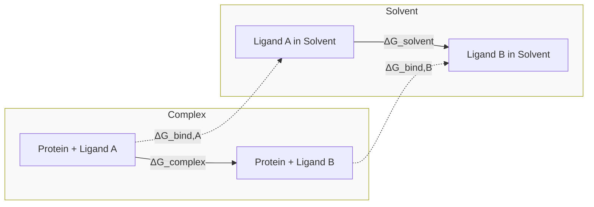

The relative binding free energy is computed as:
**ΔΔG_bind = ΔG_complex - ΔG_solvent = ΔG_bind,B - ΔG_bind,A**

Each transformation (complex or solvent) is executed as a separate `ProtocolDAG`.

Sources: [docs/guide/protocols/relativehybridtopology.rst:16-27]()

### RHFE Thermodynamic Cycle

For RHFE calculations, two legs are also computed:

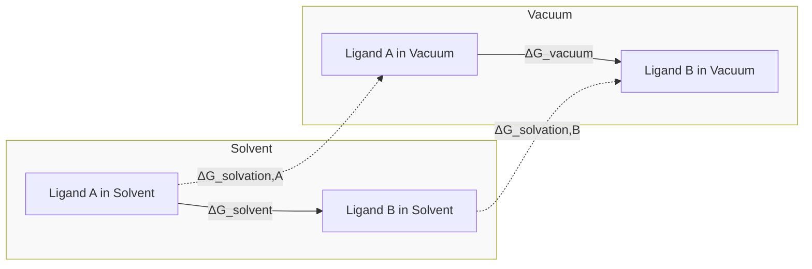

The relative hydration free energy is computed as:
**ΔΔG_hydration = ΔG_solvent - ΔG_vacuum = ΔG_solvation,B - ΔG_solvation,A**

Sources: [docs/guide/protocols/relativehybridtopology.rst:16-27]()

## Protocol Architecture

The protocol follows the standard OpenFE protocol pattern with three main classes:

### Class Hierarchy

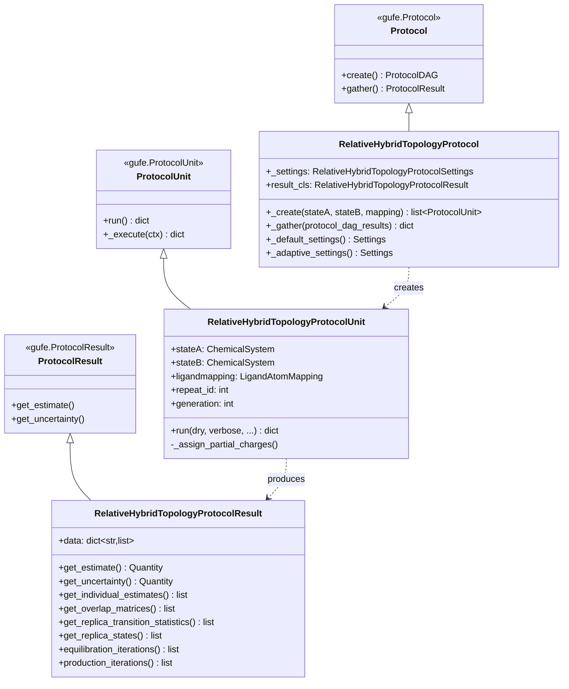

Sources: [openfe/protocols/openmm_rfe/equil_rfe_methods.py:276-494](), [openfe/protocols/openmm_rfe/equil_rfe_methods.py:496-681](), [openfe/protocols/openmm_rfe/equil_rfe_methods.py:683-1983]()

### Protocol Execution Flow

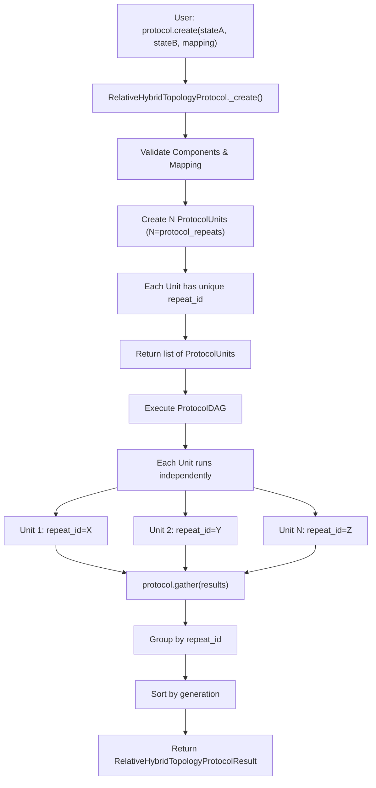

Sources: [openfe/protocols/openmm_rfe/equil_rfe_methods.py:616-681]()

## Hybrid Topology Approach

The core innovation of the `RelativeHybridTopologyProtocol` is the hybrid topology approach. A single OpenMM System is constructed that contains atoms from both end states, allowing smooth alchemical transformation.

### Hybrid System Construction

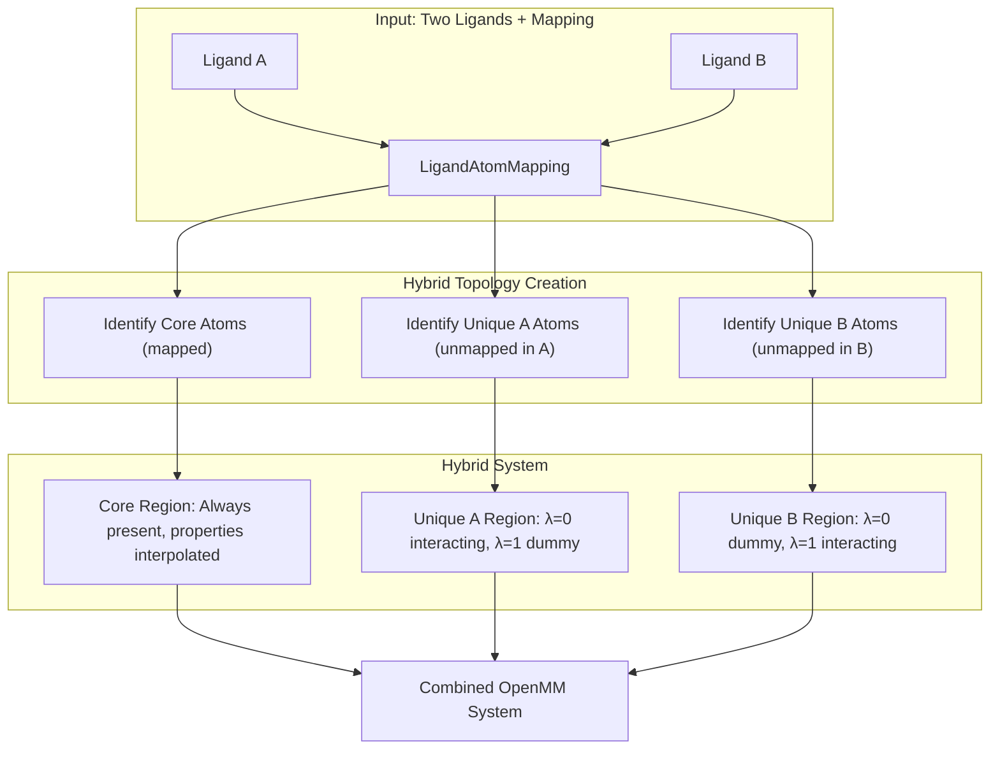

The hybrid system is created in [openfe/protocols/openmm_rfe/equil_rfe_methods.py:922-970]() using the `_rfe_utils.topologyhelpers` module.

Sources: [openfe/protocols/openmm_rfe/equil_rfe_methods.py:900-970](), [docs/guide/protocols/relativehybridtopology.rst:34-48]()

### Atom Classification

Atoms in the hybrid topology fall into three categories based on the `LigandAtomMapping`:

| Atom Type | Definition | Lambda Behavior |
|-----------|------------|-----------------|
| **Core atoms** | Present in both ligands with the same connectivity (mapped atoms) | Always present; parameters (charges, LJ) interpolated between states |
| **Unique to A** | Present only in ligand A (unmapped in A) | λ=0: fully interacting; λ=1: non-interacting (dummy atoms) |
| **Unique to B** | Present only in ligand B (unmapped in B) | λ=0: non-interacting (dummy atoms); λ=1: fully interacting |

**Important Note**: In the current implementation, all bonded interactions between dummy regions and core regions are retained. This can lead to systematic errors if the contribution of dummy groups does not cancel in the thermodynamic cycle (non-separability of the partition function).

Sources: [openfe/protocols/openmm_rfe/equil_rfe_methods.py:860-875](), [docs/guide/protocols/relativehybridtopology.rst:44-48]()

### Topology and System Generation

The hybrid topology construction process:

1. **Create stateA system**: Parameterize ligand A + environment using `system_creation.get_omm_modeller()` [openfe/protocols/openmm_rfe/equil_rfe_methods.py:900-922]()
2. **Create stateB topology**: Use `topologyhelpers.combined_topology()` to merge ligand B topology with stateA, excluding ligand A residues [openfe/protocols/openmm_rfe/equil_rfe_methods.py:924-930]()
3. **Generate stateB system**: Parameterize the combined topology [openfe/protocols/openmm_rfe/equil_rfe_methods.py:935-939]()
4. **Define atom mappings**: Use `topologyhelpers.get_system_mappings()` to establish correspondence between systems [openfe/protocols/openmm_rfe/equil_rfe_methods.py:942-952]()
5. **Handle charge corrections**: If `explicit_charge_correction=True`, select and transform waters into counterions [openfe/protocols/openmm_rfe/equil_rfe_methods.py:956-970]()

Sources: [openfe/protocols/openmm_rfe/equil_rfe_methods.py:900-970]()

## Lambda Schedule and Alchemical Transformation

The alchemical transformation proceeds through discrete lambda (λ) windows where:
- λ = 0: System in state A
- λ = 1: System in state B
- Intermediate λ values: Hybrid states with interpolated interactions

### Lambda Settings

The `LambdaSettings` class [openfe/protocols/openmm_rfe/equil_rfe_settings.py:33-48]() controls the lambda schedule:

```python
class LambdaSettings:
    lambda_functions: str = "default"  # Switching function type
    lambda_windows: int = 11           # Number of lambda windows
```

The `lambda_functions` parameter selects predefined schedules that control how electrostatics, sterics, and bonded terms are interpolated. The default schedule:
1. First turns off electrostatics of state A while turning on sterics of state B
2. Then turns off sterics of state A while turning on electrostatics of state B
3. Bonded terms are interpolated linearly throughout

Sources: [openfe/protocols/openmm_rfe/equil_rfe_settings.py:33-48](), [docs/guide/protocols/relativehybridtopology.rst:50-58]()

### Alchemical Settings

The `AlchemicalSettings` class [openfe/protocols/openmm_rfe/equil_rfe_settings.py:50-102]() configures the alchemical transformation:

| Setting | Type | Default | Description |
|---------|------|---------|-------------|
| `softcore_LJ` | `"gapsys"` or `"beutler"` | `"gapsys"` | Softcore potential function to avoid singularities |
| `softcore_alpha` | float | 0.85 | Softcore alpha parameter |
| `use_dispersion_correction` | bool | False | Apply long-range dispersion correction in hybrid system |
| `endstate_dispersion_correction` | bool | False | Add unsampled endstate windows for dispersion correction |
| `explicit_charge_correction` | bool | False | Transform water to counterion for charge changes |
| `explicit_charge_correction_cutoff` | Quantity | 0.8 nm | Minimum distance from solute for selecting alchemical water |
| `turn_off_core_unique_exceptions` | bool | False | Turn off new/old exceptions between core and unique atoms |

**Softcore Potentials**: To avoid numerical instabilities when turning atoms on/off, a softcore potential is applied to Lennard-Jones interactions. Two options are available:
- **Gapsys** [J. Chem. Theory Comput. 8, 2373-2382 (2012)]: Default, generally more stable
- **Beutler** [Chem. Phys. Lett. 222, 529-539 (1994)]: Alternative formulation

Sources: [openfe/protocols/openmm_rfe/equil_rfe_settings.py:50-102](), [docs/guide/protocols/relativehybridtopology.rst:56-58]()

### Charge Change Handling

When transformations involve a net charge change, special handling is required:

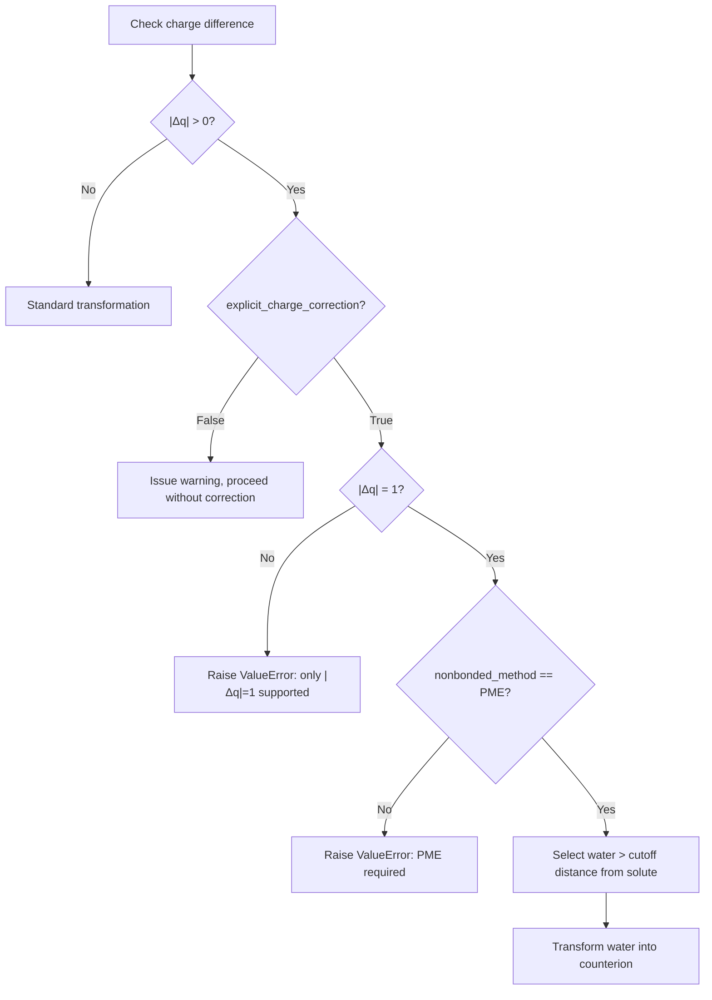

The charge correction logic is implemented in [openfe/protocols/openmm_rfe/equil_rfe_methods.py:121-194]().

Sources: [openfe/protocols/openmm_rfe/equil_rfe_methods.py:121-194](), [openfe/protocols/openmm_rfe/equil_rfe_methods.py:956-970]()

## Protocol Settings

The `RelativeHybridTopologyProtocolSettings` class [openfe/protocols/openmm_rfe/equil_rfe_settings.py:104-158]() contains all configuration parameters:

### Settings Structure

```mermaid
graph TD
    RHPS["RelativeHybridTopologyProtocolSettings"] --> PR["protocol_repeats: int"]
    RHPS --> FFS["forcefield_settings: OpenMMSystemGeneratorFFSettings"]
    RHPS --> TS["thermo_settings: ThermoSettings"]
    RHPS --> PCS["partial_charge_settings: OpenFFPartialChargeSettings"]
    RHPS --> SS["solvation_settings: OpenMMSolvationSettings"]
    RHPS --> AS["alchemical_settings: AlchemicalSettings"]
    RHPS --> LS["lambda_settings: LambdaSettings"]
    RHPS --> SIM["simulation_settings: MultiStateSimulationSettings"]
    RHPS --> ES["engine_settings: OpenMMEngineSettings"]
    RHPS --> IS["integrator_settings: IntegratorSettings"]
    RHPS --> OS["output_settings: MultiStateOutputSettings"]
```

Sources: [openfe/protocols/openmm_rfe/equil_rfe_settings.py:104-158]()

### Default Settings

The `_default_settings()` method [openfe/protocols/openmm_rfe/equil_rfe_methods.py:514-545]() provides baseline values:

| Setting Category | Key Defaults |
|-----------------|--------------|
| **Repeats** | `protocol_repeats=3` |
| **Temperature/Pressure** | 298.15 K, 1 bar |
| **Partial Charges** | AM1-BCC method |
| **Solvation** | TIP3P water, 1.5 nm padding, dodecahedron box |
| **Alchemical** | Gapsys softcore, alpha=0.85 |
| **Lambda** | 11 windows, default function |
| **Simulation** | 1 ns equilibration, 5 ns production, HREX sampler |
| **Integrator** | 4 fs timestep, 1/ps collision rate |
| **Engine** | CUDA platform |

Sources: [openfe/protocols/openmm_rfe/equil_rfe_methods.py:514-545]()

### Adaptive Settings

The `_adaptive_settings()` method [openfe/protocols/openmm_rfe/equil_rfe_methods.py:547-614]() automatically adjusts parameters based on transformation properties:

**For charge-changing transformations** (Δq ≠ 0):
- Enables `explicit_charge_correction=True`
- Increases to 22 lambda windows
- Extends production to 20 ns per window
- Based on industry benchmark recommendations

**For protein-containing systems**:
- Reduces `solvent_padding` to 1.0 nm (from default 1.5 nm)

Sources: [openfe/protocols/openmm_rfe/equil_rfe_methods.py:547-614]()

### Critical Settings for Production

| Setting | Typical Range | Impact |
|---------|--------------|--------|
| `protocol_repeats` | 3-5 | Statistical uncertainty estimation |
| `simulation_settings.production_length` | 5-20 ns | Sampling quality, convergence |
| `simulation_settings.n_replicas` | 11-22 | Should match `lambda_windows` |
| `lambda_settings.lambda_windows` | 11-22 | Phase space overlap |
| `engine_settings.compute_platform` | "CUDA"/"OpenCL"/"CPU" | Performance |
| `simulation_settings.sampler_method` | "repex"/"sams"/"independent" | Sampling algorithm |

Sources: [openfe/protocols/openmm_rfe/equil_rfe_settings.py:104-158](), [openfe/protocols/openmm_utils/omm_settings.py:544-663]()

## Usage Example

Basic workflow using the `RelativeHybridTopologyProtocol`:

```python
from openfe.protocols.openmm_rfe import RelativeHybridTopologyProtocol
from openff.units import unit

# Load or create ChemicalSystems and LigandAtomMapping
# stateA, stateB = ...  # ChemicalSystem objects
# mapping = ...          # LigandAtomMapping object

# Create protocol with customized settings
settings = RelativeHybridTopologyProtocol.default_settings()
settings.protocol_repeats = 3
settings.simulation_settings.production_length = 10.0 * unit.nanosecond
settings.simulation_settings.equilibration_length = 2.0 * unit.nanosecond
settings.engine_settings.compute_platform = "CUDA"

protocol = RelativeHybridTopologyProtocol(settings=settings)

# Create ProtocolDAG (generates ProtocolUnits)
dag = protocol.create(
    stateA=stateA,
    stateB=stateB,
    mapping=[mapping]  # Can pass single mapping or list
)

# Execute DAG (requires execution framework)
# dag_result = execute_DAG(dag)  # Implementation depends on execution backend

# Gather results from executed units
# protocol_result = protocol.gather([dag_result])

# Analyze results
# dG = protocol_result.get_estimate()
# uncertainty = protocol_result.get_uncertainty()
# overlaps = protocol_result.get_overlap_matrices()
```

**Note**: The protocol execution and result gathering steps require an execution framework (e.g., local execution, HPC submission system, or workflow manager). See the tutorial documentation for complete working examples.

Sources: [openfe/tests/protocols/test_openmm_rfe_slow.py:1-150]()

## Protocol Execution Model

### ProtocolUnit Creation

When `create()` is called, the protocol generates multiple `RelativeHybridTopologyProtocolUnit` instances:

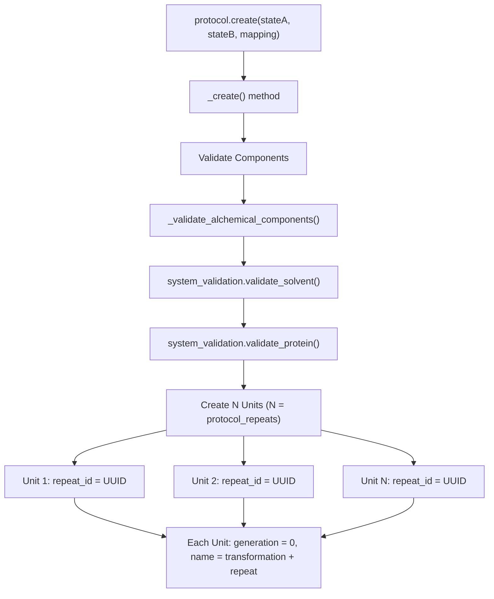

Each `RelativeHybridTopologyProtocolUnit` [openfe/protocols/openmm_rfe/equil_rfe_methods.py:683-730]() contains:
- `stateA`: Source `ChemicalSystem`
- `stateB`: Target `ChemicalSystem`
- `ligandmapping`: `LigandAtomMapping` between components
- `repeat_id`: Unique identifier (UUID) for this independent repeat
- `generation`: Counter for extensions (currently 0; extensions not yet supported)

Sources: [openfe/protocols/openmm_rfe/equil_rfe_methods.py:616-660](), [openfe/protocols/openmm_rfe/equil_rfe_methods.py:683-730]()

### ProtocolUnit Execution

Each unit executes the following workflow in its `run()` method [openfe/protocols/openmm_rfe/equil_rfe_methods.py:760-1750]():

#### Execution Steps

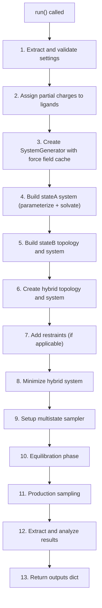

Sources: [openfe/protocols/openmm_rfe/equil_rfe_methods.py:760-1750]()

#### Key Implementation Details

**Step 2: Partial Charge Assignment** [openfe/protocols/openmm_rfe/equil_rfe_methods.py:732-758]()
- Assigns charges to both ligands using `charge_generation.assign_offmol_partial_charges()`
- Supports AM1-BCC, NAGL, Espaloma methods
- Uses existing charges if already present (overwrite=False)

**Step 4-6: System Construction** [openfe/protocols/openmm_rfe/equil_rfe_methods.py:853-970]()
- Creates OpenMM `Modeller` with protein, ligands, solvent
- Uses `system_creation.get_omm_modeller()` for solvation
- Builds hybrid topology with `topologyhelpers.combined_topology()`
- Generates system mappings with `topologyhelpers.get_system_mappings()`

**Step 9: Multistate Sampler Setup** [openfe/protocols/openmm_rfe/equil_rfe_methods.py:1097-1274]()
- Creates `SamplerState` with positions and box vectors
- Defines `ThermodynamicState` for each lambda window
- Selects sampler: `ReplicaExchangeSampler`, `SAMSSampler`, or `MultiStateSampler`
- Configures `MultiStateReporter` for trajectory storage

**Step 11: Production Sampling** [openfe/protocols/openmm_rfe/equil_rfe_methods.py:1285-1434]()
- Runs alchemical sampling with chosen method
- Supports early termination based on target error
- Performs real-time free energy analysis if configured

Sources: [openfe/protocols/openmm_rfe/equil_rfe_methods.py:760-1750]()

### Sampling Methods

The `MultiStateSimulationSettings.sampler_method` [openfe/protocols/openmm_utils/omm_settings.py:563-570]() parameter selects the sampling algorithm:

| Method | Class | Description |
|--------|-------|-------------|
| `"repex"` (default) | `ReplicaExchangeSampler` | Hamiltonian Replica Exchange - replicas swap between lambda states to enhance sampling |
| `"sams"` | `SAMSSampler` | Self-Adjusted Mixture Sampling - dynamically weights states to achieve uniform uncertainty |
| `"independent"` | `MultiStateSampler` | Independent windows - each lambda state sampled separately without swaps |

**HREX** is recommended for most cases as it provides good mixing between lambda states and reliable convergence. **SAMS** can be useful for challenging transformations with poor phase space overlap.

Sources: [openfe/protocols/openmm_rfe/equil_rfe_methods.py:1142-1209](), [openfe/protocols/openmm_utils/omm_settings.py:563-570]()

### Integrator and Dynamics

The protocol uses a `LangevinMiddleIntegrator` [openfe/protocols/openmm_rfe/equil_rfe_methods.py:1076-1087]() wrapped in OpenMMTools `LangevinDynamicsMove`:
- Integrator: Langevin dynamics with LFMiddle discretization
- Thermostat: Langevin collision frequency (default 1.0/ps)
- Barostat: `MonteCarloBarostat` for NPT simulations (frequency 25 timesteps)
- Timestep: Default 4 fs (adjustable via `integrator_settings.timestep`)

Sources: [openfe/protocols/openmm_rfe/equil_rfe_methods.py:1056-1087](), [docs/guide/protocols/relativehybridtopology.rst:87-93]()

## Results and Analysis

After executing the `ProtocolDAG`, the `gather()` method produces a `RelativeHybridTopologyProtocolResult` [openfe/protocols/openmm_rfe/equil_rfe_methods.py:276-494]().

### Result Structure

The result object organizes data by `repeat_id`:

```python
result.data = {
    "repeat_id_1": [ProtocolUnitResult],
    "repeat_id_2": [ProtocolUnitResult],
    "repeat_id_N": [ProtocolUnitResult],
}
```

Each `ProtocolUnitResult` contains outputs from one simulation repeat, including:
- `unit_estimate`: Free energy estimate for this repeat
- `unit_estimate_error`: MBAR bootstrap uncertainty
- `unit_mbar_overlap`: MBAR overlap matrix
- `forward_and_reverse_energies`: Convergence analysis data
- `replica_exchange_statistics`: Replica swap statistics (if HREX)
- `equilibration_iterations`: Number of equilibration samples
- `production_iterations`: Number of production samples
- `nc`: Path to NetCDF trajectory file
- `last_checkpoint`: Path to checkpoint file

Sources: [openfe/protocols/openmm_rfe/equil_rfe_methods.py:662-680](), [openfe/protocols/openmm_rfe/equil_rfe_methods.py:1742-1750]()

### Free Energy Estimation

The protocol uses MBAR (Multistate Bennett Acceptance Ratio) implemented in pymbar for free energy estimation [openfe/protocols/openmm_rfe/equil_rfe_methods.py:1437-1618]().

#### Primary Methods

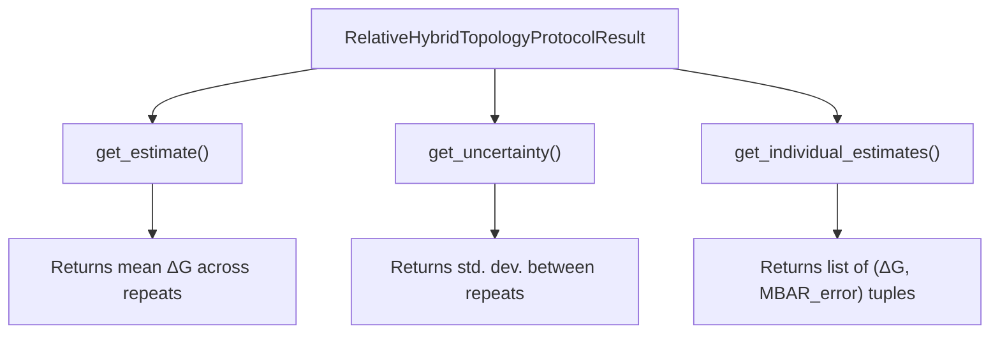

**`get_estimate()`** [openfe/protocols/openmm_rfe/equil_rfe_methods.py:295-306]():
- Computes arithmetic mean of all repeat estimates
- Returns `openff.units.Quantity` with appropriate units (typically kcal/mol)

**`get_uncertainty()`** [openfe/protocols/openmm_rfe/equil_rfe_methods.py:317-323]():
- Computes standard deviation across repeat estimates
- Represents statistical uncertainty from finite sampling
- Does NOT include MBAR internal uncertainty

**`get_individual_estimates()`** [openfe/protocols/openmm_rfe/equil_rfe_methods.py:325-340]():
- Returns list of `(estimate, mbar_error)` tuples
- One entry per repeat
- MBAR error computed via bootstrapping (1000 iterations)

Sources: [openfe/protocols/openmm_rfe/equil_rfe_methods.py:295-340]()

### Convergence Analysis

#### Forward/Reverse Analysis

**`get_forward_and_reverse_energy_analysis()`** [openfe/protocols/openmm_rfe/equil_rfe_methods.py:342-387]() performs convergence assessment:

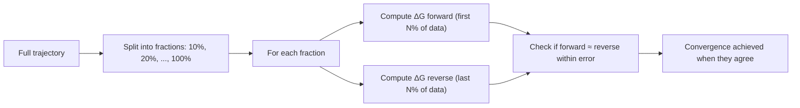

Returns dictionary with keys:
- `fractions`: Array of data fractions analyzed
- `forward_DGs`, `reverse_DGs`: Free energy estimates
- `forward_dDGs`, `reverse_dDGs`: Associated uncertainties

If analysis fails for a repeat (MBAR convergence issues), that entry is `None`.

Sources: [openfe/protocols/openmm_rfe/equil_rfe_methods.py:342-387](), [openfe/protocols/openmm_rfe/equil_rfe_methods.py:1556-1618]()

#### MBAR Overlap Analysis

**`get_overlap_matrices()`** [openfe/protocols/openmm_rfe/equil_rfe_methods.py:389-407]() returns phase space overlap between lambda states:

```python
overlap_stats = [
    {
        "scalar": float,          # 1 - largest eigenvalue
        "eigenvalues": np.ndarray,  # Sorted eigenvalues
        "matrix": np.ndarray,      # Full overlap matrix O[i,j]
    },
    # ... one dict per repeat
]
```

**Interpretation**:
- `matrix[i,j]`: Probability that a sample from state i is observable in state j
- Diagonal should have "width" connecting all states
- Adjacent elements should be ≥ 0.03 for good sampling
- `scalar` close to 0 indicates good overlap

Sources: [openfe/protocols/openmm_rfe/equil_rfe_methods.py:389-407](), [openfe/protocols/openmm_rfe/equil_rfe_methods.py:1524-1554]()

#### Replica Exchange Statistics

**`get_replica_transition_statistics()`** [openfe/protocols/openmm_rfe/equil_rfe_methods.py:409-434]() (HREX only):

```python
repex_stats = [
    {
        "eigenvalues": np.ndarray,  # Sorted eigenvalues
        "matrix": np.ndarray,       # Transition matrix T[i,j]
    },
    # ... one dict per repeat
]
```

`matrix[i,j]`: Probability of replica transitioning from state i to state j.
Good mixing shows tridiagonal pattern with ≥ 0.03 off-diagonal elements.

Sources: [openfe/protocols/openmm_rfe/equil_rfe_methods.py:409-434]()

### Additional Analysis Methods

| Method | Return Type | Description |
|--------|-------------|-------------|
| `get_replica_states()` | `list[np.ndarray]` | Timeseries of lambda states for each replica |
| `equilibration_iterations()` | `list[float]` | Number of equilibration iterations per repeat |
| `production_iterations()` | `list[float]` | Number of uncorrelated production samples per repeat |

Sources: [openfe/protocols/openmm_rfe/equil_rfe_methods.py:436-493]()

## Best Practices and Recommendations

### When to Use This Protocol

The RelativeHybridTopologyProtocol is most effective when:
- The two end states have significant structural similarity
- There is a clear atom mapping between the states
- The transformation involves small changes (e.g., adding/removing a few atoms)

For larger changes, consider breaking the transformation into smaller steps or using the Absolute Solvation Protocol.

### Performance Optimization

- Use GPU acceleration by setting `engine_settings.compute_platform` to "CUDA" or "OpenCL"
- Adjust `n_replicas` to match the number of lambda windows
- Consider using restraints for transformations involving significant conformational changes
- Use multiple repeats (3 or more) to obtain reliable uncertainty estimates

### Quality Control

For reliable results, check the following:
- MBAR overlap values should ideally be > 0.03 between adjacent windows
- The standard deviation between repeats provides an estimate of the statistical uncertainty
- Forward and reverse energy analysis should converge to similar values
- Replica exchange statistics should show good mixing between states

Sources: [openfe/protocols/openmm_rfe/equil_rfe_methods.py:315-465]()

## Limitations and Considerations

- Element changes in the core atoms are handled by using the average mass, but this may affect dynamics
- Charge changes between states may require special handling using explicit charge correction
- Very large structural changes may lead to poor convergence and require extended sampling
- Virtual sites (e.g., in TIP4P water) are fully supported but require `integrator_settings.reassign_velocities = True`

Sources: [openfe/tests/protocols/test_openmm_equil_rfe_protocols.py:413-554]()

---