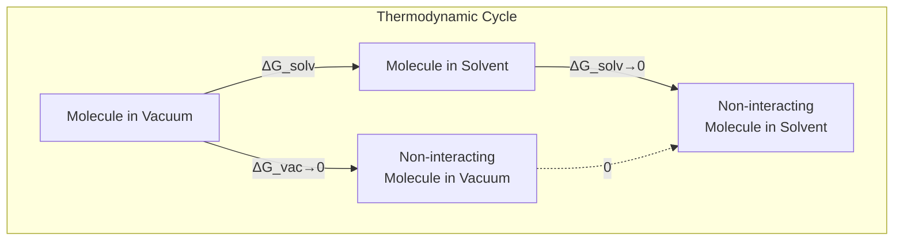
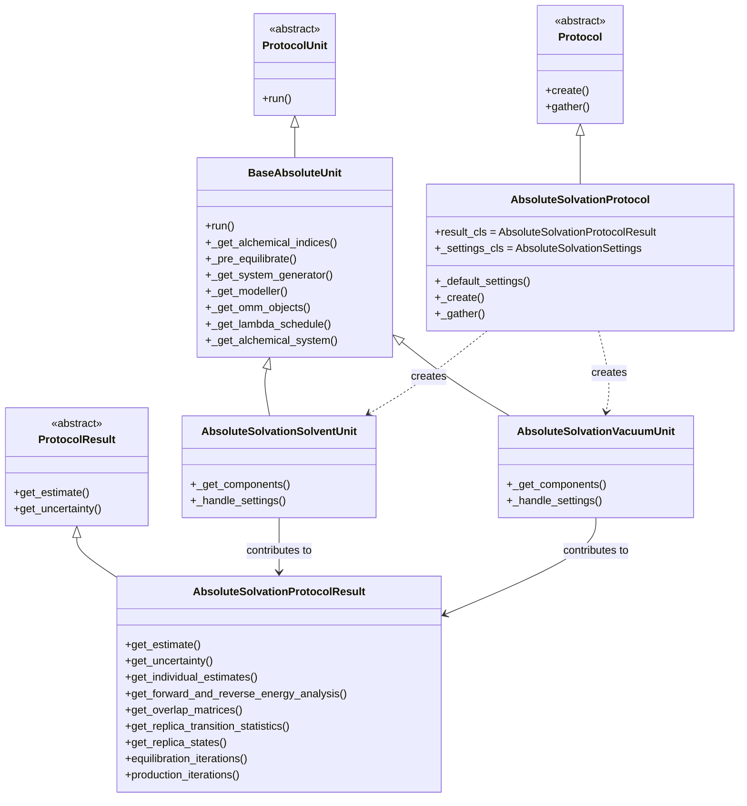
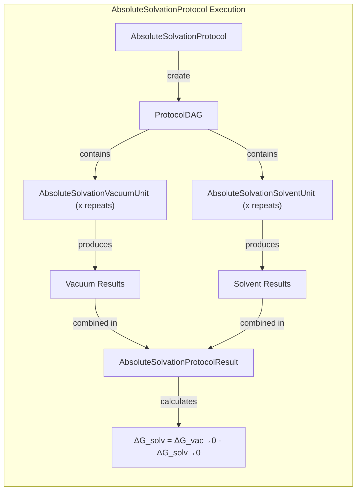
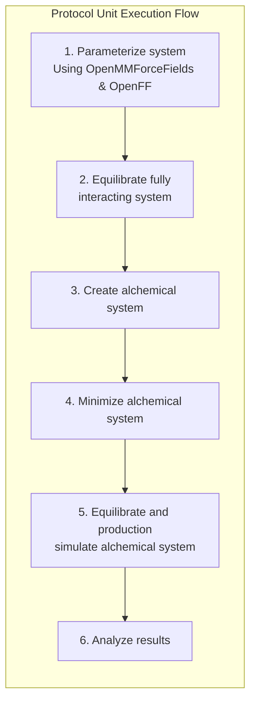

# Absolute Solvation Protocol

<details>
<summary>Relevant source files</summary>

The following files were used as context for generating this wiki page:

- [docs/guide/protocols/absolutesolvation.rst](docs/guide/protocols/absolutesolvation.rst)
- [docs/guide/protocols/img/ahfe_thermocycle.png](docs/guide/protocols/img/ahfe_thermocycle.png)
- [docs/guide/protocols/plainmd.rst](docs/guide/protocols/plainmd.rst)
- [docs/guide/protocols/relativehybridtopology.rst](docs/guide/protocols/relativehybridtopology.rst)
- [openfe/protocols/openmm_afe/base.py](openfe/protocols/openmm_afe/base.py)
- [openfe/protocols/openmm_afe/equil_afe_settings.py](openfe/protocols/openmm_afe/equil_afe_settings.py)
- [openfe/protocols/openmm_afe/equil_solvation_afe_method.py](openfe/protocols/openmm_afe/equil_solvation_afe_method.py)
- [openfe/protocols/openmm_md/plain_md_methods.py](openfe/protocols/openmm_md/plain_md_methods.py)
- [openfe/protocols/openmm_md/plain_md_settings.py](openfe/protocols/openmm_md/plain_md_settings.py)
- [openfe/protocols/openmm_rfe/equil_rfe_methods.py](openfe/protocols/openmm_rfe/equil_rfe_methods.py)
- [openfe/protocols/openmm_rfe/equil_rfe_settings.py](openfe/protocols/openmm_rfe/equil_rfe_settings.py)
- [openfe/protocols/openmm_utils/omm_settings.py](openfe/protocols/openmm_utils/omm_settings.py)
- [openfe/tests/data/openmm_afe/AHFEProtocol_json_results.gz](openfe/tests/data/openmm_afe/AHFEProtocol_json_results.gz)
- [openfe/tests/data/openmm_md/MDProtocol_json_results.gz](openfe/tests/data/openmm_md/MDProtocol_json_results.gz)
- [openfe/tests/data/openmm_rfe/RHFEProtocol_json_results.gz](openfe/tests/data/openmm_rfe/RHFEProtocol_json_results.gz)

</details>


The Absolute Solvation Protocol calculates the free energy change associated with transferring a molecule from vacuum into a solvent. It implements an alchemical free energy approach using OpenMM and OpenMMTools, supporting multiple sampling methods including Hamiltonian Replica Exchange (HREX), Self-adjusted mixture sampling (SAMS), and independent window sampling. For relative free energy calculations, see [Relative Free Energy Protocol](#2.1).

## Thermodynamic Cycle and Theory

The absolute solvation free energy is calculated through a thermodynamic cycle. In this cycle, the molecule's interactions are decoupled (turned off) using a partial annihilation scheme in both solvent and vacuum phases. The absolute solvation free energy (ΔG_solv) is obtained via summation of free energy differences along the thermodynamic cycle:

ΔG_solv = ΔG_vac→0 - ΔG_solv→0

Where ΔG_vac→0 is the free energy of turning off the molecule's interactions in vacuum and ΔG_solv→0 is the free energy of turning off the molecule's interactions in solvent.

### Thermodynamic Cycle Diagram



Sources: [openfe/protocols/openmm_afe/equil_solvation_afe_method.py:1-89](). [docs/guide/protocols/absolutesolvation.rst:1-21]()

### Partial Annihilation Scheme

In the Absolute Solvation Protocol, the molecule's interactions are systematically turned off following this scheme:
- Coulombic interactions are fully turned off (annihilated)
- Lennard-Jones interactions are decoupled (intermolecular interactions turned off while keeping intramolecular interactions)

The lambda schedule controls how these interactions are turned off during the alchemical path:
1. Electrostatic interactions are turned off first
2. Lennard-Jones interactions are turned off second

A soft-core potential is applied to the Lennard-Jones potential to avoid instabilities in intermediate lambda windows. Both Beutler et al. and Gapsys et al. soft-core potentials are available and can be specified in the `alchemical_settings.softcore_LJ` setting (default: "gapsys").

Sources: [openfe/protocols/openmm_afe/equil_solvation_afe_method.py:91-178](). [docs/guide/protocols/absolutesolvation.rst:22-38]()

## Architecture and Implementation

The implementation follows a hierarchical class structure with `AbsoluteSolvationProtocol` as the main protocol class and separate unit classes for the solvent and vacuum transformations.

### Class Structure



Sources: [openfe/protocols/openmm_afe/equil_solvation_afe_method.py:90-397](). [openfe/protocols/openmm_afe/base.py:74-585]()

### Protocol and Protocol Units Relationship

The Absolute Solvation Protocol differs from the Relative Hybrid Topology Protocol in how it organizes its Protocol DAG. It runs both legs of the thermodynamic cycle (vacuum and solvent) concurrently in the same ProtocolDAG.



Sources: [openfe/protocols/openmm_afe/equil_solvation_afe_method.py:393-490](). [docs/guide/protocols/absolutesolvation.rst:39-47]()

## Simulation Workflow

Each Protocol Unit (whether vacuum or solvent) carries out the following steps:



Sources: [docs/guide/protocols/absolutesolvation.rst:47-63](). [openfe/protocols/openmm_afe/base.py:156-269]()

### Simulation Details

1. **System Parameterization:**
   - Molecules are parameterized using OpenMMForceFields and OpenFF.
   - Partial charges can be assigned using various methods (AM1BCC, NAGL, etc.)

2. **System Equilibration:**
   - Uses the same approach as the PlainMDProtocol.
   - For solvent simulations, includes NVT and NPT equilibration phases.

3. **Alchemical System Creation:**
   - Alchemical regions are defined based on the components to be transformed.
   - Lambda schedules are set up for electrostatic and Lennard-Jones interactions.

4. **Simulation:**
   - Uses LangevinMiddleIntegrator for dynamics.
   - MonteCarloBarostat for NPT ensemble.
   - Three sampling methods are available: HREX (default), SAMS, or independent.

5. **Analysis:**
   - Free energy differences calculated using MBAR estimator.
   - Multiple analyses performed: overlap matrices, replica exchange statistics, etc.

Sources: [openfe/protocols/openmm_afe/equil_solvation_afe_method.py:452-490](). [openfe/protocols/openmm_afe/base.py:270-585]()

## Settings and Configuration

The `AbsoluteSolvationSettings` class provides comprehensive control over the simulation protocol. Key settings include:

1. **Protocol Settings:**
   - `protocol_repeats`: Number of independent repeats of the sampling process.

2. **Force Field Settings:**
   - `solvent_forcefield_settings`/`vacuum_forcefield_settings`: Parameters for force field setup.
   - `thermo_settings`: Thermodynamic parameters (temperature, pressure).

3. **Alchemical Settings:**
   - `lambda_settings`: Controls the lambda schedule for different components (electrostatics, van der Waals).
   - `alchemical_settings`: Settings for the alchemical transformation.

4. **Simulation Settings:**
   - `solvent_simulation_settings`/`vacuum_simulation_settings`: Control simulation lengths, number of replicas, etc.
   - `solvent_equil_simulation_settings`/`vacuum_equil_simulation_settings`: Pre-alchemical equilibration settings.
   - `integrator_settings`: Controls the integrator, timestep, and barostat settings.

5. **Output Settings:**
   - `solvent_output_settings`/`vacuum_output_settings`: Control file outputs for simulations.
   - `solvent_equil_output_settings`/`vacuum_equil_output_settings`: Output settings for equilibration.

Here's the default lambda schedule:

```
lambda_elec = [0.0, 0.25, 0.5, 0.75, 1.0, 1.0, 1.0, 1.0, 1.0, 1.0, 1.0, 1.0, 1.0, 1.0]
lambda_vdw = [0.0, 0.0, 0.0, 0.0, 0.0, 0.12, 0.24, 0.36, 0.48, 0.6, 0.7, 0.77, 0.85, 1.0]
```

Sources: [openfe/protocols/openmm_afe/equil_afe_settings.py:39-219](). [openfe/protocols/openmm_afe/equil_solvation_afe_method.py:422-489]()

## Analysis and Results

The `AbsoluteSolvationProtocolResult` class provides methods to analyze the simulation results:

1. **Free Energy Estimates:**
   - `get_estimate()`: Returns the solvation free energy estimate.
   - `get_uncertainty()`: Returns the uncertainty in the solvation free energy.
   - `get_individual_estimates()`: Returns individual free energy estimates for each repeat.

2. **Convergence Analysis:**
   - `get_forward_and_reverse_energy_analysis()`: Analyzes free energies using progressively larger portions of data.
   - `equilibration_iterations()` and `production_iterations()`: Return information about equilibration and production phases.

3. **Sampling Quality Analysis:**
   - `get_overlap_matrices()`: Returns MBAR overlap estimates.
   - `get_replica_transition_statistics()`: Returns replica exchange transition statistics.
   - `get_replica_states()`: Returns timeseries of replica states.

The free energy differences are obtained using the MBAR estimator (Multistate Bennett Acceptance Ratio) as implemented in the PyMBAR package.

Sources: [openfe/protocols/openmm_afe/equil_solvation_afe_method.py:90-390](). [openfe/protocols/openmm_utils/multistate_analysis.py:50-397]()

## Example Overlap Matrix and Replica State Plots

The protocol produces several diagnostic plots to help assess convergence and sampling quality:

1. **MBAR Overlap Matrix:** Shows probability of a sample from a given row state being observable in a given column state. Good overlap is essential for accurate free energy estimates.

2. **Replica Exchange Probability Matrix:** Shows the probability of a given lambda state being exchanged with another.

3. **Forward and Reverse Free Energy Convergence:** Shows free energy estimates using increasingly larger portions of data.

4. **Replica State Timeseries:** Shows time evolution of system configurations as they exchange between different lambda states.

Sources: [openfe/protocols/openmm_utils/multistate_analysis.py:89-144](). [docs/guide/protocols/relativehybridtopology.rst:120-155]()

## Limitations and Requirements

Current limitations of the Absolute Solvation Protocol include:

1. Only small molecules are allowed to act as alchemical molecules.
2. No protein components are allowed.
3. Disappearing molecules are only allowed in state A (currently no support for appearing molecules in state B).
4. Water is currently the only supported solvent.

Sources: [openfe/protocols/openmm_afe/equil_solvation_afe_method.py:9-27](). [openfe/protocols/openmm_afe/equil_solvation_afe_method.py:501-581]()

## References

The implementation cites several key resources:
- Beutler et al. for soft-core potential functions
- Gapsys et al. for alternative soft-core potential functions  
- Zhang et al. for the LFMiddle discretization in Langevin dynamics
- PyMBAR for free energy calculations
- OpenMMTools and OpenMM for simulation components

Sources: [docs/guide/protocols/absolutesolvation.rst:112-114]()

---