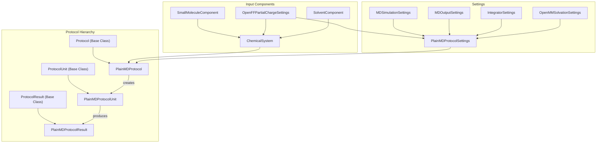
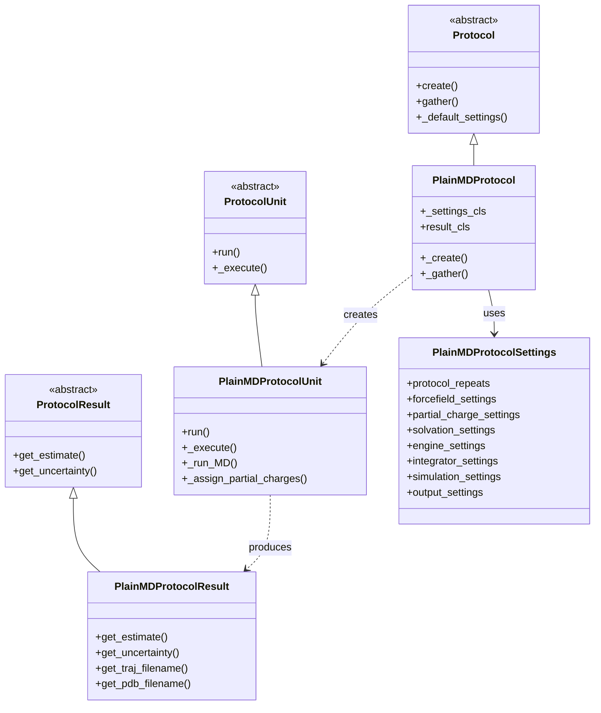
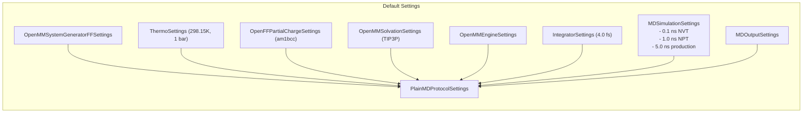
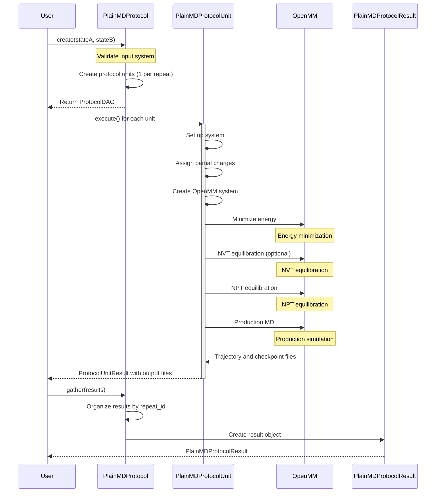

# Molecular Dynamics Protocol

<details>
<summary>Relevant source files</summary>

The following files were used as context for generating this wiki page:

- [docs/guide/protocols/absolutesolvation.rst](docs/guide/protocols/absolutesolvation.rst)
- [docs/guide/protocols/img/ahfe_thermocycle.png](docs/guide/protocols/img/ahfe_thermocycle.png)
- [docs/guide/protocols/plainmd.rst](docs/guide/protocols/plainmd.rst)
- [docs/guide/protocols/relativehybridtopology.rst](docs/guide/protocols/relativehybridtopology.rst)
- [openfe/protocols/openmm_afe/base.py](openfe/protocols/openmm_afe/base.py)
- [openfe/protocols/openmm_afe/equil_afe_settings.py](openfe/protocols/openmm_afe/equil_afe_settings.py)
- [openfe/protocols/openmm_afe/equil_solvation_afe_method.py](openfe/protocols/openmm_afe/equil_solvation_afe_method.py)
- [openfe/protocols/openmm_md/plain_md_methods.py](openfe/protocols/openmm_md/plain_md_methods.py)
- [openfe/protocols/openmm_md/plain_md_settings.py](openfe/protocols/openmm_md/plain_md_settings.py)
- [openfe/protocols/openmm_rfe/equil_rfe_methods.py](openfe/protocols/openmm_rfe/equil_rfe_methods.py)
- [openfe/protocols/openmm_rfe/equil_rfe_settings.py](openfe/protocols/openmm_rfe/equil_rfe_settings.py)
- [openfe/protocols/openmm_utils/omm_settings.py](openfe/protocols/openmm_utils/omm_settings.py)

</details>


The Molecular Dynamics Protocol provides functionality for running standard molecular dynamics (MD) simulations on chemical systems using OpenMM. Unlike the [Relative Free Energy Protocol](#2.1) and [Absolute Solvation Protocol](#2.2), this protocol does not perform alchemical transformations. Instead, it runs conventional MD simulations that can be used for conformational sampling, system equilibration, or analysis of dynamics.

## Overview

The `PlainMDProtocol` implements a workflow for setting up, running, and analyzing conventional molecular dynamics simulations. It supports a variety of system types including small molecules in vacuum, solvated small molecules, protein-ligand complexes, and multi-component systems.



Sources:
- [openfe/protocols/openmm_md/plain_md_methods.py:108-155]()
- [openfe/protocols/openmm_md/plain_md_settings.py:25-56]()

## Core Components

The protocol consists of three main classes that work together to execute and store the results of MD simulations:

1. **PlainMDProtocol**: The main protocol class that handles configuration and coordinates the simulation workflow
2. **PlainMDProtocolUnit**: Responsible for executing individual MD simulation runs
3. **PlainMDProtocolResult**: Stores and provides access to simulation outputs



Sources:
- [openfe/protocols/openmm_md/plain_md_methods.py:54-108]()
- [openfe/protocols/openmm_md/plain_md_methods.py:229-709]()
- [openfe/protocols/openmm_md/plain_md_settings.py:25-56]()

## Protocol Settings

The protocol uses a comprehensive settings system to configure all aspects of the simulation process. The main settings class is `PlainMDProtocolSettings` which contains several nested settings classes:

| Setting Component | Description |
|-------------------|-------------|
| `protocol_repeats` | Number of independent MD runs to perform |
| `forcefield_settings` | Parameters for setting up force fields via OpenMM |
| `thermo_settings` | Thermodynamic parameters (temperature, pressure) |
| `partial_charge_settings` | Settings for assigning partial charges to small molecules |
| `solvation_settings` | Configuration for solvating the system |
| `engine_settings` | OpenMM-specific settings like compute platform |
| `integrator_settings` | Parameters for the integrator (timestep, collision rate, etc.) |
| `simulation_settings` | Simulation control settings (minimization steps, equilibration length, etc.) |
| `output_settings` | Configuration for simulation outputs (trajectory files, etc.) |

Sources:
- [openfe/protocols/openmm_md/plain_md_settings.py:25-56]()
- [openfe/protocols/openmm_utils/omm_settings.py:647-691]()

### Default Settings

The protocol provides reasonable default settings through the `_default_settings` method. These defaults include:



Sources:
- [openfe/protocols/openmm_md/plain_md_methods.py:124-154]()
- [openfe/protocols/openmm_utils/omm_settings.py:647-691]()

## Workflow

The protocol operates in three main phases:

1. **Creation**: Generate `PlainMDProtocolUnit` instances based on the input chemical system and settings
2. **Execution**: Run each protocol unit, which performs the actual MD simulation
3. **Gathering**: Collect and organize the results into a `PlainMDProtocolResult`



Sources:
- [openfe/protocols/openmm_md/plain_md_methods.py:156-227]()
- [openfe/protocols/openmm_md/plain_md_methods.py:229-709]()

### System Creation Process

The protocol unit sets up the simulation system through several steps:

1. Component extraction and validation
2. Partial charge assignment for small molecules 
3. System generator creation
4. OpenMM Modeller setup with appropriate topology
5. System creation with specified force field

```mermaid
flowchart TB
    subgraph "System Creation Process"
        CS["ChemicalSystem"]
        
        CS -->|"validate_solvent()"| VC["Validate Components"]
        CS -->|"validate_protein()"| VC
        
        VC --> EC["Extract Components
                 - SolventComponent
                 - ProteinComponent
                 - SmallMoleculeComponents"]
        
        EC --> PC["Assign Partial Charges
                 to SmallMoleculeComponents"]
        
        PC --> SG["Create SystemGenerator"]
        
        SG --> STM["Create Templates for SmallMolecules"]
        
        STM --> OM["Create OpenMM Modeller
                 with all components"]
                 
        OM --> SC["Create System with force field"]
        
        SC --> SI["Setup Integrator"]
        
        SI --> SM["Create Simulation"]
        
        SM --> MD["Run MD Simulation"]
    end
```



Sources:
- [openfe/protocols/openmm_md/plain_md_methods.py:471-496]()
- [openfe/protocols/openmm_md/plain_md_methods.py:499-694]()

### MD Simulation Process

The `_run_MD` method performs the actual simulation process:

1. Energy minimization
2. NVT equilibration (optional)
3. NPT equilibration 
4. Production MD

During these phases, several intermediate structures are saved, and reporters are configured to record trajectory information.

Sources:
- [openfe/protocols/openmm_md/plain_md_methods.py:272-468]()

## Output Files

The protocol produces several output files during execution:

| Output File | Description | Setting |
|-------------|-------------|---------|
| System PDB | Complete system structure before minimization | `output_settings.preminimized_structure` |
| Minimized PDB | System after energy minimization | `output_settings.minimized_structure` |
| NVT Equilibration PDB | System after NVT equilibration | `output_settings.equil_nvt_structure` |
| NPT Equilibration PDB | System after NPT equilibration | `output_settings.equil_npt_structure` |
| Production Trajectory | Trajectory file in XTC format | `output_settings.production_trajectory_filename` |
| Checkpoint File | Simulation checkpoint for restarts | `output_settings.checkpoint_storage_filename` |
| Log File | Energy, temperature, and other simulation data | `output_settings.log_output` |

Sources:
- [openfe/protocols/openmm_md/plain_md_methods.py:680-691]()
- [openfe/protocols/openmm_utils/omm_settings.py:669-691]()

## Protocol Result Access

The `PlainMDProtocolResult` class provides methods to access the simulation outputs:

```python
# Get trajectory filenames
traj_files = result.get_traj_filename()

# Get system PDB filenames
pdb_files = result.get_pdb_filename()
```

Unlike the free energy protocols, the MD protocol does not calculate a free energy estimate, so `get_estimate()` and `get_uncertainty()` return `None`.

Sources:
- [openfe/protocols/openmm_md/plain_md_methods.py:54-107]()

## Configuration Examples

### Vacuum Simulation

To run a simulation in vacuum:

```python
from openfe.protocols.openmm_md import PlainMDProtocol

# Start with default settings
settings = PlainMDProtocol.default_settings()

# Modify for vacuum simulation
settings.forcefield_settings.nonbonded_method = 'nocutoff'

# Create protocol
protocol = PlainMDProtocol(settings=settings)
```

### Solvent Simulation with TIP4P Water

```python
from openfe.protocols.openmm_md import PlainMDProtocol
from openff.units import unit

# Start with default settings
settings = PlainMDProtocol.default_settings()

# Modify for TIP4P water
settings.forcefield_settings.forcefields = [
    "amber/ff14SB.xml",
    "amber/tip4pew_standard.xml",
    "amber/phosaa10.xml",
]
settings.solvation_settings.solvent_model = 'tip4pew'
settings.solvation_settings.solvent_padding = 1.0 * unit.nanometer

# Create protocol
protocol = PlainMDProtocol(settings=settings)
```

Sources:
- [openfe/tests/protocols/test_openmm_plain_md_protocols.py:84-107]()
- [openfe/tests/protocols/test_openmm_plain_md_protocols.py:327-356]()

## Advanced Features

### Multiple Repeats

The protocol supports running multiple independent simulations through the `protocol_repeats` setting:

```python
from openfe.protocols.openmm_md import PlainMDProtocol

# Start with default settings
settings = PlainMDProtocol.default_settings()

# Set the number of repeats
settings.protocol_repeats = 3

# Create protocol
protocol = PlainMDProtocol(settings=settings)
```

### Partial Charge Assignment Methods

The protocol supports multiple methods for partial charge assignment:

| Method | Description | Backend Options |
|--------|-------------|-----------------|
| `am1bcc` | AM1-BCC charges | ambertools, openeye |
| `am1bccelf10` | AM1-BCC with ELF10 method | openeye |
| `nagl` | OpenFF ML-based charges | ambertools, openeye, rdkit |
| `espaloma` | Espaloma Charge model | ambertools, rdkit |

Sources:
- [openfe/protocols/openmm_utils/omm_settings.py:218-289]()
- [openfe/tests/protocols/test_openmm_plain_md_protocols.py:183-234]()

## Usage in Workflows

The Molecular Dynamics Protocol is typically used for:

1. Equilibrating systems before free energy calculations
2. Generating conformational ensembles for analysis
3. Studying dynamic properties of molecular systems

Since the protocol follows the same interface as other OpenFE protocols, it can be integrated into larger workflows that include free energy calculations and other analyses.

Sources:
- [openfe/protocols/openmm_md/plain_md_methods.py:108-119]()

---