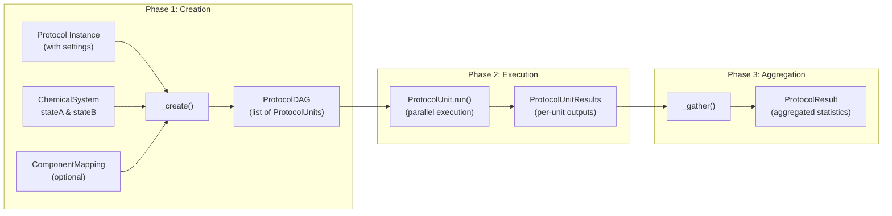
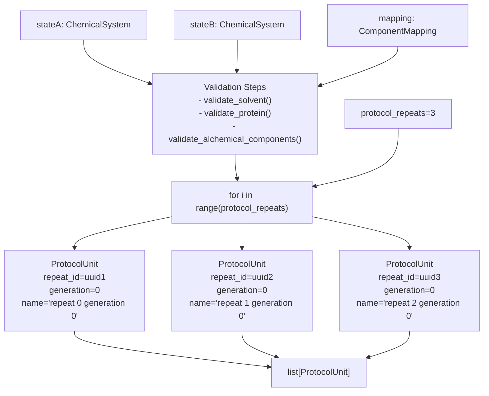
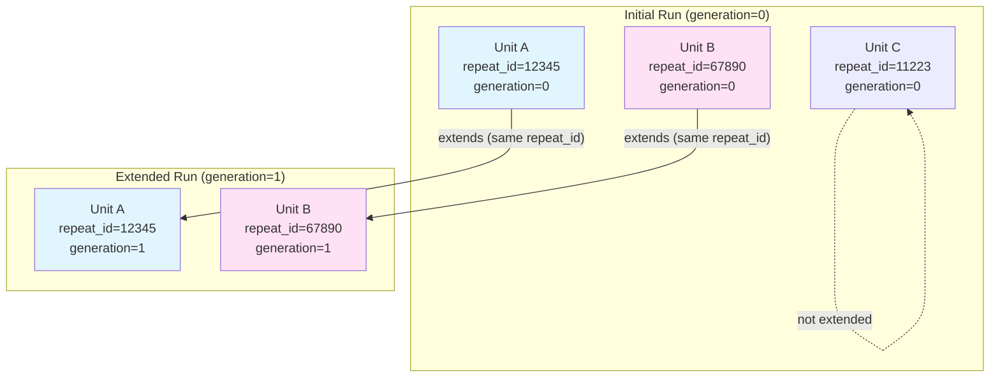
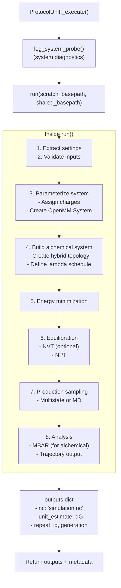
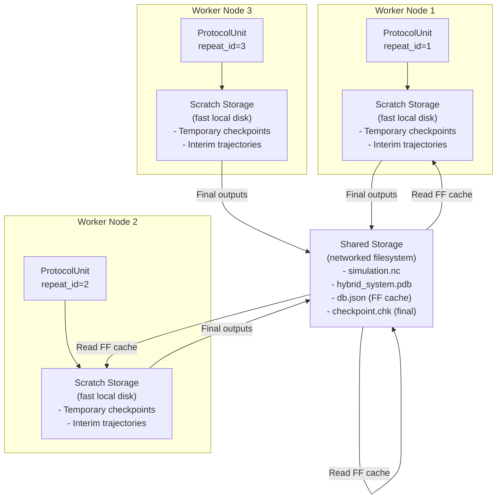
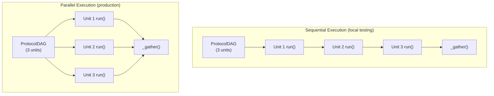
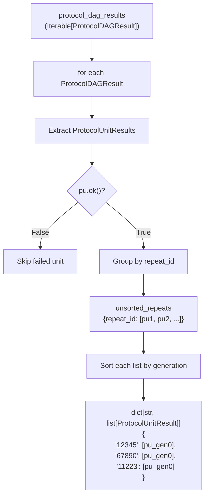
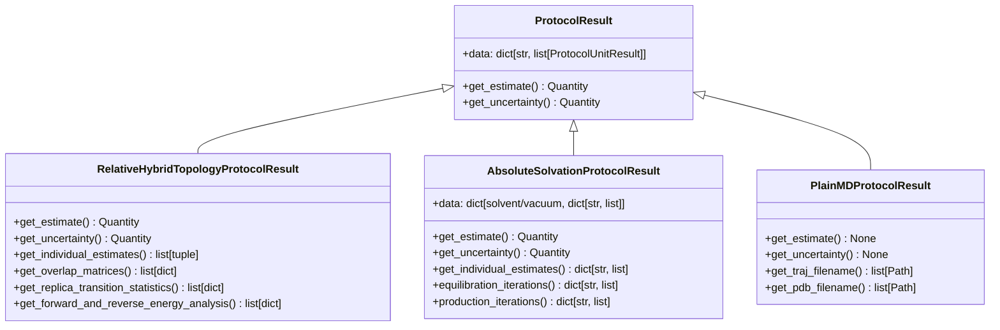

# Protocol Execution Model

<details>
<summary>Relevant source files</summary>

The following files were used as context for generating this wiki page:

- [openfe/protocols/openmm_afe/base.py](openfe/protocols/openmm_afe/base.py)
- [openfe/protocols/openmm_afe/equil_afe_settings.py](openfe/protocols/openmm_afe/equil_afe_settings.py)
- [openfe/protocols/openmm_afe/equil_solvation_afe_method.py](openfe/protocols/openmm_afe/equil_solvation_afe_method.py)
- [openfe/protocols/openmm_md/plain_md_methods.py](openfe/protocols/openmm_md/plain_md_methods.py)
- [openfe/protocols/openmm_md/plain_md_settings.py](openfe/protocols/openmm_md/plain_md_settings.py)
- [openfe/protocols/openmm_rfe/equil_rfe_methods.py](openfe/protocols/openmm_rfe/equil_rfe_methods.py)
- [openfe/protocols/openmm_rfe/equil_rfe_settings.py](openfe/protocols/openmm_rfe/equil_rfe_settings.py)
- [openfe/protocols/openmm_utils/omm_settings.py](openfe/protocols/openmm_utils/omm_settings.py)
- [openfe/tests/protocols/conftest.py](openfe/tests/protocols/conftest.py)

</details>


## Purpose and Scope

This page describes the execution model that underlies all OpenFE protocols, including how simulations are decomposed into independent units, executed in parallel, and aggregated into final results. This covers the `Protocol`, `ProtocolDAG`, `ProtocolUnit`, and `ProtocolResult` abstractions that enable reproducible, parallelizable free energy calculations.

For details on specific protocol types (RFE, AFE, MD), see [Relative Free Energy Protocols](#2.1), [Absolute Solvation Protocol](#2.2), and [Molecular Dynamics Protocol](#2.3). For configuration options, see [Protocol Settings and Configuration](#2.5).

---

## Protocol Lifecycle Overview

Every OpenFE protocol follows a consistent three-phase lifecycle:



**Sources:** [openfe/protocols/openmm_rfe/equil_rfe_methods.py:616-681](), [openfe/protocols/openmm_md/plain_md_methods.py:166-237]()

---

## ProtocolDAG Creation

The `_create()` method is called on a `Protocol` instance to generate a `ProtocolDAG` — a directed acyclic graph of `ProtocolUnit` instances representing independent computational tasks.

### Method Signature

All protocols implement `_create()` with this signature:

```python
def _create(
    self,
    stateA: ChemicalSystem,
    stateB: ChemicalSystem,
    mapping: Optional[Union[ComponentMapping, list[ComponentMapping]]],
    extends: Optional[ProtocolDAGResult] = None,
) -> list[ProtocolUnit]
```

**Sources:** [openfe/protocols/openmm_rfe/equil_rfe_methods.py:616-660](), [openfe/protocols/openmm_md/plain_md_methods.py:166-215]()

### Key Responsibilities

The `_create()` method:

1. **Validates inputs** - Checks that chemical systems are compatible with the protocol
2. **Determines repeat count** - From `settings.protocol_repeats` (typically 3 for statistical robustness)
3. **Generates unique IDs** - Each unit gets a unique `repeat_id` via `uuid.uuid4()`
4. **Instantiates units** - Creates `ProtocolUnit` instances with all necessary parameters
5. **Returns unit list** - The list defines the DAG (currently no dependencies between units)



**Sources:** [openfe/protocols/openmm_rfe/equil_rfe_methods.py:616-660](), [openfe/protocols/openmm_md/plain_md_methods.py:166-215]()

### Example: RelativeHybridTopologyProtocol

The RFE protocol creates units for ligand transformations:

```python
# From RelativeHybridTopologyProtocol._create()
n_repeats = self.settings.protocol_repeats  # typically 3
units = [
    RelativeHybridTopologyProtocolUnit(
        protocol=self,
        stateA=stateA,
        stateB=stateB,
        ligandmapping=ligandmapping,
        generation=0,
        repeat_id=int(uuid.uuid4()),
        name=f"{Anames} to {Bnames} repeat {i} generation 0",
    )
    for i in range(n_repeats)
]
```

**Sources:** [openfe/protocols/openmm_rfe/equil_rfe_methods.py:643-660]()

---

## ProtocolUnit Structure

A `ProtocolUnit` encapsulates a single independent simulation task. Each unit carries all information needed to execute autonomously.

### Core Attributes

| Attribute | Type | Purpose |
|-----------|------|---------|
| `protocol` | `Protocol` | Reference to parent protocol (contains settings) |
| `stateA` | `ChemicalSystem` | Initial state for transformation |
| `stateB` | `ChemicalSystem` | Final state for transformation (may equal stateA for MD) |
| `repeat_id` | `int` | Unique identifier for this replicate |
| `generation` | `int` | Extension counter (0 for initial run, increments on restart) |
| `name` | `str` | Human-readable identifier |

**Sources:** [openfe/protocols/openmm_rfe/equil_rfe_methods.py:688-731](), [openfe/protocols/openmm_md/plain_md_methods.py:244-279]()

### Initialization Example

```python
# RelativeHybridTopologyProtocolUnit.__init__()
def __init__(
    self,
    *,
    protocol: RelativeHybridTopologyProtocol,
    stateA: ChemicalSystem,
    stateB: ChemicalSystem,
    ligandmapping: LigandAtomMapping,
    generation: int,
    repeat_id: int,
    name: Optional[str] = None,
):
    super().__init__(
        name=name,
        protocol=protocol,
        stateA=stateA,
        stateB=stateB,
        ligandmapping=ligandmapping,
        repeat_id=repeat_id,
        generation=generation,
    )
```

**Sources:** [openfe/protocols/openmm_rfe/equil_rfe_methods.py:688-731]()

### repeat_id vs generation



**Notes:**
- `repeat_id` identifies a **statistical replicate** and remains constant across extensions
- `generation` identifies **extension iterations** and increments when simulations are restarted
- Current implementation does not support extensions (`extends` parameter raises `NotImplementedError`)

**Sources:** [openfe/protocols/openmm_rfe/equil_rfe_methods.py:623-625](), [openfe/protocols/openmm_md/plain_md_methods.py:173-175]()

---

## Unit Execution

Each `ProtocolUnit` implements two execution methods:

### The run() Method

The `run()` method contains the protocol-specific simulation logic:

```python
def run(
    self, 
    *, 
    dry=False, 
    verbose=True, 
    scratch_basepath=None, 
    shared_basepath=None
) -> dict[str, Any]
```

**Parameters:**
- `dry` - If `True`, creates system objects but skips simulation (for testing)
- `verbose` - Controls INFO-level logging output
- `scratch_basepath` - Path for temporary files (typically `/tmp` or worker-local storage)
- `shared_basepath` - Path for persistent outputs (typically networked filesystem)

**Returns:**
- Dictionary of outputs including file paths, analysis results, and metadata

**Sources:** [openfe/protocols/openmm_rfe/equil_rfe_methods.py:760-1489](), [openfe/protocols/openmm_md/plain_md_methods.py:510-711]()

### The _execute() Method

The `_execute()` method wraps `run()` for execution by the task scheduler:

```python
def _execute(
    self,
    ctx: gufe.Context,
    **kwargs,
) -> dict[str, Any]:
    log_system_probe(logging.INFO, paths=[ctx.scratch])
    
    outputs = self.run(
        scratch_basepath=ctx.scratch, 
        shared_basepath=ctx.shared
    )
    
    return {
        "repeat_id": self._inputs["repeat_id"],
        "generation": self._inputs["generation"],
        **outputs,
    }
```

**Key Features:**
- Receives execution context from scheduler (`ctx`)
- Logs system information for debugging
- Injects `repeat_id` and `generation` into outputs for aggregation

**Sources:** [openfe/protocols/openmm_rfe/equil_rfe_methods.py:1491-1501](), [openfe/protocols/openmm_md/plain_md_methods.py:713-726]()

### Execution Workflow



**Sources:** [openfe/protocols/openmm_rfe/equil_rfe_methods.py:760-1489](), [openfe/protocols/openmm_md/plain_md_methods.py:510-711](), [openfe/protocols/openmm_afe/base.py:170-286]()

---

## Storage Management

OpenFE uses a two-tier storage model to optimize I/O on HPC systems:

### Scratch vs Shared Storage

| Storage Type | Purpose | Lifecycle | Typical Location |
|--------------|---------|-----------|------------------|
| **Scratch** | Fast temporary storage for intermediate files | Per-unit, deleted after completion | Local SSD, `/tmp`, node-local disk |
| **Shared** | Persistent networked storage for results and caches | Shared across all units | NFS, Lustre, shared filesystem |



**Key Files:**

**Scratch:**
- Temporary checkpoint files during simulation
- Interim trajectory frames
- OpenMM state information

**Shared:**
- `simulation.nc` - Final trajectory with energies
- `checkpoint.chk` - Final simulation checkpoint
- `db.json` - Force field parameter cache (reused across units)
- `hybrid_system.pdb` - System topology for visualization

**Sources:** [openfe/protocols/openmm_rfe/equil_rfe_methods.py:792-797](), [openfe/protocols/openmm_md/plain_md_methods.py:542-544](), [openfe/protocols/openmm_afe/base.py:310-318]()

---

## Parallelization Model

The protocol execution model enables **embarrassingly parallel** execution across multiple independent units.

### Independence Properties

Each `ProtocolUnit`:
- Has no dependencies on other units
- Operates on independent random seeds
- Writes to isolated output files (indexed by `repeat_id`)
- Reads only shared caches (force field parameters)

### Execution Patterns



**Sources:** [openfe/protocols/openmm_rfe/equil_rfe_methods.py:646-660]()

### GPU Allocation

When using GPU platforms (`cuda`, `opencl`), the execution framework should:
1. Assign each unit to a unique GPU device
2. Set `engine_settings.gpu_device_index` appropriately
3. Monitor GPU memory to avoid over-subscription

**Sources:** [openfe/protocols/openmm_utils/omm_settings.py:331-342]()

---

## Result Aggregation

After all units complete, the `_gather()` method aggregates individual `ProtocolUnitResult` objects into a single `ProtocolResult`.

### The _gather() Method

```python
def _gather(
    self, 
    protocol_dag_results: Iterable[gufe.ProtocolDAGResult]
) -> dict[str, Any]
```

**Process:**

1. **Collect unit results** from all completed DAG executions
2. **Group by repeat_id** to associate results from the same replicate
3. **Sort by generation** within each repeat (for extensions)
4. **Skip failed units** (those where `pu.ok()` returns `False`)
5. **Return nested dict** structured as `{repeat_id: [ProtocolUnitResult, ...]}`



**Sources:** [openfe/protocols/openmm_rfe/equil_rfe_methods.py:662-681](), [openfe/protocols/openmm_md/plain_md_methods.py:217-236]()

### Example Implementation

From `RelativeHybridTopologyProtocol`:

```python
def _gather(self, protocol_dag_results: Iterable[gufe.ProtocolDAGResult]) -> dict[str, Any]:
    # Group by repeat_id
    unsorted_repeats = defaultdict(list)
    for d in protocol_dag_results:
        pu: gufe.ProtocolUnitResult
        for pu in d.protocol_unit_results:
            if not pu.ok():
                continue  # Skip failed units
            
            unsorted_repeats[pu.outputs["repeat_id"]].append(pu)
    
    # Sort by generation within each repeat_id
    repeats: dict[str, list[gufe.ProtocolUnitResult]] = {}
    for k, v in unsorted_repeats.items():
        repeats[str(k)] = sorted(v, key=lambda x: x.outputs["generation"])
    
    return repeats
```

**Sources:** [openfe/protocols/openmm_rfe/equil_rfe_methods.py:662-681]()

---

## ProtocolResult Classes

The `ProtocolResult` class provides a structured interface to aggregated simulation results.

### Base Structure

All protocol results inherit from `gufe.ProtocolResult` and:
- Store the output of `_gather()` in a `data` attribute
- Provide methods to extract estimates and uncertainties
- Implement protocol-specific analysis methods



**Sources:** [openfe/protocols/openmm_rfe/equil_rfe_methods.py:276-495](), [openfe/protocols/openmm_afe/equil_solvation_afe_method.py:106-403](), [openfe/protocols/openmm_md/plain_md_methods.py:62-116]()

### Statistical Aggregation

For alchemical protocols, the result class computes ensemble statistics:

| Method | Formula | Purpose |
|--------|---------|---------|
| `get_estimate()` | `mean(dG_repeat_i)` | Best estimate of free energy |
| `get_uncertainty()` | `std(dG_repeat_i)` | Uncertainty from repeat variance |
| `get_individual_estimates()` | `[(dG_i, err_i), ...]` | Per-repeat values with MBAR errors |

```python
# From RelativeHybridTopologyProtocolResult
def get_estimate(self) -> Quantity:
    """Average free energy difference of this transformation"""
    dGs = [pus[0].outputs["unit_estimate"] for pus in self.data.values()]
    return self.compute_mean_estimate(dGs)

def get_uncertainty(self) -> Quantity:
    """The std of the estimates of each independent repeat"""
    dGs = [pus[0].outputs["unit_estimate"] for pus in self.data.values()]
    return self.compute_uncertainty(dGs)
```

**Sources:** [openfe/protocols/openmm_rfe/equil_rfe_methods.py:295-323]()

### Convergence Diagnostics

Alchemical results provide convergence analysis tools:

- **Overlap matrices** - MBAR state overlap eigenvalue spectra
- **Forward/reverse analysis** - Convergence of estimates with simulation time
- **Replica statistics** - Exchange acceptance rates (HREX only)

```python
# Access convergence data
result = protocol_result  # RelativeHybridTopologyProtocolResult

# Get overlap matrices for each repeat
overlaps = result.get_overlap_matrices()
for repeat_overlap in overlaps:
    scalar = repeat_overlap['scalar']  # 1 - largest eigenvalue
    eigenvals = repeat_overlap['eigenvalues']
    matrix = repeat_overlap['matrix']

# Get forward/reverse convergence
forward_reverse = result.get_forward_and_reverse_energy_analysis()
for repeat_data in forward_reverse:
    if repeat_data is not None:
        fractions = repeat_data['fractions']
        forward_dGs = repeat_data['forward_DGs']
        reverse_dGs = repeat_data['reverse_DGs']
```

**Sources:** [openfe/protocols/openmm_rfe/equil_rfe_methods.py:342-435]()

---

## Summary

The OpenFE protocol execution model provides:

1. **Reproducibility** - `repeat_id` tracks statistical replicates, `generation` tracks extensions
2. **Parallelism** - Independent units execute on separate workers/GPUs
3. **Flexibility** - Protocol-specific logic in `run()`, common aggregation in `_gather()`
4. **Robustness** - Failed units are skipped, successful repeats aggregated
5. **Scalability** - Two-tier storage optimizes I/O on HPC systems

**Key Classes:**
- `Protocol._create()` - Generates `ProtocolDAG` of independent units
- `ProtocolUnit.run()` - Executes simulation and returns outputs
- `Protocol._gather()` - Aggregates unit results by `repeat_id`
- `ProtocolResult` - Provides statistical analysis interface

**Sources:** [openfe/protocols/openmm_rfe/equil_rfe_methods.py:496-681](), [openfe/protocols/openmm_md/plain_md_methods.py:118-237](), [openfe/protocols/openmm_afe/equil_solvation_afe_method.py:405-743]()

---