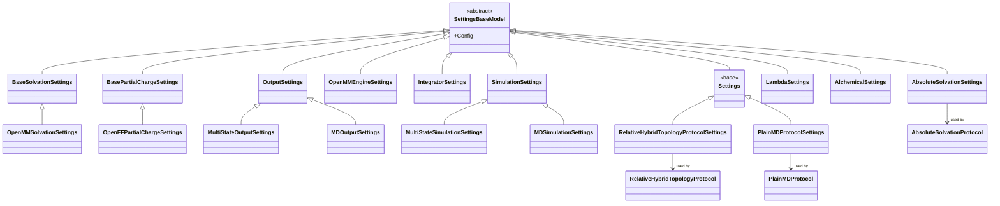
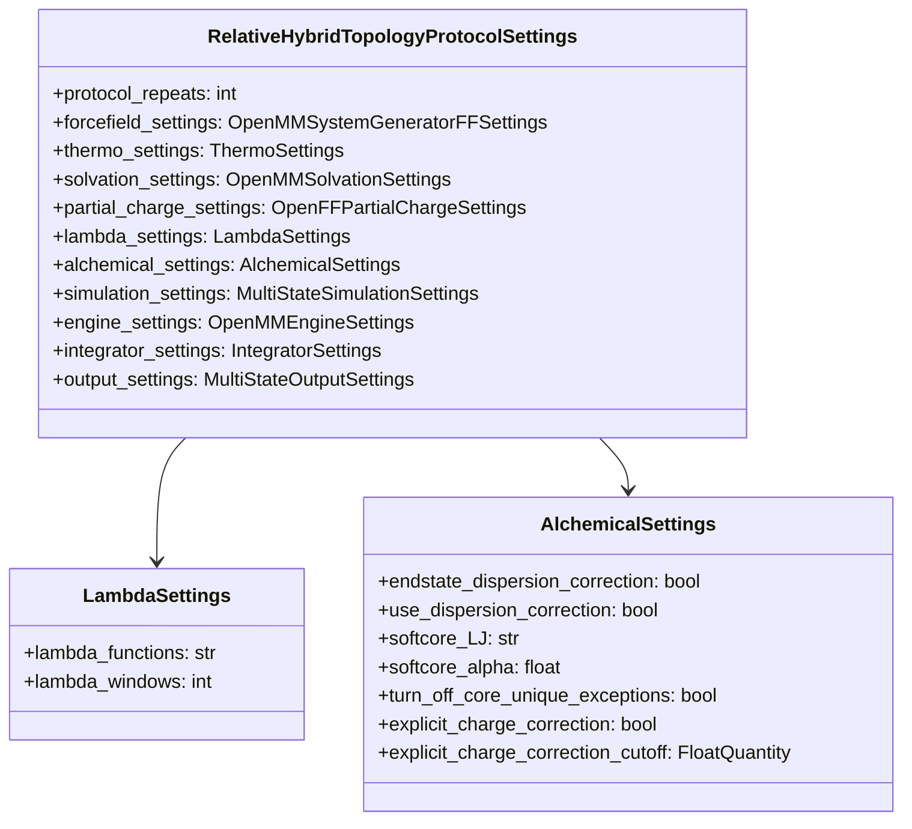
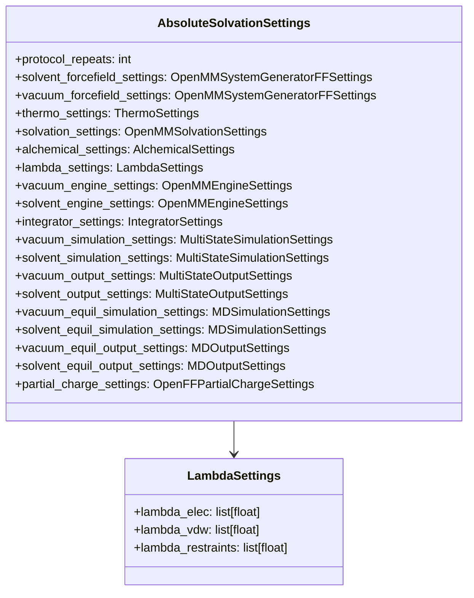
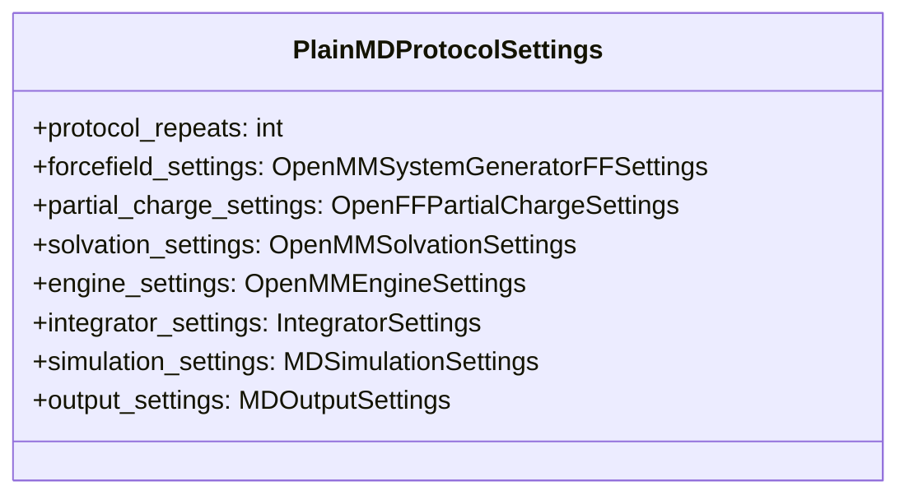
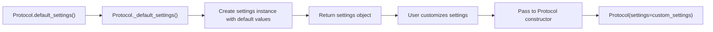
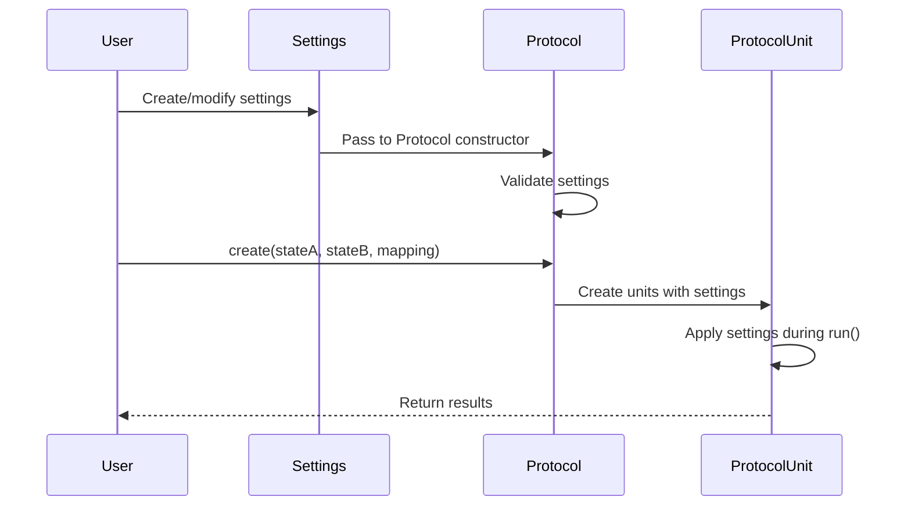

# Protocol Settings and Configuration

<details>
<summary>Relevant source files</summary>

The following files were used as context for generating this wiki page:

- [openfe/protocols/openmm_afe/base.py](openfe/protocols/openmm_afe/base.py)
- [openfe/protocols/openmm_afe/equil_afe_settings.py](openfe/protocols/openmm_afe/equil_afe_settings.py)
- [openfe/protocols/openmm_afe/equil_solvation_afe_method.py](openfe/protocols/openmm_afe/equil_solvation_afe_method.py)
- [openfe/protocols/openmm_md/plain_md_methods.py](openfe/protocols/openmm_md/plain_md_methods.py)
- [openfe/protocols/openmm_md/plain_md_settings.py](openfe/protocols/openmm_md/plain_md_settings.py)
- [openfe/protocols/openmm_rfe/equil_rfe_methods.py](openfe/protocols/openmm_rfe/equil_rfe_methods.py)
- [openfe/protocols/openmm_rfe/equil_rfe_settings.py](openfe/protocols/openmm_rfe/equil_rfe_settings.py)
- [openfe/protocols/openmm_utils/charge_generation.py](openfe/protocols/openmm_utils/charge_generation.py)
- [openfe/protocols/openmm_utils/omm_settings.py](openfe/protocols/openmm_utils/omm_settings.py)
- [openfe/tests/conftest.py](openfe/tests/conftest.py)
- [openfe/tests/protocols/openmm_ahfe/test_ahfe_protocol.py](openfe/tests/protocols/openmm_ahfe/test_ahfe_protocol.py)
- [openfe/tests/protocols/openmm_md/test_plain_md_protocol.py](openfe/tests/protocols/openmm_md/test_plain_md_protocol.py)
- [openfe/tests/protocols/openmm_rfe/test_hybrid_top_protocol.py](openfe/tests/protocols/openmm_rfe/test_hybrid_top_protocol.py)
- [openfe/tests/protocols/test_openmm_settings.py](openfe/tests/protocols/test_openmm_settings.py)
- [openfe/tests/protocols/test_openmmutils.py](openfe/tests/protocols/test_openmmutils.py)

</details>


This page provides an overview of the settings system in OpenFE and explains how to configure the various simulation protocols. It covers the common settings classes shared across protocols, the protocol-specific settings, and how they relate to each other. For information about specific protocols, see [Core Protocols](#2), [Relative Free Energy Protocol](#2.1), [Absolute Solvation Protocol](#2.2), and [Molecular Dynamics Protocol](#2.3).

## Settings Architecture

The OpenFE settings system is built on a hierarchical structure of settings classes, implemented as Pydantic models for validation and type safety. This architecture allows for consistent configuration across different protocols while accommodating protocol-specific settings.



Sources:
- [openfe/protocols/openmm_utils/omm_settings.py:17-657]()
- [openfe/protocols/openmm_rfe/equil_rfe_settings.py:32-162]()
- [openfe/protocols/openmm_afe/equil_afe_settings.py:39-220]()
- [openfe/protocols/openmm_md/plain_md_settings.py:10-57]()

## Common Settings Classes

These settings classes are shared across multiple protocols and provide configuration for common aspects of simulation setup.

### System Force Field Settings

`OpenMMSystemGeneratorFFSettings` configures the force field parameters used in simulations.

| Field | Type | Description |
|-------|------|-------------|
| forcefields | list[str] | OpenMM-compatible force field XML files |
| nonbonded_method | str | Nonbonded interaction method (e.g., 'PME', 'nocutoff') |
| nonbonded_cutoff | FloatQuantity['nanometer'] | Cutoff distance for nonbonded interactions |
| constraints | str | Constraint type for bonds ('HBonds', 'AllBonds', 'None') |
| hydrogen_mass | FloatQuantity['amu'] | Mass for hydrogen atoms (for hydrogen mass repartitioning) |
| rigid_water | bool | Whether to treat water molecules as rigid bodies |
| ... | ... | ... |

### Thermodynamic Settings

`ThermoSettings` specifies the thermodynamic conditions for simulations.

| Field | Type | Description |
|-------|------|-------------|
| temperature | FloatQuantity['kelvin'] | Temperature of the simulation |
| pressure | FloatQuantity['bar'] | Pressure for NPT simulations |

### Solvation Settings

`OpenMMSolvationSettings` controls how systems are solvated using OpenMM tooling.

| Field | Type | Description |
|-------|------|-------------|
| solvent_model | str | Force field water model ('tip3p', 'spce', 'tip4pew', 'tip5p') |
| solvent_padding | FloatQuantity['nanometer'] | Minimum distance from solute to box edge |
| box_shape | str | Shape of periodic box ('cube', 'dodecahedron', 'octahedron') |
| number_of_solvent_molecules | int | Number of solvent molecules to add |
| box_vectors | ArrayQuantity['nanometer'] | Box vectors in OpenMM reduced form |
| box_size | ArrayQuantity['nanometer'] | X, Y, Z lengths of the unit cell for rectangular box |

### Partial Charge Settings

`OpenFFPartialChargeSettings` configures how partial charges are assigned to molecules.

| Field | Type | Description |
|-------|------|-------------|
| partial_charge_method | str | Method for generating partial charges ('am1bcc', 'am1bccelf10', 'nagl', 'espaloma') |
| off_toolkit_backend | str | OpenFF toolkit registry backend ('ambertools', 'openeye', 'rdkit') |
| number_of_conformers | int | Number of conformers for charge calculation |
| nagl_model | str | NAGL model for partial charge assignment |

### Engine Settings

`OpenMMEngineSettings` controls the OpenMM computational backend.

| Field | Type | Description |
|-------|------|-------------|
| compute_platform | str | OpenMM compute platform ('CUDA', 'OpenCL', 'CPU', 'Reference') |
| gpu_device_index | list[int] | GPU device indices for CUDA/OpenCL platforms |

### Integrator Settings

`IntegratorSettings` configures the dynamics integration method.

| Field | Type | Description |
|-------|------|-------------|
| timestep | FloatQuantity['femtosecond'] | Size of the simulation timestep |
| langevin_collision_rate | FloatQuantity['1/picosecond'] | Collision frequency for Langevin dynamics |
| reassign_velocities | bool | Whether to reassign velocities from Maxwell-Boltzmann |
| n_restart_attempts | int | Number of restart attempts on NaN energies |
| constraint_tolerance | float | Tolerance for the constraint solver |
| barostat_frequency | FloatQuantity['timestep'] | Frequency for volume scaling attempts |
| remove_com | bool | Whether to remove center of mass motion |

### Output Settings

Base `OutputSettings` class with extensions for different output requirements:

1. `MultiStateOutputSettings` for alchemical simulations
2. `MDOutputSettings` for standard MD simulations

Common fields:

| Field | Type | Description |
|-------|------|-------------|
| output_indices | str | Selection string for which atoms to write coordinates for |
| checkpoint_interval | FloatQuantity['picosecond'] | Frequency to write checkpoint files |
| checkpoint_storage_filename | str | Filename for checkpoint storage |
| forcefield_cache | str | Filename for caching small molecule templates |

Sources:
- [openfe/protocols/openmm_utils/omm_settings.py:25-435]()
- [openfe/protocols/openmm_rfe/equil_rfe_settings.py:33-82]()
- [openfe/protocols/openmm_afe/equil_afe_settings.py:47-97]()

## Protocol-Specific Settings

Each protocol in OpenFE has its own settings class that combines the common settings with protocol-specific parameters.

### Relative Free Energy Protocol Settings

`RelativeHybridTopologyProtocolSettings` for the `RelativeHybridTopologyProtocol`:



The `RelativeHybridTopologyProtocolSettings` combines all common settings with specific settings for alchemical transformations:

- `protocol_repeats`: Number of independent repeats of the transformation
- `lambda_settings`: Controls the lambda schedule for alchemical transformations
- `alchemical_settings`: Controls the details of the alchemical protocol

Default settings are provided via the protocol's `_default_settings()` method, which creates a reasonable starting configuration that users can customize.

### Absolute Solvation Protocol Settings

`AbsoluteSolvationSettings` for the `AbsoluteSolvationProtocol`:



The `AbsoluteSolvationSettings` maintains separate settings for solvent and vacuum simulations, each with their own force field, engine, simulation, and output settings.

### Plain MD Protocol Settings

`PlainMDProtocolSettings` for the `PlainMDProtocol`:



The `PlainMDProtocolSettings` is the simplest of the protocol settings, focusing on standard MD simulation without alchemical transformations.

Sources:
- [openfe/protocols/openmm_rfe/equil_rfe_settings.py:108-162]()
- [openfe/protocols/openmm_afe/equil_afe_settings.py:112-220]()
- [openfe/protocols/openmm_md/plain_md_settings.py:25-57]()

## Configuring Protocols

Protocols are configured by creating and customizing settings objects, which are then passed to the protocol constructor.

### Settings Validation

The settings classes use Pydantic validators to enforce constraints:
- Type checking is automatic
- Value ranges are validated (e.g., positive values for timesteps)
- Consistency between related settings is enforced
- Unit compatibility is checked

Example validations:
- `LambdaSettings` ensures values are between 0 and 1 and monotonically increasing
- `IntegratorSettings` validates that timesteps are positive and in time units
- `OpenMMSolvationSettings` checks box vectors are in proper format

```python
# Example settings validation
@validator('timestep')
def is_time(cls, v):
    if not v.is_compatible_with(unit.picosecond):
        raise ValueError("timestep must be in time units (i.e. picoseconds)")
    return v

@validator('lambda_elec', 'lambda_vdw', 'lambda_restraints')
def must_be_between_0_and_1(cls, v):
    for window in v:
        if not 0 <= window <= 1:
            raise ValueError(f"Lambda windows must be between 0 and 1, got {window}")
    return v
```

### Default Settings

Each protocol provides default settings through a `_default_settings()` class method:



Example from the `RelativeHybridTopologyProtocol`:

```python
# Modified default settings example
settings = RelativeHybridTopologyProtocol.default_settings()
settings.protocol_repeats = 5
settings.simulation_settings.production_length = 10.0 * unit.nanosecond
settings.forcefield_settings.nonbonded_cutoff = 1.0 * unit.nanometer
settings.solvation_settings.box_shape = 'dodecahedron'

protocol = RelativeHybridTopologyProtocol(settings=settings)
```

Sources:
- [openfe/protocols/openmm_rfe/equil_rfe_methods.py:486-516]()
- [openfe/protocols/openmm_afe/equil_solvation_afe_method.py:410-489]()
- [openfe/protocols/openmm_md/plain_md_methods.py:124-154]()

## Settings Inheritance and Composition

The following diagram shows how settings are composed within protocol settings classes:

```mermaid
flowchart TD
    subgraph "Protocol Settings"
        RHT["RelativeHybridTopologyProtocolSettings"]
        ASP["AbsoluteSolvationSettings"]
        PMD["PlainMDProtocolSettings"]
    end
    
    subgraph "Common Components"
        FF["OpenMMSystemGeneratorFFSettings"]
        TS["ThermoSettings"]
        SS["OpenMMSolvationSettings"]
        PC["OpenFFPartialChargeSettings"]
        IS["IntegratorSettings"]
        ES["OpenMMEngineSettings"]
        MSS["MultiStateSimulationSettings"]
        MS["MDSimulationSettings"]
        MSO["MultiStateOutputSettings"]
        MO["MDOutputSettings"]
    end
    
    subgraph "Alchemical Components"
        LS["LambdaSettings"]
        AS["AlchemicalSettings"]
    end
    
    FF --> RHT
    TS --> RHT
    SS --> RHT
    PC --> RHT
    IS --> RHT
    ES --> RHT
    MSS --> RHT
    MSO --> RHT
    LS --> RHT
    AS --> RHT
    
    FF --> ASP
    TS --> ASP
    SS --> ASP
    PC --> ASP
    IS --> ASP
    ES --> ASP
    MSS --> ASP
    MS --> ASP
    MSO --> ASP
    MO --> ASP
    LS --> ASP
    AS --> ASP
    
    FF --> PMD
    TS --> PMD
    SS --> PMD
    PC --> PMD
    IS --> PMD
    ES --> PMD
    MS --> PMD
    MO --> PMD
```



Sources:
- [openfe/protocols/openmm_rfe/equil_rfe_settings.py:108-162]()
- [openfe/protocols/openmm_afe/equil_afe_settings.py:112-220]()
- [openfe/protocols/openmm_md/plain_md_settings.py:25-57]()

## Protocol Creation with Settings

The settings defined above are used when creating protocol objects and executing simulations:



Sources:
- [openfe/protocols/openmm_rfe/equil_rfe_methods.py:518-561]()
- [openfe/protocols/openmm_afe/equil_solvation_afe_method.py:498-534]()
- [openfe/protocols/openmm_md/plain_md_methods.py:156-203]()

## Conclusion

The OpenFE settings system provides a comprehensive and flexible framework for configuring simulation protocols. The hierarchical structure allows for both common settings shared across protocols and protocol-specific settings. Each protocol provides reasonable default settings that can be customized to meet specific requirements.

For detailed information about each protocol, refer to the specific protocol documentation pages: [Relative Free Energy Protocol](#2.1), [Absolute Solvation Protocol](#2.2), and [Molecular Dynamics Protocol](#2.3).

---