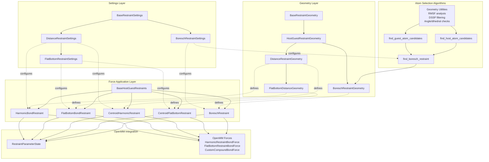
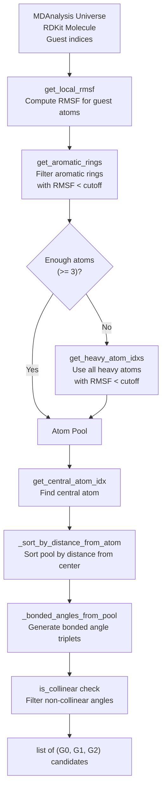
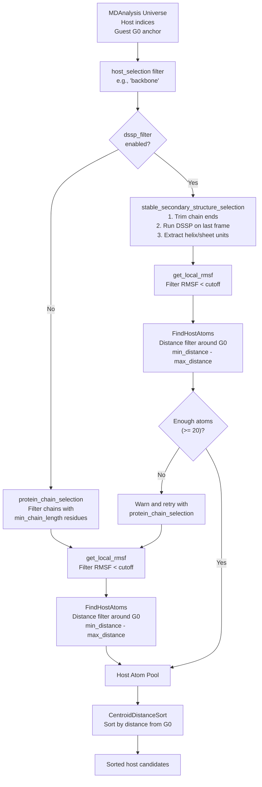
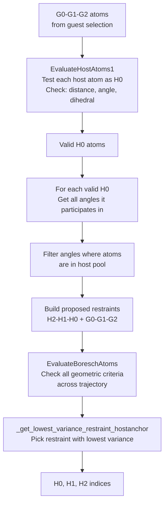
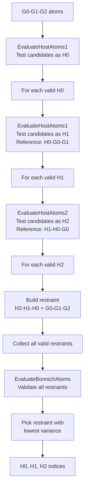
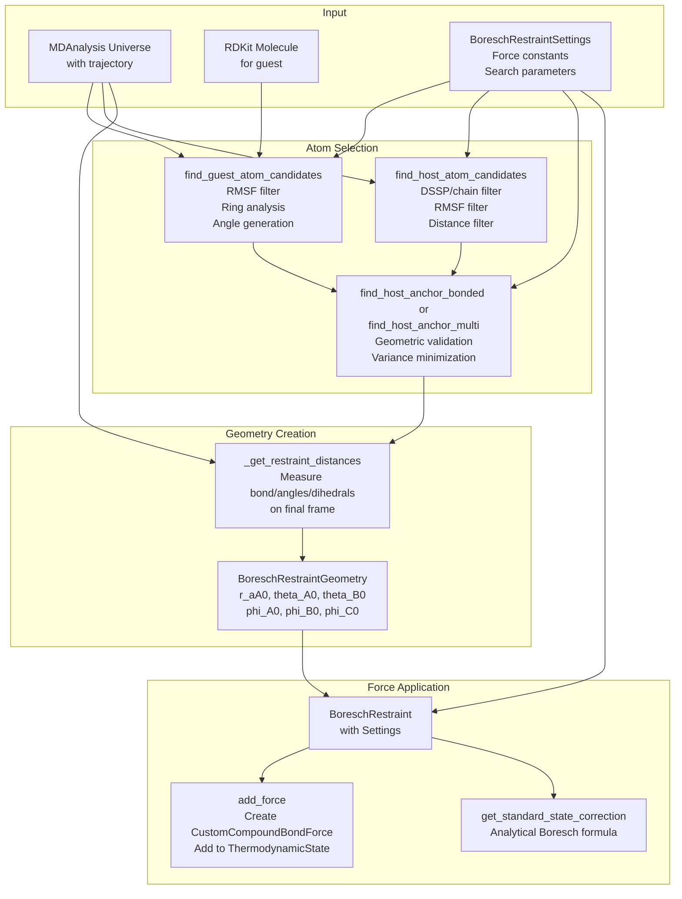
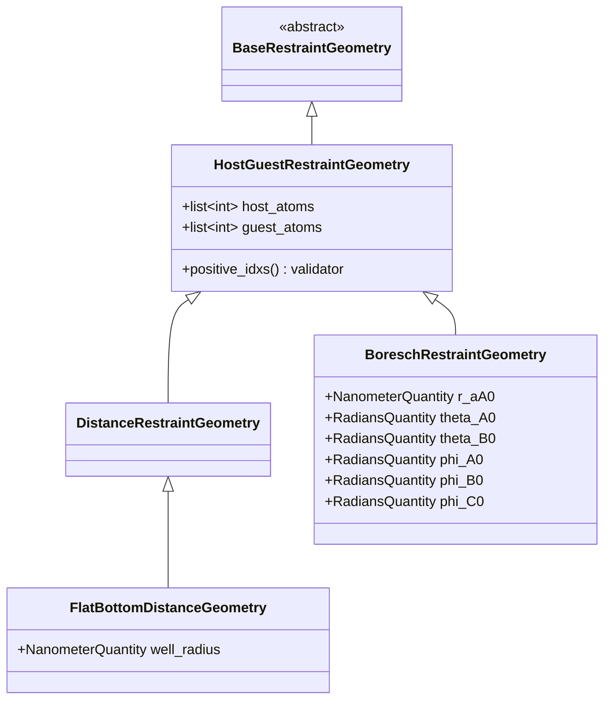

# Restraint Systems

<details>
<summary>Relevant source files</summary>

The following files were used as context for generating this wiki page:

- [openfe/protocols/restraint_utils/geometry/__init__.py](openfe/protocols/restraint_utils/geometry/__init__.py)
- [openfe/protocols/restraint_utils/geometry/base.py](openfe/protocols/restraint_utils/geometry/base.py)
- [openfe/protocols/restraint_utils/geometry/boresch/__init__.py](openfe/protocols/restraint_utils/geometry/boresch/__init__.py)
- [openfe/protocols/restraint_utils/geometry/boresch/geometry.py](openfe/protocols/restraint_utils/geometry/boresch/geometry.py)
- [openfe/protocols/restraint_utils/geometry/boresch/guest.py](openfe/protocols/restraint_utils/geometry/boresch/guest.py)
- [openfe/protocols/restraint_utils/geometry/boresch/host.py](openfe/protocols/restraint_utils/geometry/boresch/host.py)
- [openfe/protocols/restraint_utils/geometry/flatbottom.py](openfe/protocols/restraint_utils/geometry/flatbottom.py)
- [openfe/protocols/restraint_utils/geometry/harmonic.py](openfe/protocols/restraint_utils/geometry/harmonic.py)
- [openfe/protocols/restraint_utils/geometry/utils.py](openfe/protocols/restraint_utils/geometry/utils.py)
- [openfe/protocols/restraint_utils/openmm/omm_forces.py](openfe/protocols/restraint_utils/openmm/omm_forces.py)
- [openfe/protocols/restraint_utils/openmm/omm_restraints.py](openfe/protocols/restraint_utils/openmm/omm_restraints.py)
- [openfe/protocols/restraint_utils/settings.py](openfe/protocols/restraint_utils/settings.py)

</details>


## Purpose and Scope

This document describes the restraint utilities in OpenFE, which provide tools for defining and applying physical restraints between molecules during alchemical free energy simulations. Restraints are commonly used in binding free energy calculations to prevent unbinding during simulations and require standard state corrections to obtain meaningful thermodynamic results.

The restraint system consists of three main components:
1. **Geometry classes** that define which atoms are restrained and their equilibrium values
2. **Settings classes** that specify force constants and algorithmic parameters
3. **Force application classes** that add restraints to OpenMM systems and compute standard state corrections

For information about how restraints are used within specific protocols, see [Relative Free Energy Protocols](#2.1). For settings configuration, see [Protocol Settings and Configuration](#2.5).

---

## System Architecture

### Component Organization



**Sources:**
- [openfe/protocols/restraint_utils/settings.py:27-204]()
- [openfe/protocols/restraint_utils/geometry/base.py:16-51]()
- [openfe/protocols/restraint_utils/openmm/omm_restraints.py:54-686]()

---

## Restraint Types

OpenFE supports three primary restraint types, each suited to different simulation scenarios:

### Comparison Table

| Restraint Type | Use Case | Force Application | Atom Requirements | Standard State Correction |
|---|---|---|---|---|
| **Harmonic Bond** | Simple distance restraints between pairs | Single bond or centroid | 1-1 (bond) or N-N (centroid) | Analytical (radial) |
| **Flat-Bottom** | Allow flexibility within radius | Harmonic beyond cutoff | 1-1 (bond) or N-N (centroid) | Analytical (radial) |
| **Boresch** | Binding free energy calculations | 1 bond + 2 angles + 3 dihedrals | Exactly 3 host + 3 guest atoms | Analytical (Boresch formula) |

**Sources:**
- [openfe/protocols/restraint_utils/openmm/omm_restraints.py:283-686]()

---

### Harmonic Distance Restraints

Harmonic restraints apply a simple harmonic potential between atoms or centroids.

#### Force Classes

**HarmonicBondRestraint** (`HarmonicBondRestraint`)
- Applies harmonic restraint between two individual atoms
- Uses `openmmtools.forces.HarmonicRestraintBondForce`
- Energy: `0.5 * k * (r - r0)^2`

**CentroidHarmonicRestraint** (`CentroidHarmonicRestraint`)
- Applies harmonic restraint between centroids of atom groups
- Uses `openmmtools.forces.HarmonicRestraintForce`
- Allows restraining multi-atom groups (e.g., protein binding site to ligand center)

#### Configuration

```python
# Settings
DistanceRestraintSettings(
    spring_constant=2.5 * unit.kilojoule_per_mole / unit.nanometer**2,
    host_atoms=[100, 101, 102],  # Optional: manual atom selection
    guest_atoms=[5, 6, 7],
    central_atoms_only=False  # If True, restrains only central atoms
)

# Geometry
DistanceRestraintGeometry(
    host_atoms=[100, 101, 102],
    guest_atoms=[5, 6, 7]
)
```

**Sources:**
- [openfe/protocols/restraint_utils/openmm/omm_restraints.py:283-327]()
- [openfe/protocols/restraint_utils/openmm/omm_restraints.py:380-424]()
- [openfe/protocols/restraint_utils/settings.py:35-70]()
- [openfe/protocols/restraint_utils/geometry/harmonic.py:20-102]()

---

### Flat-Bottom Distance Restraints

Flat-bottom restraints have zero energy within a specified radius and become harmonic beyond that radius.

#### Energy Function

- `E = 0` when `r < well_radius`
- `E = 0.5 * k * (r - well_radius)^2` when `r >= well_radius`

This allows flexibility within the binding site while preventing complete dissociation.

#### Force Classes

**FlatBottomBondRestraint** (`FlatBottomBondRestraint`)
- Single atom-to-atom restraint
- Uses `openmmtools.forces.FlatBottomRestraintBondForce`

**CentroidFlatBottomRestraint** (`CentroidFlatBottomRestraint`)
- Centroid-to-centroid restraint
- Uses `openmmtools.forces.FlatBottomRestraintForce`

#### Automatic Well Radius Determination

The `get_flatbottom_distance_restraint` function analyzes trajectory COM distances:


**Sources:**
- [openfe/protocols/restraint_utils/openmm/omm_restraints.py:329-378]()
- [openfe/protocols/restraint_utils/openmm/omm_restraints.py:426-474]()
- [openfe/protocols/restraint_utils/settings.py:72-90]()
- [openfe/protocols/restraint_utils/geometry/flatbottom.py:24-128]()

---

### Boresch-Style Restraints

Boresch restraints provide orientation-specific restraints suitable for binding free energy calculations. They restrain 1 distance, 2 angles, and 3 dihedrals between six atoms.

#### Atom Definitions

```
H2                         G2
 -                        -
  -                      -
   H1 - - H0 -- G0 - - G1
```

Where:
- **H0, H1, H2**: Three host atoms (e.g., protein backbone atoms)
- **G0, G1, G2**: Three guest atoms (e.g., ligand heavy atoms)

#### Restrained Degrees of Freedom

| DOF | Atoms | Parameter | Force Constant Setting |
|---|---|---|---|
| Distance | H0-G0 | `r_aA0` | `K_r` |
| Angle 1 | H1-H0-G0 | `theta_A0` | `K_thetaA` |
| Angle 2 | H0-G0-G1 | `theta_B0` | `K_thetaB` |
| Dihedral 1 | H2-H1-H0-G0 | `phi_A0` | `K_phiA` |
| Dihedral 2 | H1-H0-G0-G1 | `phi_B0` | `K_phiB` |
| Dihedral 3 | H0-G0-G1-G2 | `phi_C0` | `K_phiC` |

#### Energy Function

Implemented as `openmm.CustomCompoundBondForce` with energy function:

```
E = (K_r/2)*(distance(p3,p4) - r_aA0)^2
  + (K_thetaA/2)*(angle(p2,p3,p4)-theta_A0)^2 
  + (K_thetaB/2)*(angle(p3,p4,p5)-theta_B0)^2
  + (K_phiA/2)*dphi_A^2 + (K_phiB/2)*dphi_B^2 + (K_phiC/2)*dphi_C^2

dphi_X = wrapped_difference(dihedral - phi_X0)
```

Where wrapping ensures proper dihedral periodicity.

**Sources:**
- [openfe/protocols/restraint_utils/openmm/omm_restraints.py:476-686]()
- [openfe/protocols/restraint_utils/openmm/omm_forces.py:16-43]()
- [openfe/protocols/restraint_utils/settings.py:92-204]()
- [openfe/protocols/restraint_utils/geometry/boresch/geometry.py:30-71]()

---

## Atom Selection Algorithms

### Overview

Boresch restraints require careful atom selection to ensure:
1. Atoms are stable (low RMSF)
2. Angles/dihedrals avoid collinearity
3. Geometric constraints are satisfied throughout the simulation

The automatic selection process uses a modified version of the algorithm from Baumann et al. (2023).

### Guest (Ligand) Atom Selection Pipeline



**Key Functions:**
- `find_guest_atom_candidates`: Main entry point for guest atom selection
- `get_local_rmsf`: Computes RMSF with self-alignment
- `get_aromatic_rings`: Identifies aromatic ring systems
- `get_central_atom_idx`: Finds topological center using NetworkX shortest paths

**Sources:**
- [openfe/protocols/restraint_utils/geometry/boresch/guest.py:172-247]()
- [openfe/protocols/restraint_utils/geometry/utils.py:520-551]()
- [openfe/protocols/restraint_utils/geometry/utils.py:76-107]()
- [openfe/protocols/restraint_utils/geometry/utils.py:146-187]()

---

### Host (Protein) Atom Selection Pipeline



**Key Classes and Functions:**
- `find_host_atom_candidates`: Main entry point for host atom filtering
- `stable_secondary_structure_selection`: DSSP-based filtering for stable structures
- `protein_chain_selection`: Fallback filtering by chain length
- `FindHostAtoms`: MDAnalysis-based distance filtering
- `CentroidDistanceSort`: Sort atoms by distance from reference

**Sources:**
- [openfe/protocols/restraint_utils/geometry/boresch/host.py:83-197]()
- [openfe/protocols/restraint_utils/geometry/utils.py:577-716]()
- [openfe/protocols/restraint_utils/geometry/utils.py:718-790]()
- [openfe/protocols/restraint_utils/geometry/utils.py:452-517]()
- [openfe/protocols/restraint_utils/geometry/utils.py:391-450]()

---

### Host Anchor Selection Strategies

OpenFE supports two strategies for selecting the H0-H1-H2 host atoms:

#### 1. Bonded Strategy (`anchor_finding_strategy="bonded"`)

Selects host atoms that are bonded to each other (typically within the same residue).



**Advantages:** Atoms are guaranteed to be bonded (chemically stable), typically same residue.

**Sources:**
- [openfe/protocols/restraint_utils/geometry/boresch/host.py:621-694]()

---

#### 2. Multi-Residue Strategy (`anchor_finding_strategy="multi-residue"`)

Allows host atoms to span multiple residues for more flexibility.



**Advantages:** More candidate combinations, potentially more stable geometries.

**Sources:**
- [openfe/protocols/restraint_utils/geometry/boresch/host.py:696-790]()

---

### Geometric Validation

All proposed restraints undergo rigorous validation:

**Collinearity Check** (`is_collinear`)
- Ensures sequential atoms are not collinear
- Uses normalized dot product of vectors
- Threshold: `|dot(v1, v2)| < 0.9`

**Angle Bounds Check** (`check_angle_not_flat`)
- Ensures angles are not near 0° or 180°
- Energy criterion: `0.5 * k * (θ - θ_flat)^2 > 10 kT`
- Prevents numerical instability

**Angle Variance Check** (`check_angular_variance`)
- Ensures angles don't vary too much across trajectory
- Uses circular variance statistics
- Width threshold: 1.745 radians (≈100°) for angles, 5.23 radians (≈300°) for dihedrals

**Dihedral Bounds Check** (`check_dihedral_bounds`)
- Default: `-2.618 < φ < 2.618` radians (≈-150° to 150°)
- Wrapped to [-π, π] before checking

**Sources:**
- [openfe/protocols/restraint_utils/geometry/utils.py:189-247]()
- [openfe/protocols/restraint_utils/geometry/utils.py:271-316]()
- [openfe/protocols/restraint_utils/geometry/utils.py:353-389]()
- [openfe/protocols/restraint_utils/geometry/utils.py:318-351]()
- [openfe/protocols/restraint_utils/geometry/boresch/host.py:199-332]()

---

## Force Application and Lambda Control

### RestraintParameterState

The `RestraintParameterState` class enables lambda-controlled restraint scaling:

```python
class RestraintParameterState(GlobalParameterState):
    lambda_restraints = GlobalParameter("lambda_restraints", standard_value=1.0)
    
    # Validator ensures 0.0 <= lambda_restraints <= 1.0
```

- `lambda_restraints = 1.0`: Fully active restraint
- `lambda_restraints = 0.0`: Inactive restraint
- Intermediate values: Partial restraint (for gradual insertion/removal)

**Sources:**
- [openfe/protocols/restraint_utils/openmm/omm_restraints.py:54-89]()

---

### Adding Forces to OpenMM Systems

All restraint classes implement two key methods:

#### `add_force` Method


The `add_force_in_separate_group` utility ensures the restraint is evaluated in its own force group (required for proper energy decomposition).

**Sources:**
- [openfe/protocols/restraint_utils/openmm/omm_restraints.py:130-151]()
- [openfe/protocols/restraint_utils/openmm/omm_restraints.py:220-247]()
- [openfe/protocols/restraint_utils/openmm/omm_forces.py:93-133]()

---

#### `get_standard_state_correction` Method

Computes the free energy correction needed to account for the restraint's effect on the standard state.

**Radially Symmetric Restraints** (Harmonic, Flat-bottom):
- Uses analytical formula from `openmmtools`
- Depends on system volume and force constant
- Returns correction in kJ/mol

**Boresch Restraints:**

Uses the analytical formula from Boresch et al. (2003):

```
ΔG = -kT * ln[(8π²V°)/(r²sinθ_A sinθ_B) * sqrt(K_r K_θA K_θB K_φA K_φB K_φC) / (2πkT)³]
```

Where:
- `V° = 1.66053928 nm³` (standard concentration)
- `r, θ_A, θ_B` are equilibrium geometry values
- `K_r, K_θ, K_φ` are force constants

**Sources:**
- [openfe/protocols/restraint_utils/openmm/omm_restraints.py:248-278]()
- [openfe/protocols/restraint_utils/openmm/omm_restraints.py:629-685]()

---

## Complete Boresch Restraint Workflow

### End-to-End Process



**Sources:**
- [openfe/protocols/restraint_utils/geometry/boresch/geometry.py:135-317]()
- [openfe/protocols/restraint_utils/openmm/omm_restraints.py:476-686]()

---

## Settings Configuration Reference

### DistanceRestraintSettings

| Parameter | Type | Description | Default |
|---|---|---|---|
| `spring_constant` | SpringConstantLinearQuantity | Force constant in kJ/mol/nm² | **Required** |
| `host_atoms` | Optional[list[int]] | Manual host atom selection | `None` (auto-select) |
| `guest_atoms` | Optional[list[int]] | Manual guest atom selection | `None` (auto-select) |
| `central_atoms_only` | bool | Use only central atoms | `False` |

**Sources:**
- [openfe/protocols/restraint_utils/settings.py:35-70]()

---

### FlatBottomRestraintSettings

Extends `DistanceRestraintSettings` with:

| Parameter | Type | Description | Default |
|---|---|---|---|
| `well_radius` | NanometerQuantity | Flat-bottom radius in nm | `None` (auto-calculate) |

**Sources:**
- [openfe/protocols/restraint_utils/settings.py:72-90]()

---

### BoreschRestraintSettings

| Parameter | Type | Description | Default |
|---|---|---|---|
| `K_r` | SpringConstantLinearQuantity | Bond force constant | 4184.0 kJ/mol/nm² (10 kcal/mol/Ų) |
| `K_thetaA` | SpringConstantAngularQuantity | Angle A force constant | 334.72 kJ/mol/rad² (80 kcal/mol/rad²) |
| `K_thetaB` | SpringConstantAngularQuantity | Angle B force constant | 334.72 kJ/mol/rad² |
| `K_phiA` | SpringConstantAngularQuantity | Dihedral A force constant | 334.72 kJ/mol/rad² |
| `K_phiB` | SpringConstantAngularQuantity | Dihedral B force constant | 334.72 kJ/mol/rad² |
| `K_phiC` | SpringConstantAngularQuantity | Dihedral C force constant | 334.72 kJ/mol/rad² |

**Search Algorithm Parameters:**

| Parameter | Type | Description | Default |
|---|---|---|---|
| `host_selection` | str | MDAnalysis selection for host | `"backbone"` |
| `dssp_filter` | bool | Apply DSSP secondary structure filter | `True` |
| `rmsf_cutoff` | NanometerQuantity | Maximum allowed RMSF | 0.1 nm |
| `host_min_distance` | NanometerQuantity | Min distance from G0 to host | 0.5 nm |
| `host_max_distance` | NanometerQuantity | Max distance from G0 to host | 1.5 nm |
| `anchor_finding_strategy` | Literal["multi-residue", "bonded"] | Host anchor search strategy | `"bonded"` |

**Sources:**
- [openfe/protocols/restraint_utils/settings.py:92-204]()

---

## Geometry Classes Reference

### Class Hierarchy



All geometry classes are Pydantic models that store:
1. **Atom indices**: Which atoms participate in the restraint
2. **Equilibrium values**: Target bond lengths, angles, dihedrals
3. **Validation**: Ensures all indices are non-negative

**Sources:**
- [openfe/protocols/restraint_utils/geometry/base.py:16-51]()
- [openfe/protocols/restraint_utils/geometry/harmonic.py:20-24]()
- [openfe/protocols/restraint_utils/geometry/flatbottom.py:24-31]()
- [openfe/protocols/restraint_utils/geometry/boresch/geometry.py:30-71]()

---

## Utility Functions

### Structural Analysis

**get_local_rmsf** (`get_local_rmsf`)
- Computes RMSF with trajectory aligned to itself
- Uses `NoJump` transformation to unwrap coordinates
- Uses `Aligner` from `openfe_analysis` for self-alignment
- Returns RMSF values in Ångströms

**stable_secondary_structure_selection** (`stable_secondary_structure_selection`)
- Uses MDAnalysis DSSP to classify secondary structure
- Filters for stable helices and β-sheets
- Trims chain and structure ends to avoid artifacts
- Selectable via `dssp_filter=True` in Boresch settings

**protein_chain_selection** (`protein_chain_selection`)
- Selects protein chains by minimum residue count
- Trims chain ends by specified amounts
- Fallback when DSSP filtering is too restrictive

**Sources:**
- [openfe/protocols/restraint_utils/geometry/utils.py:520-551]()
- [openfe/protocols/restraint_utils/geometry/utils.py:577-716]()
- [openfe/protocols/restraint_utils/geometry/utils.py:718-790]()

---

### Distance and Geometry Filtering

**FindHostAtoms** (`FindHostAtoms`)
- MDAnalysis AnalysisBase subclass
- Filters atoms by distance from reference across trajectory
- Uses `capped_distance` for efficient periodic boundary handling
- Returns intersection of atoms within distance range for all frames

**CentroidDistanceSort** (`CentroidDistanceSort`)
- Sorts atoms by mean distance from reference centroid
- Uses center of geometry across trajectory
- Returns sorted `AtomGroup`

**Sources:**
- [openfe/protocols/restraint_utils/geometry/utils.py:452-517]()
- [openfe/protocols/restraint_utils/geometry/utils.py:391-450]()

---

### Chemical Analysis

**get_aromatic_rings** (`get_aromatic_rings`)
- Identifies aromatic ring systems in RDKit molecules
- Merges fused rings
- Returns list of atom index sets

**get_central_atom_idx** (`get_central_atom_idx`)
- Finds topological center using NetworkX
- Computes all shortest paths
- Returns midpoint of longest shortest path

**get_heavy_atom_idxs** (`get_heavy_atom_idxs`)
- Returns indices of non-hydrogen atoms
- Used as fallback when aromatic filtering is too restrictive

**Sources:**
- [openfe/protocols/restraint_utils/geometry/utils.py:76-107]()
- [openfe/protocols/restraint_utils/geometry/utils.py:146-187]()
- [openfe/protocols/restraint_utils/geometry/utils.py:129-144]()

---

## References

The restraint implementation draws from:

1. **Boresch et al. (2003)**: Original analytical standard state correction formula
   - *J. Phys. Chem. B* 107:9535, doi:10.1021/jp0217839

2. **Baumann et al. (2023)**: Automated Boresch restraint selection algorithm
   - "Broadening the scope of binding free energy calculations using a Separated Topologies approach"

3. **Wu et al. (2025)**: Optimization for production usage
   - "Optimizing Absolute Binding Free Energy Calculations for Production Usage"
   - ChemRxiv doi:10.26434/chemrxiv-2025-q08ld-v2

4. **Yank**: Many utility functions adapted from Yank and OpenMMTools
   - https://github.com/choderalab/yank
   - https://github.com/choderalab/openmmtools

**Sources:**
- [openfe/protocols/restraint_utils/settings.py:114-121]()
- [openfe/protocols/restraint_utils/openmm/omm_restraints.py:1-16]()

---