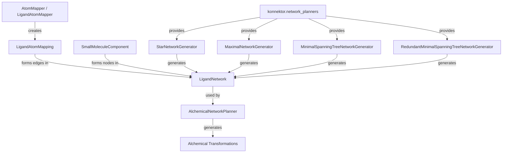
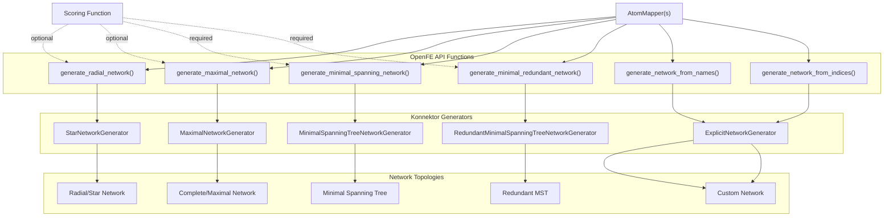
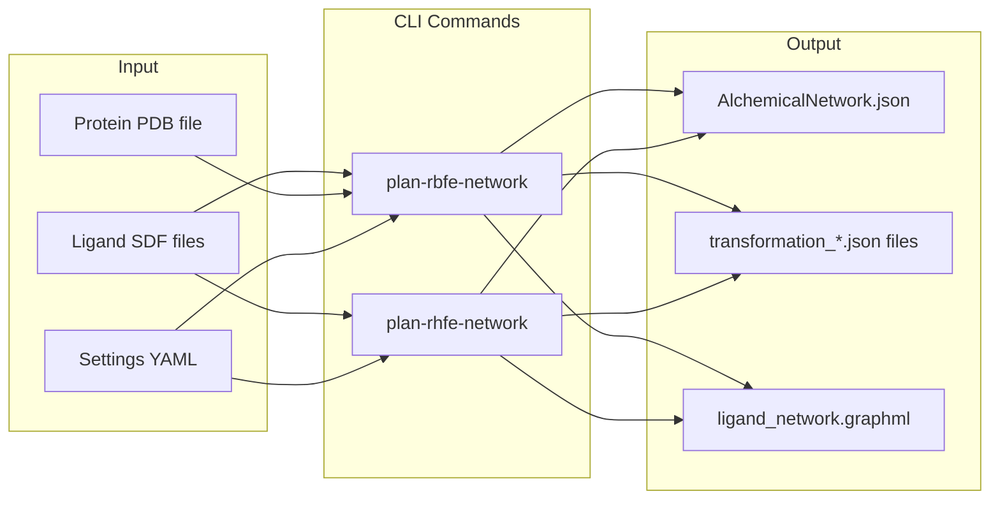

# Network Planning and Mapping

<details>
<summary>Relevant source files</summary>

The following files were used as context for generating this wiki page:

- [openfe/setup/atom_mapping/__init__.py](openfe/setup/atom_mapping/__init__.py)
- [openfe/setup/atom_mapping/ligandatommapper.py](openfe/setup/atom_mapping/ligandatommapper.py)
- [openfe/setup/atom_mapping/lomap_mapper.py](openfe/setup/atom_mapping/lomap_mapper.py)
- [openfe/setup/atom_mapping/lomap_scorers.py](openfe/setup/atom_mapping/lomap_scorers.py)
- [openfe/setup/atom_mapping/perses_mapper.py](openfe/setup/atom_mapping/perses_mapper.py)
- [openfe/setup/atom_mapping/perses_scorers.py](openfe/setup/atom_mapping/perses_scorers.py)
- [openfe/setup/ligand_network_planning.py](openfe/setup/ligand_network_planning.py)
- [openfe/utils/silence_root_logging.py](openfe/utils/silence_root_logging.py)
- [openfecli/commands/generate_partial_charges.py](openfecli/commands/generate_partial_charges.py)
- [openfecli/commands/plan_rbfe_network.py](openfecli/commands/plan_rbfe_network.py)
- [openfecli/commands/plan_rhfe_network.py](openfecli/commands/plan_rhfe_network.py)
- [openfecli/parameters/__init__.py](openfecli/parameters/__init__.py)
- [openfecli/parameters/misc.py](openfecli/parameters/misc.py)
- [openfecli/parameters/plan_network_options.py](openfecli/parameters/plan_network_options.py)
- [openfecli/plan_alchemical_networks_utils.py](openfecli/plan_alchemical_networks_utils.py)
- [openfecli/tests/commands/test_plan_rbfe_network.py](openfecli/tests/commands/test_plan_rbfe_network.py)
- [openfecli/tests/commands/test_plan_rhfe_network.py](openfecli/tests/commands/test_plan_rhfe_network.py)

</details>


## Purpose and Scope

The Network Planning and Mapping system in OpenFE provides tools for creating, manipulating, and analyzing networks of small molecules with atom-to-atom mappings between them. These networks serve as the foundation for alchemical free energy calculations by defining which molecular transformations will be performed.

This page provides an overview of the network planning and mapping components in OpenFE. For detailed information about specific aspects, see [Atom Mapping](#3.1), [Ligand Networks](#3.2), and [Alchemical Network Planning](#3.3).

Sources: [openfe/setup/__init__.py:5-14](), [openfe/setup/ligand_network_planning.py:1-20]()

## Key Components

The network planning and mapping system consists of several interconnected components. OpenFE delegates the core network generation algorithms to the `konnektor` library, which provides specialized network planner classes.



**Diagram: Network Planning and Mapping Components with Konnektor Integration**

Sources: [openfe/setup/ligand_network_planning.py:1-24](), [openfe/setup/__init__.py:1-10]()

### Atom Mappers

Atom mappers determine how atoms in one molecule correspond to atoms in another molecule. This mapping defines which atoms will be transformed during an alchemical calculation. OpenFE provides several implementations through the `LigandAtomMapper` abstract base class:

| Mapper Class | Source | Algorithm | Key Parameters |
|--------------|--------|-----------|----------------|
| `LigandAtomMapper` | [openfe/setup/atom_mapping/ligandatommapper.py:11-66]() | Abstract base class | Must implement `_mappings_generator()` |
| `LomapAtomMapper` | [openfe/setup/atom_mapping/lomap_mapper.py:9]() | LOMAP MCS algorithm | `time`, `threed`, `element_change`, `seed` |
| `PersesAtomMapper` | [openfe/setup/atom_mapping/perses_mapper.py:25-111]() | Perses atom mapping | `allow_ring_breaking`, `preserve_chirality`, `use_positions`, `coordinate_tolerance` |
| `KartografAtomMapper` | [openfe/setup/atom_mapping/__init__.py:6]() | Kartograf algorithm | `atom_max_distance`, `atom_map_hydrogens`, `map_exact_ring_matches_only` |

Atom mappers implement the `_mappings_generator()` method ([openfe/setup/atom_mapping/ligandatommapper.py:20-38]()) which yields dictionaries of atom index mappings. These are wrapped into `LigandAtomMapping` objects by the `suggest_mappings()` method ([openfe/setup/atom_mapping/ligandatommapper.py:40-66]()).

Sources: [openfe/setup/atom_mapping/__init__.py:1-10](), [openfe/setup/atom_mapping/ligandatommapper.py:11-66](), [openfe/setup/atom_mapping/perses_mapper.py:25-111]()

### Ligand Networks

A `LigandNetwork` organizes multiple small molecules (represented as `SmallMoleculeComponent` objects) and the mappings between them. The network structure is a graph where:

- Nodes are `SmallMoleculeComponent` objects representing individual molecules
- Edges are `LigandAtomMapping` objects representing atom mappings between molecules

The network defines which transformations are possible and provides a framework for planning alchemical calculations.

Sources: [openfe/setup/__init__.py:11](), [openfe/tests/utils/conftest.py:13-19]()

### Alchemical Network Planners

Alchemical network planners use ligand networks to create plans for alchemical free energy calculations. OpenFE provides two main implementations:

- `RBFEAlchemicalNetworkPlanner`: For relative binding free energy calculations
- `RHFEAlchemicalNetworkPlanner`: For relative hydration free energy calculations

These planners generate a series of alchemical transformations based on the ligand network structure.

Sources: [openfe/setup/__init__.py:14]()

## Network Generation Strategies

OpenFE provides several strategies for generating ligand networks, each with different topological properties. These functions are implemented in `ligand_network_planning.py` and delegate to `konnektor.network_planners` classes for the actual network generation.



**Diagram: Network Generation Strategies and Konnektor Integration**

| Function | Konnektor Class | Line Reference | Use Case |
|----------|----------------|----------------|----------|
| `generate_radial_network()` | `StarNetworkGenerator` | [openfe/setup/ligand_network_planning.py:49-154]() | All ligands to central hub |
| `generate_maximal_network()` | `MaximalNetworkGenerator` | [openfe/setup/ligand_network_planning.py:157-206]() | All possible pairs |
| `generate_minimal_spanning_network()` | `MinimalSpanningTreeNetworkGenerator` | [openfe/setup/ligand_network_planning.py:208-250]() | Minimum edges, maximum score |
| `generate_minimal_redundant_network()` | `RedundantMinimalSpanningTreeNetworkGenerator` | [openfe/setup/ligand_network_planning.py:252-304]() | Redundant paths for validation |
| `generate_network_from_names()` | `ExplicitNetworkGenerator` | [openfe/setup/ligand_network_planning.py:306-344]() | Custom specified edges |
| `generate_network_from_indices()` | `ExplicitNetworkGenerator` | [openfe/setup/ligand_network_planning.py:346-379]() | Custom specified edges |

Sources: [openfe/setup/ligand_network_planning.py:17-24](), [openfe/setup/ligand_network_planning.py:49-379]()

### Radial Networks

Radial networks (also known as hub-and-spoke or star networks) connect all ligands to a central reference ligand. This approach is useful when comparing multiple ligands to a common reference, such as a lead compound or a wild-type protein.

```python
network = generate_radial_network(
    ligands=ligands,
    central_ligand=central_ligand,
    mappers=mappers,
    scorer=optional_scorer,
    progress=False,
    n_processes=1
)
```

The `central_ligand` parameter can be:
- A `SmallMoleculeComponent` object
- A string matching a ligand's `name` attribute ([openfe/setup/ligand_network_planning.py:117-127]())
- An integer index into the `ligands` list ([openfe/setup/ligand_network_planning.py:109-116]())

Internally, this function creates a `StarNetworkGenerator` from konnektor ([openfe/setup/ligand_network_planning.py:130-139]()) and validates that all ligands are connected to the central hub ([openfe/setup/ligand_network_planning.py:141-153]()).

The function also applies the `_hasten_lomap()` optimization if using `LomapAtomMapper`, which pre-computes a common core to speed up subsequent mappings ([openfe/setup/ligand_network_planning.py:27-46]()).

Sources: [openfe/setup/ligand_network_planning.py:49-154]()

### Maximal Networks

Maximal networks attempt to create connections between all possible pairs of ligands. This provides comprehensive coverage but may include suboptimal transformations.

```python
network = generate_maximal_network(
    ligands=ligands,
    mappers=mappers,
    scorer=optional_scorer,
    progress=True
)
```

Sources: [openfe/setup/ligand_network_planning.py:141-200](), [openfe/tests/setup/test_network_planning.py:200-244]()

### Minimal Spanning Networks

Minimal spanning networks create a connected network with the minimum number of edges while maximizing the total score. This is the most common network topology for free energy calculations, as it provides complete connectivity with minimal computational cost.

```python
network = generate_minimal_spanning_network(
    ligands=ligands,
    mappers=mappers,
    scorer=scoring_function,  # Required for MST
    progress=True,
    n_processes=1
)
```

**Important:** The `scorer` parameter is required (not optional) for minimal spanning networks ([openfe/setup/ligand_network_planning.py:212]()). The scorer function must accept a `LigandAtomMapping` and return a `float`, where higher scores indicate better mappings. The algorithm selects edges to maximize the total network score while maintaining connectivity.

The function delegates to `MinimalSpanningTreeNetworkGenerator` from konnektor ([openfe/setup/ligand_network_planning.py:239-247]()).

Sources: [openfe/setup/ligand_network_planning.py:208-250]()

### Minimal Redundant Networks

Minimal redundant networks add redundancy to ensure each ligand is connected through multiple paths. This provides statistical validation through cycle closure and helps identify inconsistencies in free energy estimates.

```python
network = generate_minimal_redundant_network(
    ligands=ligands,
    mappers=mappers,
    scorer=scoring_function,  # Required
    progress=True,
    mst_num=2,  # Number of minimum spanning trees
    n_processes=1
)
```

The `mst_num` parameter controls the degree of redundancy ([openfe/setup/ligand_network_planning.py:279-283]()):
- `mst_num=2`: Each node connected by two edges (default)
- `mst_num=3`: Each node connected by three edges
- Higher values increase computational cost but improve cycle closure validation

The function delegates to `RedundantMinimalSpanningTreeNetworkGenerator` from konnektor ([openfe/setup/ligand_network_planning.py:293-301]()).

Sources: [openfe/setup/ligand_network_planning.py:252-304]()

### Custom Networks

Custom networks can be created by explicitly specifying connections between ligands. This is useful when domain knowledge suggests specific transformations or when replicating networks from other studies.

```python
# From molecule names
network = generate_network_from_names(
    ligands=ligands,
    mapper=mapper,
    names=[('benzene', 'toluene'), ('toluene', 'phenol')]
)

# From molecule indices
network = generate_network_from_indices(
    ligands=ligands,
    mapper=mapper,
    indices=[(0, 1), (1, 2)]
)
```

Both functions use `ExplicitNetworkGenerator` from konnektor ([openfe/setup/ligand_network_planning.py:339](), [openfe/setup/ligand_network_planning.py:376]()).

**Important validation:**
- `generate_network_from_names()` raises `KeyError` if a ligand name is not found ([openfe/setup/ligand_network_planning.py:331-332]())
- `generate_network_from_names()` raises `ValueError` if multiple ligands have the same name ([openfe/setup/ligand_network_planning.py:333-335]())
- `generate_network_from_indices()` raises `IndexError` if an index is out of bounds ([openfe/setup/ligand_network_planning.py:370-372]())

Sources: [openfe/setup/ligand_network_planning.py:306-379]()

## Integration with External Tools

OpenFE can import networks from other free energy calculation tools by parsing their network specification formats.

### Orion Networks

Networks can be imported from Orion Network Edge Specification (NES) format:

```python
network = load_orion_network(
    ligands=ligands,
    mapper=mapper,
    network_file='network.dat'
)
```

**File Format:** The Orion NES format uses the syntax `ligand1 >> ligand2` to specify edges, with comment lines starting with `#` ([openfe/setup/ligand_network_planning.py:407-411]()). Each edge should be on a separate line. Lines that don't match the expected format raise a `KeyError` ([openfe/setup/ligand_network_planning.py:415-417]()).

Sources: [openfe/setup/ligand_network_planning.py:381-425]()

### FEP+ Networks

Networks can be imported from Schrödinger's FEP+ edges format:

```python
network = load_fepplus_network(
    ligands=ligands,
    mapper=mapper,
    network_file='edges.edges'
)
```

**File Format:** The FEP+ format uses the syntax `hash:hash # name -> name` ([openfe/setup/ligand_network_planning.py:458-464]()). Each line must have exactly 5 space-separated fields. Lines that don't match this format raise a `KeyError` with a descriptive error message ([openfe/setup/ligand_network_planning.py:459-464]()).

Sources: [openfe/setup/ligand_network_planning.py:427-472]()

## CLI Integration and YAML Configuration

OpenFE provides CLI commands that integrate network planning into an automated workflow. The CLI uses YAML configuration files to specify mappers, network algorithms, and other options.

### CLI Commands



**Diagram: CLI Network Planning Commands**

The CLI commands are implemented in:
- **RBFE**: [openfecli/commands/plan_rbfe_network.py:120-256]()
- **RHFE**: [openfecli/commands/plan_rhfe_network.py:97-221]()

### YAML Configuration Structure

The YAML settings file allows customization of network planning without modifying code. The structure is parsed by [openfecli/parameters/plan_network_options.py:55-86]().

```yaml
mapper:
  method: KartografAtomMapper  # or LomapAtomMapper
  settings:
    atom_max_distance: 0.95
    atom_map_hydrogens: true

network:
  method: generate_minimal_spanning_network  # or others
  settings:
    # Network-specific parameters (e.g., mst_num for redundant networks)

partial_charge:
  method: am1bcc  # or nagl, espaloma, am1bccelf10
  settings:
    off_toolkit_backend: ambertools
```

**Mapper Choices** ([openfecli/parameters/plan_network_options.py:134-145]()):
- `"lomap"` or `"lomapatommapper"` → `LomapAtomMapper`
- `"kartograf"` or `"kartografatommapper"` → `KartografAtomMapper`

**Network Choices** ([openfecli/parameters/plan_network_options.py:162-177]()):
- `"generate_radial_network"` or `"radial"`
- `"generate_minimal_spanning_network"` or `"mst"` (default)
- `"generate_minimal_redundant_network"`
- `"generate_maximal_network"`
- `"generate_lomap_network"`

**Partial Charge Methods** ([openfecli/parameters/plan_network_options.py:182-190]()):
- `"am1bcc"`: AM1-BCC via AmberTools (default)
- `"am1bccelf10"`: AM1-BCC via OpenEye (requires license)
- `"nagl"`: Neural network charges via openff-nagl
- `"espaloma"`: Machine learning charges via espaloma

### Workflow Integration

The CLI commands automatically handle:

1. **Charge Assignment**: All molecules are automatically charged before network generation ([openfecli/commands/plan_rbfe_network.py:80-90](), [openfecli/commands/plan_rhfe_network.py:74-84]())
2. **Network Generation**: The specified algorithm generates the ligand network
3. **Alchemical Network Creation**: Protocol settings are applied to each transformation
4. **Output Serialization**: Networks and transformations are saved as JSON files ([openfecli/plan_alchemical_networks_utils.py:10-36]())

The output directory structure is:
```
alchemicalNetwork/
├── alchemicalNetwork.json
├── ligand_network.graphml
└── transformations/
    ├── rbfe_ligA_complex_ligB_complex.json
    ├── rbfe_ligA_solvent_ligB_solvent.json
    └── ...
```

Sources: [openfecli/commands/plan_rbfe_network.py:120-256](), [openfecli/commands/plan_rhfe_network.py:97-221](), [openfecli/parameters/plan_network_options.py:88-202]()

## Common Workflows

### Python API Workflow

```python
from openfe import SmallMoleculeComponent, LomapAtomMapper
from openfe.setup import ligand_network_planning, lomap_scorers

# 1. Load molecules
ligands = [
    SmallMoleculeComponent.from_sdf_file(f)
    for f in ligand_files
]

# 2. Choose mapper and scorer
mapper = LomapAtomMapper(time=20, threed=True)
scorer = lomap_scorers.default_lomap_score

# 3. Generate network
network = ligand_network_planning.generate_minimal_spanning_network(
    ligands=ligands,
    mappers=[mapper],
    scorer=scorer,
    progress=True
)

# 4. Use with alchemical planner
from openfe.setup import RBFEAlchemicalNetworkPlanner
from openfe.protocols import RelativeHybridTopologyProtocol

planner = RBFEAlchemicalNetworkPlanner(
    mappers=[mapper],
    mapping_scorer=scorer,
    ligand_network_planner=ligand_network_planning.generate_minimal_spanning_network,
    protocol=RelativeHybridTopologyProtocol.default_settings()
)

alchemical_network = planner(
    ligands=ligands,
    solvent=solvent,
    protein=protein
)
```

### CLI Workflow

```bash
# 1. Create settings YAML (optional, uses defaults otherwise)
cat > settings.yaml << EOF
mapper:
  method: KartografAtomMapper
  settings:
    atom_max_distance: 0.95

network:
  method: generate_minimal_spanning_network
EOF

# 2. Plan RBFE network
openfecli plan-rbfe-network \
    --molecules ligands/ \
    --protein protein.pdb \
    --settings settings.yaml \
    --output-dir my_network

# 3. Run transformations
openfecli quickrun \
    my_network/transformations/rbfe_ligA_complex_ligB_complex.json \
    --output results/

# 4. Gather results
openfecli gather results/ --report ddg
```

Sources: [openfecli/commands/plan_rbfe_network.py:19-117](), [openfecli/commands/plan_rhfe_network.py:21-94]()

## Scoring Functions and Mapper Optimization

Atom mapping quality can be improved using scoring functions that evaluate mappings. Scoring functions must be callables that accept a `LigandAtomMapping` and return a `float`, where higher values indicate better mappings.

### Predefined Scoring Functions

OpenFE provides scoring functions through two modules:

**LOMAP Scorers** ([openfe/setup/atom_mapping/lomap_scorers.py:1-17]()):
- `default_lomap_score`: Default LOMAP scoring algorithm
- `atomic_number_score`: Penalizes atomic number changes
- `ecr_score`: Electron-withdrawing group score
- `mcsr_score`: Maximum common subgraph ring score
- `mncar_score`: Minimum number of changed atoms in rings
- `tmcsr_score`: Transmuting maximum common subgraph rings
- `hybridization_score`: Penalizes hybridization changes
- `sulfonamides_score`: Sulfonamide-specific scoring
- `heterocycles_score`: Heterocycle-specific scoring
- `transmuting_methyl_into_ring_score`: Methyl to ring penalties
- `transmuting_ring_sizes_score`: Ring size change penalties

**Perses Scorers** ([openfe/setup/atom_mapping/perses_scorers.py:38-122]()):
- `default_perses_scorer`: Default Perses scoring with optional normalization
  - Supports `use_positions` for position-based scoring
  - Supports `normalize` to enable comparison across different molecule pairs

### Custom Scoring Functions

```python
def custom_scorer(mapping: LigandAtomMapping) -> float:
    """Example: Prefer mappings with more atoms mapped"""
    return len(mapping.componentA_to_componentB)

network = generate_minimal_spanning_network(
    ligands=ligands,
    mappers=[mapper1, mapper2],  # Multiple mappers
    scorer=custom_scorer
)
```

When multiple mappers are provided, each mapper generates candidate mappings, and the scorer selects the best mapping for each edge based on the highest score.

Sources: [openfe/setup/atom_mapping/lomap_scorers.py:1-17](), [openfe/setup/atom_mapping/perses_scorers.py:38-122]()

## Network Validation and Analysis

After generating a network, it's important to validate its properties:

- Connectivity: Ensure all nodes are reachable (`network.is_connected()`)
- Edge quality: Check mapping scores and atom count
- Network topology: Analyze the number of edges and their distribution

The `LigandNetwork` class provides methods for extracting and analyzing this information.

Sources: [openfe/tests/setup/test_network_planning.py:307-335]()

---