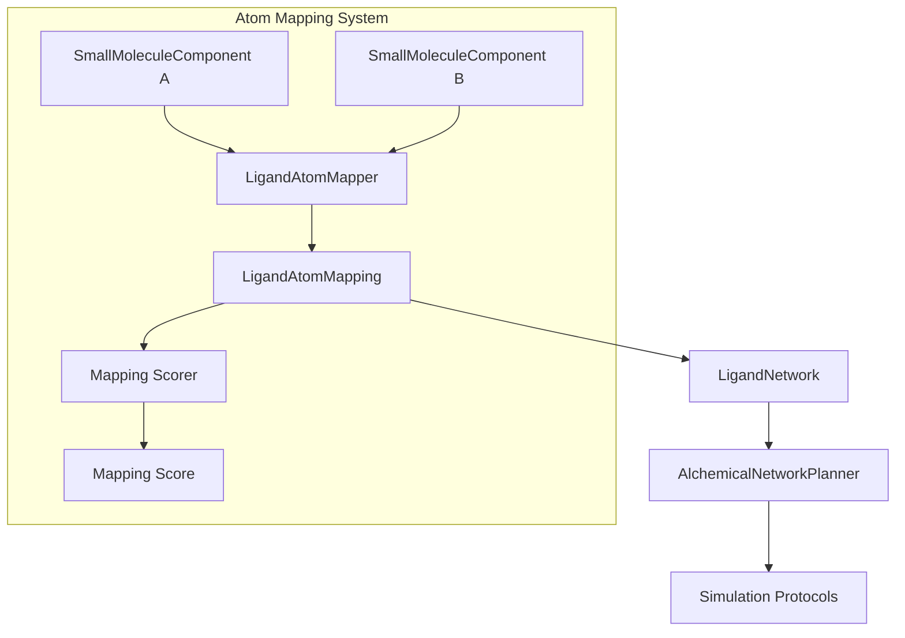
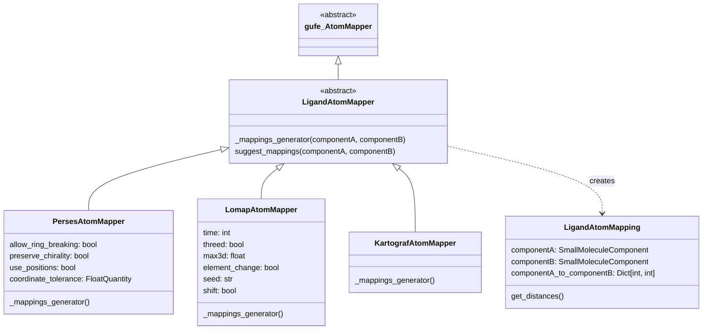
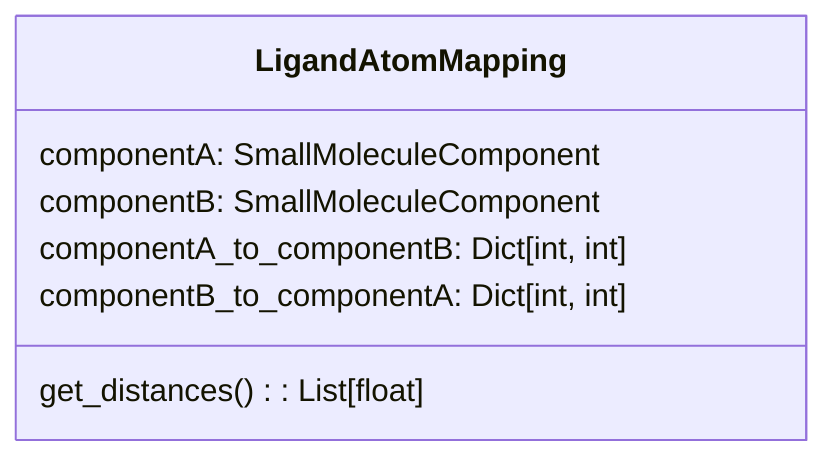
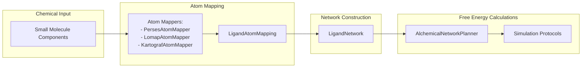

# Atom Mapping

<details>
<summary>Relevant source files</summary>

The following files were used as context for generating this wiki page:

- [openfe/setup/atom_mapping/__init__.py](openfe/setup/atom_mapping/__init__.py)
- [openfe/setup/atom_mapping/ligandatommapper.py](openfe/setup/atom_mapping/ligandatommapper.py)
- [openfe/setup/atom_mapping/lomap_mapper.py](openfe/setup/atom_mapping/lomap_mapper.py)
- [openfe/setup/atom_mapping/lomap_scorers.py](openfe/setup/atom_mapping/lomap_scorers.py)
- [openfe/setup/atom_mapping/perses_mapper.py](openfe/setup/atom_mapping/perses_mapper.py)
- [openfe/setup/atom_mapping/perses_scorers.py](openfe/setup/atom_mapping/perses_scorers.py)
- [openfe/setup/ligand_network_planning.py](openfe/setup/ligand_network_planning.py)
- [openfe/tests/setup/atom_mapping/conftest.py](openfe/tests/setup/atom_mapping/conftest.py)
- [openfe/tests/setup/atom_mapping/test_atommapper.py](openfe/tests/setup/atom_mapping/test_atommapper.py)
- [openfe/tests/setup/atom_mapping/test_lomap_atommapper.py](openfe/tests/setup/atom_mapping/test_lomap_atommapper.py)
- [openfe/tests/setup/atom_mapping/test_lomap_scorers.py](openfe/tests/setup/atom_mapping/test_lomap_scorers.py)
- [openfe/tests/setup/atom_mapping/test_perses_atommapper.py](openfe/tests/setup/atom_mapping/test_perses_atommapper.py)
- [openfe/tests/setup/atom_mapping/test_perses_scorers.py](openfe/tests/setup/atom_mapping/test_perses_scorers.py)
- [openfe/tests/setup/test_network_planning.py](openfe/tests/setup/test_network_planning.py)
- [openfe/utils/silence_root_logging.py](openfe/utils/silence_root_logging.py)

</details>


Atom mapping is a core functionality in OpenFE that establishes correspondences between atoms in different molecules. This is a crucial step for alchemical free energy calculations where one molecule is transformed into another. The atom mapping system provides standardized interfaces for suggesting and evaluating mappings between small molecules.

For information about using atom mappings to construct networks of related molecules, see [Ligand Networks](#3.2). For planning alchemical transformations based on these mappings, see [Alchemical Network Planning](#3.3).

## Atom Mapping Overview

The atom mapping system identifies which atoms in one molecule correspond to which atoms in another molecule. These mappings are used to define the transformations that occur during alchemical simulations, where a molecule is gradually transformed into another.



Sources: [openfe/setup/atom_mapping/ligandatommapper.py:11-61](), [openfe/setup/atom_mapping/perses_mapper.py:26-108]()

## Atom Mapping Architecture

The atom mapping system is built around a few key classes:

1. `LigandAtomMapper` - Abstract base class defining the interface for all atom mappers
2. `LigandAtomMapping` - Class representing a specific mapping between two molecules
3. Concrete mapper implementations - `PersesAtomMapper`, `LomapAtomMapper`, `KartografAtomMapper`
4. Scoring functions - To evaluate mapping quality



Sources: [openfe/setup/atom_mapping/ligandatommapper.py:11-61](), [openfe/setup/atom_mapping/perses_mapper.py:26-108](), [openfe/setup/atom_mapping/__init__.py:1-10]()

## Available Atom Mappers

OpenFE provides multiple atom mapping implementations, each with different algorithms and characteristics:

### PersesAtomMapper

The `PersesAtomMapper` uses the Maximum Common Substructure (MCS) algorithm from the Perses package to suggest atom mappings between molecules.

```python
from openfe.setup.atom_mapping import PersesAtomMapper
from openff.units import unit

# Create a mapper with default settings
mapper = PersesAtomMapper()

# Or customize the behavior
mapper = PersesAtomMapper(
    allow_ring_breaking=False,
    preserve_chirality=True,
    use_positions=True,
    coordinate_tolerance=0.25 * unit.angstrom
)
```

Configuration options:
- `allow_ring_breaking` - Whether to allow mappings that break rings (default: True)
- `preserve_chirality` - Whether mappings must strictly preserve chirality (default: True)
- `use_positions` - Whether to use 3D coordinates in mapping (default: True)
- `coordinate_tolerance` - Tolerance for position-based mapping (default: 0.25 Å)

Sources: [openfe/setup/atom_mapping/perses_mapper.py:26-108]()

### LomapAtomMapper

The `LomapAtomMapper` uses the LOMAP (Lead Optimization Mapper) algorithm for atom mapping. This mapper is particularly suited for drug design applications.

```python
from openfe.setup.atom_mapping import LomapAtomMapper

# Create a mapper with default settings
mapper = LomapAtomMapper()

# Or customize the behavior
mapper = LomapAtomMapper(
    time=20,
    threed=True,
    max3d=1000.0,
    element_change=True,
    seed='',
    shift=True
)
```

Sources: [openfe/setup/atom_mapping/lomap_mapper.py:1-9](), [openfe/tests/setup/atom_mapping/test_lomap_atommapper.py:14-25]()

### KartografAtomMapper

The `KartografAtomMapper` leverages the Kartograf package for atom mapping.

```python
from openfe.setup.atom_mapping import KartografAtomMapper

# Create a mapper
mapper = KartografAtomMapper()
```

Sources: [openfe/setup/atom_mapping/__init__.py:6]()

## Using Atom Mappers

All atom mappers follow the same interface, making them interchangeable in most contexts:

```python
from openfe import SmallMoleculeComponent
from openfe.setup.atom_mapping import PersesAtomMapper

# Create two molecules
moleculeA = SmallMoleculeComponent(...)
moleculeB = SmallMoleculeComponent(...)

# Create a mapper
mapper = PersesAtomMapper()

# Get mappings (generator of LigandAtomMapping objects)
mappings_generator = mapper.suggest_mappings(moleculeA, moleculeB)

# Get the first mapping
try:
    mapping = next(mappings_generator)
    print(f"Found mapping with {len(mapping.componentA_to_componentB)} atoms mapped")
except StopIteration:
    print("No mapping found between molecules")
```

The `suggest_mappings` method returns a generator of `LigandAtomMapping` objects, each representing a possible mapping between the molecules. If no mappings are found, the generator will be empty.

Sources: [openfe/setup/atom_mapping/ligandatommapper.py:38-61](), [openfe/tests/setup/atom_mapping/test_perses_atommapper.py:11-38]()

## Mapping Scoring

OpenFE provides scoring functions to evaluate the quality of atom mappings. Different scoring approaches highlight different aspects of mapping quality.

### Perses Scorer

The Perses scorer evaluates mappings based on the number of mapped atoms and optionally their positions:

```python
from openfe.setup.atom_mapping import perses_scorers

# Score a mapping
score = perses_scorers.default_perses_scorer(
    mapping,
    use_positions=False,
    normalize=True
)
```

Sources: [openfe/setup/atom_mapping/perses_scorers.py:38-111]()

### LOMAP Scorers

LOMAP provides multiple scoring functions for different aspects of mapping quality:

```python
from openfe.setup.atom_mapping import lomap_scorers

# Default LOMAP score (combination of multiple criteria)
score = lomap_scorers.default_lomap_score(mapping)

# Individual scoring functions
mcsr_score = lomap_scorers.mcsr_score(mapping)  # Maximum Common Substructure Ratio
mncar_score = lomap_scorers.mncar_score(mapping)  # Maximum Number of Common Atoms Ratio
atomic_number_score = lomap_scorers.atomic_number_score(mapping)  # Atomic number matching
hybridization_score = lomap_scorers.hybridization_score(mapping)  # Hybridization state matching
sulfonamides_score = lomap_scorers.sulfonamides_score(mapping)  # Sulfonamide groups penalty
```

Sources: [openfe/setup/atom_mapping/lomap_scorers.py:1-17](), [openfe/tests/setup/atom_mapping/test_lomap_scorers.py:62-276]()

## LigandAtomMapping Structure

The `LigandAtomMapping` class represents a specific mapping between two molecules:



The mapping is represented as a dictionary where:
- Keys are atom indices in the first molecule (`componentA`)
- Values are corresponding atom indices in the second molecule (`componentB`)

The `get_distances` method calculates the 3D distances between mapped atoms, which can be useful for evaluating mapping quality.

Sources: [openfe/tests/setup/atom_mapping/test_lomap_atommapper.py:42-59](), [openfe/tests/utils/conftest.py:33-36]()

## Implementation Details

### LigandAtomMapper Base Class

The `LigandAtomMapper` is an abstract base class that defines the interface for all atom mappers:

```python
class LigandAtomMapper(gufe.AtomMapper):
    """
    Suggest atom mappings between two :class:`SmallMoleculeComponent` instances.

    Subclasses will typically implement the ``_mappings_generator`` method,
    which returns an iterable of :class:`.LigandAtomMapping` suggestions.
    """
    @abc.abstractmethod
    def _mappings_generator(self,
                            componentA: SmallMoleculeComponent,
                            componentB: SmallMoleculeComponent
                            ) -> Iterable[dict[int, int]]:
        """
        Suggest mapping options for the input molecules.

        Parameters
        ----------
        componentA, componentB : rdkit.Mol
            the two molecules to create a mapping for

        Returns
        -------
        Iterable[dict[int, int]] :
            an iterable over proposed mappings from componentA to componentB
        """
        ...

    def suggest_mappings(self, componentA: SmallMoleculeComponent,
                         componentB: SmallMoleculeComponent
    ) -> Iterable[LigandAtomMapping]:
        """
        Suggest :class:`.LigandAtomMapping` options for the input molecules.

        Parameters
        ---------
        componentA, componentB : :class:`.SmallMoleculeComponent`
            the two molecules to create a mapping for

        Returns
        -------
        Iterable[LigandAtomMapping] :
            an iterable over proposed mappings
        """
        for map_dct in self._mappings_generator(componentA, componentB):
            yield LigandAtomMapping(componentA, componentB, map_dct)
```

Concrete implementations need to provide the `_mappings_generator` method, which yields dictionaries mapping atom indices from the first molecule to the second. The base class takes care of wrapping these dictionaries in `LigandAtomMapping` objects.

Sources: [openfe/setup/atom_mapping/ligandatommapper.py:11-61]()

### PersesAtomMapper Implementation

The `PersesAtomMapper` uses the Perses package's Maximum Common Substructure algorithm:

```python
class PersesAtomMapper(LigandAtomMapper):
    def _mappings_generator(self, componentA, componentB):
        # Construct Perses Mapper
        _atom_mapper = AtomMapper(
            use_positions=self.use_positions,
            coordinate_tolerance=to_openmm(self.coordinate_tolerance),
            allow_ring_breaking=self.allow_ring_breaking)

        # Try generating a mapping
        try:
            _atom_mappings = _atom_mapper.get_all_mappings(
                    old_mol=componentA.to_openff(), new_mol=componentB.to_openff())
        except InvalidMappingException:
            return

        # Catch empty mappings here
        if _atom_mappings is None:
            return

        # Post processing
        if self.preserve_chirality:
            for x in _atom_mappings:
                x.preserve_chirality()

        # Translate mapping objects
        mapping_dict = (x.old_to_new_atom_map for x in _atom_mappings)

        yield from mapping_dict
```

The mapper converts the molecules to OpenFF format, uses the Perses mapper to generate mappings, and then yields each mapping.

Sources: [openfe/setup/atom_mapping/perses_mapper.py:82-108]()

## Integration with the OpenFE Workflow

Atom mapping is a key step in the OpenFE workflow for free energy calculations:



1. The process starts with `SmallMoleculeComponent` objects representing the molecules of interest
2. Atom mappers identify corresponding atoms between molecules
3. These mappings are used to construct a `LigandNetwork` representing transformations between molecules
4. The `AlchemicalNetworkPlanner` uses this network to plan simulations
5. The planned simulations are executed using the appropriate simulation protocols

Sources: [openfe/tests/setup/atom_mapping/test_perses_atommapper.py:11-38](), [openfe/tests/utils/conftest.py:42-49]()

## Choosing an Atom Mapper

Different mappers have different strengths and are suitable for different types of transformations:

| Mapper | Strengths | Best for |
|--------|-----------|----------|
| PersesAtomMapper | Considers 3D structure, preserves chirality | Accurate mappings for similar molecules |
| LomapAtomMapper | Drug design specific rules, multiple scoring functions | Lead optimization in drug discovery |
| KartografAtomMapper | Modern algorithm with good performance | General purpose mappings |

When evaluating a specific mapper for your use case, consider:
1. The ability to find mappings for your molecules
2. The quality of mappings (use scoring functions)
3. Performance considerations for large sets of molecules

Sources: [openfe/setup/atom_mapping/perses_mapper.py:56-76](), [openfe/tests/setup/atom_mapping/test_lomap_atommapper.py:14-25]()

---