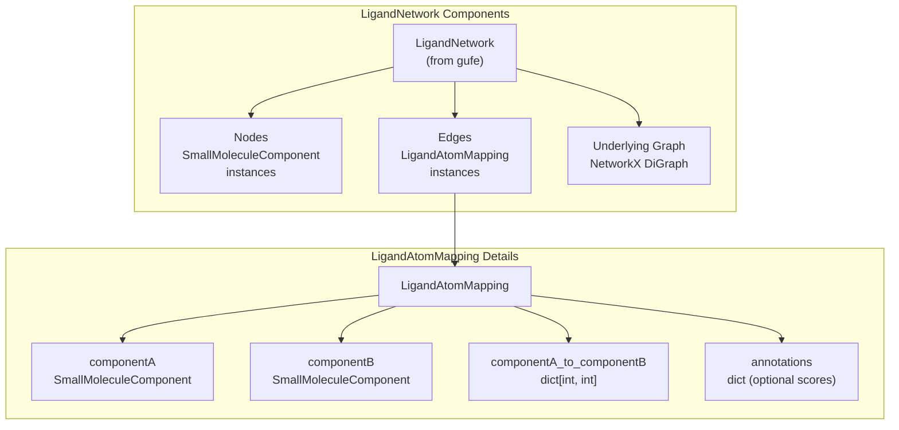
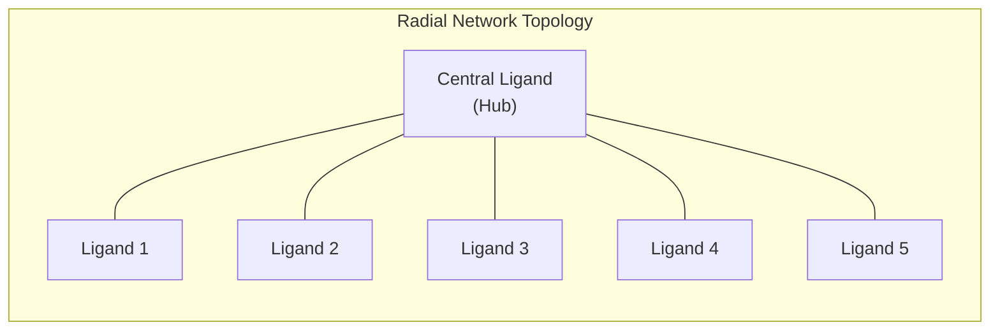
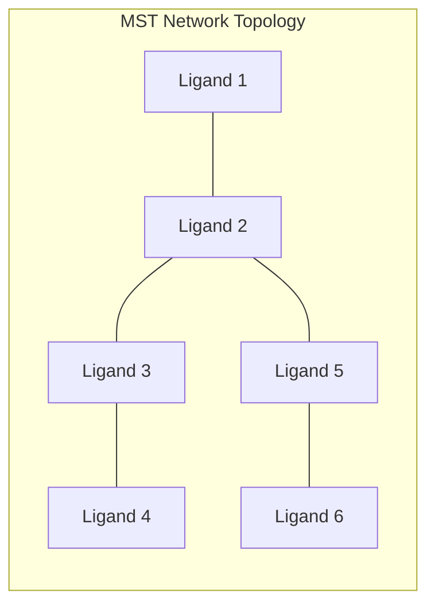
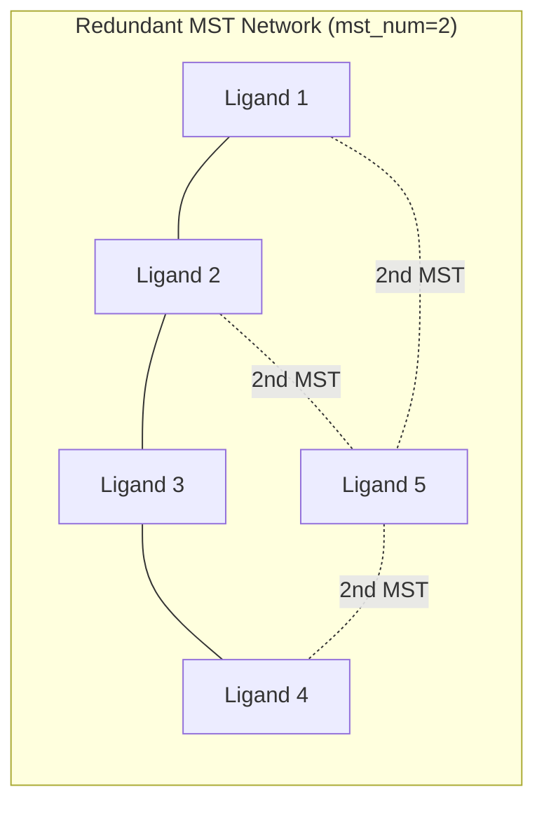
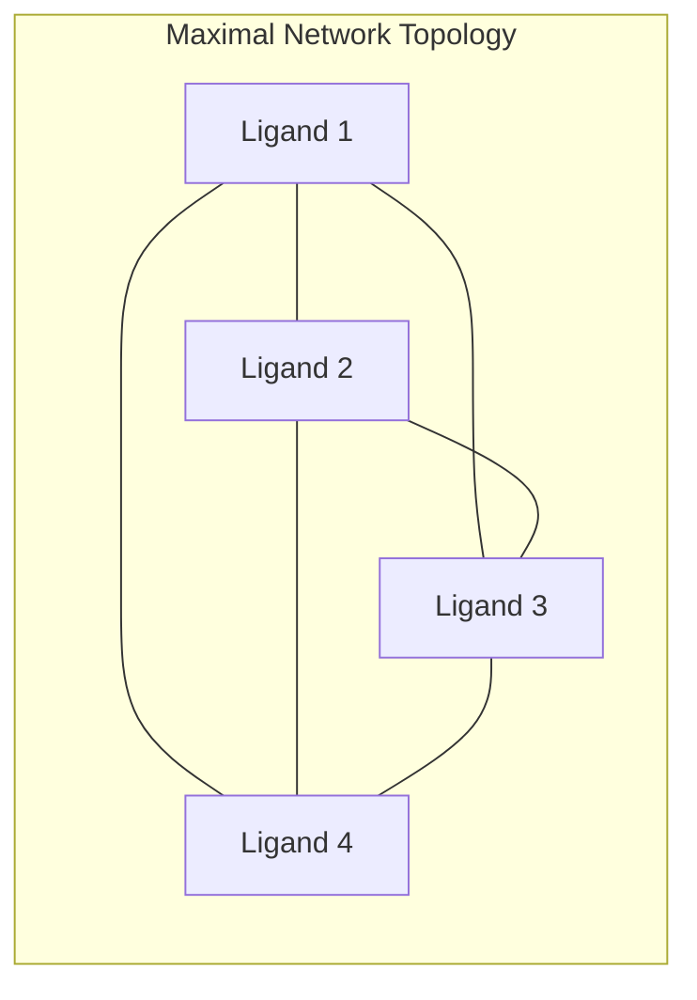
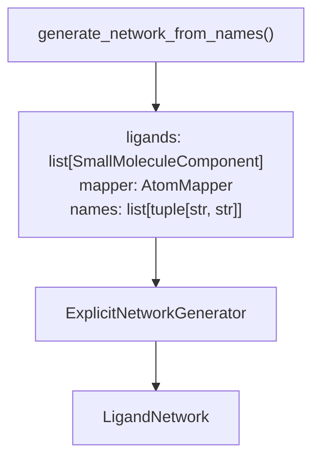
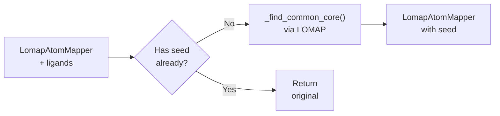
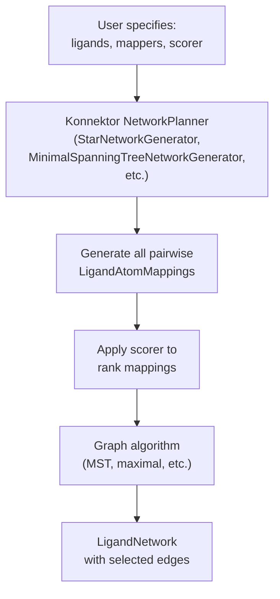
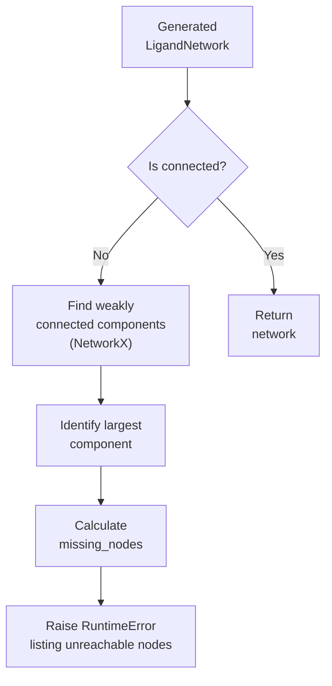

# Ligand Networks

<details>
<summary>Relevant source files</summary>

The following files were used as context for generating this wiki page:

- [openfe/setup/atom_mapping/__init__.py](openfe/setup/atom_mapping/__init__.py)
- [openfe/setup/atom_mapping/ligandatommapper.py](openfe/setup/atom_mapping/ligandatommapper.py)
- [openfe/setup/atom_mapping/lomap_mapper.py](openfe/setup/atom_mapping/lomap_mapper.py)
- [openfe/setup/atom_mapping/lomap_scorers.py](openfe/setup/atom_mapping/lomap_scorers.py)
- [openfe/setup/atom_mapping/perses_mapper.py](openfe/setup/atom_mapping/perses_mapper.py)
- [openfe/setup/atom_mapping/perses_scorers.py](openfe/setup/atom_mapping/perses_scorers.py)
- [openfe/setup/ligand_network_planning.py](openfe/setup/ligand_network_planning.py)
- [openfe/tests/setup/atom_mapping/conftest.py](openfe/tests/setup/atom_mapping/conftest.py)
- [openfe/tests/setup/atom_mapping/test_atommapper.py](openfe/tests/setup/atom_mapping/test_atommapper.py)
- [openfe/tests/setup/atom_mapping/test_lomap_atommapper.py](openfe/tests/setup/atom_mapping/test_lomap_atommapper.py)
- [openfe/tests/setup/atom_mapping/test_lomap_scorers.py](openfe/tests/setup/atom_mapping/test_lomap_scorers.py)
- [openfe/tests/setup/atom_mapping/test_perses_atommapper.py](openfe/tests/setup/atom_mapping/test_perses_atommapper.py)
- [openfe/tests/setup/atom_mapping/test_perses_scorers.py](openfe/tests/setup/atom_mapping/test_perses_scorers.py)
- [openfe/tests/setup/test_network_planning.py](openfe/tests/setup/test_network_planning.py)
- [openfe/utils/silence_root_logging.py](openfe/utils/silence_root_logging.py)

</details>


## Purpose and Scope

This page documents the `LigandNetwork` data structure and the various network topologies (radial, minimal spanning tree, maximal, redundant) available for organizing relative free energy calculations. A ligand network defines which pairs of ligands will be compared through alchemical transformations. Understanding network topology is critical for designing efficient, statistically robust free energy campaigns.

For information about atom mapping algorithms that determine *how* atoms are mapped within each edge, see [Atom Mapping](#3.1). For integration of networks with protocols to create `AlchemicalNetwork` objects, see [Alchemical Network Planning](#3.3).

---

## LigandNetwork Structure

A `LigandNetwork` is a directed graph where nodes are `SmallMoleculeComponent` instances and edges are `LigandAtomMapping` instances. The network represents a set of planned alchemical transformations.



**Sources:** [openfe/setup/ligand_network_planning.py:1-26]()

### Key Properties

| Property | Type | Description |
|----------|------|-------------|
| `nodes` | `Iterable[SmallMoleculeComponent]` | All ligands in the network |
| `edges` | `Iterable[LigandAtomMapping]` | All mappings/transformations |
| `graph` | `networkx.DiGraph` | Underlying directed graph structure |

### Connectivity

Networks can be checked for connectivity using `network.is_connected()`. A connected network ensures all ligands can be related through some path of transformations, which is essential for computing relative binding free energies.

**Sources:** [openfe/setup/ligand_network_planning.py:49-154](), [openfe/tests/setup/test_network_planning.py:427]()

---

## Network Topology Types

OpenFE provides five primary strategies for generating ligand networks, each with distinct trade-offs between computational cost, statistical robustness, and result accuracy.

### Radial (Star) Network



The radial topology connects all ligands to a single central ligand. This is also called a "hub and spoke" or "star" topology.

**Function:** `generate_radial_network()`

**Key Parameters:**
- `ligands`: Collection of ligands to arrange around the center
- `central_ligand`: The hub ligand (specified as `SmallMoleculeComponent`, `str` name, or `int` index)
- `mappers`: Atom mapper(s) to use
- `scorer`: Optional scoring function to select best mapping

**Use Cases:**
- When one reference ligand has known experimental data
- Initial exploration of a congeneric series
- Rapid screening with minimal computational cost

**Characteristics:**
- **Edges:** N-1 (where N = number of ligands)
- **Connectivity:** Guaranteed if all ligands can map to center
- **Redundancy:** None - no statistical cross-validation
- **Cost:** Minimal

**Sources:** [openfe/setup/ligand_network_planning.py:49-154](), [openfe/tests/setup/test_network_planning.py:108-317]()

### Minimal Spanning Tree (MST) Network



The MST topology creates a connected network with the minimum number of edges while maximizing the total score (typically structural similarity).

**Function:** `generate_minimal_spanning_network()`

**Key Parameters:**
- `ligands`: Collection of ligands to connect
- `mappers`: Atom mapper(s) to use
- `scorer`: **Required** - scoring function to evaluate mappings

**Algorithm:** Uses Kruskal's algorithm via `MinimalSpanningTreeNetworkGenerator` from konnektor.

**Use Cases:**
- Balanced approach for moderate-sized ligand sets
- When computational budget is limited
- When all ligands are reasonably similar

**Characteristics:**
- **Edges:** N-1 (minimum for connectivity)
- **Connectivity:** Guaranteed if all ligands are reachable
- **Redundancy:** None
- **Cost:** Moderate
- **Score Requirement:** Scorer is mandatory for edge selection

**Sources:** [openfe/setup/ligand_network_planning.py:208-249](), [openfe/tests/setup/test_network_planning.py:368-465]()

### Minimal Redundant Network



This topology generates multiple overlapping MSTs to provide statistical redundancy. Each node connects to at least `mst_num` edges.

**Function:** `generate_minimal_redundant_network()`

**Key Parameters:**
- `ligands`: Collection of ligands to connect
- `mappers`: Atom mapper(s) to use
- `scorer`: **Required** - scoring function
- `mst_num`: Number of MSTs to generate (default: 2)

**Algorithm:** Iteratively computes MSTs, removing selected edges before each iteration. Uses `RedundantMinimalSpanningTreeNetworkGenerator`.

**Use Cases:**
- Production-quality free energy calculations
- When statistical validation is required
- Standard recommended approach for publication

**Characteristics:**
- **Edges:** Approximately `mst_num × (N-1)`
- **Connectivity:** Guaranteed
- **Redundancy:** Each node connects to ≥ `mst_num` edges
- **Cost:** Higher, scales with `mst_num`
- **Statistical Power:** Enables cycle closure analysis

**Sources:** [openfe/setup/ligand_network_planning.py:252-303](), [openfe/tests/setup/test_network_planning.py:467-568]()

### Maximal Network



The maximal topology attempts to create all possible pairwise mappings (up to N(N-1)/2 edges).

**Function:** `generate_maximal_network()`

**Key Parameters:**
- `ligands`: Collection of ligands
- `mappers`: Atom mapper(s) to use
- `scorer`: Optional scoring function
- `progress`: Show progress bar (default: True)

**Use Cases:**
- Debugging atom mappers (see which pairs fail)
- Small ligand sets (<10 molecules) where exhaustive comparison is feasible
- Maximum statistical redundancy for critical projects

**Characteristics:**
- **Edges:** Up to N(N-1)/2 (actual count may be lower if some mappers fail)
- **Connectivity:** Guaranteed (if any valid mappings exist)
- **Redundancy:** Maximum - every possible cycle
- **Cost:** Very high, O(N²) transformations

**Sources:** [openfe/setup/ligand_network_planning.py:157-205](), [openfe/tests/setup/test_network_planning.py:319-366]()

---

## Network Topology Comparison

| Topology | Edges | Redundancy | Computational Cost | Statistical Power | Best Use Case |
|----------|-------|------------|-------------------|-------------------|---------------|
| **Radial** | N-1 | None | Minimal | Low | Initial screening, reference-based |
| **MST** | N-1 | None | Moderate | Low | Balanced exploration |
| **Redundant MST** | ~2(N-1) | Medium | High | Medium-High | Production calculations |
| **Maximal** | N(N-1)/2 | Maximum | Very High | Maximum | Small sets, debugging |

**Recommended Default:** Minimal Redundant Network with `mst_num=2` provides the best balance of cost and reliability for most applications.

**Sources:** [openfe/setup/ligand_network_planning.py:49-303]()

---

## Explicit Network Construction

For complete control, networks can be specified explicitly by ligand names or indices.

### By Name



**Function:** `generate_network_from_names()`

Specify edges as tuples of ligand names:

```python
names = [
    ("benzene", "toluene"),
    ("toluene", "phenol"),
    ("phenol", "anisole")
]
```

**Error Handling:**
- Raises `KeyError` if invalid name requested
- Raises `ValueError` if duplicate names exist

**Sources:** [openfe/setup/ligand_network_planning.py:306-343](), [openfe/tests/setup/test_network_planning.py:570-630]()

### By Index

**Function:** `generate_network_from_indices()`

Specify edges as tuples of integer indices (0-based):

```python
indices = [
    (0, 1),  # First ligand to second
    (1, 2),  # Second to third
    (2, 3)   # Third to fourth
]
```

**Error Handling:**
- Raises `IndexError` if invalid index
- Warns if network is disconnected

**Sources:** [openfe/setup/ligand_network_planning.py:346-378](), [openfe/tests/setup/test_network_planning.py:632-680]()

---

## External Network Formats

OpenFE can import networks from other free energy calculation tools.

### Orion NES Format


**Function:** `load_orion_network()`

**File Format:**
```
# Total number of edges: 3
# ------------------------
benzene >> toluene
toluene >> phenol
phenol >> anisole
```

Lines starting with `#` are comments. Edge lines must follow `name >> name` format.

**Sources:** [openfe/setup/ligand_network_planning.py:381-424](), [openfe/tests/setup/test_network_planning.py:682-756]()

### FEP+ Edges Format

**Function:** `load_fepplus_network()`

**File Format:**
```
hash:hash # benzene -> toluene
hash:hash # toluene -> phenol
hash:hash # phenol -> anisole
```

Each line must follow `hash:hash # name -> name` format.

**Sources:** [openfe/setup/ligand_network_planning.py:427-471](), [openfe/tests/setup/test_network_planning.py:714-778]()

---

## Implementation Details

### Mapper Optimization

The `_hasten_lomap()` helper function optimizes LOMAP mapper performance by pre-computing a common core for all ligands:



This reduces redundant MCS calculations when mapping many ligand pairs.

**Sources:** [openfe/setup/ligand_network_planning.py:27-46]()

### Network Generation Flow



All network generation functions delegate to specialized generators from the `konnektor` library:
- `StarNetworkGenerator` for radial networks
- `MinimalSpanningTreeNetworkGenerator` for MST
- `RedundantMinimalSpanningTreeNetworkGenerator` for redundant MST
- `MaximalNetworkGenerator` for maximal networks
- `ExplicitNetworkGenerator` for custom networks

**Sources:** [openfe/setup/ligand_network_planning.py:17-24](), [openfe/setup/ligand_network_planning.py:130-139]()

### Disconnected Node Handling

Network generators check for disconnected nodes after construction:



If any ligands cannot be mapped, the function raises `RuntimeError` with the names of unreachable nodes.

**Sources:** [openfe/setup/ligand_network_planning.py:141-152](), [openfe/tests/setup/test_network_planning.py:303-316, 448-464]()

---

## Scorer Integration

Most network generation functions accept an optional `scorer` parameter—a callable that takes a `LigandAtomMapping` and returns a `float`. Higher scores indicate better mappings.

### Scorer Behavior

| Scenario | Behavior |
|----------|----------|
| Single mapper, no scorer | Use first valid mapping |
| Multiple mappers, no scorer | Use first valid mapping from first mapper |
| With scorer | Evaluate all mapper outputs, select highest score |
| MST/Redundant without scorer | **Error** - scorer required for graph algorithms |

**Common Scorers:**
- `default_lomap_score` - LOMAP's composite scoring (see [Atom Mapping](#3.1))
- `default_perses_scorer` - Perses scoring function
- Custom functions based on mapping size, RMSD, etc.

**Sources:** [openfe/setup/ligand_network_planning.py:74-77](), [openfe/tests/setup/test_network_planning.py:40-46, 248-277]()

---

## Error Handling and Validation

### Common Errors

| Error Type | Condition | Example |
|------------|-----------|---------|
| `RuntimeError` | No mapping to central ligand (radial) | Unmappable chemistry to hub |
| `RuntimeError` | Unreachable nodes (MST) | Isolated ligand with no valid mappings |
| `KeyError` | Invalid ligand name | Typo in `generate_network_from_names()` |
| `IndexError` | Invalid ligand index | Out-of-bounds index |
| `ValueError` | Duplicate ligand names | Same name used twice |
| `ValueError` | Central ligand specification error | Multiple ligands with same name, or negative index |

### Warnings

| Warning | Condition | Action |
|---------|-----------|--------|
| `UserWarning` | Central ligand in `ligands` list | Automatically removed to avoid self-edge |
| `UserWarning` | Disconnected network from indices | Network generated but connectivity questionable |

**Sources:** [openfe/tests/setup/test_network_planning.py:181-218, 303-316, 596-629, 656-679]()

---

## Code Reference Summary

### Main Functions

| Function | Location | Purpose |
|----------|----------|---------|
| `generate_radial_network()` | [openfe/setup/ligand_network_planning.py:49-154]() | Star topology |
| `generate_maximal_network()` | [openfe/setup/ligand_network_planning.py:157-205]() | All possible edges |
| `generate_minimal_spanning_network()` | [openfe/setup/ligand_network_planning.py:208-249]() | Minimum edges, maximum score |
| `generate_minimal_redundant_network()` | [openfe/setup/ligand_network_planning.py:252-303]() | Multiple MSTs for redundancy |
| `generate_network_from_names()` | [openfe/setup/ligand_network_planning.py:306-343]() | Explicit by name |
| `generate_network_from_indices()` | [openfe/setup/ligand_network_planning.py:346-378]() | Explicit by index |
| `load_orion_network()` | [openfe/setup/ligand_network_planning.py:381-424]() | Import from Orion |
| `load_fepplus_network()` | [openfe/setup/ligand_network_planning.py:427-471]() | Import from FEP+ |

### Key Dependencies

| Component | Source | Role |
|-----------|--------|------|
| `LigandNetwork` | `gufe` | Core data structure |
| `SmallMoleculeComponent` | `gufe` | Network nodes |
| `LigandAtomMapping` | `gufe` | Network edges |
| `konnektor.network_planners` | `konnektor` | Network generation algorithms |
| `networkx` | External | Graph operations |

**Sources:** [openfe/setup/ligand_network_planning.py:1-24]()

---