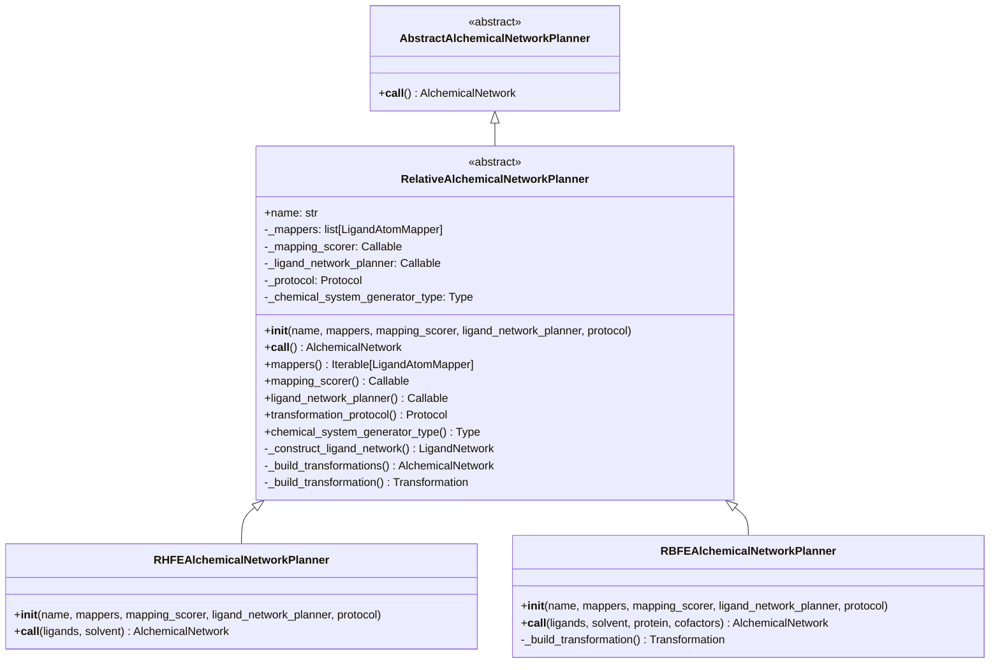
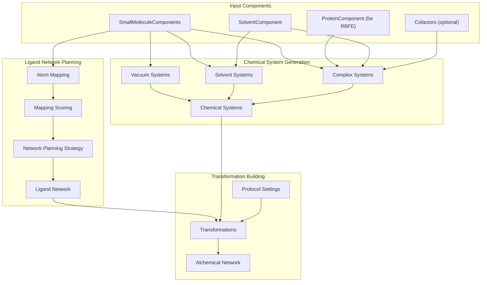
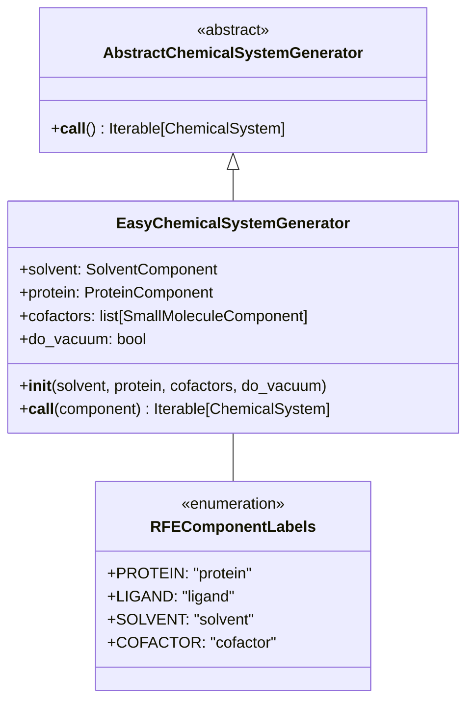
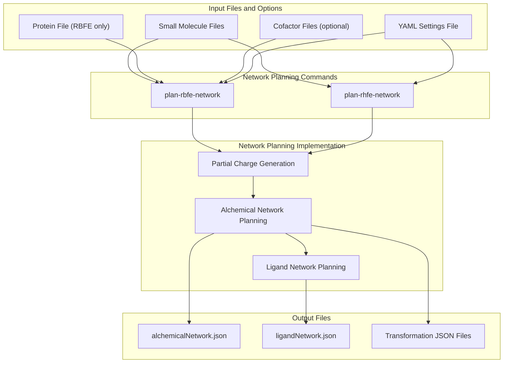

# Alchemical Network Planning

<details>
<summary>Relevant source files</summary>

The following files were used as context for generating this wiki page:

- [openfe/setup/atom_mapping/__init__.py](openfe/setup/atom_mapping/__init__.py)
- [openfe/setup/atom_mapping/ligandatommapper.py](openfe/setup/atom_mapping/ligandatommapper.py)
- [openfe/setup/atom_mapping/lomap_mapper.py](openfe/setup/atom_mapping/lomap_mapper.py)
- [openfe/setup/atom_mapping/lomap_scorers.py](openfe/setup/atom_mapping/lomap_scorers.py)
- [openfe/setup/atom_mapping/perses_mapper.py](openfe/setup/atom_mapping/perses_mapper.py)
- [openfe/setup/atom_mapping/perses_scorers.py](openfe/setup/atom_mapping/perses_scorers.py)
- [openfe/setup/ligand_network_planning.py](openfe/setup/ligand_network_planning.py)
- [openfe/utils/silence_root_logging.py](openfe/utils/silence_root_logging.py)
- [openfecli/commands/generate_partial_charges.py](openfecli/commands/generate_partial_charges.py)
- [openfecli/commands/plan_rbfe_network.py](openfecli/commands/plan_rbfe_network.py)
- [openfecli/commands/plan_rhfe_network.py](openfecli/commands/plan_rhfe_network.py)
- [openfecli/parameters/__init__.py](openfecli/parameters/__init__.py)
- [openfecli/parameters/misc.py](openfecli/parameters/misc.py)
- [openfecli/parameters/plan_network_options.py](openfecli/parameters/plan_network_options.py)
- [openfecli/plan_alchemical_networks_utils.py](openfecli/plan_alchemical_networks_utils.py)
- [openfecli/tests/commands/test_plan_rbfe_network.py](openfecli/tests/commands/test_plan_rbfe_network.py)
- [openfecli/tests/commands/test_plan_rhfe_network.py](openfecli/tests/commands/test_plan_rhfe_network.py)

</details>


## Purpose and Scope

This document explains the alchemical network planning system in OpenFE, which is responsible for creating and configuring networks of alchemical transformations for free energy calculations. Alchemical network planning connects the atom mapping system (described in [Atom Mapping](#3.1)) with the simulation protocols (described in [Core Protocols](#2)) by determining which transformations to perform and building the complete alchemical network with the necessary chemical systems and configurations.

The alchemical network planners handle:
1. Coordinating atom mapping between molecules
2. Planning the optimal network of transformations 
3. Generating appropriate chemical systems for each state
4. Configuring protocol settings for each transformation
5. Building the final alchemical network that can be executed

Sources: [openfe/setup/alchemical_network_planner/abstract_alchemical_network_planner.py:1-17](), [openfe/setup/alchemical_network_planner/relative_alchemical_network_planner.py:1-45]()

## Alchemical Network Planner Architecture



**Diagram: Hierarchy of Alchemical Network Planners**

The alchemical network planning system follows a hierarchical design with specialized planners for different types of free energy calculations:

1. **AbstractAlchemicalNetworkPlanner**: The base abstract class that defines the interface for all network planners.
   
2. **RelativeAlchemicalNetworkPlanner**: An abstract implementation that handles the common logic for relative free energy calculations (both hydration and binding).
   
3. **RHFEAlchemicalNetworkPlanner**: A concrete implementation for Relative Hydration Free Energy (RHFE) calculations, which involve transformations between molecules in vacuum and solvent.
   
4. **RBFEAlchemicalNetworkPlanner**: A concrete implementation for Relative Binding Free Energy (RBFE) calculations, which involve transformations between molecules bound to a protein in solvent.

Each planner is responsible for coordinating the creation of appropriate chemical systems and transformations based on the specific type of free energy calculation.

Sources: [openfe/setup/alchemical_network_planner/abstract_alchemical_network_planner.py:1-17](), [openfe/setup/alchemical_network_planner/relative_alchemical_network_planner.py:46-120](), [openfe/setup/alchemical_network_planner/relative_alchemical_network_planner.py:233-294](), [openfe/setup/alchemical_network_planner/relative_alchemical_network_planner.py:296-403]()

## Network Planning Process



**Diagram: Alchemical Network Planning Process Flow**

The alchemical network planning process follows a series of defined steps:

1. **Input Preparation**:
   - Small molecules for transformation
   - Protein component (for binding calculations)
   - Solvent component
   - Optional cofactors

2. **Ligand Network Construction**:
   - Generate atom mappings between molecule pairs using `LigandAtomMapper` implementations
   - Score mappings using a mapping scorer function (typically the default LOMAP scorer)
   - Plan the network using a network planner function (typically generating a minimal spanning tree)
   - Create a `LigandNetwork` containing the planned transformations

3. **Chemical System Generation**:
   - Create appropriate chemical systems for each environment:
     - Vacuum systems (for RHFE)
     - Solvent systems (for both RHFE and RBFE)
     - Complex systems with protein (for RBFE)
   - Include any cofactors in complex systems if provided

4. **Transformation Building**:
   - Create transformations for each edge in the ligand network
   - Configure protocol settings based on transformation type
   - Handle special cases (e.g., charge-changing transformations)
   - Construct the final alchemical network

Sources: [openfe/setup/alchemical_network_planner/relative_alchemical_network_planner.py:121-191](), [openfe/setup/alchemical_network_planner/relative_alchemical_network_planner.py:192-232]()

## Chemical System Generation



**Diagram: Chemical System Generation Architecture**

A critical part of alchemical network planning is the generation of chemical systems for each transformation. This is handled by the `EasyChemicalSystemGenerator` class, which creates chemical systems with consistent components based on the type of free energy calculation:

1. **Chemical System Environment Types**:
   - **Vacuum**: Just the small molecule in vacuum (for RHFE vacuum leg)
   - **Solvent**: Small molecule in solvent (for both RHFE and RBFE solvent legs)
   - **Complex**: Small molecule bound to protein in solvent (for RBFE complex leg)

2. **Component Labeling**:
   - Components in chemical systems are labeled using the `RFEComponentLabels` enumeration:
     - `LIGAND`: The small molecule being transformed
     - `PROTEIN`: The protein component (for RBFE)
     - `SOLVENT`: The solvent component
     - `COFACTOR`: Any cofactors in the system (numbered from 1)

3. **System Generation Process**:
   - The generator is initialized with the environment components (solvent, protein, cofactors)
   - When called with a small molecule component, it yields chemical systems for each relevant environment
   - Systems are named based on the small molecule name and environment (e.g., `"ligand_23_vacuum"`, `"ligand_23_solvent"`, `"ligand_23_complex"`)

The chemical system generator ensures that all chemical systems are created with consistent components and naming, which is essential for properly setting up and analyzing free energy calculations.

Sources: [openfe/setup/chemicalsystem_generator/abstract_chemicalsystem_generator.py:1-26](), [openfe/setup/chemicalsystem_generator/easy_chemicalsystem_generator.py:1-124]()

## RHFE vs RBFE Network Planning

### RHFE Network Planning

The `RHFEAlchemicalNetworkPlanner` creates networks for relative hydration free energy calculations, which involve:

1. **Transformations Between Small Molecules**:
   - In vacuum (small molecule only)
   - In solvent (small molecule in solvent)

2. **Workflow**:
   - Create atom mappings between all pairs of small molecules
   - Score mappings and plan the optimal network
   - Generate vacuum and solvent chemical systems for each small molecule
   - Build transformations between corresponding systems

### RBFE Network Planning

The `RBFEAlchemicalNetworkPlanner` creates networks for relative binding free energy calculations, which involve:

1. **Transformations Between Small Molecules**:
   - In solvent (small molecule in solvent)
   - In complex (small molecule bound to protein in solvent)

2. **Workflow**:
   - Create atom mappings between all pairs of small molecules
   - Score mappings and plan the optimal network
   - Generate solvent and complex chemical systems for each small molecule
   - Build transformations between corresponding systems
   - Handle special cases like charge-changing transformations

### Special Handling for Charge Changes

The `RBFEAlchemicalNetworkPlanner` includes special handling for transformations where the net charge changes between the two small molecules:

```python
# If the transformation involves a charge change, apply special settings
if get_alchemical_charge_difference(ligand_mapping_edge) != 0:
    # Issue a warning
    warnings.warn("Charge changing transformation between ligands...")
    
    # Apply more rigorous simulation settings
    protocol_settings.alchemical_settings.explicit_charge_correction = True
    protocol_settings.simulation_settings.production_length = 20 * unit.nanosecond
    protocol_settings.simulation_settings.n_replicas = 22
    protocol_settings.lambda_settings.lambda_windows = 22
```

These special settings ensure more accurate results for charge-changing transformations, which are typically more challenging.

Sources: [openfe/setup/alchemical_network_planner/relative_alchemical_network_planner.py:233-294](), [openfe/setup/alchemical_network_planner/relative_alchemical_network_planner.py:296-403](), [openfe/setup/alchemical_network_planner/relative_alchemical_network_planner.py:320-358]()

## Command Line Interface



**Diagram: Command Line Interface for Network Planning**

OpenFE provides two main command line tools for alchemical network planning:

1. **plan-rbfe-network**: For planning relative binding free energy calculations
   - Requires small molecule files, protein file, and optional cofactor files
   - Creates an alchemical network with transformations in solvent and complex environments

2. **plan-rhfe-network**: For planning relative hydration free energy calculations
   - Requires only small molecule files
   - Creates an alchemical network with transformations in vacuum and solvent environments

Both commands share common features:

1. **Partial Charge Generation**:
   - Automatically assigns partial charges to small molecules if not already present
   - Can be customized using the YAML settings file
   - Can optionally overwrite existing charges with `--overwrite-charges`

2. **Network Planning Configuration**:
   - Atom mapping method (default: LOMAP)
   - Mapping scoring function (default: LOMAP default scorer)
   - Network planning strategy (default: minimal spanning network)
   - Protocol settings (default: RelativeHybridTopologyProtocol with standard settings)

3. **Output**:
   - Alchemical network JSON file
   - Ligand network JSON file
   - Individual transformation JSON files for each edge in the network
   - These files can be used with the `quickrun` command to execute simulations

### Example Command Usage

```
# RBFE Planning
openfe plan-rbfe-network -M molecules_directory -p protein.pdb -o output_directory -s settings.yaml

# RHFE Planning
openfe plan-rhfe-network -M molecules_directory -o output_directory -s settings.yaml
```

Sources: [openfecli/commands/plan_rbfe_network.py:1-265](), [openfecli/commands/plan_rhfe_network.py:1-219](), [openfecli/tests/commands/test_plan_rbfe_network.py:1-424](), [openfecli/tests/commands/test_plan_rhfe_network.py:1-242]()

## YAML Configuration Options

The behavior of the alchemical network planners can be customized through a YAML configuration file:

```yaml
# Network planning strategy
network:
  method: generate_minimal_spanning_network  # or generate_lomap_network, generate_radial_network, etc.
  settings:
    # Strategy-specific settings
    # e.g., max_path_length: 6 for LOMAP network

# Atom mapping method
mapper:
  method: LomapAtomMapper
  settings:
    time: 45
    element_change: True
    # Other mapper-specific settings

# Partial charge method
partial_charge:
  method: am1bcc  # or nagl, mmff, etc.
  settings:
    # Method-specific settings
    # e.g., nagl_model: "openff-gnn-am1bcc-0.1.0-rc.3.pt" for nagl
```

This configuration system allows for flexible customization of the network planning process, including:

1. **Network Planning Strategy**:
   - `generate_minimal_spanning_network`: Creates a minimal spanning tree (default)
   - `generate_lomap_network`: Uses LOMAP's network planning algorithm
   - `generate_radial_network`: Creates a hub-and-spoke network from a central ligand

2. **Atom Mapping Method**:
   - `LomapAtomMapper`: Uses LOMAP for atom mapping (with customizable parameters)
   - Other mappers as implemented in the system

3. **Partial Charge Method**:
   - `am1bcc`: Uses AM1-BCC charges (default)
   - `nagl`: Uses neural network-based charge assignment
   - `mmff`: Uses MMFF94 charges
   - Others as supported by the charge generation system

Sources: [openfecli/tests/commands/test_plan_rbfe_network.py:337-354](), [openfecli/tests/commands/test_plan_rbfe_network.py:381-398](), [openfecli/tests/commands/test_plan_rhfe_network.py:162-179]()

## Programmatic Usage

For advanced use cases, the alchemical network planners can be used directly in Python code:

```python
# RBFE Planning
from openfe.setup.alchemical_network_planner import RBFEAlchemicalNetworkPlanner
from openfe.setup import LomapAtomMapper, lomap_scorers, ligand_network_planning
from openfe.protocols.openmm_rfe.equil_rfe_methods import RelativeHybridTopologyProtocol

# Create the planner
planner = RBFEAlchemicalNetworkPlanner(
    mappers=[LomapAtomMapper()],
    mapping_scorer=lomap_scorers.default_lomap_score,
    ligand_network_planner=ligand_network_planning.generate_minimal_spanning_network,
    protocol=RelativeHybridTopologyProtocol(RelativeHybridTopologyProtocol.default_settings())
)

# Plan the network
alchemical_network = planner(
    ligands=small_molecules,
    solvent=solvent_component,
    protein=protein_component,
    cofactors=[]
)
```

This approach allows for more fine-grained control over the network planning process and integration with other parts of the OpenFE framework.

Sources: [openfecli/commands/plan_rbfe_network.py:11-105](), [openfecli/commands/plan_rhfe_network.py:14-80]()

## Integration with Other Systems

The alchemical network planning system integrates with several other components of the OpenFE framework:

1. **Atom Mapping System** ([Atom Mapping](#3.1)):
   - Uses atom mappers to determine how atoms correspond between molecules
   - Relies on scoring functions to evaluate mapping quality
   - Feeds into network planning strategies to determine optimal transformations

2. **Chemical System Generation**:
   - Creates consistent chemical systems for different environments
   - Ensures correct labeling of components for protocols to identify

3. **Protocols** ([Core Protocols](#2)):
   - Configures protocol settings based on transformation type
   - Handles special cases like charge-changing transformations
   - Creates transformations that can be executed by simulation protocols

4. **Command Line Interface** ([Command Line Interface](#4)):
   - Provides user-friendly tools for common network planning tasks
   - Handles file I/O and configuration management
   - Integrates with simulation execution (`quickrun`) and analysis

This integration allows the alchemical network planning system to serve as a bridge between the input specification and the executable simulation plan.

Sources: [openfe/setup/alchemical_network_planner/relative_alchemical_network_planner.py:1-45](), [openfe/setup/alchemical_network_planner/relative_alchemical_network_planner.py:121-191]()

---