# Charge Generation

<details>
<summary>Relevant source files</summary>

The following files were used as context for generating this wiki page:

- [openfe/protocols/openmm_utils/charge_generation.py](openfe/protocols/openmm_utils/charge_generation.py)
- [openfe/tests/conftest.py](openfe/tests/conftest.py)
- [openfe/tests/protocols/openmm_ahfe/test_ahfe_protocol.py](openfe/tests/protocols/openmm_ahfe/test_ahfe_protocol.py)
- [openfe/tests/protocols/openmm_md/test_plain_md_protocol.py](openfe/tests/protocols/openmm_md/test_plain_md_protocol.py)
- [openfe/tests/protocols/openmm_rfe/test_hybrid_top_protocol.py](openfe/tests/protocols/openmm_rfe/test_hybrid_top_protocol.py)
- [openfe/tests/protocols/test_openmm_settings.py](openfe/tests/protocols/test_openmm_settings.py)
- [openfe/tests/protocols/test_openmmutils.py](openfe/tests/protocols/test_openmmutils.py)
- [openfecli/commands/generate_partial_charges.py](openfecli/commands/generate_partial_charges.py)
- [openfecli/commands/plan_rbfe_network.py](openfecli/commands/plan_rbfe_network.py)
- [openfecli/commands/plan_rhfe_network.py](openfecli/commands/plan_rhfe_network.py)
- [openfecli/parameters/__init__.py](openfecli/parameters/__init__.py)
- [openfecli/parameters/misc.py](openfecli/parameters/misc.py)
- [openfecli/parameters/plan_network_options.py](openfecli/parameters/plan_network_options.py)
- [openfecli/plan_alchemical_networks_utils.py](openfecli/plan_alchemical_networks_utils.py)
- [openfecli/tests/commands/test_plan_rbfe_network.py](openfecli/tests/commands/test_plan_rbfe_network.py)
- [openfecli/tests/commands/test_plan_rhfe_network.py](openfecli/tests/commands/test_plan_rhfe_network.py)

</details>


## Purpose and Scope

This page documents the partial charge generation system in OpenFE, which assigns atomic partial charges to small molecules prior to simulation. Partial charges are essential for non-bonded electrostatic interactions in molecular dynamics and free energy calculations. The system supports multiple charge assignment methods (AM1-BCC, NAGL, Espaloma) and toolkit backends (AmberTools, OpenEye, RDKit), with automatic conformer generation and parallel processing capabilities.

For information about force field settings and system parameterization, see [Protocol Settings and Configuration](#2.5). For network planning workflows that utilize charge generation, see [Alchemical Network Planning](#3.3).

---

## System Architecture

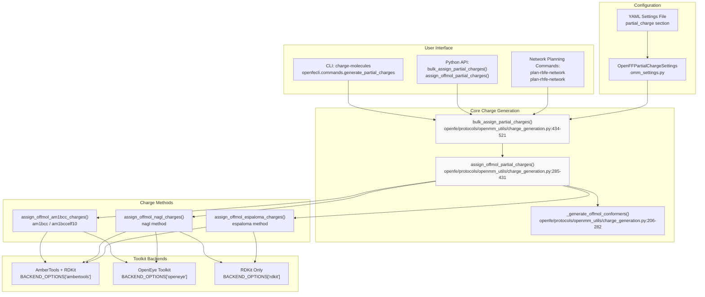

**System Overview**: The charge generation system provides a unified interface for assigning partial charges to molecules using different methods and backends. The workflow flows from user input (CLI or Python API) through the core assignment logic, which delegates to specific charge methods based on configuration. Each method uses one or more toolkit backends for the actual computation.

**Sources**: [openfe/protocols/openmm_utils/charge_generation.py:1-522](), [openfecli/commands/generate_partial_charges.py:1-97](), [openfecli/commands/plan_rbfe_network.py:74-90]()

---

## Charge Assignment Methods

OpenFE supports four partial charge assignment methods, each with different computational requirements and accuracy profiles:

| Method | Description | Max Conformers | Required Backend(s) | Notes |
|--------|-------------|----------------|---------------------|-------|
| `am1bcc` | AM1-BCC semi-empirical charges | 1 | ambertools, openeye | Default method, good balance of speed/accuracy |
| `am1bccelf10` | AM1-BCC with ELF10 conformer ensemble | unlimited | openeye only | Requires OpenEye license, uses multiple conformers |
| `nagl` | Graph neural network charges | 1 | ambertools, openeye, rdkit | Requires openff-nagl package |
| `espaloma` | Machine learning charges | 1 | rdkit, ambertools | Requires espaloma_charge package, experimental |

**Method Selection Logic**:

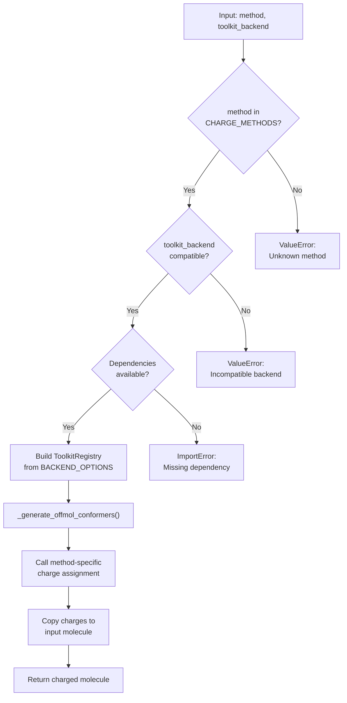

**Sources**: [openfe/protocols/openmm_utils/charge_generation.py:353-382](), [openfe/protocols/openmm_utils/charge_generation.py:285-334]()

---

## Toolkit Backend Selection

The system uses the OpenFF Toolkit's wrapper architecture to support multiple cheminformatics toolkits:

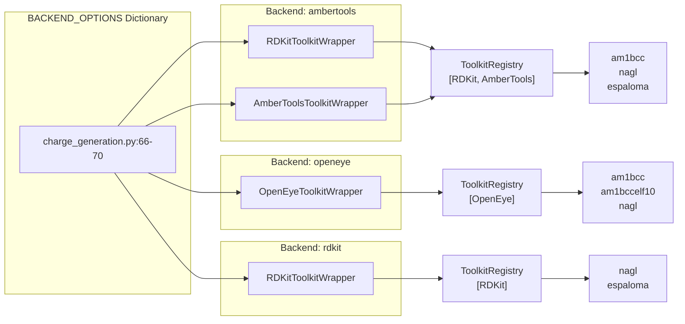

**Backend Compatibility Matrix**:

The `BACKEND_OPTIONS` dictionary ([charge_generation.py:66-70]()) defines which toolkit wrappers are instantiated for each backend choice. The compatibility is enforced at runtime by checking the method's allowed backends against the selected backend ([charge_generation.py:392-398]()).

**Special Considerations**:
- **OpenEye**: Requires a commercial license. Availability checked via `HAS_OPENEYE` flag ([charge_generation.py:24-29]())
- **AmberTools**: Provides AM1-BCC through sqm; thread limits applied to avoid concurrency issues ([charge_generation.py:420-421]())
- **RDKit**: Cannot compute AM1-BCC charges directly, only used for conformer generation with other methods

**Sources**: [openfe/protocols/openmm_utils/charge_generation.py:66-70](), [openfe/protocols/openmm_utils/charge_generation.py:392-403](), [openfe/protocols/openmm_utils/charge_generation.py:24-59]()

---

## Conformer Generation Workflow

Charge methods require molecular conformers. The system handles conformer generation automatically:

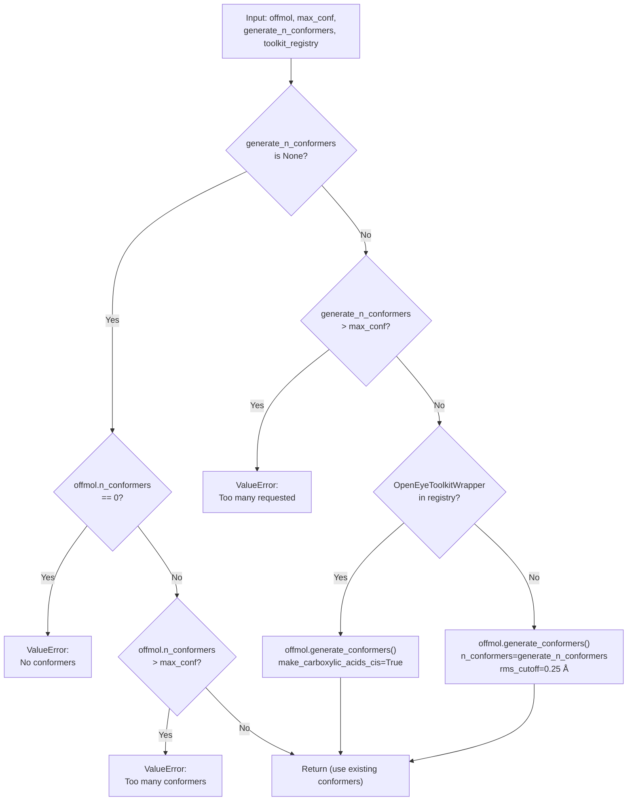

**Implementation Details**:

The `_generate_offmol_conformers()` function ([charge_generation.py:206-282]()) handles several cases:

1. **No generation requested** (`generate_n_conformers=None`): Validates existing conformers
2. **Generation requested**: Creates new conformers with RMS cutoff of 0.25 Å
3. **OpenEye backend**: Sets `make_carboxylic_acids_cis=True` for correct AM1-BCC geometry

**Maximum Conformer Limits**:
- `am1bcc`: 1 conformer
- `am1bccelf10`: unlimited (`sys.maxsize`)
- `nagl`: 1 conformer
- `espaloma`: 1 conformer (actually requires 0, handled specially)

**Sources**: [openfe/protocols/openmm_utils/charge_generation.py:206-282](), [openfe/protocols/openmm_utils/charge_generation.py:353-382]()

---

## Method-Specific Implementation

### AM1-BCC Charges

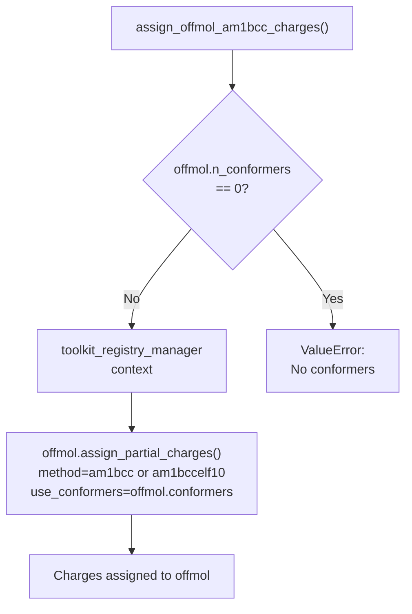

**Function**: `assign_offmol_am1bcc_charges()` ([charge_generation.py:163-203]())

**Parameters**:
- `partial_charge_method`: Either `"am1bcc"` or `"am1bccelf10"`
- `toolkit_registry`: ToolkitRegistry with appropriate backend(s)

**Behavior**:
- Requires at least one conformer on the input molecule
- Uses `toolkit_registry_manager` context to strictly control available toolkits
- For `am1bccelf10`, uses ensemble of conformers if multiple provided

**Sources**: [openfe/protocols/openmm_utils/charge_generation.py:163-203]()

### NAGL Charges

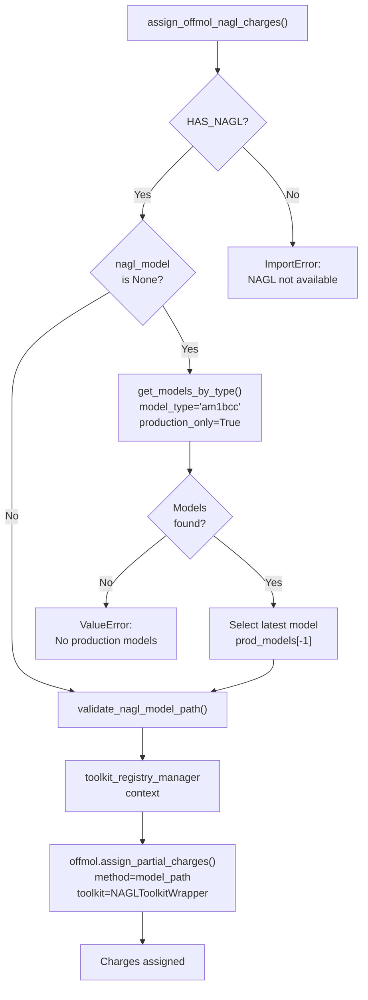

**Function**: `assign_offmol_nagl_charges()` ([charge_generation.py:111-160]())

**Parameters**:
- `nagl_model`: Optional path to NAGL model; if `None`, fetches latest production am1bcc model
- `toolkit_registry`: ToolkitRegistry (backend doesn't matter for NAGL)

**Model Selection**:
- Automatic: Uses `get_models_by_type()` from openff-nagl-models package
- Manual: User can specify model path via `nagl_model` parameter

**Sources**: [openfe/protocols/openmm_utils/charge_generation.py:111-160](), [openfe/protocols/openmm_utils/charge_generation.py:42-51]()

### Espaloma Charges

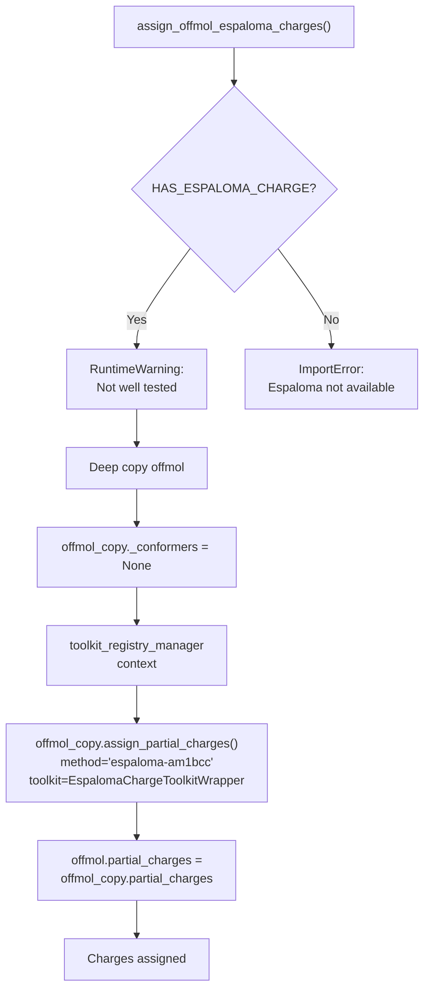

**Function**: `assign_offmol_espaloma_charges()` ([charge_generation.py:73-108]())

**Special Handling**:
- Espaloma requires **zero** conformers, enforced by deep copying and clearing
- Issues a `RuntimeWarning` that method is not well tested
- Uses `EspalomaChargeToolkitWrapper` from espaloma_charge package

**Sources**: [openfe/protocols/openmm_utils/charge_generation.py:73-108](), [openfe/protocols/openmm_utils/charge_generation.py:54-59]()

---

## Bulk Charge Assignment

For efficiency when charging multiple molecules (common in network planning), the system provides parallel processing:

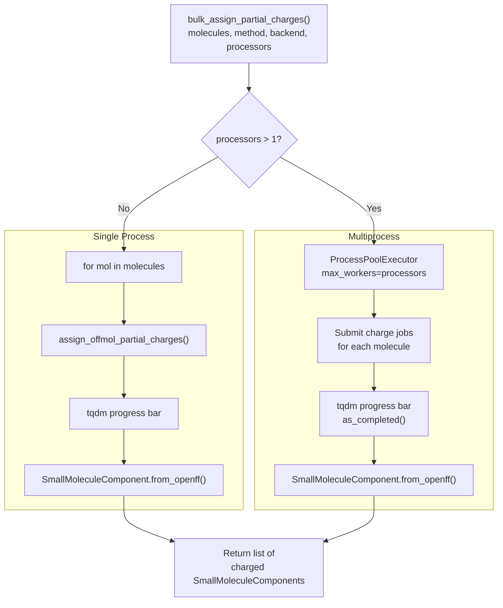

**Function**: `bulk_assign_partial_charges()` ([charge_generation.py:434-521]())

**Parallel Processing**:
- Uses `ProcessPoolExecutor` when `processors > 1`
- Each molecule charged in separate process to avoid GIL contention
- Progress tracked via `tqdm` with total molecule count

**Overwrite Behavior**:
- If `overwrite=False`: Skips molecules that already have non-zero partial charges
- If `overwrite=True`: Regenerates charges for all molecules
- Zero charges are always overwritten regardless of setting

**Sources**: [openfe/protocols/openmm_utils/charge_generation.py:434-521](), [openfe/protocols/openmm_utils/charge_generation.py:335-340]()

---

## Command Line Interface

### charge-molecules Command

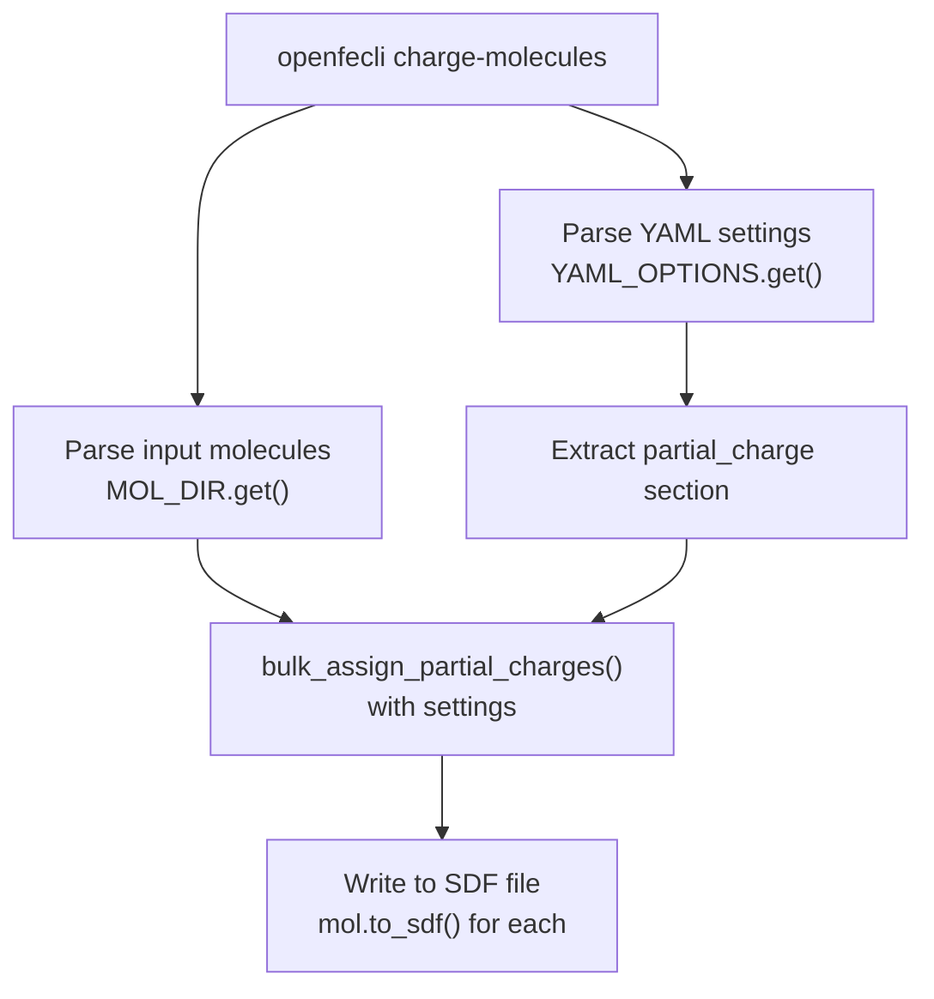

**Command**: `charge-molecules` ([openfecli/commands/generate_partial_charges.py:30-95]())

**Usage**:
```bash
openfecli charge-molecules -M molecules/*.sdf -o charged.sdf -s settings.yaml -n 4
```

**Arguments**:
- `-M, --molecules`: Input SDF files containing molecules to charge
- `-o, --output`: Output SDF file path
- `-s, --settings`: YAML file with partial charge configuration
- `-n, --n-cores`: Number of parallel processes (default: 1)
- `--overwrite-charges`: Flag to overwrite existing charges

**Sources**: [openfecli/commands/generate_partial_charges.py:30-95]()

### Integration with Network Planning

Network planning commands automatically charge molecules before building networks:

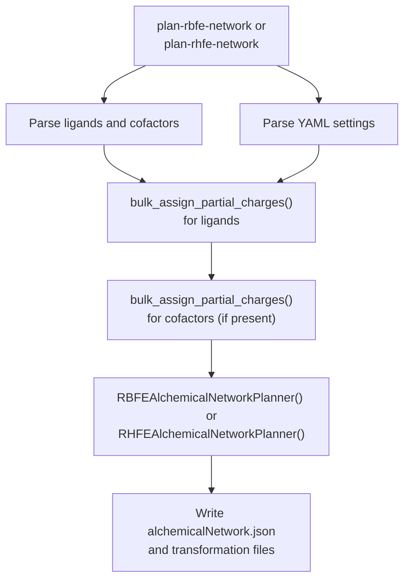

**Automatic Charging**: Network planning commands invoke `bulk_assign_partial_charges()` before constructing the network to ensure consistent charges across all transformations.

**Location**: 
- RBFE: [openfecli/commands/plan_rbfe_network.py:74-103]()
- RHFE: [openfecli/commands/plan_rhfe_network.py:74-84]()

**Sources**: [openfecli/commands/plan_rbfe_network.py:74-103](), [openfecli/commands/plan_rhfe_network.py:74-84]()

---

## Configuration via YAML

Charge generation settings are specified in the `partial_charge` section of YAML configuration files:

**Example Configuration**:
```yaml
partial_charge:
  method: nagl
  settings:
    nagl_model: openff-gnn-am1bcc-0.1.0-rc.3.pt
    off_toolkit_backend: rdkit
    number_of_conformers: null
```

**Settings Structure**:

| Field | Type | Description | Default |
|-------|------|-------------|---------|
| `method` | str | Charge method: am1bcc, am1bccelf10, nagl, espaloma | am1bcc |
| `settings.off_toolkit_backend` | str | Backend: ambertools, openeye, rdkit | ambertools |
| `settings.number_of_conformers` | int or null | Number of conformers to generate | null |
| `settings.nagl_model` | str or null | NAGL model path (for nagl method) | null |

**Parser Implementation**:

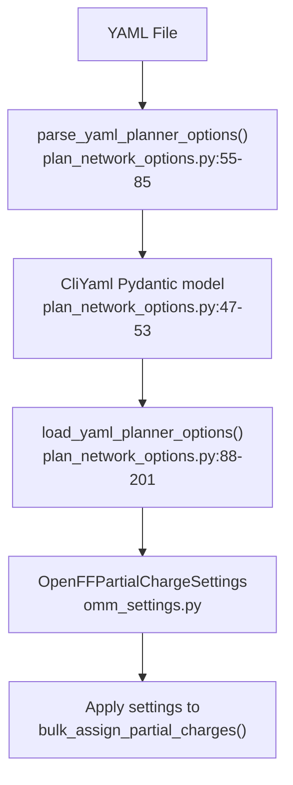

**Settings Class**: `OpenFFPartialChargeSettings` is a Pydantic model in [openfe/protocols/openmm_utils/omm_settings.py]() that defines:
- `partial_charge_method`: Method name
- `off_toolkit_backend`: Toolkit backend name
- `number_of_conformers`: Conformer count or None
- `nagl_model`: NAGL model specification

**Sources**: [openfecli/parameters/plan_network_options.py:40-53](), [openfecli/parameters/plan_network_options.py:182-190]()

---

## Error Handling and Validation

The charge generation system implements several validation checks:

**Validation Flow**:

| Check | Location | Error Type | Message |
|-------|----------|------------|---------|
| Unknown method | [charge_generation.py:385-389]() | ValueError | "Unknown partial charge method {method}" |
| Incompatible backend | [charge_generation.py:392-398]() | ValueError | "Selected toolkit_backend ({backend}) cannot be used with ({method})" |
| OpenEye not available | [charge_generation.py:401-403]() | ImportError | "OpenEye is not available" |
| NAGL not installed | [charge_generation.py:132-138]() | ImportError | "NAGL toolkit is not available" |
| Espaloma not installed | [charge_generation.py:87-89]() | ImportError | "Espaloma ToolkitWrapper is not available" |
| No conformers | [charge_generation.py:238-245]() | ValueError | "No conformers are associated with input" |
| Too many conformers | [charge_generation.py:246-253]() | ValueError | "OpenFF Molecule has too many conformers" |
| Requested > max | [charge_generation.py:257-263]() | ValueError | "{n} conformers were requested but method supports {max}" |

**Dependency Detection**:

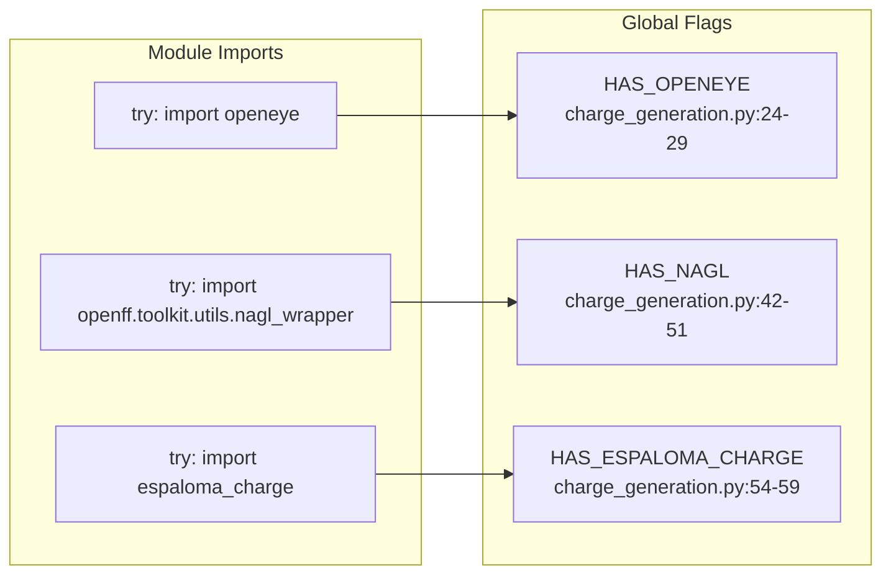

**Sources**: [openfe/protocols/openmm_utils/charge_generation.py:24-59](), [openfe/protocols/openmm_utils/charge_generation.py:385-403](), [openfe/protocols/openmm_utils/charge_generation.py:236-263]()

---

## Testing and Validation

The test suite validates charge generation across multiple dimensions:

**Test Coverage**:

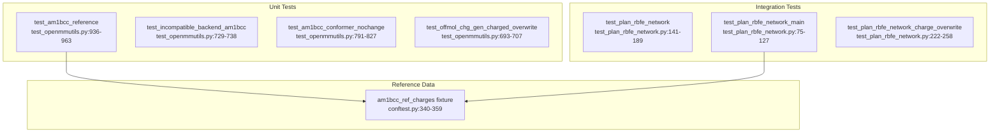

**Reference Charges**: The test suite includes reference partial charges for a CN molecule computed with different methods ([conftest.py:340-359]()):
- AmberTools: Used as baseline reference
- OpenEye: Validated against AmberTools (small differences expected)
- NAGL: Validates neural network predictions
- Espaloma: Validates ML-based charges

**Platform-Specific Skipping**: Tests are conditionally skipped based on:
- `HAS_OPENEYE`: OpenEye-dependent tests
- `HAS_NAGL`: NAGL-dependent tests  
- `HAS_ESPALOMA_CHARGE`: Espaloma-dependent tests
- `sys.platform.startswith("darwin")`: macOS-specific issues with NAGL

**Sources**: [openfe/tests/protocols/test_openmmutils.py:687-1014](), [openfe/tests/conftest.py:340-359](), [openfecli/tests/commands/test_plan_rbfe_network.py:75-258]()

---