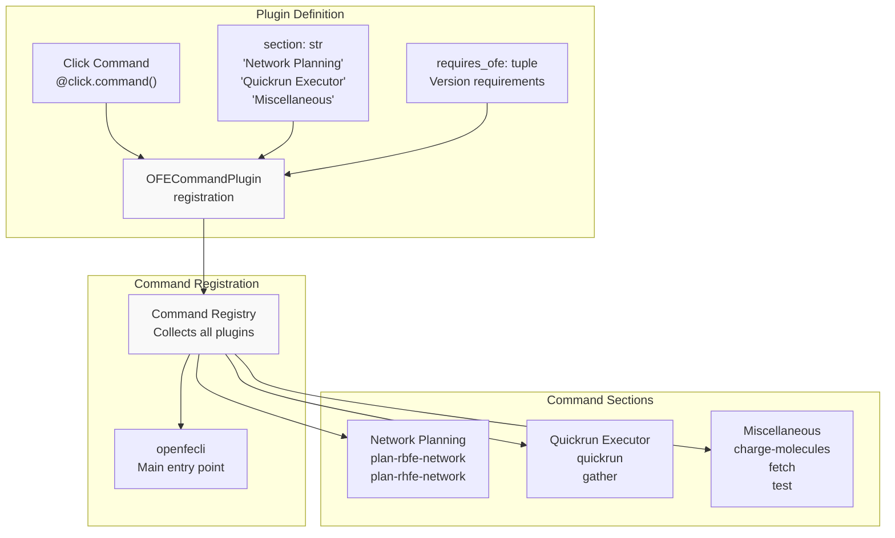
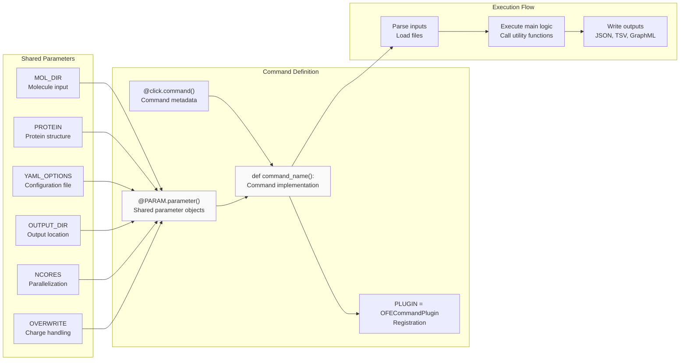
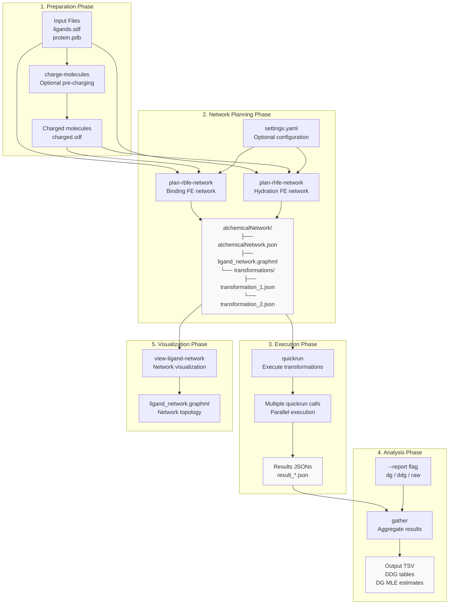
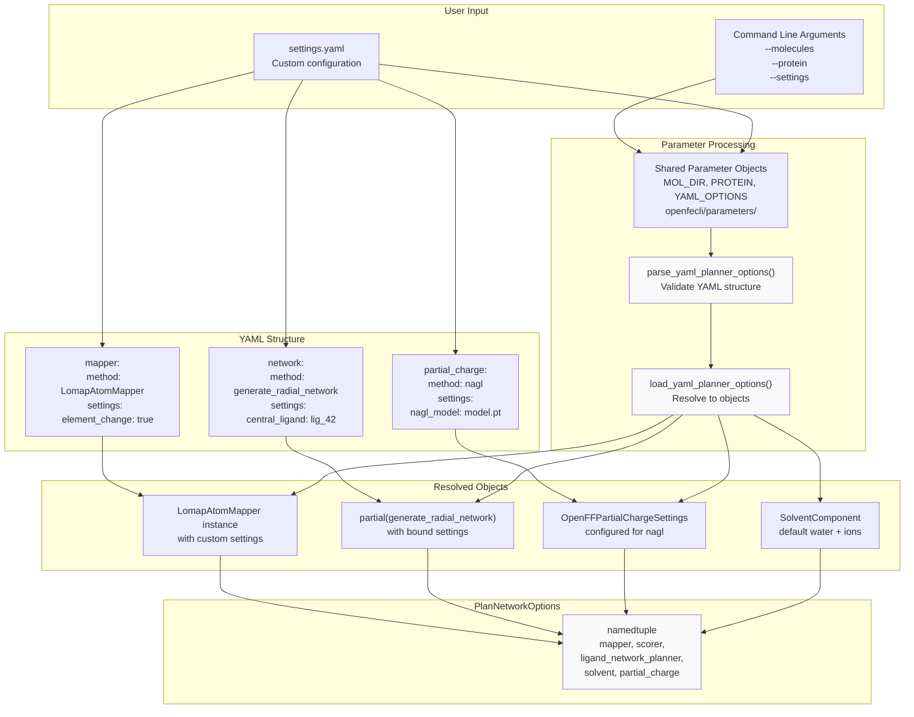
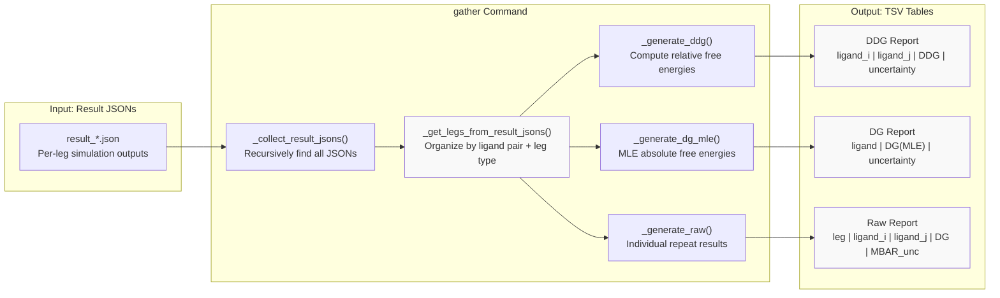
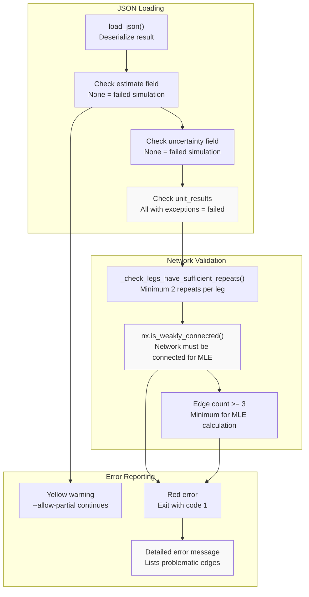
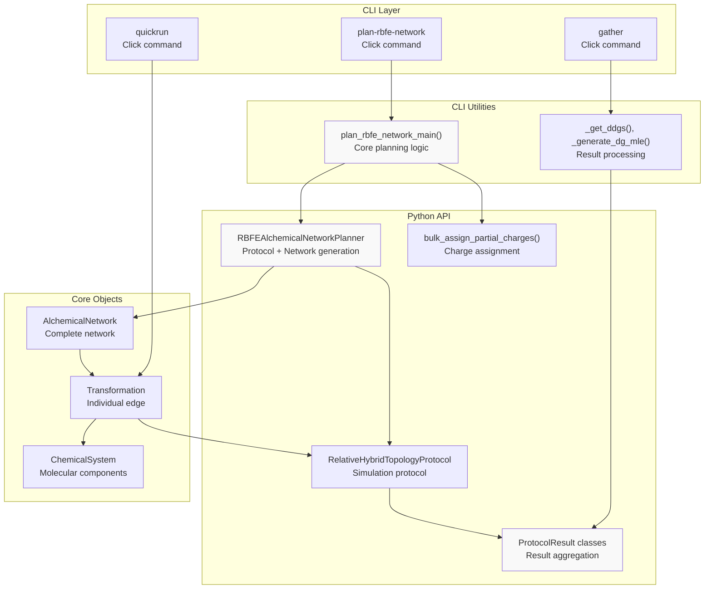

# Command Line Interface

<details>
<summary>Relevant source files</summary>

The following files were used as context for generating this wiki page:

- [openfecli/clicktypes/__init__.py](openfecli/clicktypes/__init__.py)
- [openfecli/clicktypes/hyphenchoice.py](openfecli/clicktypes/hyphenchoice.py)
- [openfecli/commands/gather.py](openfecli/commands/gather.py)
- [openfecli/commands/generate_partial_charges.py](openfecli/commands/generate_partial_charges.py)
- [openfecli/commands/plan_rbfe_network.py](openfecli/commands/plan_rbfe_network.py)
- [openfecli/commands/plan_rhfe_network.py](openfecli/commands/plan_rhfe_network.py)
- [openfecli/parameters/__init__.py](openfecli/parameters/__init__.py)
- [openfecli/parameters/misc.py](openfecli/parameters/misc.py)
- [openfecli/parameters/plan_network_options.py](openfecli/parameters/plan_network_options.py)
- [openfecli/plan_alchemical_networks_utils.py](openfecli/plan_alchemical_networks_utils.py)
- [openfecli/tests/clicktypes/test_hyphenchoice.py](openfecli/tests/clicktypes/test_hyphenchoice.py)
- [openfecli/tests/commands/test_charge_generation.py](openfecli/tests/commands/test_charge_generation.py)
- [openfecli/tests/commands/test_gather.py](openfecli/tests/commands/test_gather.py)
- [openfecli/tests/commands/test_plan_rbfe_network.py](openfecli/tests/commands/test_plan_rbfe_network.py)
- [openfecli/tests/commands/test_plan_rhfe_network.py](openfecli/tests/commands/test_plan_rhfe_network.py)
- [openfecli/tests/test_rbfe_tutorial.py](openfecli/tests/test_rbfe_tutorial.py)
- [openfecli/tests/utils.py](openfecli/tests/utils.py)

</details>


## Purpose and Scope

The OpenFE Command Line Interface (`openfecli`) provides a complete workflow for planning, executing, and analyzing alchemical free energy calculations. This document describes the CLI architecture, plugin system, and how commands interact to form a complete workflow pipeline.

For detailed information about individual commands:
- Network planning commands: see [Network Planning Commands](#4.1)
- Simulation execution: see [Simulation Execution](#4.2)
- Results processing: see [Results Gathering and Analysis](#4.3)
- Visualization tools: see [Network Visualization](#4.4)
- Utility commands: see [Utility Commands](#4.5)

---

## CLI Architecture and Plugin System

The OpenFE CLI is built on a plugin architecture that allows commands to be organized into logical sections and registered dynamically.

### Plugin Registration Model



**Sources:** [openfecli/commands/gather.py:694-698](), [openfecli/commands/plan_rbfe_network.py:254-256](), [openfecli/commands/generate_partial_charges.py:96]()

Each command is registered as a plugin using the `OFECommandPlugin` class. Commands specify their section (grouping in help output) and version requirements. The plugin system enables modular command organization and versioning control.

---

## Command Structure and Implementation

OpenFE CLI commands are implemented using the Click library, with a consistent pattern for parameter handling and execution.

### Command Implementation Pattern



**Sources:** [openfecli/commands/plan_rbfe_network.py:120-144](), [openfecli/parameters/__init__.py:1-12](), [openfecli/commands/generate_partial_charges.py:30-40]()

Commands follow a consistent structure:
1. **Command decorator** defines the command name and help text
2. **Shared parameters** are imported from `openfecli.parameters` for consistency
3. **Main function** implements the command logic
4. **Plugin registration** makes the command discoverable

---

## Complete Workflow Pipeline

The CLI commands form a complete pipeline for free energy calculations, from network planning through result analysis.

### End-to-End Workflow



**Sources:** [openfecli/commands/plan_rbfe_network.py:145-177](), [openfecli/commands/gather.py:593-663](), [openfecli/tests/test_rbfe_tutorial.py:60-148]()

The workflow consists of five phases:

| Phase | Commands | Purpose | Key Outputs |
|-------|----------|---------|-------------|
| **Preparation** | `charge-molecules` | Assign partial charges to ligands | `charged.sdf` |
| **Network Planning** | `plan-rbfe-network`<br/>`plan-rhfe-network` | Design transformation network | `alchemicalNetwork/` directory |
| **Execution** | `quickrun` | Run MD simulations | `result_*.json` files |
| **Analysis** | `gather` | Aggregate and compute statistics | TSV tables with ΔΔG or ΔG |
| **Visualization** | `view-ligand-network` | Visualize network topology | GraphML files |

---

## Parameter System and YAML Configuration

The CLI uses a shared parameter system for consistency across commands, with YAML files enabling advanced customization.

### Parameter Hierarchy and YAML Processing



**Sources:** [openfecli/parameters/plan_network_options.py:55-201](), [openfecli/commands/plan_rbfe_network.py:186-210]()

### YAML Configuration Options

The YAML configuration file supports three main sections:

**Mapper Configuration:**
```yaml
mapper:
  method: KartografAtomMapper  # or LomapAtomMapper
  settings:
    atom_max_distance: 0.95
    element_change: false
```

**Network Algorithm:**
```yaml
network:
  method: generate_radial_network  # or mst, maximal, etc.
  settings:
    central_ligand: lig_reference
```

**Partial Charges:**
```yaml
partial_charge:
  method: nagl  # or am1bcc, am1bccelf10, espaloma
  settings:
    nagl_model: openff-gnn-am1bcc-0.1.0-rc.3.pt
```

**Sources:** [openfecli/parameters/plan_network_options.py:226-267](), [openfecli/commands/generate_partial_charges.py:7-27]()

### Supported Configuration Values

| Section | Methods | Key Settings |
|---------|---------|--------------|
| **mapper** | `LomapAtomMapper`<br/>`KartografAtomMapper` | `element_change`, `time`, `atom_max_distance`, `allow_bond_breaks` |
| **network** | `generate_minimal_spanning_network`<br/>`generate_radial_network`<br/>`generate_minimal_redundant_network`<br/>`generate_maximal_network`<br/>`generate_lomap_network` | `central_ligand`, `mst_num`, `max_path_length` |
| **partial_charge** | `am1bcc`<br/>`am1bccelf10`<br/>`nagl`<br/>`espaloma` | `off_toolkit_backend`, `nagl_model`, `number_of_conformers` |

**Sources:** [openfecli/parameters/plan_network_options.py:134-201]()

---

## Output File Structure

CLI commands generate a structured directory hierarchy for organized workflow management.

### Network Planning Output Structure

When `plan-rbfe-network` or `plan-rhfe-network` is executed, the following directory structure is created:

```
alchemicalNetwork/
├── alchemicalNetwork.json          # Complete AlchemicalNetwork object
├── ligand_network.graphml          # Network topology for visualization
└── transformations/
    ├── rbfe_ligA_complex_ligB_complex.json
    ├── rbfe_ligA_solvent_ligB_solvent.json
    ├── rbfe_ligC_complex_ligD_complex.json
    └── ...                         # One JSON per transformation leg
```

**Sources:** [openfecli/plan_alchemical_networks_utils.py:10-36]()

### Transformation JSON Structure

Each transformation JSON file in the `transformations/` directory is a complete serialized transformation object that contains:

- **Chemical Systems**: StateA and StateB with all components (ligand, protein, solvent, cofactors)
- **Atom Mapping**: The correspondence between atoms in the two states
- **Protocol Settings**: All simulation parameters (lambda schedule, MD settings, etc.)
- **Repeat Information**: Number of independent repeats configured

These JSON files serve as input to the `quickrun` command.

**Sources:** [openfecli/plan_alchemical_networks_utils.py:32-36]()

### Results Gathering Output

The `gather` command processes result JSONs and produces different output formats based on the `--report` flag:



**Sources:** [openfecli/commands/gather.py:487-571](), [openfecli/commands/gather.py:255-316](), [openfecli/commands/gather.py:394-484](), [openfecli/commands/gather.py:348-380]()

### Report Types

| Report Type | Flag | Output Content | Use Case |
|-------------|------|----------------|----------|
| **DDG** | `--report ddg` | Ligand pairs with relative free energies ΔΔG(i→j) = ΔG(j) - ΔG(i) | Direct comparison of ligand pairs |
| **DG** | `--report dg` | Absolute free energies per ligand via maximum likelihood estimation | Network-wide analysis, experimental correlation |
| **Raw** | `--report raw` | Individual repeat results for each leg | Convergence analysis, outlier detection |

**Sources:** [openfecli/commands/gather.py:648-663]()

---

## Error Handling and Validation

The CLI includes validation and error handling at multiple stages to provide clear feedback.

### Result Validation Pipeline



**Sources:** [openfecli/commands/gather.py:192-227](), [openfecli/commands/gather.py:383-391](), [openfecli/commands/gather.py:447-472]()

### Common Error Scenarios

**Missing Results:**
```
Some edge(s) are missing runs!
The following edges were found but are missing one or more run types
('solvent', 'complex', or 'vacuum') to complete the calculation:

ligand_i    ligand_j    run_type_found
ligA        ligB        solvent
```

**Disconnected Network:**
```
ERROR: The results network is disconnected due to failed or missing edges.
Absolute free energies cannot be calculated in a disconnected network.
Please either connect the network by addressing failed runs or adding edges.
You can still compute relative free energies using the ``--report=ddg`` flag.
```

**Insufficient Edges:**
```
The results network has 2 edge(s), but 3 or more edges are required to calculate DG values.
```

**Sources:** [openfecli/commands/gather.py:229-252](), [openfecli/commands/gather.py:447-458](), [openfecli/commands/gather.py:467-472]()

---

## Command-Line Options and Flags

### Common Options Across Commands

| Option | Flag | Type | Description | Commands |
|--------|------|------|-------------|----------|
| **Molecules** | `-M`, `--molecules` | Path(s) | Input ligand SDF files | `plan-*-network`, `charge-molecules` |
| **Protein** | `-p`, `--protein` | Path | Input protein PDB file | `plan-rbfe-network` |
| **Cofactors** | `-C`, `--cofactors` | Path(s) | Cofactor SDF files | `plan-rbfe-network` |
| **Settings** | `-s`, `--settings` | Path | YAML configuration file | `plan-*-network`, `charge-molecules` |
| **Output** | `-o`, `--output` | Path | Output file or directory | All commands |
| **Cores** | `-n`, `--n-cores` | Integer | Number of parallel processes | `plan-*-network`, `charge-molecules` |
| **Repeats** | `--n-protocol-repeats` | Integer | Independent repeats per transformation | `plan-*-network` |
| **Overwrite** | `--overwrite-charges` | Flag | Force charge recalculation | `plan-*-network`, `charge-molecules` |

**Sources:** [openfecli/parameters/misc.py:4-20](), [openfecli/parameters/__init__.py:1-12]()

### Gather Command Options

| Option | Flag | Values | Description |
|--------|------|--------|-------------|
| **Report Type** | `--report` | `dg`, `ddg`, `raw` | Type of output report (default: `dg`) |
| **Output Format** | `--tsv` | Flag | Force TSV output to stdout (default: pretty table) |
| **Partial Results** | `--allow-partial` | Flag | Continue with incomplete results, skip failed edges |

**Sources:** [openfecli/commands/gather.py:603-633]()

---

## Integration with Python API

While the CLI provides a streamlined interface for common workflows, all CLI commands internally use the Python API. Users can transition from CLI to Python API for more complex scenarios.

### CLI-to-API Mapping



**Sources:** [openfecli/commands/plan_rbfe_network.py:19-117](), [openfecli/commands/gather.py:255-316]()

Users can access the same functionality programmatically:

```python
# Equivalent to: openfecli plan-rbfe-network -M ligands.sdf -p protein.pdb
from openfe.setup.alchemical_network_planner import RBFEAlchemicalNetworkPlanner
from openfe.protocols.openmm_rfe import RelativeHybridTopologyProtocol

protocol = RelativeHybridTopologyProtocol.default_settings()
planner = RBFEAlchemicalNetworkPlanner(
    mappers=[mapper],
    mapping_scorer=scorer,
    ligand_network_planner=network_func,
    protocol=protocol
)
alchemical_network = planner(ligands=ligands, protein=protein, solvent=solvent)
```

**Sources:** [openfecli/commands/plan_rbfe_network.py:68-117]()

---