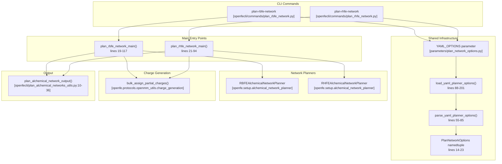
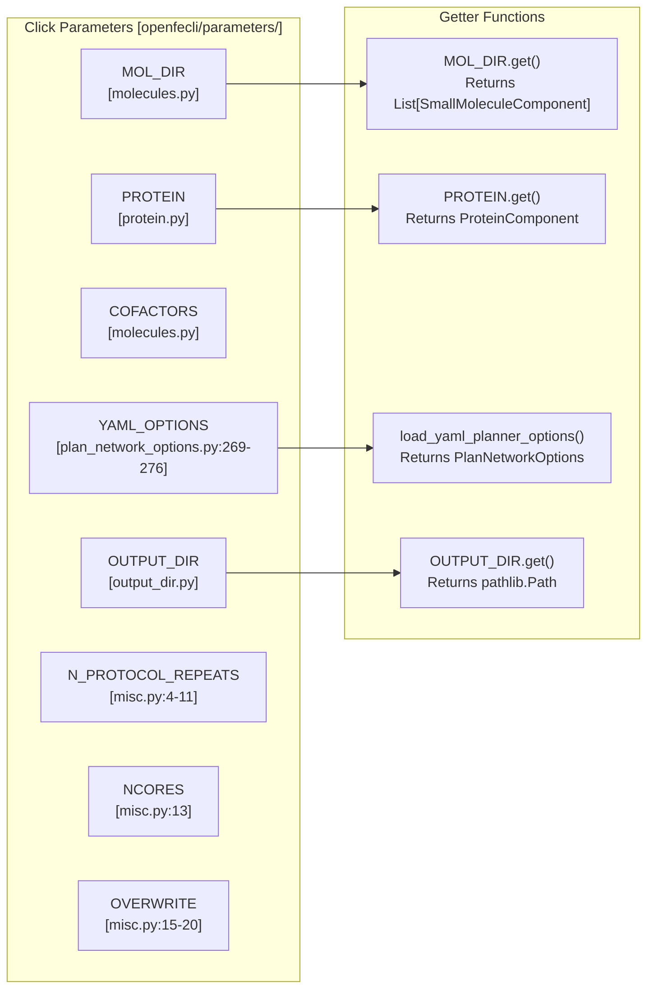
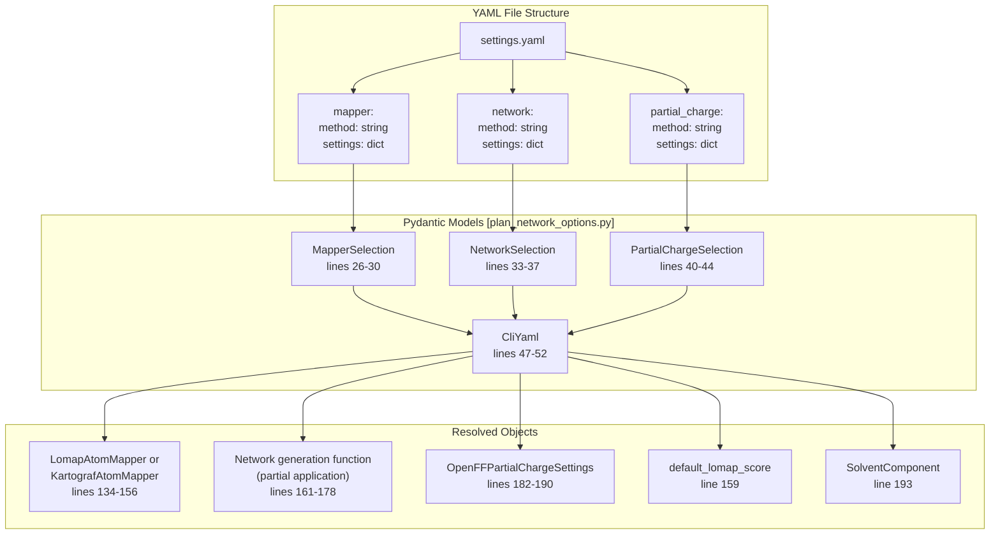
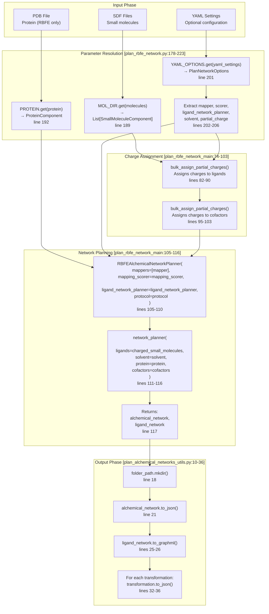
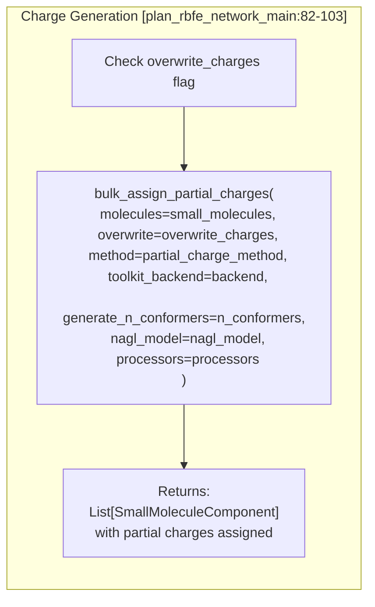
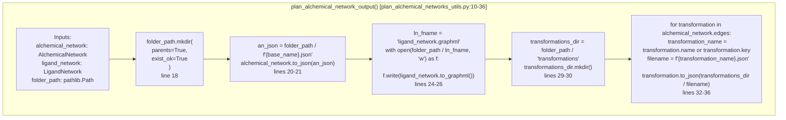
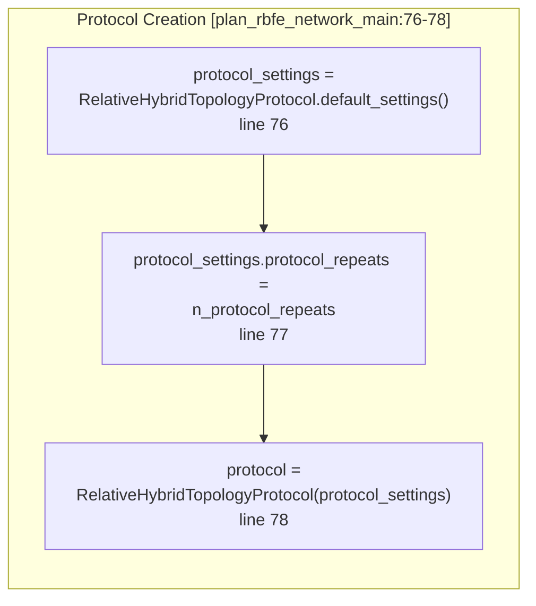

# Network Planning Commands

<details>
<summary>Relevant source files</summary>

The following files were used as context for generating this wiki page:

- [openfecli/commands/generate_partial_charges.py](openfecli/commands/generate_partial_charges.py)
- [openfecli/commands/plan_rbfe_network.py](openfecli/commands/plan_rbfe_network.py)
- [openfecli/commands/plan_rhfe_network.py](openfecli/commands/plan_rhfe_network.py)
- [openfecli/parameters/__init__.py](openfecli/parameters/__init__.py)
- [openfecli/parameters/misc.py](openfecli/parameters/misc.py)
- [openfecli/parameters/plan_network_options.py](openfecli/parameters/plan_network_options.py)
- [openfecli/plan_alchemical_networks_utils.py](openfecli/plan_alchemical_networks_utils.py)
- [openfecli/tests/commands/test_plan_rbfe_network.py](openfecli/tests/commands/test_plan_rbfe_network.py)
- [openfecli/tests/commands/test_plan_rhfe_network.py](openfecli/tests/commands/test_plan_rhfe_network.py)

</details>


## Purpose and Scope

This document describes the network planning commands in the OpenFE CLI: `plan-rbfe-network` and `plan-rhfe-network`. These commands automate the creation of alchemical transformation networks for relative binding free energy (RBFE) and relative hydration free energy (RHFE) calculations. The commands handle atom mapping, network topology generation, partial charge assignment, and produce JSON files ready for simulation execution.

For information about executing the planned transformations, see [Simulation Execution](#4.2). For details on the underlying network planning algorithms and atom mapping, see [Network Planning and Mapping](#3).

---

## Command Overview

OpenFE provides two network planning commands that share a common architecture:

| Command | Purpose | Required Inputs | Output |
|---------|---------|-----------------|--------|
| `plan-rbfe-network` | Plan relative binding free energy networks | Ligands (SDF), Protein (PDB) | AlchemicalNetwork with complex + solvent legs |
| `plan-rhfe-network` | Plan relative hydration free energy networks | Ligands (SDF) | AlchemicalNetwork with solvent + vacuum legs |

Both commands:
1. Load input molecules and protein (if applicable)
2. Automatically assign partial charges to all ligands
3. Generate atom mappings between ligand pairs
4. Construct a network topology from the mappings
5. Create an `AlchemicalNetwork` with protocol settings
6. Write JSON files for each transformation

**Command Architecture**



Sources: [openfecli/commands/plan_rbfe_network.py:1-257](), [openfecli/commands/plan_rhfe_network.py:1-222](), [openfecli/parameters/plan_network_options.py:1-277]()

---

## Command-Line Parameters

### Common Parameters

Both `plan-rbfe-network` and `plan-rhfe-network` accept the following parameters:

| Parameter | Short | Type | Default | Description |
|-----------|-------|------|---------|-------------|
| `--molecules` | `-M` | Path(s) | Required | Directory or file path(s) to SDF files containing ligands |
| `--settings` | `-s` | Path | None | YAML file with mapper, network, and charge settings |
| `--output-dir` | `-o` | Path | `alchemicalNetwork` | Output directory for JSON files |
| `--n-protocol-repeats` | | Integer | 3 | Number of independent simulation repeats per transformation |
| `--n-cores` | `-n` | Integer | 1 | Number of CPU cores for parallel charge generation |
| `--overwrite-charges` | | Flag | False | Overwrite existing partial charges on input molecules |

### RBFE-Specific Parameters

The `plan-rbfe-network` command additionally requires:

| Parameter | Short | Type | Default | Description |
|-----------|-------|------|---------|-------------|
| `--protein` | `-p` | Path | Required | PDB file containing the protein structure |
| `--cofactors` | `-C` | Path(s) | None | SDF file(s) containing cofactor molecules |

**Parameter Implementation Mapping**



Sources: [openfecli/parameters/__init__.py:1-12](), [openfecli/parameters/misc.py:1-21](), [openfecli/commands/plan_rbfe_network.py:120-133](), [openfecli/commands/plan_rhfe_network.py:97-109]()

---

## YAML Configuration

The `--settings` parameter accepts a YAML file that customizes three aspects of network planning: atom mapping, network topology, and partial charge generation.

### YAML Structure



Sources: [openfecli/parameters/plan_network_options.py:26-52](), [openfecli/parameters/plan_network_options.py:88-201]()

### Mapper Configuration

The `mapper` section specifies which atom mapping algorithm to use:

| Method Value | Python Class | Default Settings |
|--------------|--------------|------------------|
| `LomapAtomMapper` or `lomap` | `openfe.setup.LomapAtomMapper` | Lomap defaults |
| `KartografAtomMapper` or `kartograf` | `openfe.setup.KartografAtomMapper` | `atom_max_distance=0.95`<br/>`atom_map_hydrogens=True`<br/>`map_hydrogens_on_hydrogens_only=True`<br/>`map_exact_ring_matches_only=True`<br/>`allow_partial_fused_rings=True`<br/>`allow_bond_breaks=False` |

**Example YAML:**
```yaml
mapper:
  method: LomapAtomMapper
  settings:
    time: 45
    element_change: True
```

Sources: [openfecli/parameters/plan_network_options.py:133-156](), [openfecli/tests/commands/test_plan_rbfe_network.py:354-371]()

### Network Configuration

The `network` section specifies the network topology algorithm:

| Method Value | Python Function | Description |
|--------------|-----------------|-------------|
| `generate_minimal_spanning_network` or `mst` (default) | `openfe.setup.ligand_network_planning.generate_minimal_spanning_network` | Minimal spanning tree |
| `generate_radial_network` or `radial` | `openfe.setup.ligand_network_planning.generate_radial_network` | Star topology around central ligand |
| `generate_minimal_redundant_network` | `openfe.setup.ligand_network_planning.generate_minimal_redundant_network` | MST with additional edges |
| `generate_maximal_network` | `openfe.setup.ligand_network_planning.generate_maximal_network` | All-to-all connections |
| `generate_lomap_network` | `openfe.setup.ligand_network_planning.generate_lomap_network` | LOMAP algorithm |

**Example YAML:**
```yaml
network:
  method: generate_radial_network
  settings:
    central_ligand: lig_CHEMBL1078774

# OR

network:
  method: generate_minimal_redundant_network
  settings:
    mst_num: 3
```

Sources: [openfecli/parameters/plan_network_options.py:161-178](), [openfecli/tests/commands/test_plan_rbfe_network.py:395-412](), [openfecli/tests/commands/test_plan_rhfe_network.py:158-175]()

### Partial Charge Configuration

The `partial_charge` section specifies how to assign charges to ligands:

| Method Value | Requirements | Backend Settings |
|--------------|--------------|------------------|
| `am1bcc` (default) | AmberTools or OpenEye | `off_toolkit_backend`: `ambertools` or `openeye` |
| `am1bccelf10` | OpenEye only | `off_toolkit_backend`: `openeye` |
| `nagl` | `openff-nagl` + `openff-nagl-models` | `nagl_model`: model file path or name |
| `espaloma` | `espaloma_charge` | N/A |

**Example YAML:**
```yaml
partial_charge:
  method: nagl
  settings:
    nagl_model: openff-gnn-am1bcc-0.1.0-rc.3.pt

# OR

partial_charge:
  method: am1bcc
  settings:
    off_toolkit_backend: ambertools
    number_of_conformers: 10
```

Sources: [openfecli/parameters/plan_network_options.py:182-190](), [openfecli/parameters/plan_network_options.py:226-266](), [openfecli/commands/generate_partial_charges.py:7-27]()

---

## Execution Workflow

### Data Flow Through Network Planning



Sources: [openfecli/commands/plan_rbfe_network.py:178-252](), [openfecli/commands/plan_rbfe_network.py:19-117](), [openfecli/plan_alchemical_networks_utils.py:10-36]()

### Charge Generation Process

Both commands automatically generate partial charges before network planning to ensure consistency across transformations. This behavior can be controlled with the `--overwrite-charges` flag.

**Charge Assignment Logic:**

1. Load input molecules (may or may not have charges)
2. If `--overwrite-charges` is specified, always regenerate charges
3. Otherwise, only assign charges to molecules lacking them
4. Apply the same charge method to all molecules (ligands + cofactors)

The charge generation uses `bulk_assign_partial_charges()` which handles parallelization internally:



Sources: [openfecli/commands/plan_rbfe_network.py:74-103](), [openfecli/tests/commands/test_plan_rbfe_network.py:222-258]()

---

## Output Structure

The network planning commands create a directory structure containing all necessary files for simulation execution:

```
alchemicalNetwork/
├── alchemicalNetwork.json          # Complete AlchemicalNetwork serialization
├── ligand_network.graphml          # Network topology visualization
└── transformations/
    ├── rbfe_ligand_23_complex_ligand_55_complex.json
    ├── rbfe_ligand_23_solvent_ligand_55_solvent.json
    └── ...                         # One JSON per transformation
```

### Output Files

| File | Content | Usage |
|------|---------|-------|
| `alchemicalNetwork.json` | Complete `AlchemicalNetwork` object with all nodes, edges, and protocol settings | Can be loaded with `AlchemicalNetwork.from_json()` for programmatic access |
| `ligand_network.graphml` | Graph representation of ligand connectivity | Visualization with `view-ligand-network` command (see [Network Visualization](#4.4)) |
| `transformations/*.json` | Individual `Transformation` objects with `ChemicalSystem` states and `Protocol` | Input for `quickrun` command (see [Simulation Execution](#4.2)) |

**Output Generation Implementation:**



Sources: [openfecli/plan_alchemical_networks_utils.py:10-36]()

### Transformation Naming Convention

The transformation JSON files follow a naming pattern that identifies the ligands and simulation legs:

**RBFE Transformations:**
- Format: `rbfe_{ligandA}_{leg}_{ligandB}_{leg}.json`
- Example: `rbfe_ligand_23_complex_ligand_55_complex.json`
- Legs: `complex` (protein-ligand) and `solvent` (ligand only)

**RHFE Transformations:**
- Format: `rhfe_{ligandA}_{leg}_{ligandB}_{leg}.json`
- Example: `rhfe_ligand_23_solvent_ligand_55_solvent.json`
- Legs: `solvent` (ligand in water) and `vacuum` (ligand in vacuum)

Sources: [openfecli/tests/commands/test_plan_rbfe_network.py:161-169](), [openfecli/tests/commands/test_plan_rhfe_network.py:126-134]()

---

## Protocol Settings and Adaptive Adjustments

### Default Protocol Configuration

Both commands instantiate a `RelativeHybridTopologyProtocol` with default settings, modified by the `n_protocol_repeats` parameter:



The `protocol_repeats` setting controls how many independent simulation repeats are performed for statistical robustness. The default is 3 repeats per transformation.

Sources: [openfecli/commands/plan_rbfe_network.py:76-78](), [openfecli/tests/commands/test_plan_rbfe_network.py:191-210]()

### Adaptive Settings for Charge-Changing Transformations

The `RBFEAlchemicalNetworkPlanner` automatically detects transformations with net charge changes and applies modified protocol settings:

| Setting | Default | Charge-Changing |
|---------|---------|-----------------|
| `explicit_charge_correction` | `False` | `True` |
| `production_length` | 5.0 ps | 20.0 ps |
| `n_replicas` | 11 | 22 |
| `lambda_windows` | 11 | 22 |

This automatic adjustment ensures sufficient sampling for the more challenging charge-changing transformations.

Sources: [openfecli/tests/commands/test_plan_rbfe_network.py:317-350]()

### Adaptive Settings for Complex vs. Solvent

The planner also applies different settings based on whether the transformation involves a protein:

| Setting | Complex Leg | Solvent Leg |
|---------|-------------|-------------|
| `solvent_padding` | 1.0 nm | 1.5 nm |
| `box_shape` | `dodecahedron` | `dodecahedron` |
| `nonbonded_cutoff` | 0.9 nm | 0.9 nm |
| `time_per_iteration` | 2.5 ps | 2.5 ps |

These settings optimize simulation efficiency while maintaining accuracy.

Sources: [openfecli/tests/commands/test_plan_rbfe_network.py:116-126]()

---

## Usage Examples

### Basic RBFE Network

Plan a minimal RBFE network with default settings:

```bash
openfecli plan-rbfe-network \
  --molecules ligands/ \
  --protein protein.pdb \
  --output-dir rbfe_network
```

This uses:
- KartografAtomMapper with default settings
- Minimal spanning tree topology
- AM1-BCC charges via AmberTools
- 3 protocol repeats per transformation

### RHFE Network with Custom Settings

Plan an RHFE network with custom mapper and redundant edges:

```yaml
# settings.yaml
mapper:
  method: LomapAtomMapper
  settings:
    time: 45
    element_change: True

network:
  method: generate_minimal_redundant_network
  settings:
    mst_num: 2

partial_charge:
  method: nagl
  settings:
    nagl_model: openff-gnn-am1bcc-0.1.0-rc.3.pt
```

```bash
openfecli plan-rhfe-network \
  --molecules ligands.sdf \
  --settings settings.yaml \
  --n-protocol-repeats 5 \
  --output-dir rhfe_network
```

Sources: [openfecli/tests/commands/test_plan_rhfe_network.py:158-195]()

### RBFE Network with Cofactors

Include cofactor molecules in the binding site:

```bash
openfecli plan-rbfe-network \
  --molecules ligands.sdf \
  --protein protein.pdb \
  --cofactors cofactor.sdf \
  --n-cores 4 \
  --output-dir rbfe_with_cofactor
```

The command will:
1. Assign charges to ligands (parallelized across 4 cores)
2. Assign charges to cofactors
3. Include cofactors in all complex-leg transformations
4. Exclude cofactors from solvent-leg transformations

Sources: [openfecli/tests/commands/test_plan_rbfe_network.py:261-306](), [openfecli/commands/plan_rbfe_network.py:92-103]()

### Radial Network with Central Ligand

Create a star topology around a specific ligand:

```yaml
# radial_settings.yaml
network:
  method: generate_radial_network
  settings:
    central_ligand: lig_CHEMBL1078774

mapper:
  method: LomapAtomMapper
  settings:
    time: 45
    element_change: True

partial_charge:
  method: nagl
  settings:
    nagl_model: openff-gnn-am1bcc-0.1.0-rc.3.pt
```

```bash
openfecli plan-rbfe-network \
  --molecules ligands.sdf \
  --protein protein.pdb \
  --settings radial_settings.yaml
```

Sources: [openfecli/tests/commands/test_plan_rbfe_network.py:395-433]()

### Overwriting Existing Charges

If input molecules already have partial charges but you want to regenerate them:

```bash
openfecli plan-rbfe-network \
  --molecules charged_ligands.sdf \
  --protein protein.pdb \
  --overwrite-charges \
  --settings settings.yaml
```

The `--overwrite-charges` flag ensures all molecules receive newly generated charges using the method specified in the settings file, regardless of whether they already have charges assigned.

Sources: [openfecli/tests/commands/test_plan_rbfe_network.py:213-258]()

---

## Error Handling and Validation

### Input Validation

The commands perform several validation checks:

1. **Molecule loading**: Verifies SDF files are readable and contain valid molecular structures
2. **Protein loading** (RBFE only): Validates PDB file format and structure
3. **YAML parsing**: Checks for valid YAML syntax and expected field names
4. **Mapper selection**: Validates mapper method name against known options
5. **Network method**: Validates network planning algorithm name

### Warning Messages

The commands emit warnings for:

- **Charge-changing transformations**: Alerts when net charge differs between ligands
- **Ignored YAML fields**: Warns about unrecognized sections in the settings file

Sources: [openfecli/parameters/plan_network_options.py:73-85](), [openfecli/tests/commands/test_plan_rbfe_network.py:317-350]()

### Common Failure Modes

| Issue | Symptom | Solution |
|-------|---------|----------|
| Missing OpenEye | Charge generation fails | Install OpenEye toolkit or use `ambertools` backend |
| Missing NAGL | NAGL charge method unavailable | Install `openff-nagl` and `openff-nagl-models` |
| Invalid central ligand name | Radial network fails | Check ligand name matches exactly (case-sensitive) |
| Incompatible mapper settings | Mapping fails | Review mapper documentation for valid parameters |
| File already exists | Output directory conflicts | Choose different output directory or remove existing files |

Sources: [openfecli/tests/commands/test_plan_rbfe_network.py:270-306]()

---