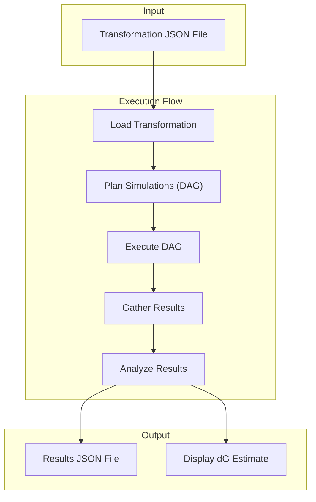
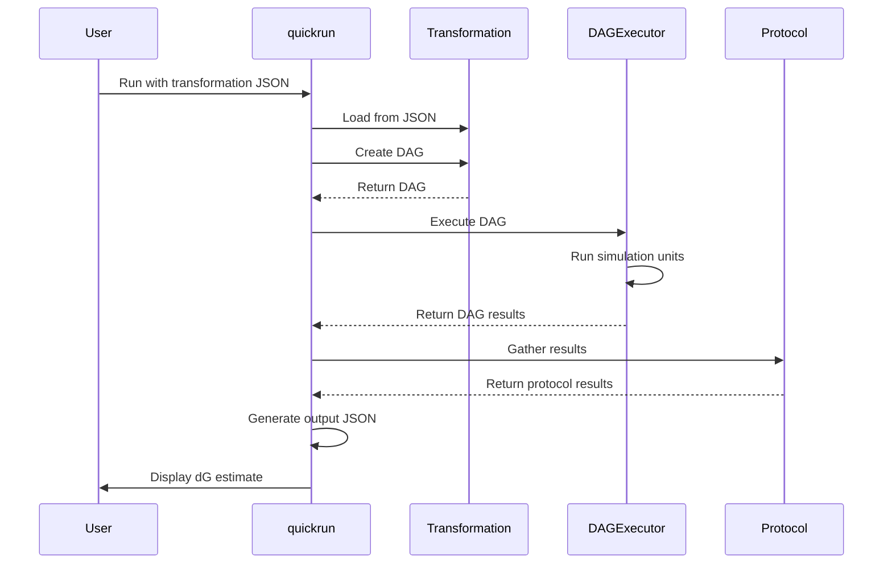
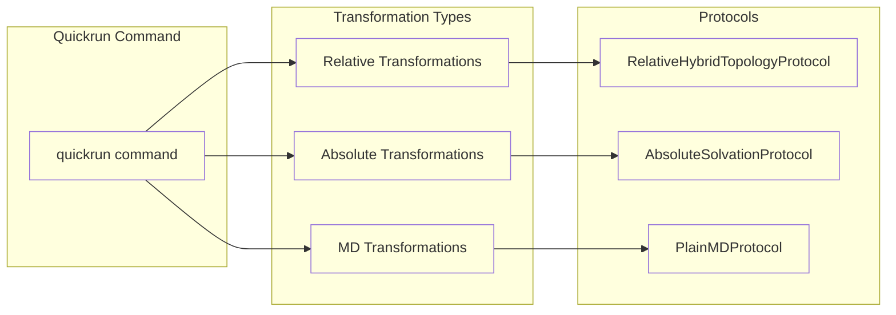

# Simulation Execution

<details>
<summary>Relevant source files</summary>

The following files were used as context for generating this wiki page:

- [openfe/protocols/openmm_afe/base.py](openfe/protocols/openmm_afe/base.py)
- [openfe/protocols/openmm_afe/equil_afe_settings.py](openfe/protocols/openmm_afe/equil_afe_settings.py)
- [openfe/protocols/openmm_afe/equil_solvation_afe_method.py](openfe/protocols/openmm_afe/equil_solvation_afe_method.py)
- [openfe/protocols/openmm_md/plain_md_methods.py](openfe/protocols/openmm_md/plain_md_methods.py)
- [openfe/protocols/openmm_md/plain_md_settings.py](openfe/protocols/openmm_md/plain_md_settings.py)
- [openfe/protocols/openmm_rfe/equil_rfe_methods.py](openfe/protocols/openmm_rfe/equil_rfe_methods.py)
- [openfe/protocols/openmm_rfe/equil_rfe_settings.py](openfe/protocols/openmm_rfe/equil_rfe_settings.py)
- [openfe/protocols/openmm_utils/omm_settings.py](openfe/protocols/openmm_utils/omm_settings.py)
- [openfecli/commands/generate_partial_charges.py](openfecli/commands/generate_partial_charges.py)
- [openfecli/commands/plan_rbfe_network.py](openfecli/commands/plan_rbfe_network.py)
- [openfecli/commands/plan_rhfe_network.py](openfecli/commands/plan_rhfe_network.py)
- [openfecli/parameters/__init__.py](openfecli/parameters/__init__.py)
- [openfecli/parameters/misc.py](openfecli/parameters/misc.py)
- [openfecli/parameters/plan_network_options.py](openfecli/parameters/plan_network_options.py)
- [openfecli/plan_alchemical_networks_utils.py](openfecli/plan_alchemical_networks_utils.py)
- [openfecli/tests/commands/test_plan_rbfe_network.py](openfecli/tests/commands/test_plan_rbfe_network.py)
- [openfecli/tests/commands/test_plan_rhfe_network.py](openfecli/tests/commands/test_plan_rhfe_network.py)

</details>


## Purpose and Scope

This document details the simulation execution system in OpenFE, which is primarily implemented through the `quickrun` command-line interface. This tool executes alchemical transformations (also called "edges") that have been defined during the network planning phase. For information about creating transformation networks, see [Network Planning Commands](#4.1), and for analyzing results after execution, see [Results Gathering and Analysis](#4.3).

## Overview

The simulation execution system takes a JSON-formatted transformation specification and executes all the required simulation steps. It handles workflow orchestration, error handling, output management, and result gathering.



Sources: [openfecli/commands/quickrun.py:94-134]()

## The `quickrun` Command

The `quickrun` command is the primary tool for executing transformations in OpenFE. It takes a transformation JSON file and runs all the necessary simulation steps to calculate free energy differences.

### Command Syntax

```
openfe quickrun [OPTIONS] TRANSFORMATION
```

Where `TRANSFORMATION` is the path to a JSON file containing a serialized transformation.

### Options

- `--work-dir, -d`: Directory in which to store simulation files (defaults to current directory)
- `--output, -o`: Filepath at which to create and write the JSON-formatted results

Sources: [openfecli/commands/quickrun.py:19-38]()

## Execution Flow

The `quickrun` command follows a specific sequence of operations to execute a transformation:



Sources: [openfecli/commands/quickrun.py:94-134]()

### 1. Loading the Transformation

The command first loads the transformation definition from the provided JSON file. This transformation object contains all the necessary information about the chemical transformation being simulated, including:

- The initial and final chemical states
- The protocol to be used (e.g., RelativeHybridTopologyProtocol)
- Protocol settings and parameters

Sources: [openfecli/commands/quickrun.py:94-95]()

### 2. Planning Simulations

After loading the transformation, `quickrun` creates a Directed Acyclic Graph (DAG) of simulation tasks. This DAG represents the workflow of individual simulation units that need to be executed to complete the free energy calculation.

Sources: [openfecli/commands/quickrun.py:102-103]()

### 3. Executing the DAG

The command then executes the DAG, which runs all the simulation units. Each unit corresponds to a specific task in the alchemical free energy calculation process. During execution:

- A directory is created for each simulation unit
- Simulation output files are stored in these directories
- Error handling and retries are managed automatically (up to 2 retries per unit)

Sources: [openfecli/commands/quickrun.py:104-111]()

### 4. Gathering and Analyzing Results

After all simulations are complete, `quickrun` gathers the results from all units and passes them to the protocol's analysis tools. These tools:

- Process the raw simulation data
- Calculate the free energy estimate
- Estimate the associated uncertainty

Sources: [openfecli/commands/quickrun.py:112-117]()

### 5. Output Generation

Finally, `quickrun` generates a comprehensive JSON output file containing:

- The free energy estimate and uncertainty
- The complete protocol result
- Results from individual simulation units

The command also displays the final free energy estimate and uncertainty directly in the terminal.

Sources: [openfecli/commands/quickrun.py:121-134]()

## Error Handling

The `quickrun` command includes robust error handling to deal with simulation failures:

- Failed simulation units are recorded in the output JSON
- Detailed error messages are displayed
- Up to 2 automatic retries are attempted for each failed unit
- The command returns a non-zero exit code if simulations fail

If any simulation unit fails after retries, the command will report the specific error with details about which unit failed and why.

Sources: [openfecli/commands/quickrun.py:137-144]()

## Output Structure

The JSON output file produced by `quickrun` has the following structure:

```
{
    "estimate": <float>,              # Free energy estimate in kJ/mol
    "uncertainty": <float>,           # Uncertainty of the estimate in kJ/mol
    "protocol_result": {              # Complete protocol result object
        ...
    },
    "unit_results": {                 # Results from individual simulation units
        "<unit_key>": {
            ...
        },
        ...
    }
}
```

Sources: [openfecli/commands/quickrun.py:121-129](), [openfecli/tests/commands/test_quickrun.py:38-39]()

## Usage Examples

### Basic Usage

Run a single transformation with default settings:

```bash
openfe quickrun transformation.json
```

This will execute the transformation defined in `transformation.json` and create a results file named with the transformation key in the current directory.

### Specifying Work Directory

Run a transformation and store all simulation files in a specific directory:

```bash
openfe quickrun transformation.json --work-dir my_simulations
```

This will create the directory `my_simulations` if it doesn't exist and store all simulation files and results there.

### Custom Output File

Run a transformation and specify a custom name and location for the results file:

```bash
openfe quickrun transformation.json --output results/my_results.json
```

This will create the results directory if it doesn't exist and store the results file as `results/my_results.json`.

Sources: [openfecli/commands/quickrun.py:39-56](), [openfecli/tests/commands/test_quickrun.py:20-67]()

## Integration with Protocols

The `quickrun` command works with all the main simulation protocols in OpenFE:



The transformation JSON file determines which protocol is used, and `quickrun` adapts its execution accordingly.

Sources: [openfecli/commands/quickrun.py:102-114]()

## Logging and Output Display

The `quickrun` command configures comprehensive logging for all OpenFE components:

- Logs from the `gufe`, `gufekey`, and `openfe` modules are captured
- Warnings are converted to log messages
- Certain repetitive warnings are filtered
- Progress information is displayed during execution
- Line buffering is enabled to ensure output is visible in queuing systems

Sources: [openfecli/commands/quickrun.py:57-84]()

## Technical Implementation Details

The `quickrun` command integrates with the following OpenFE components:

- `gufe.transformations.transformation.Transformation`: Defines the alchemical transformation
- `gufe.protocols.protocoldag.execute_DAG`: Executes the simulation workflow
- `JSON_HANDLER`: Handles serialization/deserialization of complex objects
- `MsgIncludesStringFilter`: Filters repetitive log messages

The command is implemented as a Click plugin and registered with the OpenFE CLI system through the `OFECommandPlugin` mechanism.

Sources: [openfecli/commands/quickrun.py:57-151]()

## Summary

The simulation execution system in OpenFE, primarily through the `quickrun` command, provides a straightforward way to run alchemical free energy calculations. It handles the complexity of creating and executing simulation workflows, managing outputs, analyzing results, and handling errors. The command is designed to work with transformations created by the network planning tools and produces outputs suitable for further analysis.

---