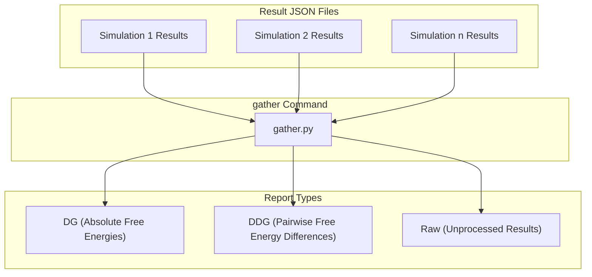
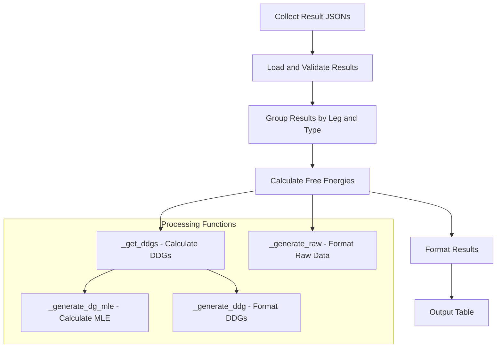
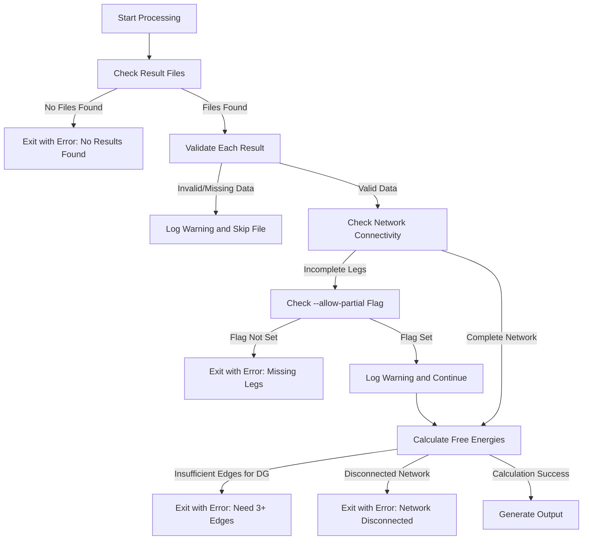
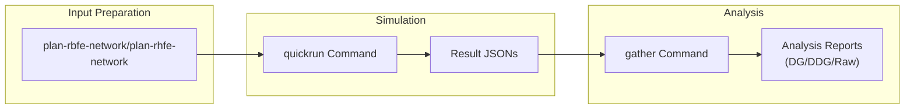

# Results Gathering and Analysis

<details>
<summary>Relevant source files</summary>

The following files were used as context for generating this wiki page:

- [openfecli/clicktypes/__init__.py](openfecli/clicktypes/__init__.py)
- [openfecli/clicktypes/hyphenchoice.py](openfecli/clicktypes/hyphenchoice.py)
- [openfecli/commands/gather.py](openfecli/commands/gather.py)
- [openfecli/tests/clicktypes/test_hyphenchoice.py](openfecli/tests/clicktypes/test_hyphenchoice.py)
- [openfecli/tests/commands/test_charge_generation.py](openfecli/tests/commands/test_charge_generation.py)
- [openfecli/tests/commands/test_gather.py](openfecli/tests/commands/test_gather.py)
- [openfecli/tests/test_rbfe_tutorial.py](openfecli/tests/test_rbfe_tutorial.py)
- [openfecli/tests/utils.py](openfecli/tests/utils.py)

</details>


## Overview

The Results Gathering and Analysis system provides tools to collect, process, and analyze simulation results from free energy calculations performed using OpenFE. It allows users to extract meaningful thermodynamic values and their associated uncertainties from the raw simulation output data. This page focuses on the `gather` command-line tool, which is the primary interface for post-simulation analysis in OpenFE.

For information about planning and executing simulations, see [Network Planning Commands](#4.1) and [Simulation Execution](#4.2).

Sources: [openfecli/commands/gather.py:569-675]()

## Command Usage

The `gather` command recursively searches through specified directories for result JSON files generated by OpenFE's simulation protocols, analyzes the results, and produces standardized output.

```
openfecli gather [OPTIONS] RESULTS...
```

### Arguments

- `RESULTS`: One or more directories or specific JSON files containing simulation results. The command will recursively search through directories to find all result files.

### Options

- `--report`: Type of analysis to perform. Options are:
  - `dg`: Maximum-likelihood estimate of absolute free energies (default)
  - `ddg`: Pairwise relative free energy differences
  - `raw`: Raw simulation results without statistical processing
- `-o, --output`: Specify an output file (defaults to stdout)
- `--tsv`: Format the output as tab-separated values (useful for programmatic parsing)
- `--allow-partial`: Process partial results when some edges in the network are missing

Sources: [openfecli/commands/gather.py:569-621](), [openfecli/commands/gather.py:614-637]()

## Report Types

The `gather` command can generate three different types of reports:



Sources: [openfecli/commands/gather.py:583-588](), [openfecli/commands/gather.py:622-636]()

### DG Report (Maximum Likelihood Estimate)

The default report type (`dg`) provides absolute free energy estimates for each ligand in the network. These values are calculated using the Maximum Likelihood Estimate (MLE) method, which combines all pairwise relative free energy measurements to produce consistent absolute values.

Key features:
- Values are centered around 0.0 (can be shifted to match experimental data)
- Requires at least 3 edges in the connected network
- Uncertainty estimates are provided

Sample output:

| ligand | DG(MLE) (kcal/mol) | uncertainty (kcal/mol) |
|--------|---------------------|------------------------|
| lig_A  | -0.5                | 0.1                    |
| lig_B  | 1.2                 | 0.2                    |
| lig_C  | -1.3                | 0.1                    |

Sources: [openfecli/commands/gather.py:376-468](), [openfecli/tests/commands/test_gather.py:136-148]()

### DDG Report (Pairwise Differences)

The `ddg` report shows pairwise relative free energy differences between ligands (DDG(i->j) = DG(j) - DG(i)). This is useful for direct comparison of ligand pairs without calculating absolute values.

Sample output:

| ligand_i | ligand_j | DDG(i->j) (kcal/mol) | uncertainty (kcal/mol) |
|----------|----------|----------------------|------------------------|
| lig_A    | lig_B    | 1.7                  | 0.2                    |
| lig_A    | lig_C    | -0.8                 | 0.1                    |
| lig_B    | lig_C    | -2.5                 | 0.2                    |

Sources: [openfecli/commands/gather.py:307-330](), [openfecli/tests/commands/test_gather.py:150-161]()

### Raw Report (Unprocessed Results)

The `raw` report provides the raw DG values for each simulation leg without combining or statistical processing. This is useful for detailed inspection of individual simulations.

Sample output:

| leg     | ligand_i | ligand_j | DG(i->j) (kcal/mol) | MBAR uncertainty (kcal/mol) |
|---------|----------|----------|---------------------|----------------------------|
| complex | lig_A    | lig_B    | -14.9               | 0.8                        |
| solvent | lig_A    | lig_B    | -15.7               | 0.8                        |
| complex | lig_B    | lig_C    | 23.1                | 0.8                        |
| solvent | lig_B    | lig_C    | 23.5                | 0.8                        |

Sources: [openfecli/commands/gather.py:332-364](), [openfecli/tests/commands/test_gather.py:163-219]()

## Data Processing Flow

The `gather` command processes simulation results through a series of steps:



Sources: [openfecli/commands/gather.py:470-655]()

### Result Collection and Validation

The process begins by recursively searching for JSON result files in the provided paths. Each file is loaded and validated to ensure it contains the necessary data.

Key validation steps:
- Check for required fields (`estimate`, `uncertainty`)
- Extract ligand names and simulation types
- Identify failed simulations based on exceptions or missing data

Sources: [openfecli/commands/gather.py:78-216](), [openfecli/commands/gather.py:470-497]()

### Organizing Results

The validated results are organized into a hierarchical structure based on:
1. Ligand pairs (`lig_A -> lig_B`)
2. Simulation types (`complex`, `solvent`, `vacuum`)
3. Simulation repeats

This organization allows for combining results from multiple simulations and identifying complete thermodynamic cycles.

Sources: [openfecli/commands/gather.py:500-546]()

### Calculating Free Energies

Different calculations are performed based on the requested report type:

1. **Raw Report**: Minimal processing, simply formats the individual results
2. **DDG Report**: Calculates relative free energies by combining corresponding legs
   - For relative binding (RBFE): DDG(bind) = DG(complex) - DG(solvent)
   - For relative hydration (RHFE): DDG(hyd) = DG(solvent) - DG(vacuum)
3. **DG Report**: Uses maximum likelihood estimation to calculate absolute free energies
   - Constructs a network graph from all pairwise measurements
   - Applies statistical methods to find the most consistent set of absolute values
   - Requires at least 3 connected edges in the network

Sources: [openfecli/commands/gather.py:244-304](), [openfecli/commands/gather.py:376-468]()

## Error Handling

The system includes comprehensive error handling for various scenarios:



Common error scenarios:
1. **No result files found**: The specified paths contain no valid result JSONs
2. **Missing simulation legs**: Some edges are missing required simulations (e.g., only have solvent but not complex)
3. **Disconnected network**: For DG calculations, the network must be fully connected
4. **Insufficient repeats**: For statistical analysis, at least two repeats are required
5. **Insufficient edges**: For DG calculations, at least 3 edges are needed

Sources: [openfecli/commands/gather.py:217-244](), [openfecli/commands/gather.py:432-442](), [openfecli/commands/gather.py:450-456](), [openfecli/commands/gather.py:366-374]()

## Uncertainty Analysis

The system provides uncertainty estimates for all calculated values. Uncertainties are propagated using standard statistical methods:

1. For raw values: Reported directly from the MBAR analysis
2. For DDG calculations: Combined using error propagation (sqrt of sum of squares)
3. For DG calculations: Derived from the maximum likelihood estimation

Results are formatted to show appropriate significant figures based on the uncertainty magnitude.

Sources: [openfecli/commands/gather.py:16-76](), [openfecli/commands/gather.py:267-284]()

## Integration with OpenFE Workflow

The results gathering system is an integral part of the OpenFE workflow:



The `gather` command completes the workflow by:
1. Collecting results from simulations set up by the network planning commands
2. Extracting meaningful thermodynamic values
3. Providing statistically sound uncertainty estimates
4. Enabling further analysis and visualization

Sources: [openfecli/tests/test_rbfe_tutorial.py:1-125]()

## Examples

### Basic Usage

Collect all results from a directory and calculate absolute free energies:

```
openfecli gather results/
```

### Generating DDG Report

Create a tab-separated file with relative free energy differences:

```
openfecli gather results/ --report ddg -o ddg_results.tsv
```

### Handling Partial Results

Process available results even when some simulations failed:

```
openfecli gather results/ --allow-partial
```

### Examining Raw Data

Inspect the unprocessed simulation results:

```
openfecli gather results/ --report raw
```

Sources: [openfecli/tests/commands/test_gather.py:339-371](), [openfecli/tests/test_rbfe_tutorial.py:107-125]()

---