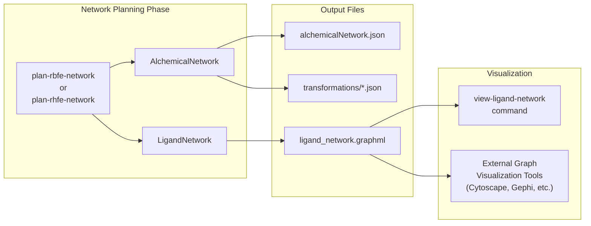
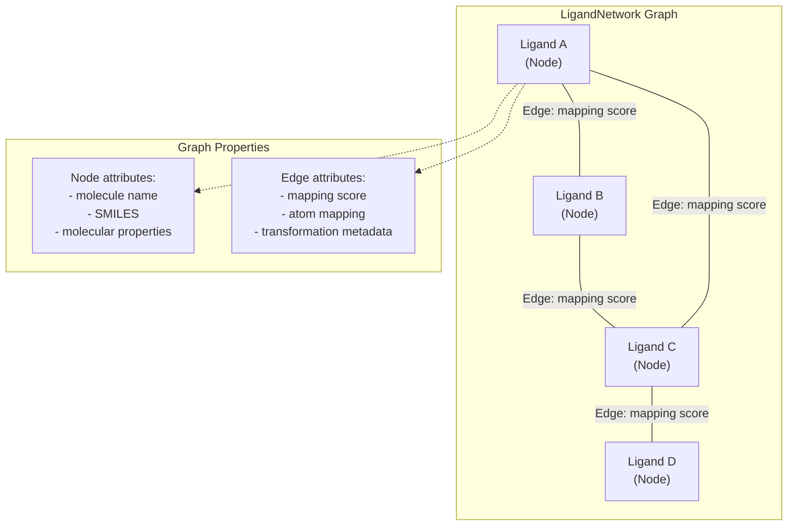
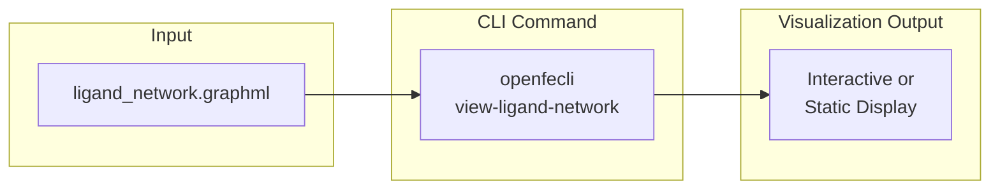
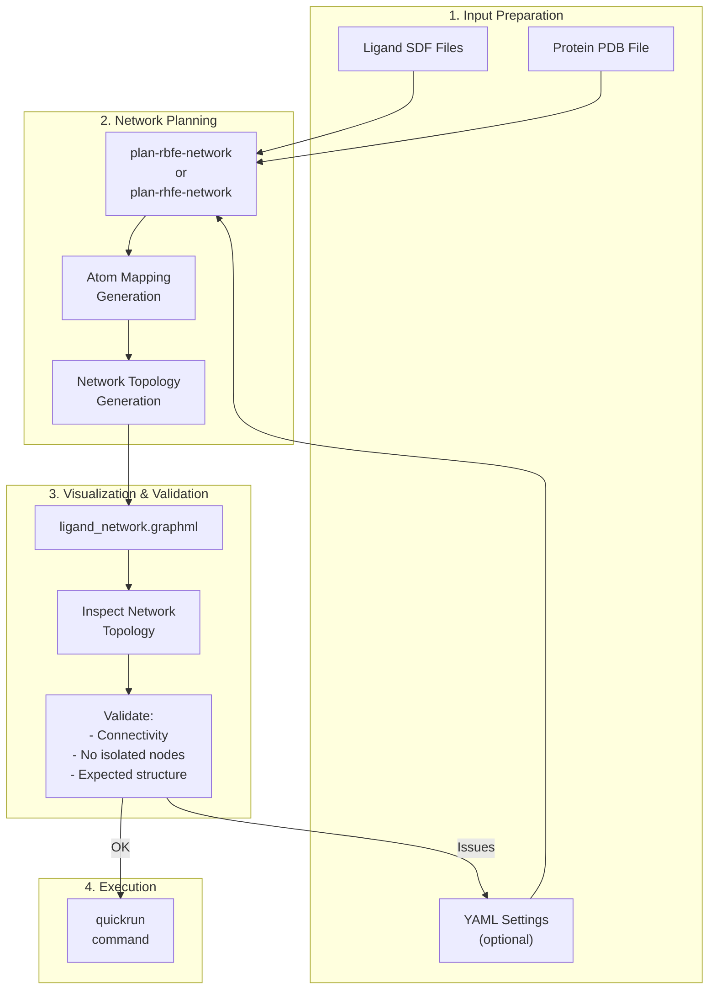
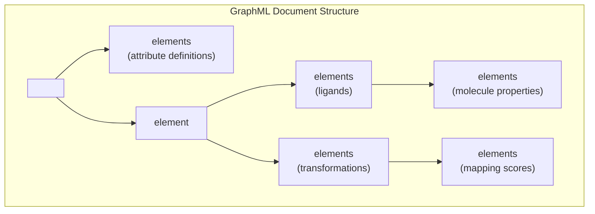

# Network Visualization

<details>
<summary>Relevant source files</summary>

The following files were used as context for generating this wiki page:

- [openfecli/commands/generate_partial_charges.py](openfecli/commands/generate_partial_charges.py)
- [openfecli/commands/plan_rbfe_network.py](openfecli/commands/plan_rbfe_network.py)
- [openfecli/commands/plan_rhfe_network.py](openfecli/commands/plan_rhfe_network.py)
- [openfecli/parameters/__init__.py](openfecli/parameters/__init__.py)
- [openfecli/parameters/misc.py](openfecli/parameters/misc.py)
- [openfecli/parameters/plan_network_options.py](openfecli/parameters/plan_network_options.py)
- [openfecli/plan_alchemical_networks_utils.py](openfecli/plan_alchemical_networks_utils.py)
- [openfecli/tests/commands/test_plan_rbfe_network.py](openfecli/tests/commands/test_plan_rbfe_network.py)
- [openfecli/tests/commands/test_plan_rhfe_network.py](openfecli/tests/commands/test_plan_rhfe_network.py)

</details>


## Purpose and Scope

This page documents the network visualization capabilities in OpenFE's CLI, specifically the GraphML output format generated during network planning and the tools for visualizing ligand networks. Network visualization allows users to inspect the topology of alchemical transformations before running simulations, helping to identify network structure, connectivity patterns, and potential issues with the planned campaign.

For information about generating the networks themselves, see [Network Planning Commands](#4.1). For the underlying data structures, see [Ligand Networks](#3.2) and [Alchemical Network Planning](#3.3).

---

## Overview

When planning an alchemical free energy network using `plan-rbfe-network` or `plan-rhfe-network`, OpenFE automatically generates a GraphML file that encodes the ligand network topology. This file can be visualized using standard graph visualization tools to understand the connectivity and structure of the planned transformations.



**Sources:** [openfecli/plan_alchemical_networks_utils.py:10-37](), [openfecli/commands/plan_rbfe_network.py:228-252](), [openfecli/commands/plan_rhfe_network.py:195-216]()

---

## GraphML Output Generation

### File Creation

During network planning, the `plan_alchemical_network_output` function writes three types of output files:

| File Type | Filename Pattern | Content | Format |
|-----------|------------------|---------|--------|
| Alchemical Network | `{base_name}.json` | Full network with protocols | JSON |
| Ligand Network | `ligand_network.graphml` | Network topology only | GraphML |
| Transformations | `transformations/{name}.json` | Individual transformation definitions | JSON |

The GraphML file is generated by calling the `to_graphml()` method on the `LigandNetwork` object:

```python
# From plan_alchemical_network_output function
ln_fname = "ligand_network.graphml"
with open(folder_path / ln_fname, mode="w") as f:
    f.write(ligand_network.to_graphml())
```

**Sources:** [openfecli/plan_alchemical_networks_utils.py:10-37]()

### Output Location

The GraphML file is written to the output directory specified by the `--output-dir` (or `-o`) option:

- **Default location:** `./alchemicalNetwork/ligand_network.graphml`
- **Custom location:** `{custom_dir}/ligand_network.graphml`

Both `plan-rbfe-network` and `plan-rhfe-network` commands generate this file:

```bash
# RBFE network planning
openfecli plan-rbfe-network -M ligands.sdf -p protein.pdb -o my_network

# RHFE network planning  
openfecli plan-rhfe-network -M ligands.sdf -o my_network

# Both create: my_network/ligand_network.graphml
```

**Sources:** [openfecli/commands/plan_rbfe_network.py:130-131](), [openfecli/commands/plan_rhfe_network.py:106-107](), [openfecli/plan_alchemical_networks_utils.py:17-27]()

---

## Network Topology Representation

### Graph Structure

The GraphML file represents a `LigandNetwork` as an undirected graph where:

- **Nodes:** Individual small molecules (`SmallMoleculeComponent` objects)
- **Edges:** Alchemical transformations between pairs of molecules
- **Edge Weights:** Mapping scores from the atom mapping algorithm



### Network Topologies

The topology depends on the network planning algorithm specified in the YAML settings:

| Algorithm | Description | Use Case |
|-----------|-------------|----------|
| `generate_minimal_spanning_network` | Minimum spanning tree (MST) | Default; minimal number of edges |
| `generate_radial_network` | Star topology around central ligand | Testing against reference compound |
| `generate_maximal_network` | Fully connected graph | Maximum redundancy |
| `generate_minimal_redundant_network` | MST with additional edges | Balance between efficiency and redundancy |
| `generate_lomap_network` | LOMAP algorithm with path constraints | Moderate redundancy |

**Sources:** [openfecli/parameters/plan_network_options.py:162-180]()

---

## Visualization Methods

### view-ligand-network Command

The CLI provides a `view-ligand-network` command for visualizing the network topology directly from the GraphML file. This command allows users to inspect the network structure without requiring external tools.



### External Visualization Tools

GraphML is a standard graph format supported by many visualization tools:

**Recommended Tools:**
- **Cytoscape:** Network analysis and visualization platform
- **Gephi:** Open-source graph visualization software  
- **yEd:** Graph editor with automatic layout algorithms
- **NetworkX + Matplotlib:** Programmatic visualization in Python

**Example workflow:**
1. Generate network: `openfecli plan-rbfe-network -M ligands/ -p protein.pdb`
2. Locate GraphML: `alchemicalNetwork/ligand_network.graphml`
3. Open in visualization tool of choice
4. Inspect node connectivity and edge weights
5. Identify central molecules, isolated clusters, or problematic mappings

**Sources:** [openfecli/plan_alchemical_networks_utils.py:24-27]()

---

## Integration with Network Planning Workflow

### Complete Planning Pipeline

Network visualization fits into the overall workflow as a validation step between planning and execution:



### Validation Checklist

When visualizing a network, check for:

| Aspect | Expected | Problematic |
|--------|----------|-------------|
| **Connectivity** | All nodes connected | Isolated nodes or clusters |
| **Edge Weights** | Reasonable mapping scores | Unusually low scores (<0.3) |
| **Topology** | Matches intended algorithm | Unexpected structure |
| **Central Nodes** | Well-distributed (MST) or intentional (radial) | Unintended hub nodes |
| **Path Lengths** | Short paths between all pairs | Very long minimum paths |

**Sources:** [openfecli/commands/plan_rbfe_network.py:19-117](), [openfecli/commands/plan_rhfe_network.py:21-94]()

---

## GraphML File Contents

### File Structure

The GraphML file contains XML-formatted graph data following the GraphML specification. Key elements include:



### Node and Edge Attributes

The `LigandNetwork.to_graphml()` method encodes:

**Node Attributes:**
- Molecule identifier (name or key)
- Chemical structure information
- Molecular properties

**Edge Attributes:**
- Mapping score (from atom mapper scoring function)
- Atom mapping information
- Transformation metadata

These attributes enable filtering and analysis during visualization.

**Sources:** [openfecli/plan_alchemical_networks_utils.py:24-27]()

---

## Common Visualization Workflows

### Workflow 1: Quick Network Inspection

```bash
# 1. Plan network
openfecli plan-rbfe-network -M ligands.sdf -p protein.pdb

# 2. View network topology
openfecli view-ligand-network alchemicalNetwork/ligand_network.graphml

# 3. If satisfied, proceed to execution
openfecli quickrun alchemicalNetwork/transformations/*.json
```

### Workflow 2: Custom Network with Validation

```bash
# 1. Create custom settings
cat > settings.yaml << EOF
network:
  method: generate_minimal_redundant_network
  settings:
    mst_num: 2
mapper:
  method: KartografAtomMapper
EOF

# 2. Plan network with custom settings
openfecli plan-rbfe-network -M ligands.sdf -p protein.pdb -s settings.yaml

# 3. Visualize and validate topology
openfecli view-ligand-network alchemicalNetwork/ligand_network.graphml

# 4. If redundancy is insufficient, adjust mst_num and re-plan
```

### Workflow 3: Radial Network Verification

```bash
# 1. Plan radial network around central ligand
cat > radial_settings.yaml << EOF
network:
  method: generate_radial_network
  settings:
    central_ligand: reference_compound
EOF

openfecli plan-rbfe-network -M ligands.sdf -p protein.pdb -s radial_settings.yaml

# 2. Verify star topology in visualization
# All ligands should connect to central_ligand only
openfecli view-ligand-network alchemicalNetwork/ligand_network.graphml
```

**Sources:** [openfecli/parameters/plan_network_options.py:161-180](), [openfecli/commands/plan_rbfe_network.py:135-177]()

---

## Programmatic Access

### Loading GraphML in Python

The GraphML file can be loaded programmatically for custom analysis:

```python
import networkx as nx
from pathlib import Path

# Load GraphML file
graph = nx.read_graphml('alchemicalNetwork/ligand_network.graphml')

# Analyze network properties
print(f"Number of ligands: {graph.number_of_nodes()}")
print(f"Number of transformations: {graph.number_of_edges()}")
print(f"Network density: {nx.density(graph)}")

# Find central nodes (by degree)
degree_centrality = nx.degree_centrality(graph)
most_central = max(degree_centrality, key=degree_centrality.get)
print(f"Most connected ligand: {most_central}")
```

### Visualization with NetworkX

```python
import matplotlib.pyplot as plt

# Create visualization
pos = nx.spring_layout(graph)
nx.draw(graph, pos, 
        with_labels=True,
        node_color='lightblue',
        node_size=500,
        font_size=8)

# Add edge weights (mapping scores) as labels
edge_labels = nx.get_edge_attributes(graph, 'weight')
nx.draw_networkx_edge_labels(graph, pos, edge_labels)

plt.savefig('network_topology.png')
```

**Sources:** The GraphML format is standard and compatible with NetworkX and other graph libraries

---

## Troubleshooting

### Common Issues

| Issue | Cause | Solution |
|-------|-------|----------|
| GraphML file not generated | Planning command failed | Check command output for errors |
| Empty or corrupt GraphML | No valid mappings found | Review atom mapper settings; check molecule compatibility |
| Cannot open in visualization tool | GraphML version mismatch | Try different tool or update software |
| Network has isolated nodes | Molecule cannot map to others | Review molecule structures; consider removing outliers |
| Unexpected topology | Wrong network algorithm | Verify YAML settings; check algorithm choice |

### Validation Commands

```bash
# Check if GraphML file exists and is valid XML
xmllint --noout alchemicalNetwork/ligand_network.graphml

# Count nodes and edges using NetworkX
python -c "import networkx as nx; g = nx.read_graphml('alchemicalNetwork/ligand_network.graphml'); print(f'Nodes: {g.number_of_nodes()}, Edges: {g.number_of_edges()}')"

# Verify network is connected
python -c "import networkx as nx; g = nx.read_graphml('alchemicalNetwork/ligand_network.graphml'); print('Connected:', nx.is_connected(g))"
```

**Sources:** [openfecli/plan_alchemical_networks_utils.py:14-27]()

---

## Related Commands and Files

### CLI Commands
- `plan-rbfe-network`: Generates GraphML for binding free energy networks (see [Network Planning Commands](#4.1))
- `plan-rhfe-network`: Generates GraphML for hydration free energy networks (see [Network Planning Commands](#4.1))
- `quickrun`: Executes the planned network (see [Simulation Execution](#4.2))

### Output Files
- `ligand_network.graphml`: Network topology for visualization
- `alchemicalNetwork.json`: Full alchemical network with protocols
- `transformations/*.json`: Individual transformation definitions

### Python API
- `LigandNetwork.to_graphml()`: Method that generates GraphML representation
- `AlchemicalNetwork`: Contains both ligand network and protocol information

**Sources:** [openfecli/plan_alchemical_networks_utils.py:1-37](), [openfecli/commands/plan_rbfe_network.py:1-257](), [openfecli/commands/plan_rhfe_network.py:1-222]()

---