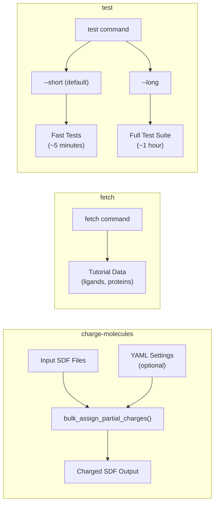
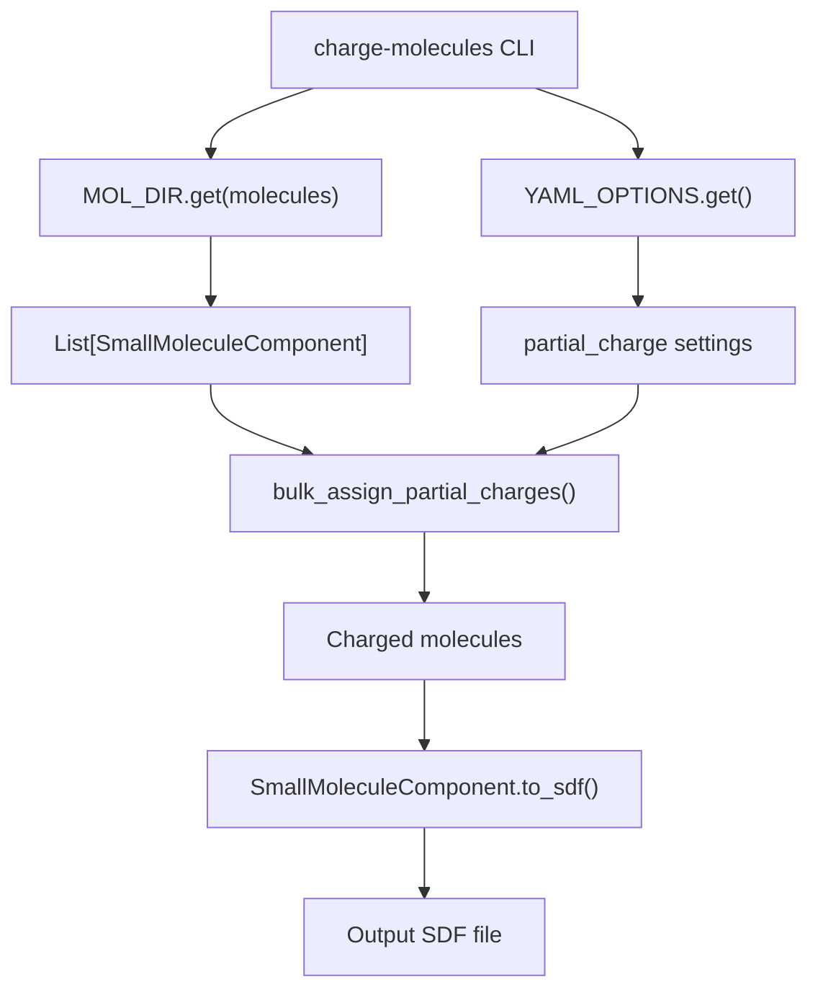
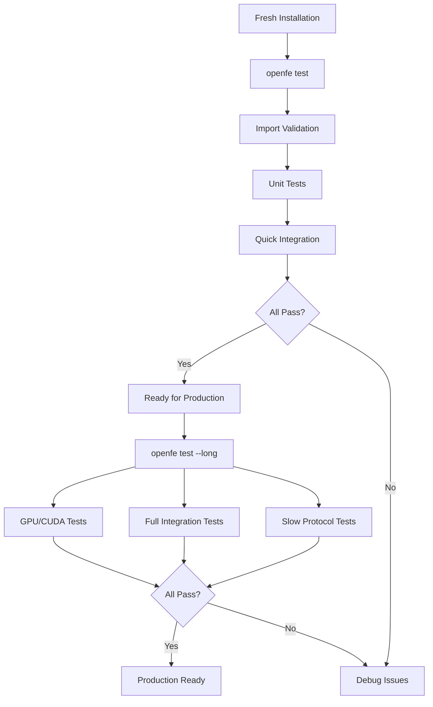
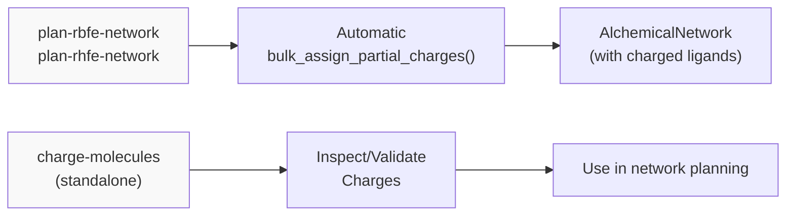
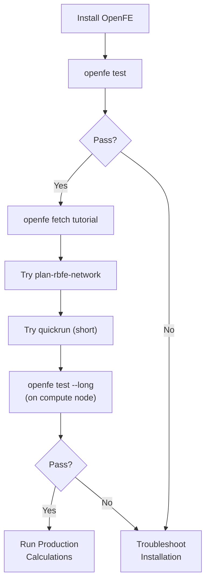

# Utility Commands

<details>
<summary>Relevant source files</summary>

The following files were used as context for generating this wiki page:

- [docs/_static/OFE-color-icon.svg](docs/_static/OFE-color-icon.svg)
- [docs/guide/index.rst](docs/guide/index.rst)
- [docs/index.rst](docs/index.rst)
- [docs/installation.rst](docs/installation.rst)
- [openfecli/commands/generate_partial_charges.py](openfecli/commands/generate_partial_charges.py)
- [openfecli/commands/plan_rbfe_network.py](openfecli/commands/plan_rbfe_network.py)
- [openfecli/commands/plan_rhfe_network.py](openfecli/commands/plan_rhfe_network.py)
- [openfecli/parameters/__init__.py](openfecli/parameters/__init__.py)
- [openfecli/parameters/misc.py](openfecli/parameters/misc.py)
- [openfecli/parameters/plan_network_options.py](openfecli/parameters/plan_network_options.py)
- [openfecli/plan_alchemical_networks_utils.py](openfecli/plan_alchemical_networks_utils.py)
- [openfecli/tests/commands/test_plan_rbfe_network.py](openfecli/tests/commands/test_plan_rbfe_network.py)
- [openfecli/tests/commands/test_plan_rhfe_network.py](openfecli/tests/commands/test_plan_rhfe_network.py)

</details>


This page documents supporting CLI commands that facilitate OpenFE workflows but are not directly involved in network planning, execution, or analysis. These commands handle preparatory tasks (charge generation, test data fetching) and environment validation.

For network planning commands, see [Network Planning Commands](#4.1). For simulation execution, see [Simulation Execution](#4.2). For results analysis, see [Results Gathering and Analysis](#4.3).

---

## Overview of Utility Commands

OpenFE provides three utility commands under the "Miscellaneous Commands" section:

| Command | Purpose | Typical Use Case |
|---------|---------|------------------|
| `charge-molecules` | Generate partial charges for molecules | Prepare ligands before network planning |
| `fetch` | Download tutorial datasets and resources | Obtain example data for learning |
| `test` | Validate OpenFE installation | Verify correct installation and GPU access |

Sources: [docs/installation.rst:394-398]()

---

## Command Data Flow



Sources: [openfecli/commands/generate_partial_charges.py:1-97](), [docs/installation.rst:110-127]()

---

## charge-molecules Command

### Purpose

The `charge-molecules` command assigns partial charges to a collection of small molecules and writes them to an SDF file. This is a standalone version of the charge generation step that happens automatically during network planning commands.

**When to use:**
- Pre-charge molecules to inspect charges before network planning
- Generate charges using specific methods for analysis
- Prepare molecules for external tools that require charged structures

### Command Syntax

```bash
openfe charge-molecules \
    --molecules <molecule_dir_or_files> \
    --output <output.sdf> \
    [--settings <settings.yaml>] \
    [--n-cores <N>] \
    [--overwrite-charges]
```

### Parameters

| Parameter | Short | Type | Required | Description |
|-----------|-------|------|----------|-------------|
| `--molecules` | `-M` | Path | Yes | Directory containing SDF files or individual SDF files |
| `--output` | `-o` | Path | Yes | Output SDF filename for charged molecules |
| `--settings` | `-s` | Path | No | YAML file specifying charge generation method |
| `--n-cores` | `-n` | Integer | No | Number of cores for parallel processing (default: 1) |
| `--overwrite-charges` | | Flag | No | Overwrite existing partial charges |

Sources: [openfecli/commands/generate_partial_charges.py:30-40](), [openfecli/parameters/misc.py:13-20]()

### Charge Generation Methods

The command supports multiple charge generation backends through the `partial_charge` section in YAML settings:

| Method | Backend Requirement | Notes |
|--------|-------------------|-------|
| `am1bcc` | AmberTools (default) | Semi-empirical AM1-BCC charges |
| `am1bccelf10` | OpenEye Toolkits | AM1-BCC with ELF10 conformer selection |
| `nagl` | openff-nagl | Neural network predicted charges |
| `espaloma` | espaloma_charge | Machine learning force field charges |

### YAML Configuration

The `--settings` YAML file accepts a `partial_charge` section:

```yaml
partial_charge:
  method: am1bcc
  settings:
    off_toolkit_backend: ambertools
    number_of_conformers: 10
```

For NAGL charges:

```yaml
partial_charge:
  method: nagl
  settings:
    nagl_model: openff-gnn-am1bcc-0.1.0-rc.3.pt
```

Sources: [openfecli/commands/generate_partial_charges.py:7-27](), [openfecli/parameters/plan_network_options.py:40-53]()

### Implementation Details



The command delegates to `bulk_assign_partial_charges()` from the charge generation module:

- **Function**: `bulk_assign_partial_charges(molecules, overwrite, method, toolkit_backend, generate_n_conformers, nagl_model, processors)`
- **Location**: `openfe.protocols.openmm_utils.charge_generation`
- **Returns**: List of `SmallMoleculeComponent` with partial charges assigned

Sources: [openfecli/commands/generate_partial_charges.py:55-94]()

### Usage Example

```bash
# Generate AM1-BCC charges using default settings
openfe charge-molecules \
    --molecules ligands/ \
    --output charged_ligands.sdf

# Generate NAGL charges with custom settings
cat > charge_settings.yaml << EOF
partial_charge:
  method: nagl
  settings:
    nagl_model: openff-gnn-am1bcc-0.1.0-rc.3.pt
EOF

openfe charge-molecules \
    --molecules ligands/*.sdf \
    --output charged_ligands.sdf \
    --settings charge_settings.yaml \
    --n-cores 4
```

### Output

The command writes a single SDF file containing all input molecules with partial charges assigned. The output includes:

- Original molecular structure
- Partial charges as properties on each atom
- All original metadata from input files

If `--overwrite-charges` is not specified and input molecules already have charges, those charges are preserved.

Sources: [openfecli/commands/generate_partial_charges.py:40-94]()

---

## fetch Command

### Purpose

The `fetch` command downloads tutorial datasets and example resources from the OpenFE repository. This provides curated test data for learning and validation.

### Command Syntax

```bash
openfe fetch <resource_name>
```

### Available Resources

The command can fetch tutorial datasets that include:
- Example ligand SDF files
- Protein PDB structures
- Pre-configured YAML settings files
- Complete example workflows

### Typical Usage

```bash
# Fetch tutorial data
openfe fetch tutorial_data
```

After fetching, tutorial files are downloaded to the current directory or a specified location, ready for use with other OpenFE commands.

**Note**: The specific implementation details for the `fetch` command are managed through OpenFE's command plugin system but are not included in the provided source files. The command is confirmed to exist in the CLI help output.

Sources: [docs/installation.rst:395]()

---

## test Command

### Purpose

The `test` command runs OpenFE's test suite to validate the installation. This is critical for:
- Verifying correct installation of dependencies
- Confirming GPU/CUDA access (if applicable)
- Detecting platform-specific issues
- Validating compute environment before production runs

### Command Syntax

```bash
openfe test [--long]
```

### Test Modes

| Mode | Duration | Scope | Use Case |
|------|----------|-------|----------|
| Default (fast) | ~5 minutes | Core functionality, unit tests | Quick validation after installation |
| `--long` | ~1 hour | Full integration tests, GPU tests | Complete validation before production use |

Sources: [docs/installation.rst:110-127]()

### Fast Tests (Default)

```bash
openfe test
```

Fast tests run automatically and include:
- Import validation (ensures all modules load correctly)
- Unit tests for core functionality
- Basic integration tests
- Platform detection tests

**First run note**: The initial execution compiles JIT code, which takes extra time. Subsequent runs are faster.

### Long Tests

```bash
openfe test --long
```

The long test suite should be run:
- On the actual compute hardware where simulations will execute
- To validate GPU/CUDA functionality
- Before deploying to production environments
- After major environment changes

This suite includes:
- All fast tests
- Slow integration tests
- GPU-specific functionality tests
- Complete protocol execution tests

Sources: [docs/installation.rst:119-127]()

### Test Validation Flow



Sources: [docs/installation.rst:110-127]()

### Expected Output

```
$ openfe test
================================ test session starts =================================
platform linux -- Python 3.11.5, pytest-7.4.0, pluggy-1.2.0
rootdir: /path/to/openfe
plugins: ...
collected 457 items

openfe/tests/test_module.py ........................................    [ 10%]
...
================================ 457 passed in 287.45s ==============================
```

All tests should report status as either:
- **passed**: Test succeeded
- **skipped**: Test skipped due to missing optional dependencies
- **xfailed**: Expected failure (known issue, not a problem)

Sources: [docs/installation.rst:110-127]()

### Alternative: Direct pytest

The test suite can also be invoked directly via pytest:

```bash
# Run fast tests only
pytest --pyargs openfe openfecli

# Run all tests including slow ones
pytest --pyargs openfe openfecli -m slow
```

This provides more control over test selection and output formatting.

Sources: [docs/installation.rst:189-193](), [docs/installation.rst:404-408]()

---

## Integration with Other Commands

### Charge Generation in Network Planning

The `charge-molecules` functionality is automatically invoked during network planning:



Both `plan-rbfe-network` and `plan-rhfe-network` automatically call `bulk_assign_partial_charges()` to ensure consistent charges across all transformations in the network. The standalone `charge-molecules` command uses the identical charging logic.

Sources: [openfecli/commands/plan_rbfe_network.py:80-90](), [openfecli/commands/plan_rhfe_network.py:74-84]()

### Test Validation Before Production

Recommended workflow for new installations:



Sources: [docs/installation.rst:110-127]()

---

## Common Use Cases

### Case 1: Pre-charging Ligands for Analysis

```bash
# Generate charges to inspect before network planning
openfe charge-molecules \
    --molecules ligands/ \
    --output charged_ligands.sdf \
    --settings charge_config.yaml

# Examine charges in external tool
# Then use charged ligands in network planning
openfe plan-rbfe-network \
    --molecules charged_ligands.sdf \
    --protein protein.pdb
```

### Case 2: Learning OpenFE Workflow

```bash
# 1. Validate installation
openfe test

# 2. Get tutorial data
openfe fetch tutorial_data

# 3. Follow tutorial notebooks
# (use fetched data with other commands)
```

### Case 3: HPC Environment Validation

```bash
# On login node
openfe test  # Fast validation

# Submit job to compute node
cat > validate_gpu.sh << 'EOF'
#!/bin/bash
#SBATCH --gres=gpu:1
module load cuda/11.7
openfe test --long
EOF

sbatch validate_gpu.sh
```

Sources: [docs/installation.rst:479-596]()

---

## Error Handling

### charge-molecules Errors

**File exists error**:
```
FileExistsError: The output file charged_ligands.sdf already exists
```
**Solution**: Choose a different output filename or delete the existing file.

**Missing charge backend**:
```
ImportError: openff-nagl not installed
```
**Solution**: Install required backend (`mamba install openff-nagl`) or use a different method.

Sources: [openfecli/commands/generate_partial_charges.py:46-49]()

### test Command Failures

**Import errors during test**:
- Indicates incomplete installation
- Re-install using `mamba create -n openfe_env openfe`

**GPU test failures**:
- Run `nvidia-smi` to check GPU visibility
- Verify CUDA version compatibility
- Set `CONDA_OVERRIDE_CUDA` if needed

**Expected failures (xfailed)**:
- These are known issues and do not indicate problems
- Test suite tracks them for future fixes

Sources: [docs/installation.rst:637-668]()

---

## Command-Line Reference

### charge-molecules

```
Usage: openfe charge-molecules [OPTIONS]

  Generate partial charges for a set of molecules.

Options:
  -M, --molecules PATH      Path to directory or SDF files  [required]
  -o, --output PATH         Output SDF filename  [required]
  -s, --settings PATH       YAML configuration file
  -n, --n-cores INTEGER     Number of cores for parallel processing
  --overwrite-charges       Overwrite existing partial charges
  -h, --help               Show this message and exit
```

Sources: [openfecli/commands/generate_partial_charges.py:30-40]()

### test

```
Usage: openfe test [OPTIONS]

  Run the OpenFE test suite

Options:
  --long                   Run comprehensive test suite (~1 hour)
  -h, --help              Show this message and exit
```

Sources: [docs/installation.rst:110-127]()

### fetch

```
Usage: openfe fetch [OPTIONS] RESOURCE

  Fetch tutorial or other resource.

Options:
  -h, --help              Show this message and exit
```

Sources: [docs/installation.rst:395]()

---