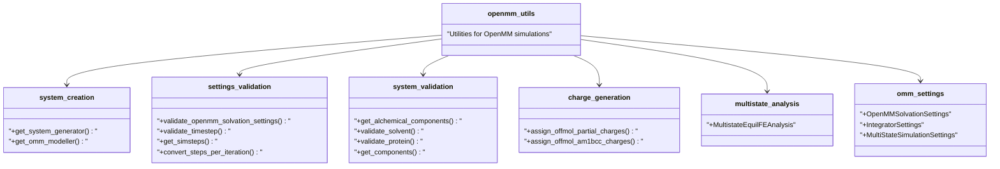
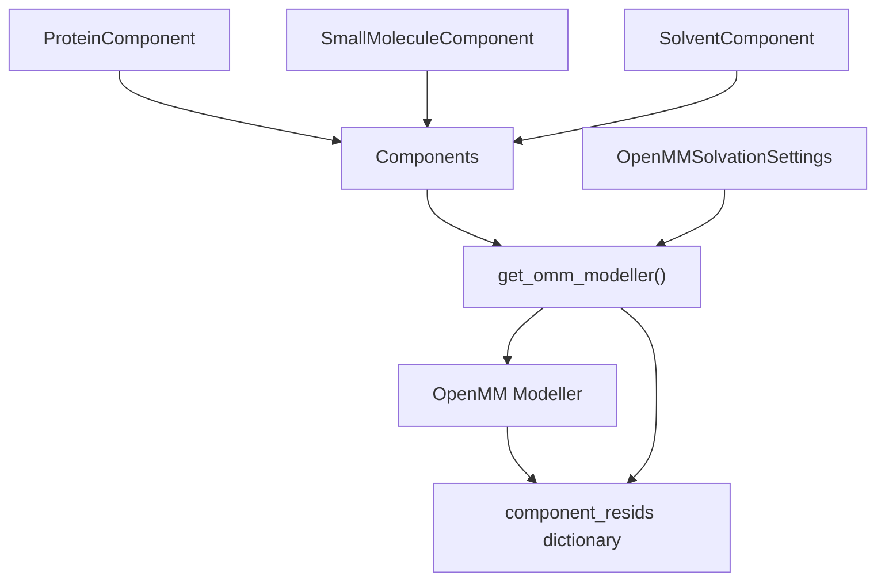
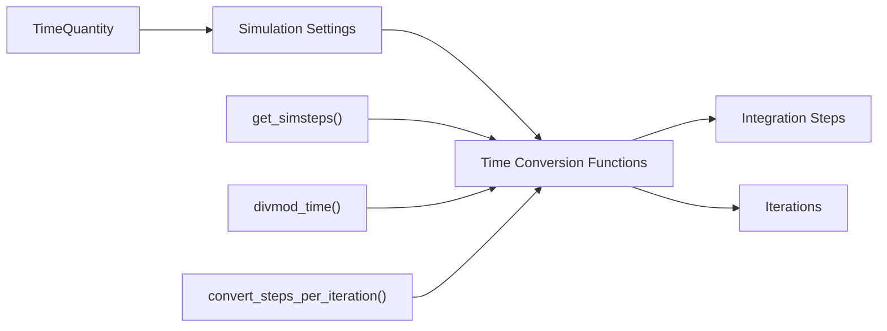
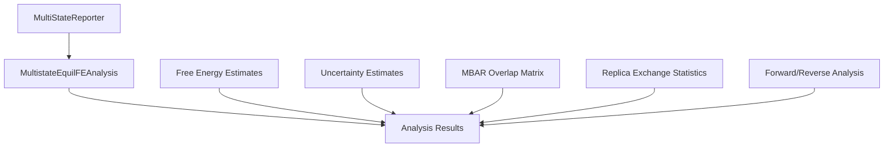
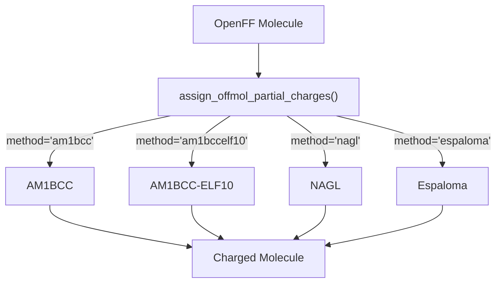
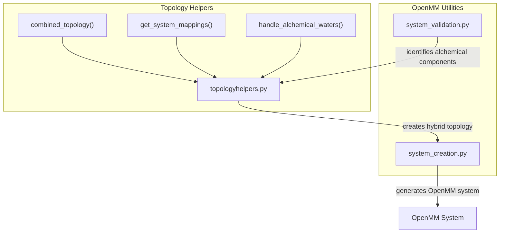

# OpenMM Utilities

<details>
<summary>Relevant source files</summary>

The following files were used as context for generating this wiki page:

- [openfe/protocols/openmm_afe/base.py](openfe/protocols/openmm_afe/base.py)
- [openfe/protocols/openmm_afe/equil_afe_settings.py](openfe/protocols/openmm_afe/equil_afe_settings.py)
- [openfe/protocols/openmm_afe/equil_solvation_afe_method.py](openfe/protocols/openmm_afe/equil_solvation_afe_method.py)
- [openfe/protocols/openmm_md/plain_md_methods.py](openfe/protocols/openmm_md/plain_md_methods.py)
- [openfe/protocols/openmm_md/plain_md_settings.py](openfe/protocols/openmm_md/plain_md_settings.py)
- [openfe/protocols/openmm_rfe/equil_rfe_methods.py](openfe/protocols/openmm_rfe/equil_rfe_methods.py)
- [openfe/protocols/openmm_rfe/equil_rfe_settings.py](openfe/protocols/openmm_rfe/equil_rfe_settings.py)
- [openfe/protocols/openmm_utils/charge_generation.py](openfe/protocols/openmm_utils/charge_generation.py)
- [openfe/protocols/openmm_utils/omm_settings.py](openfe/protocols/openmm_utils/omm_settings.py)
- [openfe/tests/conftest.py](openfe/tests/conftest.py)
- [openfe/tests/protocols/openmm_ahfe/test_ahfe_protocol.py](openfe/tests/protocols/openmm_ahfe/test_ahfe_protocol.py)
- [openfe/tests/protocols/openmm_md/test_plain_md_protocol.py](openfe/tests/protocols/openmm_md/test_plain_md_protocol.py)
- [openfe/tests/protocols/openmm_rfe/test_hybrid_top_protocol.py](openfe/tests/protocols/openmm_rfe/test_hybrid_top_protocol.py)
- [openfe/tests/protocols/test_openmm_settings.py](openfe/tests/protocols/test_openmm_settings.py)
- [openfe/tests/protocols/test_openmmutils.py](openfe/tests/protocols/test_openmmutils.py)

</details>


The OpenFE codebase provides a collection of utility functions that simplify working with OpenMM in the context of free energy calculations. These utilities handle common tasks like system creation, validation, settings management, and analysis of simulation results. They form the foundation on which the higher-level protocols operate, providing consistent interfaces and handling many implementation details.

For details about specific protocols that use these utilities, see [Core Protocols](#2) and for network planning that uses these systems, see [Network Planning and Mapping](#3).

## Overview of OpenMM Utilities



Sources: [openfe/protocols/openmm_utils/__init__.py:1-2](), [openfe/tests/protocols/test_openmmutils.py:18-21]()

## System Creation

The system creation utilities handle the generation of OpenMM `System` objects and `Modeller` objects from OpenFE components and settings.

### System Generator Creation

The `get_system_generator` function creates an OpenMMForceFields `SystemGenerator` based on protocol settings. This generator is responsible for creating OpenMM `System` objects with appropriate force fields.

```python
generator = system_creation.get_system_generator(
    forcefield_settings=ffsets,
    thermo_settings=thermosets,
    integrator_settings=intsets,
    cache=Path('./db.json'),
    has_solvent=True
)
```

Key parameters include:
- Force field settings (constraints, water model, hydrogen mass, etc.)
- Thermodynamic settings (temperature, pressure)
- Integrator settings (barostat frequency, etc.)
- Force field cache path
- Whether the system has solvent (controls barostat addition)

The function handles details such as:
- Setting up the correct constraints
- Configuring nonbonded methods and cutoffs
- Adding a barostat if needed
- Setting up caching for performance

Sources: [openfe/protocols/openmm_utils/system_creation.py:26-130]()

### OpenMM Modeller Creation

The `get_omm_modeller` function builds an OpenMM `Modeller` object from OpenFE components (proteins, small molecules, solvent).



The function:
- Takes protein, solvent, and small molecule components
- Constructs an OpenMM `Modeller` with all components
- Solvates the system if needed
- Tracks residue indices for each component

It supports various solvation options:
- Solvent padding
- Number of solvent molecules
- Box vectors or box size
- Box shape (cube, dodecahedron, etc.)
- Ion addition and neutralization

Sources: [openfe/protocols/openmm_utils/system_creation.py:136-257]()

## Settings Validation

Settings validation utilities ensure that simulation parameters are consistent and valid before running simulations.

### Solvation Settings Validation

The `validate_openmm_solvation_settings` function checks that solvation settings are consistent:

- Only one box definition method can be used (padding, number of molecules, box size, or box vectors)
- Box shape cannot be defined alongside box size or box vectors

Sources: [openfe/protocols/openmm_utils/settings_validation.py:16-44]()

### Timestep Validation and Conversion

Several utilities handle time and timestep validation:

- `validate_timestep`: Ensures the timestep is appropriate for the hydrogen mass
- `get_simsteps`: Converts simulation length to number of integration steps
- `divmod_time`: Converts time quantities to iterations
- `convert_steps_per_iteration`: Converts time per iteration to steps per iteration



These functions handle details like:
- Ensuring times are divisible by timesteps
- Converting between time units and iterations
- Validating Monte Carlo step intervals

Sources: [openfe/protocols/openmm_utils/settings_validation.py:47-301]()

## System Validation

System validation utilities check if OpenFE `ChemicalSystem` objects are valid for use in alchemical transformations.

### Identifying Alchemical Components

The `get_alchemical_components` function identifies which components differ between two chemical systems and need to be transformed alchemically.

```python
alchemical_components = system_validation.get_alchemical_components(stateA, stateB)
```

This returns a dictionary with lists of components that differ between the states.

Sources: [openfe/protocols/openmm_utils/system_validation.py:15-67]()

### Solvent and Protein Validation

Validation functions check specific constraints on system components:

- `validate_solvent`: Ensures solvent configuration is compatible with nonbonded method
- `validate_protein`: Checks that there's at most one protein component

Sources: [openfe/protocols/openmm_utils/system_validation.py:70-130]()

### Component Extraction

The `get_components` function extracts relevant components from a chemical system:

```python
solvent_comp, protein_comp, small_mols = system_validation.get_components(state)
```

This organizes components by type for further processing.

Sources: [openfe/protocols/openmm_utils/system_validation.py:139-177]()

## MultiState Analysis

The `multistate_analysis` module provides tools for analyzing results from multistate simulations, particularly for free energy calculations.

### MultistateEquilFEAnalysis

This class analyzes output from multistate simulations to calculate free energies and uncertainties:



Key features:
- Calculates free energy differences and uncertainties
- Generates forward and reverse free energy convergence analysis
- Creates MBAR overlap matrices and replica exchange statistics
- Provides plotting functions for visualization

Sources: [openfe/tests/protocols/test_openmmutils.py:232-324]()

## Charge Generation

The `charge_generation` module handles the assignment of partial charges to OpenFF molecules.

### Partial Charge Assignment

The primary function is `assign_offmol_partial_charges`, which:
- Assigns partial charges to OpenFF molecules
- Supports multiple charge assignment methods:
  - AM1BCC (via AmberTools or OpenEye)
  - AM1BCC-ELF10 (via OpenEye)
  - NAGL (neural network approach)
  - Espaloma (graph neural network approach)
- Handles conformer generation when needed



Sources: [openfe/tests/protocols/test_openmmutils.py:648-931]()

## Integration with Alchemical Topology Utilities

The OpenMM utilities work alongside topology manipulation utilities to handle alchemical transformations:



The topology helpers handle:
- Combining topologies for alchemical transformations
- Creating atom mappings between systems
- Handling charge changes through alchemical waters

Sources: [openfe/protocols/openmm_rfe/_rfe_utils/topologyhelpers.py:121-708]()

## Utility Functions in Context

The OpenMM utilities form part of a larger workflow, serving as the building blocks for the more complex protocols:

```mermaid
flowchart TD
    subgraph "OpenFE Protocol Components"
        direction LR
        subgraph "Core Settings"
            FF["OpenMMSystemGeneratorFFSettings"]
            TS["ThermoSettings"]
            IS["IntegratorSettings"]
            SS["OpenMMSolvationSettings"]
        end
        
        subgraph "OpenMM Utilities"
            SC["system_creation"]
            SV["settings_validation"]
            SYV["system_validation"]
            CG["charge_generation"]
            MA["multistate_analysis"]
        end
        
        subgraph "Protocol Units"
            RHTU["RelativeHybridTopologyProtocolUnit"]
            ASPU["AbsoluteSolvationProtocolUnit"]
            PMDU["PlainMDProtocolUnit"]
        end
    end
    
    Core Settings --> OpenMM Utilities
    OpenMM Utilities --> Protocol Units
```

Sources: [openfe/tests/protocols/test_openmmutils.py:219-228](), [openfe/tests/protocols/test_openmmutils.py:325-423]()

## Summary

The OpenMM Utilities package provides a collection of robust, reusable functions and classes for working with OpenMM in the context of free energy calculations. These utilities handle system creation, settings validation, system validation, charge generation, and result analysis, serving as the foundation for the higher-level protocols in OpenFE.

For more detailed information, see:
- [System Creation and Validation](#5.1) for details on creating and validating OpenMM systems
- [Settings Validation](#5.2) for more on validating simulation settings
- [Analysis Tools](#5.3) for utilities for analyzing simulation results

---