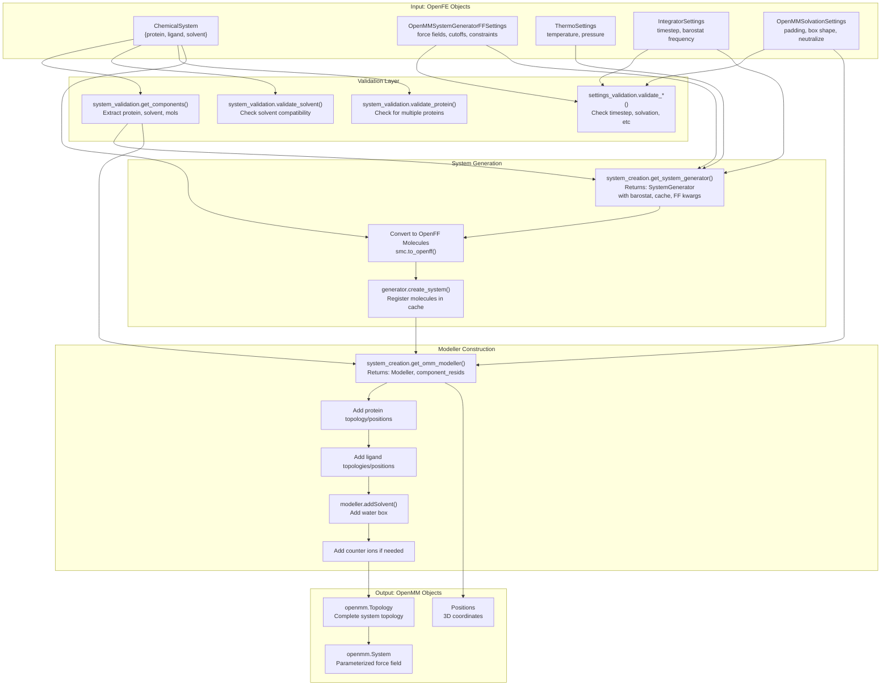
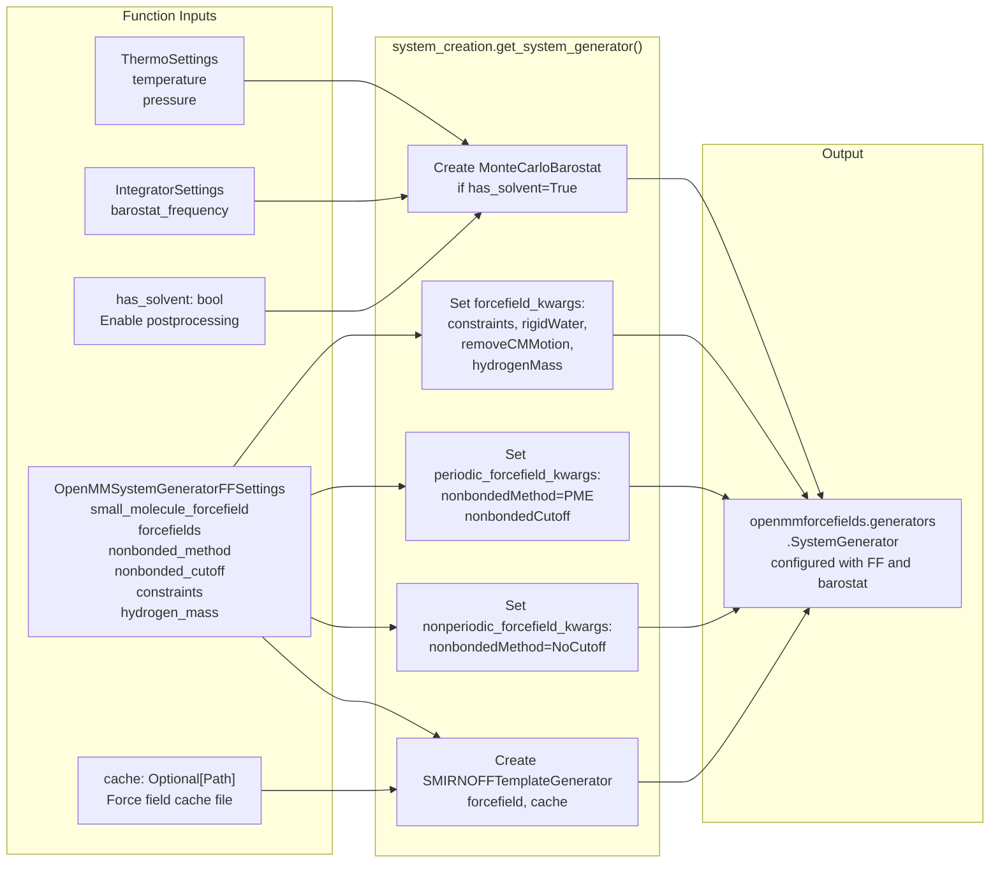
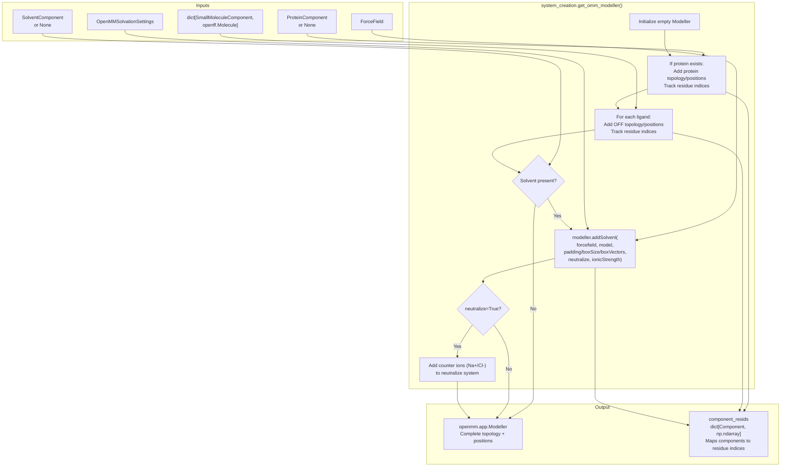
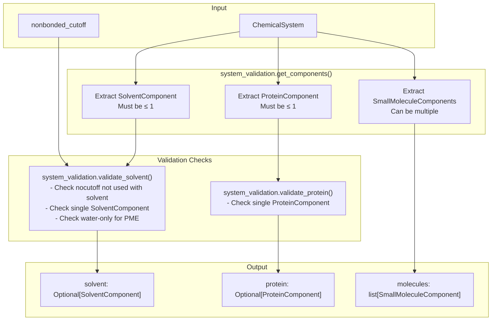
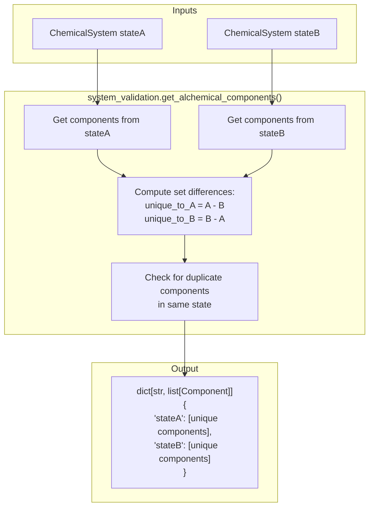
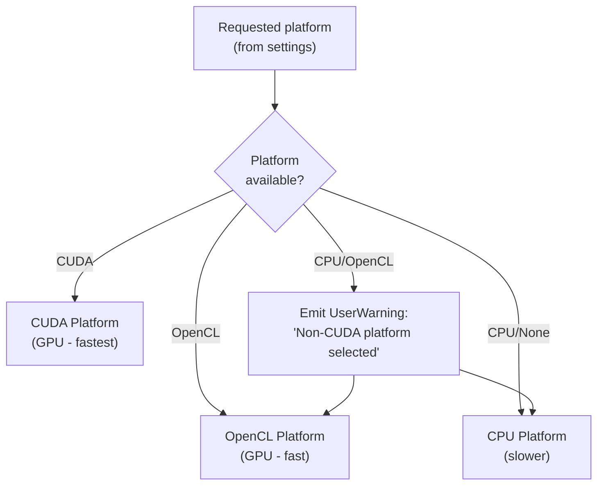

# System Creation and Validation

<details>
<summary>Relevant source files</summary>

The following files were used as context for generating this wiki page:

- [openfe/protocols/openmm_utils/charge_generation.py](openfe/protocols/openmm_utils/charge_generation.py)
- [openfe/tests/conftest.py](openfe/tests/conftest.py)
- [openfe/tests/protocols/openmm_ahfe/test_ahfe_protocol.py](openfe/tests/protocols/openmm_ahfe/test_ahfe_protocol.py)
- [openfe/tests/protocols/openmm_md/test_plain_md_protocol.py](openfe/tests/protocols/openmm_md/test_plain_md_protocol.py)
- [openfe/tests/protocols/openmm_rfe/test_hybrid_top_protocol.py](openfe/tests/protocols/openmm_rfe/test_hybrid_top_protocol.py)
- [openfe/tests/protocols/test_openmm_settings.py](openfe/tests/protocols/test_openmm_settings.py)
- [openfe/tests/protocols/test_openmmutils.py](openfe/tests/protocols/test_openmmutils.py)

</details>


## Purpose and Scope

This document covers the utilities for creating and validating OpenMM simulation systems in the OpenFE toolkit. These utilities are shared across all simulation protocols (RFE, AFE, MD) and handle the conversion from high-level `ChemicalSystem` objects to OpenMM `System` and `Topology` objects ready for simulation. The modules provide functions for:

- Creating OpenMM `SystemGenerator` instances with force field parameters
- Constructing `Modeller` objects from chemical components  
- Validating chemical system composition and settings
- Detecting and configuring OpenMM compute platforms

For information about charge assignment to molecules, see [Charge Generation](#3.4). For analysis of simulation outputs, see [Analysis Tools](#5.2).

---

## System Creation Pipeline

The following diagram illustrates the complete pipeline from OpenFE chemical components to a parameterized OpenMM system ready for simulation.

**Diagram: System Creation Data Flow**



Sources: [openfe/tests/protocols/test_openmmutils.py:378-456](), [openfe/tests/protocols/openmm_rfe/test_hybrid_top_protocol.py:425-456]()

---

## System Generator Creation

The `get_system_generator()` function creates an OpenMM `SystemGenerator` configured with force field parameters, barostat settings, and molecular template caching.

**Diagram: SystemGenerator Configuration**



Sources: [openfe/tests/protocols/test_openmmutils.py:379-424]()

### Key Configuration Parameters

| Parameter | Type | Description |
|-----------|------|-------------|
| `forcefield_settings` | `OpenMMSystemGeneratorFFSettings` | Force field selection and parameters |
| `thermo_settings` | `ThermoSettings` | Temperature and pressure for barostat |
| `integrator_settings` | `IntegratorSettings` | Barostat frequency in timesteps |
| `cache` | `Optional[Path]` | Path to force field template cache file (typically `db.json`) |
| `has_solvent` | `bool` | If `True`, creates barostat and enables postprocessing |

The function returns a configured `SystemGenerator` with:
- **Barostat**: `MonteCarloBarostat` at specified temperature/pressure (if `has_solvent=True`)
- **Template Cache**: Stores parameterized molecules to avoid recomputation
- **Force Field Kwargs**: Constraints (typically `HBonds`), hydrogen mass, rigid water, etc.
- **Periodic/Nonperiodic Kwargs**: Appropriate nonbonded method and cutoff

Sources: [openfe/tests/protocols/test_openmmutils.py:379-424]()

---

## OpenMM Modeller Construction

The `get_omm_modeller()` function builds an OpenMM `Modeller` object containing the complete system topology and positions, including protein, ligands, and solvated environment.

**Diagram: Modeller Construction Steps**



Sources: [openfe/tests/protocols/test_openmmutils.py:425-583]()

### Solvation Configuration Options

The `OpenMMSolvationSettings` class provides several mutually exclusive ways to define the simulation box:

| Setting | Description | Typical Value |
|---------|-------------|---------------|
| `solvent_padding` | Minimum distance from solute to box edge | `1.2 * unit.nanometer` |
| `number_of_solvent_molecules` | Exact number of water molecules | `400` |
| `box_vectors` | Explicit 3x3 periodic box vectors | `[[3,0,0],[0,3,0],[0,0,3]] * unit.nm` |
| `box_size` | 3D box dimensions (cubic) | `[3, 3, 3] * unit.nanometer` |

**Validation rule**: Only one of these four options may be set (others must be `None`). Additionally, `box_shape` (e.g., `"cube"`, `"dodecahedron"`, `"octahedron"`) cannot be defined alongside `box_size` or `box_vectors`.

Sources: [openfe/tests/protocols/test_openmmutils.py:46-91](), [openfe/tests/protocols/test_openmm_settings.py:69-101]()

### Neutralization and Ion Concentration

When a `SolventComponent` has `neutralize=True`, the system charge is neutralized by adding counter ions:
- Negatively charged systems receive Na⁺ ions
- Positively charged systems receive Cl⁻ ions
- The number of ions added equals the absolute net charge

The `ion_concentration` parameter (in molar units) adds additional salt beyond neutralization requirements.

Sources: [openfe/tests/protocols/test_openmmutils.py:473-531](), [openfe/tests/protocols/openmm_ahfe/test_ahfe_protocol.py:290-365]()

### Component Residue Mapping

The function returns a `component_resids` dictionary mapping each `Component` to its residue indices in the final topology:

```python
# Example structure
component_resids = {
    protein_component: np.array([0, 1, 2, ..., 163]),
    ligand_component: np.array([164]),
    solvent_component: np.array([165, 166, ..., 1000])
}
```

This mapping is critical for identifying which atoms belong to which component during simulation setup and analysis.

Sources: [openfe/tests/protocols/test_openmmutils.py:425-456]()

---

## Component Validation and Extraction

Before system construction, the chemical system composition must be validated to ensure compatibility with simulation protocols.

**Diagram: Component Extraction and Validation**



Sources: [openfe/tests/protocols/test_openmmutils.py:207-253]()

### Validation Rules

The following validation rules are enforced:

**Solvent Validation** (`validate_solvent`):
- `NoCutoff` nonbonded method cannot be used with solvated systems
- Maximum of one `SolventComponent` allowed per `ChemicalSystem`
- For PME method, only water solvent is supported (non-water raises `ValueError`)

**Protein Validation** (`validate_protein`):
- Maximum of one `ProteinComponent` allowed per `ChemicalSystem`

**Component Composition**:
- Gas phase: No `SolventComponent`, no `ProteinComponent`, multiple `SmallMoleculeComponent` allowed
- Solvent phase: One `SolventComponent`, no `ProteinComponent`, multiple `SmallMoleculeComponent` allowed
- Complex: One `SolventComponent`, one `ProteinComponent`, multiple `SmallMoleculeComponent` allowed

Sources: [openfe/tests/protocols/test_openmmutils.py:169-204]()

---

## Alchemical Component Identification

For relative free energy protocols, the system must identify which components undergo alchemical transformation.

**Diagram: Alchemical Component Extraction**



The function identifies components that appear in one state but not the other. These are the components that will be alchemically transformed (appearing/disappearing) during the simulation.

**Duplicate Detection**: If a component appears multiple times in the same state (different keys, same component), a `ValueError` is raised identifying the duplicate.

Sources: [openfe/tests/protocols/test_openmmutils.py:126-166]()

---

## Settings Validation

The `settings_validation` module provides functions to validate protocol settings and perform unit conversions.

### Timestep Validation

```python
# Function: validate_timestep(hydrogen_mass, timestep)
```

Validates that the integration timestep is appropriate for the hydrogen mass:
- If `hydrogen_mass < 1.5 * unit.amu`, `timestep` must be ≤ `2.5 * unit.femtosecond`
- If `hydrogen_mass ≥ 1.5 * unit.amu`, `timestep` must be ≤ `4.0 * unit.femtosecond`

Larger hydrogen masses (hydrogen mass repartitioning) allow larger timesteps by reducing the mass difference between heavy and light atoms.

Sources: [openfe/tests/protocols/test_openmmutils.py:93-95]()

### Simulation Step Calculation

```python
# Function: get_simsteps(time_length, timestep, mc_steps)
```

Converts simulation time lengths to discrete simulation steps:

| Parameter | Type | Description |
|-----------|------|-------------|
| `time_length` | `unit.Quantity` | Total simulation time (e.g., `5 * unit.nanosecond`) |
| `timestep` | `unit.Quantity` | Integration timestep (e.g., `4 * unit.femtosecond`) |
| `mc_steps` | `int` | Monte Carlo barostat steps per iteration |
| **Returns** | `int` | Number of simulation steps |

**Validation**:
- `time_length` must be evenly divisible by `timestep`
- `time_length / timestep` must be evenly divisible by `mc_steps`

Example: For `5 * unit.nanosecond` with `4 * unit.femtosecond` timestep and `mc_steps=250`:
- Total steps = 5 ns / 4 fs = 1,250,000 steps
- Must be divisible by 250 → 5,000 iterations of 250 steps each

Sources: [openfe/tests/protocols/test_openmmutils.py:98-124]()

### Real-Time Analysis Iteration Conversion

```python
# Function: convert_real_time_analysis_iterations(simulation_settings)
```

Converts real-time analysis timing from physical time units to iteration counts:

```python
# Input
simulation_settings.time_per_iteration = 1.0 * unit.picosecond
simulation_settings.real_time_analysis_interval = 250 * unit.picosecond
simulation_settings.real_time_analysis_minimum_time = 500 * unit.picosecond

# Output
rta_iterations = 250  # Check convergence every 250 iterations
rta_min_iterations = 500  # Start checking after 500 iterations
```

If `real_time_analysis_interval` is `None`, both return values are `None` (RTA disabled).

Sources: [openfe/tests/protocols/test_openmmutils.py:611-666]()

### Target Error Unit Conversion

```python
# Function: convert_target_error_from_kcal_per_mole_to_kT(temperature, target_error)
```

Converts free energy target error from `kcal/mol` to dimensionless `kT` units:

```python
temperature = 298.15 * unit.kelvin
target_error = 0.12 * unit.kilocalorie_per_mole

kT = convert_target_error_from_kcal_per_mole_to_kT(temperature, target_error)
# Returns: 0.2025 (dimensionless)
```

This conversion is used for early termination criteria in multistate samplers, which internally work in `kT` units.

Sources: [openfe/tests/protocols/test_openmmutils.py:668-684]()

---

## OpenMM Platform Detection

OpenMM supports multiple compute platforms (CUDA, OpenCL, CPU, Reference) with varying performance characteristics. The system provides utilities to detect available platforms and warn about suboptimal selections.

**Platform Selection Logic**:



**Warning Behavior**: If a non-CUDA platform is explicitly selected, a `UserWarning` is emitted indicating slower performance. Example:

```python
# Triggers warning
omm_compute.get_openmm_platform("CPU")
# UserWarning: Non-CUDA platform selected: CPU
```

Sources: [openfe/tests/protocols/openmm_rfe/test_hybrid_top_protocol.py:64-66]()

### Compute Platform Priority

| Platform | Typical Device | Relative Speed | Use Case |
|----------|----------------|----------------|----------|
| `CUDA` | NVIDIA GPU | 100x | Production simulations |
| `OpenCL` | AMD GPU / Intel GPU | 20-50x | Multi-vendor GPU support |
| `CPU` | CPU cores | 1x | Debugging, small systems |
| `Reference` | CPU (single thread) | 0.01x | Validation only |

The `compute_platform` setting in `OpenMMEngineSettings` accepts: `"CUDA"`, `"OpenCL"`, `"CPU"`, or `None` (auto-select fastest available).

Sources: [openfe/tests/protocols/test_openmm_settings.py:103-111]()

---

## Common Usage Patterns

### Creating a Vacuum System

```python
# Validation
solvent, protein, molecules = system_validation.get_components(chemical_system)
# Returns: None, None, [ligand_component]

# System generator (no barostat for vacuum)
generator = system_creation.get_system_generator(
    forcefield_settings=ff_settings,
    thermo_settings=thermo_settings, 
    integrator_settings=integrator_settings,
    cache=None,
    has_solvent=False  # Critical: disables barostat
)

# Convert to OpenFF and register
offmol = ligand_component.to_openff()
generator.create_system(offmol.to_topology().to_openmm(), molecules=[offmol])

# Create OpenMM system (no Modeller needed for vacuum)
system = generator.create_system(offmol.to_topology().to_openmm())
```

Sources: [openfe/tests/protocols/test_openmmutils.py:379-400]()

### Creating a Solvated Ligand System

```python
# Validation
solvent, protein, molecules = system_validation.get_components(chemical_system)
system_validation.validate_solvent(chemical_system, nonbonded_cutoff)
# Returns: solvent_component, None, [ligand_component]

# System generator with barostat
generator = system_creation.get_system_generator(
    forcefield_settings=ff_settings,
    thermo_settings=thermo_settings,
    integrator_settings=integrator_settings,
    cache=Path("./db.json"),
    has_solvent=True  # Enables barostat
)

# Register molecules
offmols = {comp: comp.to_openff() for comp in molecules}
for offmol in offmols.values():
    generator.create_system(offmol.to_topology().to_openmm(), molecules=[offmol])

# Build Modeller
modeller, component_resids = system_creation.get_omm_modeller(
    protein_component=None,
    solvent_component=solvent,
    small_molecules=offmols,
    forcefield=generator.forcefield,
    solvent_settings=solvation_settings
)

# Create parameterized system
system = generator.create_system(modeller.topology, molecules=list(offmols.values()))
```

Sources: [openfe/tests/protocols/test_openmmutils.py:401-424](), [openfe/tests/protocols/test_openmmutils.py:506-531]()

### Creating a Protein-Ligand Complex System

```python
# Validation
solvent, protein, molecules = system_validation.get_components(chemical_system)
system_validation.validate_solvent(chemical_system, nonbonded_cutoff)
system_validation.validate_protein(chemical_system)
# Returns: solvent_component, protein_component, [ligand_component]

# System generator (same as solvated ligand)
generator = system_creation.get_system_generator(
    forcefield_settings=ff_settings,
    thermo_settings=thermo_settings,
    integrator_settings=integrator_settings,
    cache=Path("./db.json"),
    has_solvent=True
)

# Register small molecules
offmols = {comp: comp.to_openff() for comp in molecules}
for offmol in offmols.values():
    generator.create_system(offmol.to_topology().to_openmm(), molecules=[offmol])

# Build Modeller (now includes protein)
modeller, component_resids = system_creation.get_omm_modeller(
    protein_component=protein,
    solvent_component=solvent,
    small_molecules=offmols,
    forcefield=generator.forcefield,
    solvent_settings=solvation_settings
)

# Create parameterized system
system = generator.create_system(modeller.topology, molecules=list(offmols.values()))
```

The `component_resids` dictionary maps each component to its residue indices, enabling later identification of protein residues, ligand residues, and solvent residues in the combined topology.

Sources: [openfe/tests/protocols/test_openmmutils.py:425-456]()

---

## Virtual Site Handling

Systems with explicit water models containing virtual sites (e.g., TIP4P-Ew, TIP5P) require special handling during simulation setup.

**Key Consideration**: Virtual sites are massless particles positioned relative to real atoms. When `integrator_settings.reassign_velocities=False`, virtual site positions may not be properly initialized, leading to numerical instability. For water models with virtual sites, always use `reassign_velocities=True`.

**Validation**: The hybrid topology factory automatically validates virtual site configurations and raises errors if unstable conditions are detected.

Example configuration for TIP4P-Ew:

```python
settings.forcefield_settings.forcefields = [
    "amber/ff14SB.xml",
    "amber/tip4pew_standard.xml",
    "amber/phosaa10.xml"
]
settings.solvation_settings.solvent_model = "tip4pew"
settings.integrator_settings.reassign_velocities = True  # Required
```

Sources: [openfe/tests/protocols/openmm_rfe/test_hybrid_top_protocol.py:482-556](), [openfe/tests/protocols/openmm_ahfe/test_ahfe_protocol.py:179-248]()

---