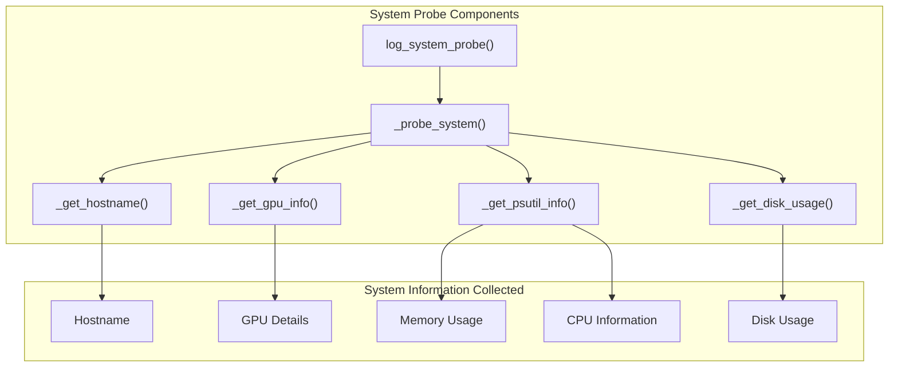
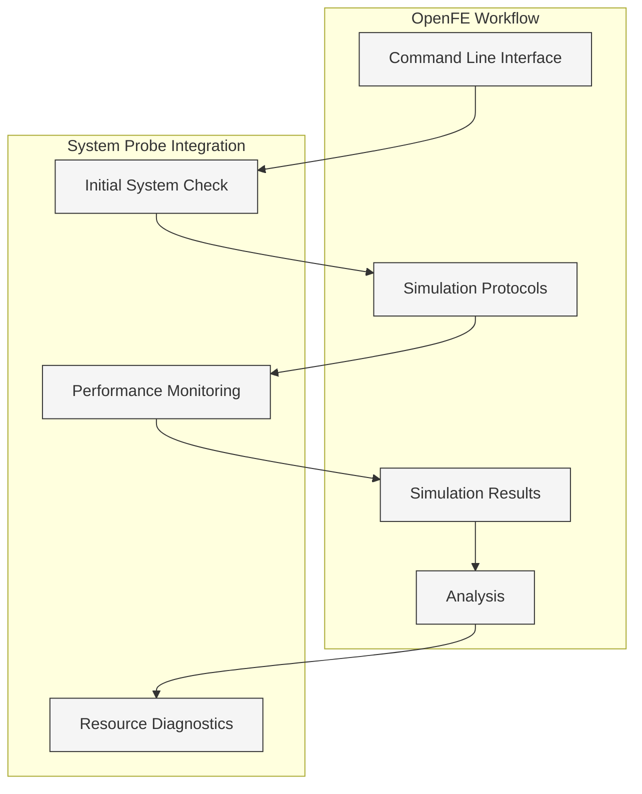
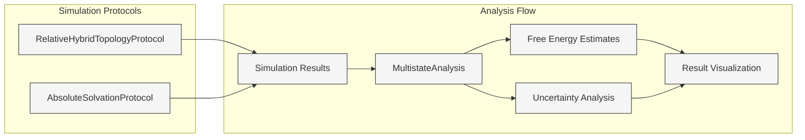

# Analysis Tools

<details>
<summary>Relevant source files</summary>

The following files were used as context for generating this wiki page:

- [openfe/protocols/openmm_afe/base.py](openfe/protocols/openmm_afe/base.py)
- [openfe/protocols/openmm_afe/equil_afe_settings.py](openfe/protocols/openmm_afe/equil_afe_settings.py)
- [openfe/protocols/openmm_afe/equil_solvation_afe_method.py](openfe/protocols/openmm_afe/equil_solvation_afe_method.py)
- [openfe/protocols/openmm_md/plain_md_methods.py](openfe/protocols/openmm_md/plain_md_methods.py)
- [openfe/protocols/openmm_md/plain_md_settings.py](openfe/protocols/openmm_md/plain_md_settings.py)
- [openfe/protocols/openmm_rfe/equil_rfe_methods.py](openfe/protocols/openmm_rfe/equil_rfe_methods.py)
- [openfe/protocols/openmm_rfe/equil_rfe_settings.py](openfe/protocols/openmm_rfe/equil_rfe_settings.py)
- [openfe/protocols/openmm_utils/charge_generation.py](openfe/protocols/openmm_utils/charge_generation.py)
- [openfe/protocols/openmm_utils/omm_settings.py](openfe/protocols/openmm_utils/omm_settings.py)
- [openfe/tests/conftest.py](openfe/tests/conftest.py)
- [openfe/tests/protocols/openmm_ahfe/test_ahfe_protocol.py](openfe/tests/protocols/openmm_ahfe/test_ahfe_protocol.py)
- [openfe/tests/protocols/openmm_md/test_plain_md_protocol.py](openfe/tests/protocols/openmm_md/test_plain_md_protocol.py)
- [openfe/tests/protocols/openmm_rfe/test_hybrid_top_protocol.py](openfe/tests/protocols/openmm_rfe/test_hybrid_top_protocol.py)
- [openfe/tests/protocols/test_openmm_settings.py](openfe/tests/protocols/test_openmm_settings.py)
- [openfe/tests/protocols/test_openmmutils.py](openfe/tests/protocols/test_openmmutils.py)

</details>


## Purpose and Scope

This document details the analysis tools available in OpenFE that help users examine system properties, monitor resource usage, and analyze simulation results. These tools support troubleshooting, performance optimization, and extraction of scientific insights from simulations. For information about running simulations with specific protocols, see [Core Protocols](#2).

## System Probe Utilities

The System Probe utilities provide functionality to gather detailed information about the computing environment where OpenFE is running. These tools are particularly useful for diagnosing performance issues, verifying hardware capabilities, and documenting the execution environment.

### Overview of System Probe Components



Sources: [openfe/utils/system_probe.py:386-498](), [openfe/utils/system_probe.py:501-544]()

### Key Functions

#### log_system_probe()

This is the main entry point for system probing functionality. It configures logging and reports system information at the specified log level.

```python
log_system_probe(level=logging.DEBUG, paths: Optional[Iterable[os.PathLike]] = None)
```

- **Parameters**:
  - `level`: The logging level (default: `logging.DEBUG`)
  - `paths`: Optional paths to check for disk usage

- **Example Output**:
  ```
  SYSTEM CONFIG DETAILS:
  hostname: 'compute-node-1'
  GPU: uuid='GPU-1234' NVIDIA RTX 4090 mode=Default
  Memory used: 27.8G (52.8%)
  /dev/sda1: 37% full (1.1T free)
  ```

Sources: [openfe/utils/system_probe.py:501-544]()

#### _probe_system()

Collects comprehensive system information including hostname, GPU details, process information, and disk usage.

```python
_probe_system(paths: Optional[Iterable[pathlib.Path]] = None) -> dict
```

- **Returns**: A nested dictionary containing all system information

Sources: [openfe/utils/system_probe.py:386-498]()

### Information Collected

The system probe utilities collect the following categories of information:

| Category | Function | Information Collected |
|----------|----------|----------------------|
| System Identification | `_get_hostname()` | System hostname |
| GPU Details | `_get_gpu_info()` | GPU name, compute mode, temperature, memory usage, driver version |
| Process & Memory | `_get_psutil_info()` | CPU usage, memory usage, process details, virtual memory statistics |
| Storage | `_get_disk_usage()` | Filesystem size, used space, available space, usage percentage |

Sources: [openfe/utils/system_probe.py:13-124](), [openfe/utils/system_probe.py:127-242](), [openfe/utils/system_probe.py:245-273](), [openfe/utils/system_probe.py:276-384]()

### Usage Example

The system probe functionality can be incorporated into scripts or applications to log system information:

```python
import logging
from openfe.utils import log_system_probe

# Configure logging
logging.basicConfig(level=logging.DEBUG)

# Log system information
log_system_probe(level=logging.INFO)

# Continue with simulation or analysis...
```

Sources: [openfe/utils/__init__.py:1-7]()

### System Probe in OpenFE Workflow



Sources: [openfe/utils/system_probe.py:386-498](), [openfe/utils/system_probe.py:501-544]()

## Other Analysis Tools in OpenFE

Apart from the system probe utilities detailed above, OpenFE includes other analysis tools that are part of the broader ecosystem. While not covered in detail in the provided files, these are important components of the analysis framework:

### Multistate Analysis

The MultistateAnalysis tools provide functionality for analyzing data from alchemical free energy calculations, particularly those that use the multistate sampling approach. This includes:

- Analysis of overlap matrices
- Free energy estimates and uncertainties 
- Convergence assessment

These tools are typically used in conjunction with the "gather" command line interface to analyze results from completed simulations.

### Free Energy Analysis Workflow



### Integration with External Analysis Tools

OpenFE is designed to work with external analysis tools like Cinnabar, which provides advanced visualization and analysis capabilities for free energy calculations. Cinnabar can be used to:

1. Visualize free energy networks
2. Analyze the reliability of results
3. Generate publication-quality plots and reports

The results from OpenFE simulations can be exported in formats compatible with these external tools for further analysis.

## Summary

The analysis tools in OpenFE provide comprehensive capabilities for:

1. **System Diagnostics**: Through the system probe utilities that collect detailed information about the computing environment
2. **Result Analysis**: Through multistate analysis tools that process simulation data and extract free energy estimates
3. **Visualization and Reporting**: Through integration with specialized tools for representing free energy results

These tools together form a complete ecosystem for conducting, analyzing, and interpreting free energy calculations.

---