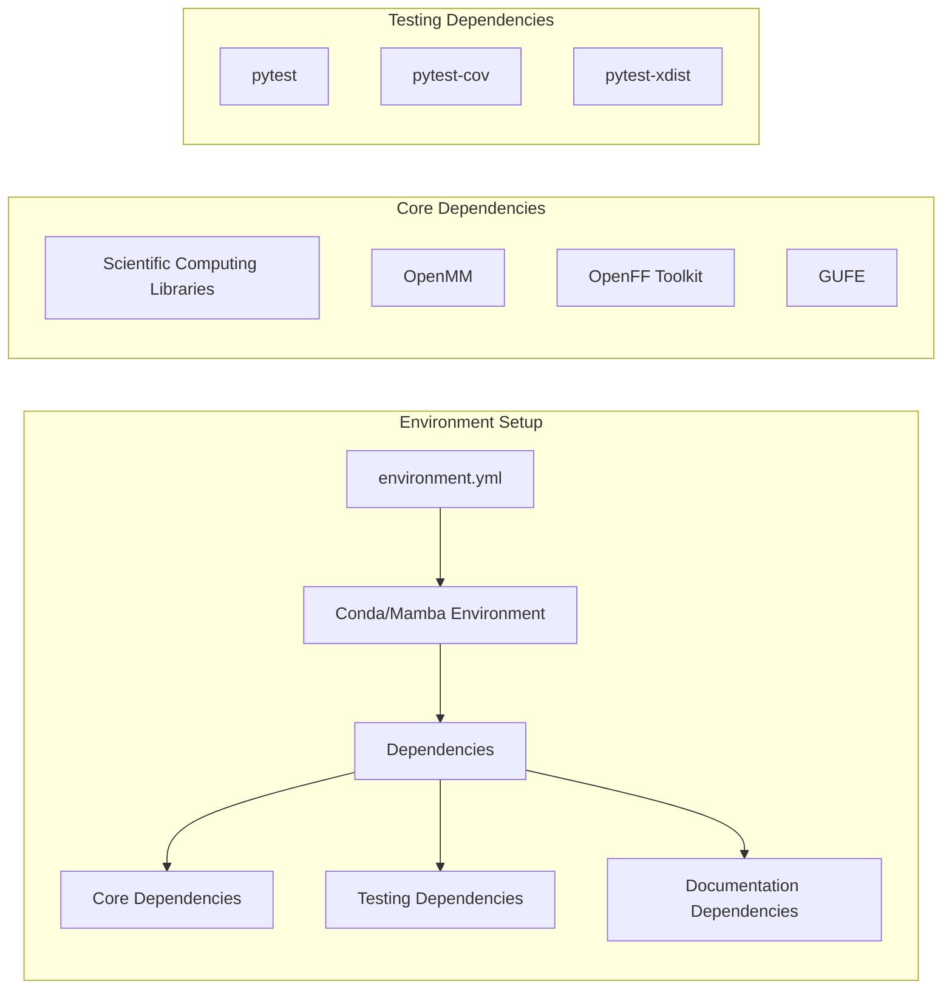
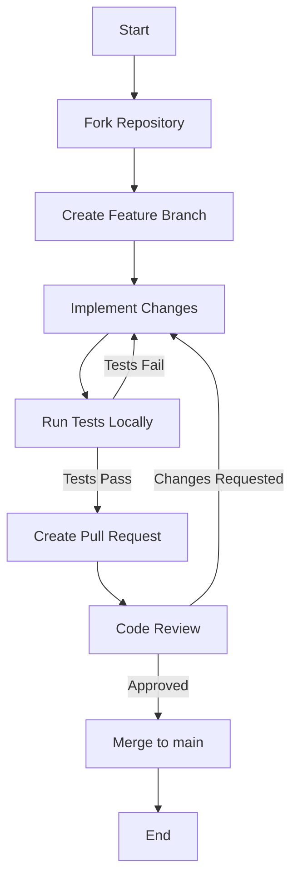
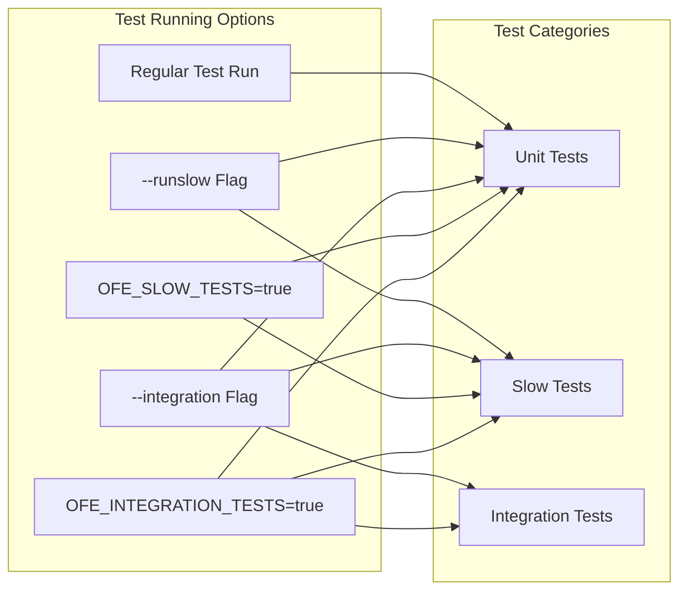
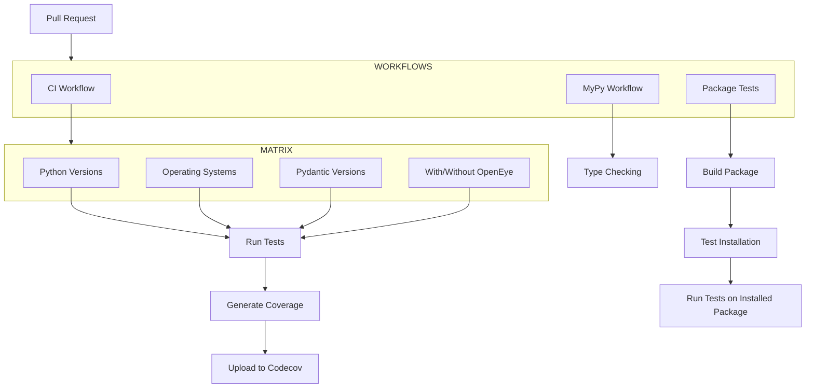
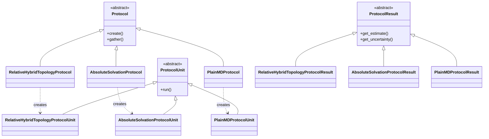

# Development Guide

<details>
<summary>Relevant source files</summary>

The following files were used as context for generating this wiki page:

- [.github/workflows/check_for_api_break.yaml](.github/workflows/check_for_api_break.yaml)
- [.github/workflows/ci.yaml](.github/workflows/ci.yaml)
- [.github/workflows/conda_cron.yaml](.github/workflows/conda_cron.yaml)
- [.github/workflows/cpu-long-tests.yaml](.github/workflows/cpu-long-tests.yaml)
- [.github/workflows/gen-lock-file.yaml](.github/workflows/gen-lock-file.yaml)
- [.github/workflows/gpu-integration-tests.yaml](.github/workflows/gpu-integration-tests.yaml)
- [.github/workflows/installer.yaml](.github/workflows/installer.yaml)
- [.github/workflows/mypy.yaml](.github/workflows/mypy.yaml)
- [openfe/tests/protocols/conftest.py](openfe/tests/protocols/conftest.py)

</details>


This document provides essential information for developers who want to contribute to the OpenFE (Open Free Energy) project. It covers the development environment setup, contribution workflow, coding standards, and an overview of the testing and CI/CD infrastructure. For detailed information about specific subsystems, please refer to the dedicated pages for the [Testing Framework](#6.1), [CI/CD Pipeline](#6.2), and [Documentation System](#6.3).

## Development Environment Setup

Setting up a proper development environment is the first step toward contributing to OpenFE.

### Dependencies and Environment

OpenFE uses a conda/mamba environment for managing dependencies. All required packages are specified in the environment.yml file.



Sources: [environment.yml:1-56]()

To set up your development environment:

1. Clone the repository:
   ```bash
   git clone https://github.com/OpenFreeEnergy/openfe.git
   cd openfe
   ```

2. Create and activate the conda environment:
   ```bash
   conda env create -f environment.yml
   conda activate openfe_env
   ```

3. Install the package in development mode:
   ```bash
   pip install -e .
   ```

## Code Contribution Workflow

The standard workflow for contributing to OpenFE follows the GitHub pull request model.



### Pull Request Guidelines

1. Create a new branch for each feature or bugfix
2. Follow the code style guidelines
3. Add tests for new functionality
4. Update documentation as necessary
5. Ensure all tests pass locally before submitting a PR
6. Keep PRs focused on a single concern

## Testing Framework

OpenFE has a comprehensive testing framework based on pytest. For detailed information about the testing framework, see the [Testing Framework](#6.1) page.

### Running Tests Locally

The test suite can be run with pytest:

```bash
pytest -n auto
```

#### Handling Slow Tests

OpenFE has special handling for slow-running tests. These tests are marked with `@pytest.mark.slow` or `@pytest.mark.integration` decorators and are skipped by default.



Sources: [openfe/tests/conftest.py:17-80]()

To run slow tests:
```bash
pytest --runslow
# OR
OFE_SLOW_TESTS=true pytest
```

To run integration tests:
```bash
pytest --integration
# OR
OFE_INTEGRATION_TESTS=true pytest
```

## CI/CD Pipeline

OpenFE uses GitHub Actions for continuous integration and deployment. For detailed information about the CI/CD pipeline, see the [CI/CD Pipeline](#6.2) page.

The main workflows include:

1. **CI** - Runs tests on multiple platforms and Python versions
2. **mypy** - Performs type checking
3. **Package Tests** - Ensures the package can be installed properly



Sources: [.github/workflows/ci.yaml:1-146](), [.github/workflows/mypy.yaml:1-57](), [.github/workflows/package-tests.yaml:1-76]()

## Code Style and Standards

OpenFE follows standard Python coding practices with some specific requirements:

1. **Type Hints**: Code should use Python type hints, checked with mypy
2. **Testing**: All code should have corresponding tests
3. **Documentation**: All public APIs should be documented
4. **Dependency Management**: New dependencies should be carefully considered and added to `environment.yml`

### Project Structure

The main project structure follows the standard Python package layout with additional organization for simulation protocols, utilities, and CLI tools.

```mermaid
classDiagram
    class "OpenFE Repository" {
        openfe/ - Main package
        openfecli/ - CLI tools
        docs/ - Documentation
        tests/ - Test suite
    }
    
    class "openfe Package" {
        protocols/ - Simulation protocols
        setup/ - Setup utilities
        utils/ - General utilities
        tests/ - Tests for openfe
    }
    
    class "openfecli Package" {
        commands/ - CLI commands
        tests/ - Tests for CLI
    }
    
    "OpenFE Repository" --> "openfe Package"
    "OpenFE Repository" --> "openfecli Package"
```

## Development Workflow for Specific Components

When developing specific components of OpenFE, it's helpful to understand how they integrate with the rest of the system.

### Protocol Development

Protocols are a core part of OpenFE, implementing various free energy calculation methods.



When developing a new protocol:

1. Subclass the appropriate base classes
2. Implement the required methods
3. Add comprehensive tests
4. Document the protocol parameters and behavior

## Best Practices for Testing

Testing is a crucial part of development in OpenFE. The project uses pytest fixtures extensively to provide test components.

### Fixtures for Testing Protocols

The test suite includes various fixtures for creating chemical systems, molecules, and mappings for testing protocols.

| Fixture Name | Purpose | Scope |
|-------------|---------|-------|
| `benzene_vacuum_system` | Benzene in vacuum | function |
| `benzene_system` | Benzene in solvent | session |
| `benzene_complex_system` | Benzene with protein in solvent | function |
| `toluene_vacuum_system` | Toluene in vacuum | function |
| `toluene_system` | Toluene in solvent | session |
| `toluene_complex_system` | Toluene with protein in solvent | function |
| `benzene_to_toluene_mapping` | Atom mapping between benzene and toluene | session |

Sources: [openfe/tests/protocols/conftest.py:12-128]()

### Test Categories

OpenFE categorizes tests to efficiently manage test execution:

| Category | Description | How to Run |
|----------|-------------|-----------|
| Regular Tests | Fast unit tests | `pytest` |
| Slow Tests | Tests that take longer to run | `pytest --runslow` |
| Integration Tests | End-to-end tests | `pytest --integration` |

Sources: [openfe/tests/conftest.py:17-96]()

## Common Development Tasks

Below are some common development tasks and how to complete them:

### Adding a New Dependency

1. Add the dependency to `environment.yml`
2. Document why the dependency is needed in PR description
3. Consider compatibility with existing dependencies

### Creating a New Test

1. Place test files in the appropriate location in the test directory
2. Use existing fixtures where possible
3. Mark slow or integration tests appropriately
4. Ensure tests are deterministic

### Running the mypy Type Checker

Type checking with mypy can be performed locally:

```bash
pip install mypy
mypy openfe openfecli
```

Sources: [.github/workflows/mypy.yaml:43-56]()

## Conclusion

This development guide outlines the basic practices for contributing to OpenFE. For more detailed information about specific subsystems, please refer to the dedicated pages for the [Testing Framework](#6.1), [CI/CD Pipeline](#6.2), and [Documentation System](#6.3).

Remember that OpenFE is an open source project focused on free energy calculations, and contributions that maintain high scientific standards while improving usability, performance, and robustness are highly valued.

---