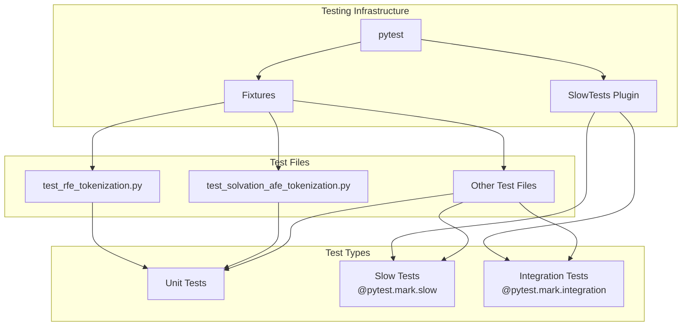
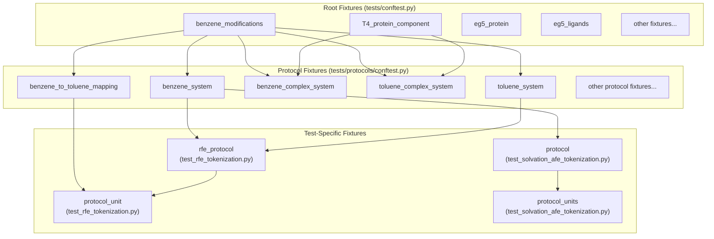
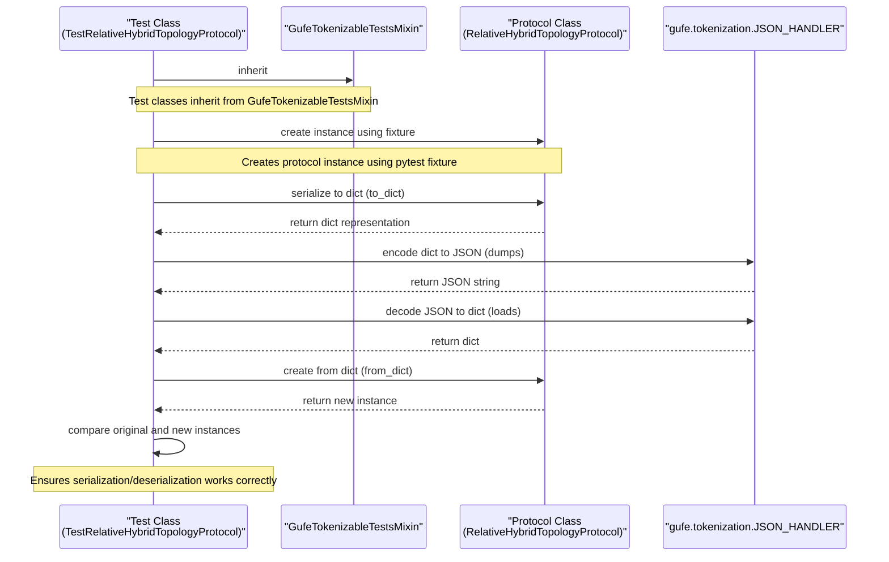

# Testing Framework

<details>
<summary>Relevant source files</summary>

The following files were used as context for generating this wiki page:

- [openfe/protocols/openmm_utils/charge_generation.py](openfe/protocols/openmm_utils/charge_generation.py)
- [openfe/tests/conftest.py](openfe/tests/conftest.py)
- [openfe/tests/protocols/conftest.py](openfe/tests/protocols/conftest.py)
- [openfe/tests/protocols/openmm_ahfe/test_ahfe_protocol.py](openfe/tests/protocols/openmm_ahfe/test_ahfe_protocol.py)
- [openfe/tests/protocols/openmm_md/test_plain_md_protocol.py](openfe/tests/protocols/openmm_md/test_plain_md_protocol.py)
- [openfe/tests/protocols/openmm_rfe/test_hybrid_top_protocol.py](openfe/tests/protocols/openmm_rfe/test_hybrid_top_protocol.py)
- [openfe/tests/protocols/test_openmm_settings.py](openfe/tests/protocols/test_openmm_settings.py)
- [openfe/tests/protocols/test_openmmutils.py](openfe/tests/protocols/test_openmmutils.py)
- [openfe/tests/setup/atom_mapping/conftest.py](openfe/tests/setup/atom_mapping/conftest.py)
- [openfe/tests/setup/atom_mapping/test_atommapper.py](openfe/tests/setup/atom_mapping/test_atommapper.py)
- [openfe/tests/setup/atom_mapping/test_lomap_atommapper.py](openfe/tests/setup/atom_mapping/test_lomap_atommapper.py)
- [openfe/tests/setup/atom_mapping/test_lomap_scorers.py](openfe/tests/setup/atom_mapping/test_lomap_scorers.py)
- [openfe/tests/setup/atom_mapping/test_perses_atommapper.py](openfe/tests/setup/atom_mapping/test_perses_atommapper.py)
- [openfe/tests/setup/atom_mapping/test_perses_scorers.py](openfe/tests/setup/atom_mapping/test_perses_scorers.py)
- [openfe/tests/setup/test_network_planning.py](openfe/tests/setup/test_network_planning.py)

</details>


The OpenFE Testing Framework provides the infrastructure, conventions, and tools for validating the functionality and ensuring the reliability of the OpenFE codebase. This page describes how tests are organized, how to write new tests, and how to run tests in the OpenFE project. For information about the continuous integration pipeline, see [CI/CD Pipeline](#6.2).

## Testing Infrastructure

OpenFE uses pytest as its primary testing framework, enhanced with custom plugins and fixtures to support the specific needs of molecular simulation testing.

### Test Organization



Sources: [openfe/tests/conftest.py:17-81]()

Tests in OpenFE are organized into three main categories:

1. **Unit Tests**: Standard, quick tests that validate individual components
2. **Slow Tests**: Time-consuming tests that still validate specific units but take longer to run
3. **Integration Tests**: Very slow tests that validate the full functionality of the system through real-world usage scenarios

The testing framework includes a `SlowTests` plugin defined in `conftest.py` that provides mechanisms for marking and selectively running different types of tests.

## Test Fixtures

OpenFE uses pytest fixtures extensively to provide reusable test components, particularly chemical systems, molecules, and protocol instances. These fixtures are organized hierarchically to minimize duplication and ensure consistency across tests.



Sources: [openfe/tests/conftest.py:86-314](), [openfe/tests/protocols/conftest.py:1-233]()

### Core Fixtures

The main fixtures are defined in `openfe/tests/conftest.py` and include:

| Fixture | Description | Scope |
|---------|-------------|-------|
| `benzene_modifications` | Dictionary of SmallMoleculeComponents for benzene and derivatives | session |
| `T4_protein_component` | T4 lysozyme protein component | session |
| `eg5_protein` | EG5 protein component | function |
| `eg5_ligands` | List of EG5 ligands | function |
| `simple_mapping` | Basic ligand atom mapping | session |
| `atom_mapping_basic_test_files` | Dictionary of SmallMoleculeComponents for testing atom mapping | session |

### Protocol-Specific Fixtures

Additional fixtures specific to protocol testing are defined in `openfe/tests/protocols/conftest.py`:

| Fixture | Description | Scope |
|---------|-------------|-------|
| `benzene_system` | ChemicalSystem containing benzene in solvent | session |
| `toluene_system` | ChemicalSystem containing toluene in solvent | session |
| `benzene_complex_system` | ChemicalSystem with benzene and protein | function |
| `toluene_complex_system` | ChemicalSystem with toluene and protein | function |
| `benzene_to_toluene_mapping` | LigandAtomMapping between benzene and toluene | session |
| `rfe_transformation_json` | JSON string of RFE results | function |
| `afe_solv_transformation_json` | JSON string of AFE results | function |
| `md_json` | JSON string of MD results | function |

### Using Fixtures in Tests

Fixtures can be used directly as test function parameters:

```python
def test_something(benzene_system, toluene_system, benzene_to_toluene_mapping):
    # Test code using the fixture objects
```

## Writing Tests

### Tokenization Testing

A key aspect of testing in OpenFE is ensuring that protocol classes can be properly serialized and deserialized. This is done using the `GufeTokenizableTestsMixin` from the GUFE library.



Sources: [openfe/tests/protocols/test_rfe_tokenization.py:1-98](), [openfe/tests/protocols/test_solvation_afe_tokenization.py:1-116]()

Example of a tokenization test class:

```python
class TestRelativeHybridTopologyProtocol(GufeTokenizableTestsMixin):
    cls = openmm_rfe.RelativeHybridTopologyProtocol
    key = None
    repr = "<RelativeHybridTopologyProtocol-"

    @pytest.fixture()
    def instance(self, rfe_protocol):
        return rfe_protocol

    def test_repr(self, instance):
        """
        Overwrites the base `test_repr` call.
        """
        assert isinstance(repr(instance), str)
        assert self.repr in repr(instance)
```

### Test Conventions

When writing tests for OpenFE, follow these conventions:

1. Test files should be named with a `test_` prefix
2. Test functions should also have a `test_` prefix
3. Use appropriate fixtures to minimize setup code
4. Use pytest's assertion mechanisms for validation
5. Mark slow or integration tests appropriately

## Running Tests

### Command Line Options

OpenFE adds custom command line options to pytest for running different test types:

| Option | Description |
|--------|-------------|
| `--runslow` | Run slow tests in addition to regular tests |
| `--integration` | Run integration tests (also runs slow tests) |

Example usage:

```bash
# Run only regular unit tests
pytest

# Run unit tests and slow tests
pytest --runslow

# Run all tests including integration tests
pytest --integration
```

Sources: [openfe/tests/conftest.py:83-92]()

### Environment Variables

As an alternative to command line options, you can use environment variables:

| Variable | Value | Description |
|----------|-------|-------------|
| `OFE_SLOW_TESTS` | `true` | Run slow tests |
| `OFE_INTEGRATION_TESTS` | `true` | Run integration tests |

Example:

```bash
# Run all tests including integration tests
OFE_INTEGRATION_TESTS=true pytest
```

Sources: [openfe/tests/conftest.py:42-48]()

### Test Markers

Individual tests can be marked as slow or integration tests using pytest decorators:

```python
@pytest.mark.slow
def test_slow_function():
    # This is a slow test

@pytest.mark.integration
def test_full_system():
    # This is an integration test
```

These markers determine which tests are run based on the command line options or environment variables.

Sources: [openfe/tests/conftest.py:97-99]()

## Best Practices

### Writing Effective Tests

1. **Use fixtures extensively**: Reuse test fixtures to minimize setup code and ensure consistency across tests
2. **Test one thing per test function**: Each test function should validate a single aspect of functionality
3. **Keep unit tests fast**: Slow operations should be moved to tests marked as slow
4. **Test edge cases**: Include tests for boundary conditions and error cases

### Testing Tokenization

All protocol classes in OpenFE must be serializable. When adding a new protocol class:

1. Create a test class inheriting from `GufeTokenizableTestsMixin`
2. Set the `cls` attribute to your protocol class
3. Provide an `instance` fixture that returns an instance of your protocol class
4. Override `test_repr` if needed

### Testing Protocols

When testing protocol classes, consider these aspects:

1. Test protocol creation with various settings and inputs
2. Test protocol unit creation and execution
3. Test protocol result parsing and analysis
4. Test serialization/deserialization of protocols and results

### Common Issues and Solutions

- **Test too slow**: Mark it with `@pytest.mark.slow` and improve its efficiency
- **Test fails intermittently**: Look for race conditions or external dependencies
- **Test fails in CI but passes locally**: Check for environment-specific behavior

## Example Test Suite

The RFE protocol tokenization tests provide a good example of a comprehensive test suite:

1. Tests for the protocol class itself
2. Tests for protocol units created by the protocol
3. Tests for protocol results
4. Tests for variations of the protocol with different units

This suite ensures that all aspects of the protocol system can be properly serialized and deserialized, which is essential for saving and loading computation states.

Sources: [openfe/tests/protocols/test_rfe_tokenization.py:36-97]()

---