# CI/CD Pipeline

Relevant source files

The following files were used as context for generating this wiki page:

- [.github/workflows/check_for_api_break.yaml](.github/workflows/check_for_api_break.yaml)
- [.github/workflows/ci.yaml](.github/workflows/ci.yaml)
- [.github/workflows/conda_cron.yaml](.github/workflows/conda_cron.yaml)
- [.github/workflows/cpu-long-tests.yaml](.github/workflows/cpu-long-tests.yaml)
- [.github/workflows/gen-lock-file.yaml](.github/workflows/gen-lock-file.yaml)
- [.github/workflows/gpu-integration-tests.yaml](.github/workflows/gpu-integration-tests.yaml)
- [.github/workflows/installer.yaml](.github/workflows/installer.yaml)
- [.github/workflows/mypy.yaml](.github/workflows/mypy.yaml)

This document describes the Continuous Integration and Continuous Deployment (CI/CD) pipeline used by the OpenFE project. The pipeline ensures code quality, test coverage, and proper packaging of the software through automated processes.

## Overview

OpenFE employs GitHub Actions to manage its CI/CD pipeline, with multiple workflows that handle different aspects of testing, validation, and deployment. These workflows automatically run when code changes are pushed, pull requests are created, or on a scheduled basis.

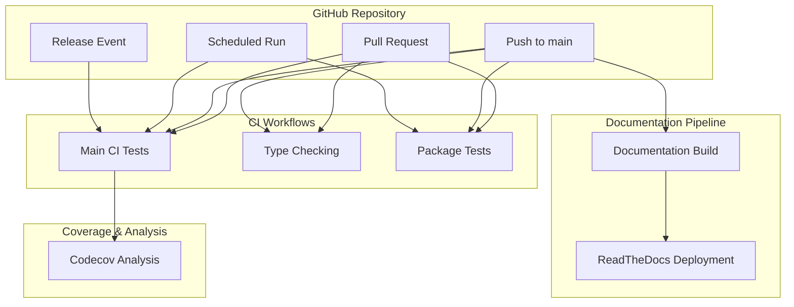

Sources: [.github/workflows/ci.yaml:1-146](), [.github/workflows/mypy.yaml:1-57](), [.github/workflows/package-tests.yaml:1-76](), [docs/conf.py:1-252]()

## Main CI Workflow

The core CI workflow performs comprehensive testing across multiple configurations to ensure the codebase works correctly in various environments.

### Workflow Triggers

The main CI workflow (`ci.yaml`) runs:
- On all pull requests to the main branch
- When code is pushed to the main branch
- On a daily schedule at 07:00 UTC
- When manually triggered using the workflow_dispatch event
- When a release is published

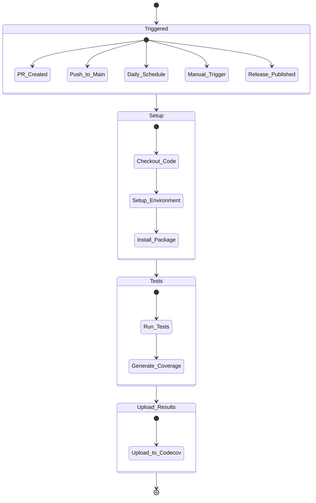

Sources: [.github/workflows/ci.yaml:1-20]()

### Matrix Strategy

One of the most important features of the CI pipeline is its matrix testing strategy, which runs tests across multiple combinations of:
- Operating systems (Ubuntu and macOS)
- Python versions (3.10, 3.11, 3.12)
- Pydantic versions (version 1 and version 2 compatibility)
- With and without OpenEye toolkit

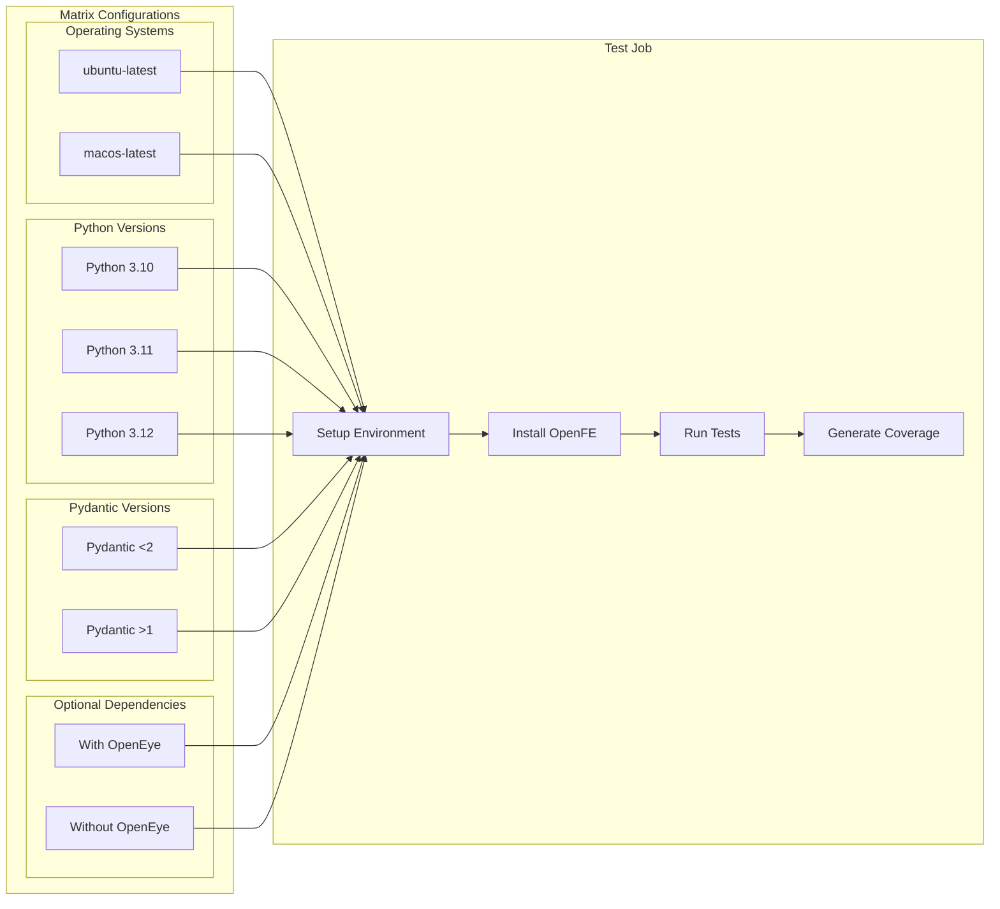

Sources: [.github/workflows/ci.yaml:31-59]()

## Type Checking Workflow

A separate workflow performs static type checking using mypy to ensure type safety across the codebase.

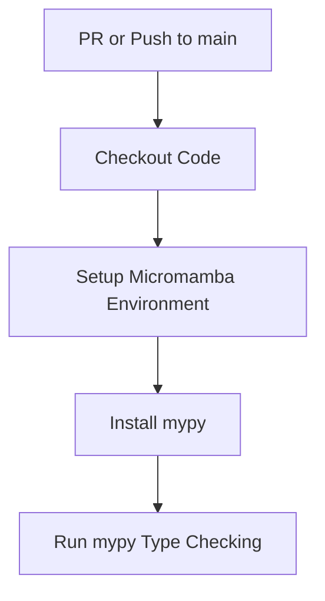

Sources: [.github/workflows/mypy.yaml:1-57]()

## Package Installation Tests

This workflow verifies that the package can be properly built, installed, and used by end-users.

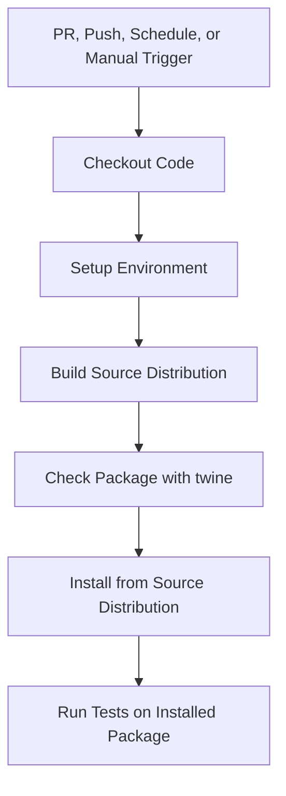

Sources: [.github/workflows/package-tests.yaml:1-76]()

## Environment Management

The CI/CD pipeline uses Micromamba (a lightweight version of Conda) to manage test environments, ensuring consistent dependency versions across all test runs.

### Dependencies Specification

The environment is defined in the `environment.yml` file which lists all the dependencies required to build, test, and run OpenFE.

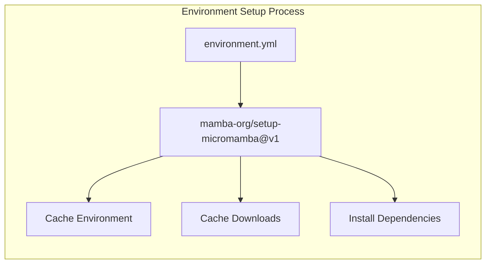

Sources: [environment.yml:1-56](), [.github/workflows/ci.yaml:73-87](), [.github/workflows/mypy.yaml:28-41](), [.github/workflows/package-tests.yaml:39-51]()

## Documentation Pipeline

Documentation for OpenFE is built using Sphinx and deployed to ReadTheDocs.

### Documentation Build Process

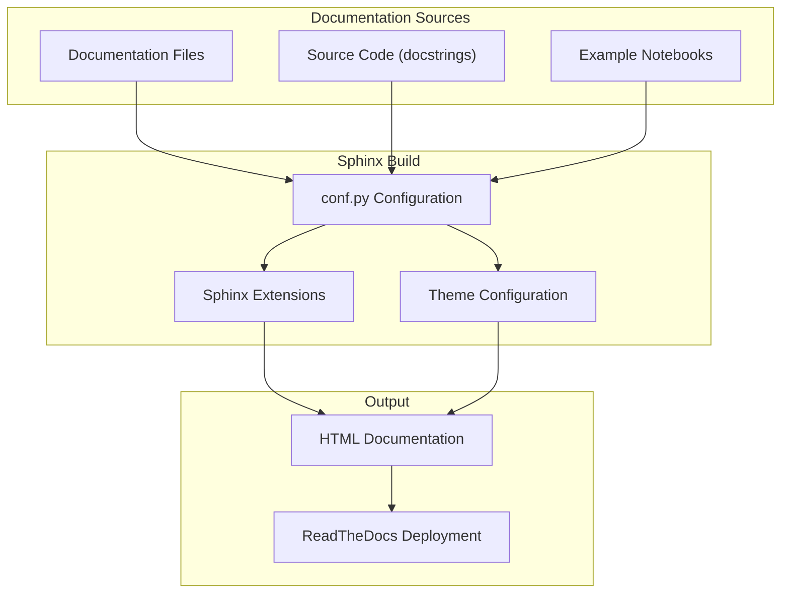

Sources: [docs/conf.py:1-252](), [docs/environment.yaml:1-38](), [docs/_ext/sass.py:1-89]()

## Code Coverage Analysis

OpenFE uses Codecov to track code coverage across the codebase, with different reporting strategies for pull requests vs. main branch updates.

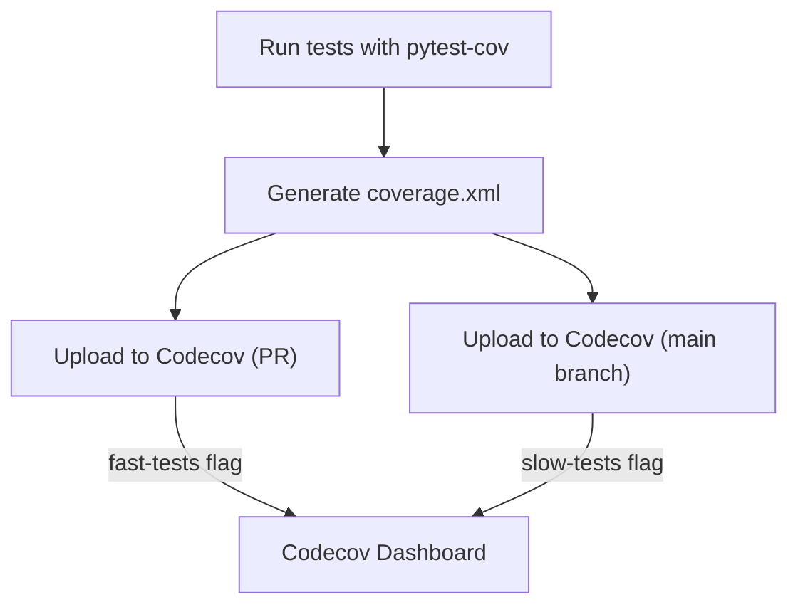

Sources: [.github/workflows/ci.yaml:118-145]()

## Workflow Dependencies and Integration

The following diagram shows how the different workflows in the CI/CD pipeline interact with each other and with the development workflow:

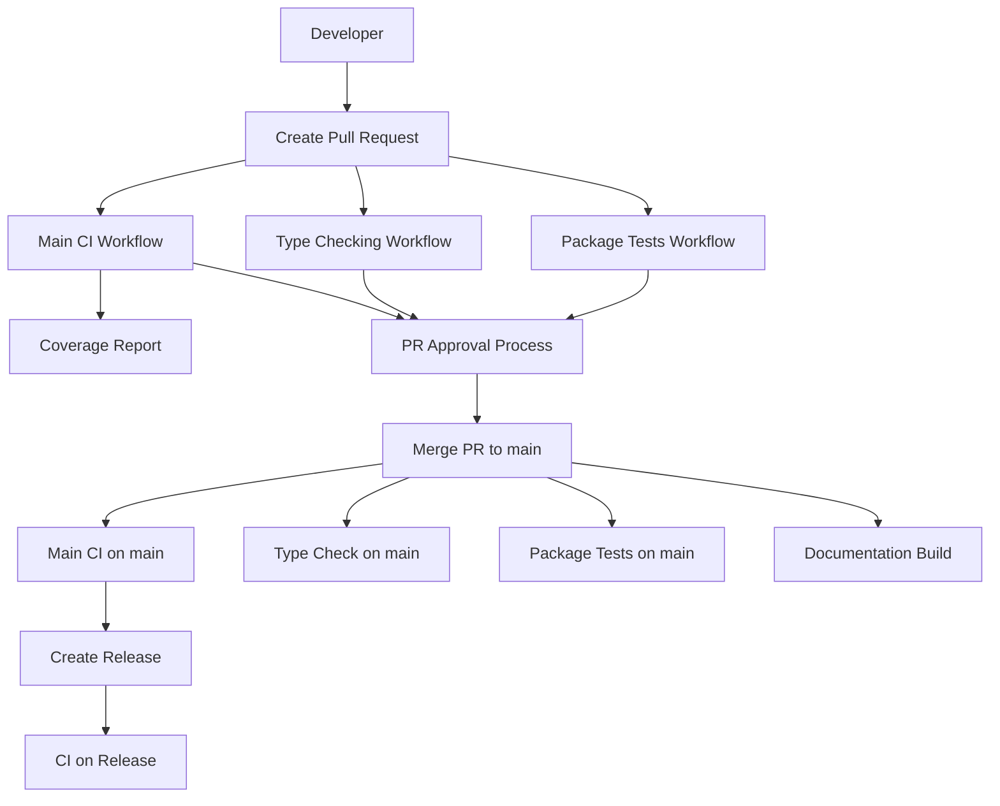

Sources: [.github/workflows/ci.yaml:1-146](), [.github/workflows/mypy.yaml:1-57](), [.github/workflows/package-tests.yaml:1-76]()

## Slow Tests Strategy

OpenFE differentiates between fast and slow tests, running all tests for main branch and scheduled runs, but only fast tests for pull requests. This is controlled by the `OFE_SLOW_TESTS` environment variable.

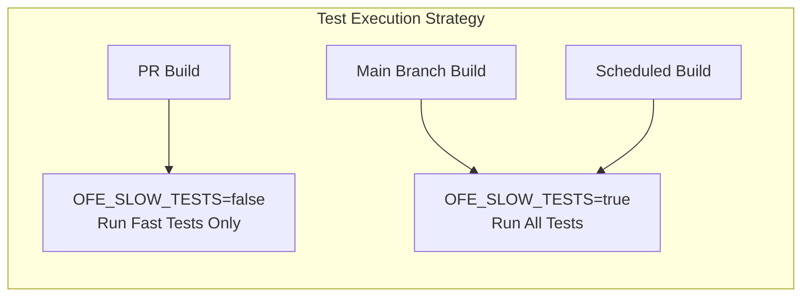

Sources: [.github/workflows/ci.yaml:114-117](), [.github/workflows/package-tests.yaml:71-75]()

## Scheduling Strategy

The CI pipeline includes scheduled runs to catch issues that might arise from external dependency changes or intermittent failures.

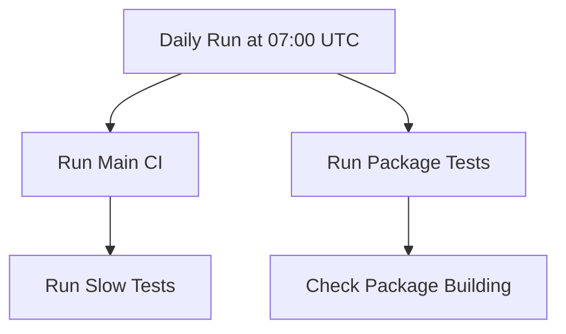

Sources: [.github/workflows/ci.yaml:14-16](), [.github/workflows/package-tests.yaml:16-18]()

---