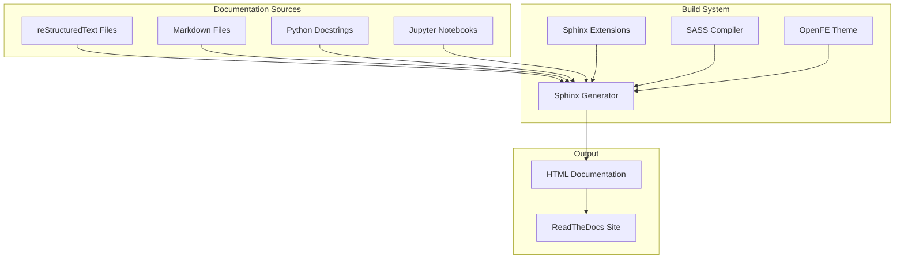
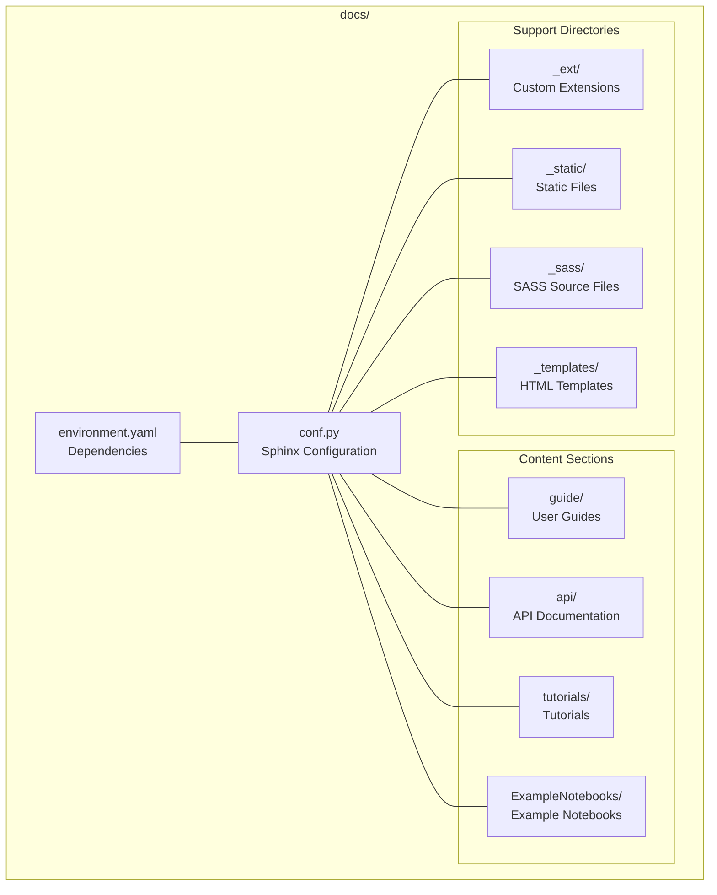
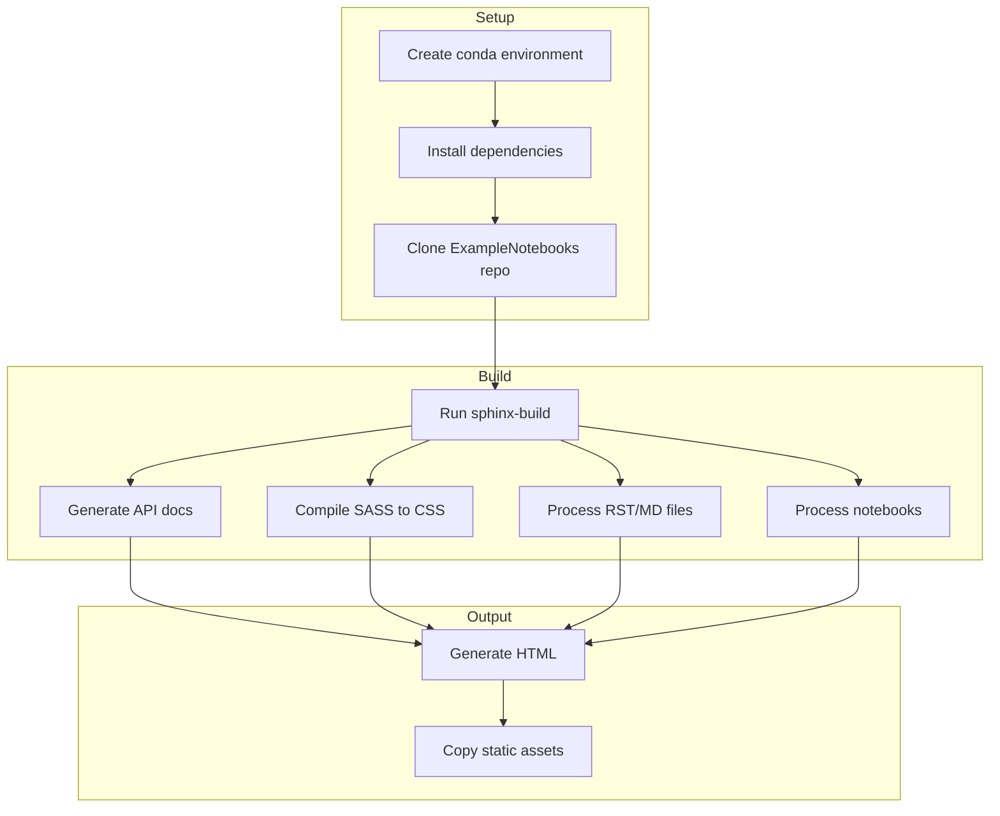
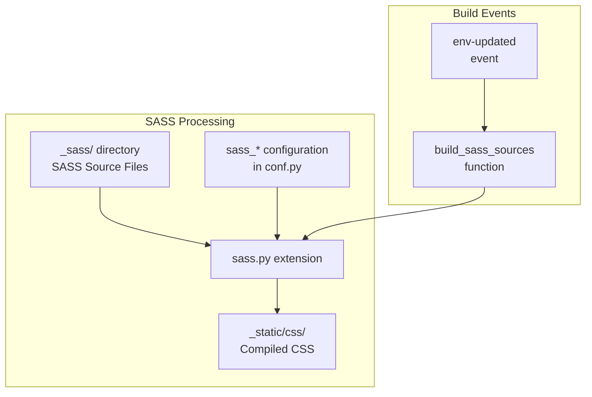
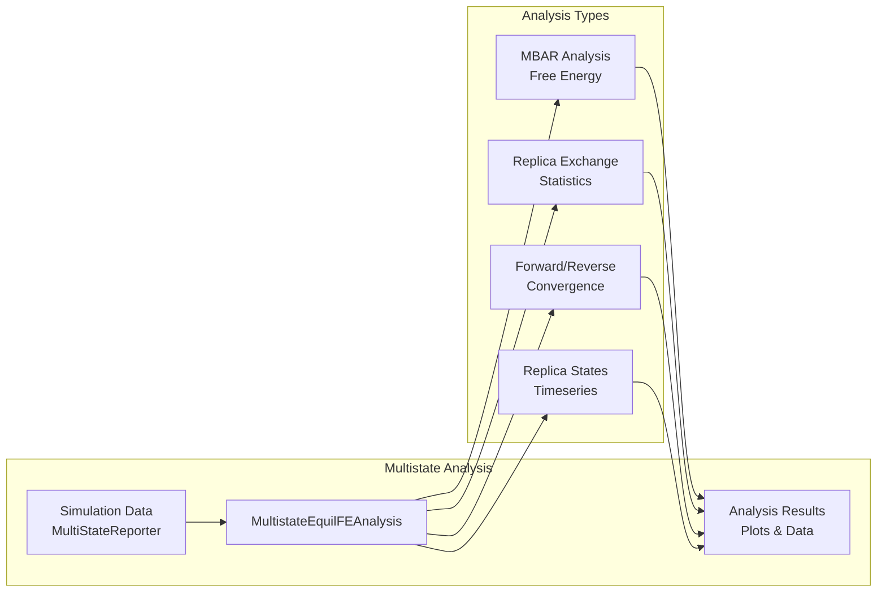

# Documentation System

<details>
<summary>Relevant source files</summary>

The following files were used as context for generating this wiki page:

- [docs/_static/OFE-color-icon.svg](docs/_static/OFE-color-icon.svg)
- [docs/conf.py](docs/conf.py)
- [docs/environment.yaml](docs/environment.yaml)
- [docs/guide/index.rst](docs/guide/index.rst)
- [docs/index.rst](docs/index.rst)
- [docs/installation.rst](docs/installation.rst)
- [environment.yml](environment.yml)

</details>


The OpenFE documentation system provides a comprehensive framework for documenting the codebase, creating user guides, tutorials, and API references. This page describes the documentation infrastructure, how it's built, and how to contribute to it.

For information about how to use the documentation as a user, see the tutorials and guides in section [7](#7).

## Documentation Technologies

OpenFE uses a sophisticated documentation system based on Sphinx with numerous extensions to provide a rich, interactive documentation experience.



Sources: [docs/conf.py:12-57](), [docs/environment.yaml:5-37]()

## Documentation Structure

The documentation is organized into several key sections, with separate directories for different types of content:



Sources: [docs/conf.py:88-102](), [docs/guide/protocols/index.rst:1-12]()

## Configuration and Extensions

The documentation system is configured through `conf.py`, which sets up Sphinx and its extensions. OpenFE uses numerous extensions to enhance documentation capabilities.

### Core Extensions

| Extension | Purpose |
|-----------|---------|
| `sphinx.ext.autodoc` | Generates API documentation from docstrings |
| `sphinx.ext.napoleon` | Supports Google/NumPy style docstrings |
| `sphinx_click.ext` | Documents CLI commands |
| `sphinxcontrib.autodoc_pydantic` | Documents Pydantic models |
| `sphinx_design` | Enhanced page layouts |
| `sphinx.ext.intersphinx` | Cross-references to external documentation |
| `myst_parser` | Markdown support |
| `nbsphinx` | Jupyter notebook integration |
| `sphinx.ext.mathjax` | Mathematical notation |
| `docs._ext.sass` | SASS compilation for styling |

Sources: [docs/conf.py:42-57](), [docs/conf.py:59-70]()

### Custom Theme

OpenFE uses a custom Sphinx theme (`ofe_sphinx_theme`) with specific configuration options to maintain a consistent visual identity.

```python
html_theme = "ofe_sphinx_theme"
html_theme_options = {
    "logo": {"text": "OpenFE Documentation"},
    "icon_links": [
        {
            "name": "GitHub",
            "url": "https://github.com/OpenFreeEnergy/openfe",
            "icon": "fa-brands fa-square-github",
            "type": "fontawesome",
        }
    ],
    "accent_color": "DarkGoldenYellow",
    "navigation_with_keys": False,
}
html_logo = "_static/Squaredcircle.svg"
```

Sources: [docs/conf.py:128-142](), [docs/conf.py:158-163]()

## Building the Documentation

To build the documentation, you need to set up the required dependencies and run the Sphinx build process.

### Dependencies

Dependencies are managed in `environment.yaml`:

```yaml
name: openfe-docs
channels:
- https://conda.anaconda.org/jaimergp/label/unsupported-cudatoolkit-shim
- https://conda.anaconda.org/conda-forge
dependencies:
- autodoc-pydantic <2.0
- gitpython
- kartograf >=1.0.0
- libsass
- lomap2 >=3.0.0
- myst-parser
- nbsphinx
- nbsphinx-link
- openff-models >=0.0.5
- openff-toolkit >=0.13.0
- openff-units
- openmm
- packaging
- pip
- plugcli
- python=3.10
- sphinx <7.3
- sphinx-click
- sphinx-design
- sphinx-toolbox
- threadpoolctl
- tqdm
# ...and more
```

Sources: [docs/environment.yaml:1-38]()

### Build Process



Sources: [docs/conf.py:170-187](), [docs/_ext/sass.py:55-69]()

## Working with Jupyter Notebooks

OpenFE documentation integrates Jupyter notebooks from a separate repository (`ExampleNotebooks`). The documentation build process automatically clones or updates this repository.

### Notebook Integration

The notebooks are integrated using `nbsphinx` and `nbsphinx_link`, with custom formatting to provide useful links:

```python
# Clone or update ExampleNotebooks
example_notebooks_path = Path("ExampleNotebooks")
try:
    if example_notebooks_path.exists():
        repo = Repo(example_notebooks_path)
        repo.remote('origin').pull()
    else:
        repo = Repo.clone_from(
            "https://github.com/OpenFreeEnergy/ExampleNotebooks.git",
            to_path=example_notebooks_path,
        )
except Exception as e:
    from sphinx.util.logging import getLogger
    filename = e.__traceback__.tb_frame.f_code.co_filename
    lineno = e.__traceback__.tb_lineno
    getLogger('sphinx.ext.openfe_git').warning(
        f"Getting ExampleNotebooks failed in {filename} line {lineno}: {e}"
    )
```

Each notebook has buttons to view on GitHub, download, or run in Colab:

```python
nbsphinx_prolog = cleandoc(r"""
    
    
    
    
        
    
    
        
    
    
    .. container:: ofe-top-of-notebook

        .. button-link:: {{gh_url}}
            :color: primary
            :shadow:
            :outline:

            :octicon:`mark-github` View on GitHub

        .. button-link:: {{dl_url}}
            :color: primary
            :shadow:
            :outline:

            :octicon:`download` Download Notebook

        .. button-link:: {{colab_url}}
            :color: primary
            :shadow:
            :outline:

            :octicon:`rocket` Run in Colab
""")
```

Sources: [docs/conf.py:170-252]()

## Style Customization

OpenFE documentation uses SASS for advanced CSS styling, with a custom extension to compile SASS to CSS during the documentation build process.

### SASS Compilation

The `sass.py` extension handles SASS compilation:



Sources: [docs/_ext/sass.py:1-89](), [docs/conf.py:165-167]()

## Documentation Conventions

OpenFE documentation follows specific conventions for different types of content.

### Protocol Documentation

Protocol documentation (such as for RelativeHybridTopologyProtocol, AbsoluteSolvationProtocol, etc.) follows a standard structure:

1. Overview
2. Scientific Details
3. Implementation Details
4. Usage Examples
5. See Also (links to related documentation)
6. References

Each protocol documentation includes:
- Explanatory text
- Mathematical notation when needed
- Diagrams for visual explanation
- Tables for structured information
- Links to tutorials and API documentation

Sources: [docs/guide/protocols/relativehybridtopology.rst:1-227](), [docs/guide/protocols/absolutesolvation.rst:1-115](), [docs/guide/protocols/plainmd.rst:1-71]()

### API Documentation

API documentation is generated from docstrings using `autodoc` and follows specific configuration:

```python
autodoc_default_options = {
    "members": True,
    "member-order": "bysource",
    "inherited-members": "GufeTokenizable,BaseModel",
    "undoc-members": True,
    "special-members": "__call__",
}
toc_object_entries_show_parents = "hide"
```

Sources: [docs/conf.py:77-86]()

## Contributing Documentation

When contributing to the OpenFE documentation system, follow these guidelines to ensure consistency and high quality.

### File Organization

- Place user guides in `docs/guide/`
- Place tutorials in `docs/tutorials/`
- Place API documentation in `docs/api/`
- Place static files (images, etc.) in `docs/_static/`

### Markup and Syntax

- Use reStructuredText (`.rst`) for structured documentation
- Use Markdown (`.md`) for simpler content
- Use Jupyter notebooks (`.ipynb`) for interactive tutorials
- Follow Google/NumPy style for docstrings in Python code

### Cross-References

- Use intersphinx for references to external documentation
- Use standard Sphinx cross-references for internal documentation
- Use `autosectionlabel` for section references

Sources: [docs/conf.py:74-75]()

## Analysis Documentation Example

The OpenFE documentation often includes detailed explanations of analysis tools, such as the `MultistateEquilFEAnalysis` class. This demonstrates how detailed technical concepts are documented with both explanatory text and visual elements.

### Multistate Analysis

The documentation for multistate analysis includes:

- Class and method descriptions
- Parameter explanations
- Return value details
- Visual examples (plots, diagrams)
- Mathematical background



Sources: [openfe/protocols/openmm_utils/multistate_analysis.py:1-492]()

## Documentation in Continuous Integration

The documentation build process is integrated into the continuous integration pipeline to ensure that:

1. Documentation builds successfully
2. Cross-references are valid
3. Code examples work as expected
4. Everything is kept up-to-date

This ensures that the documentation remains reliable and current as the codebase evolves.

Sources: [docs/conf.py:1-252]()

---