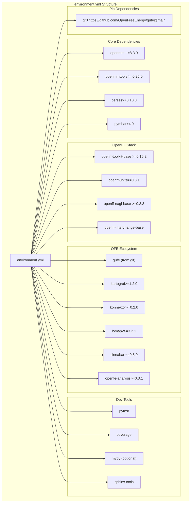
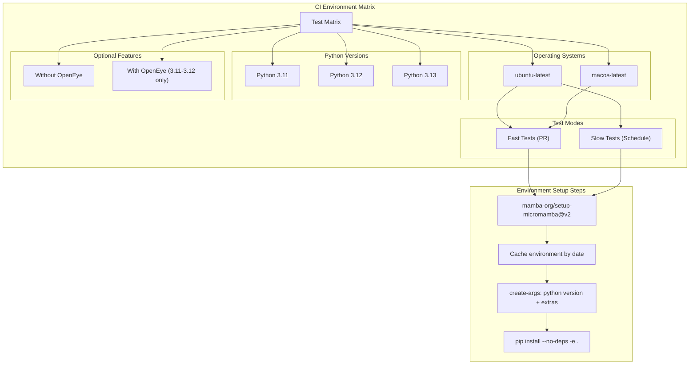
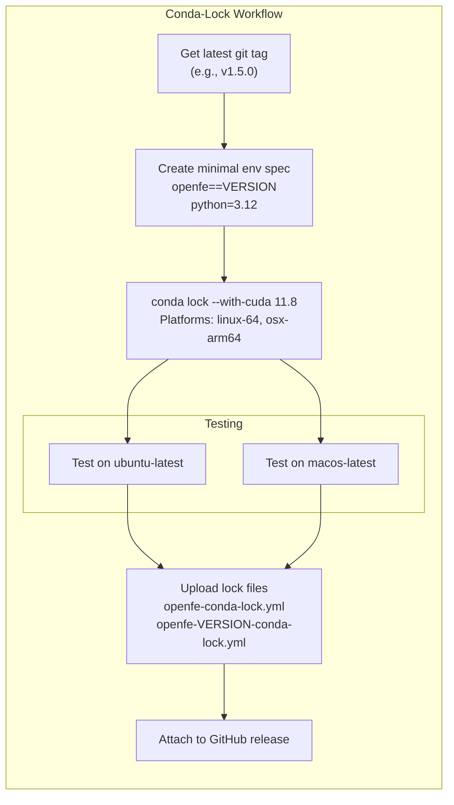
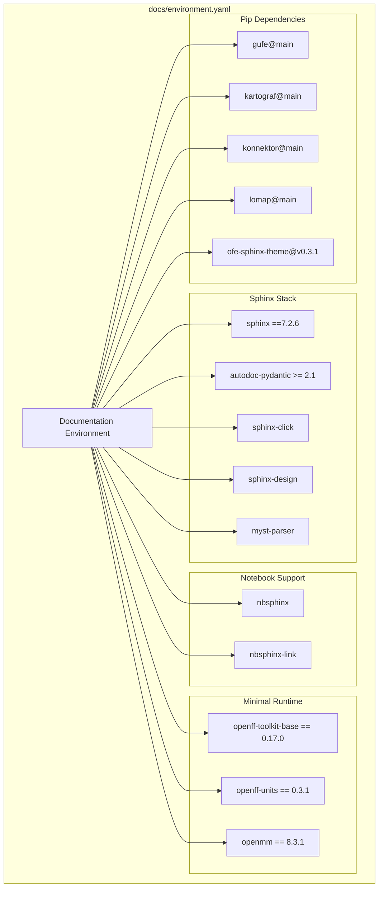
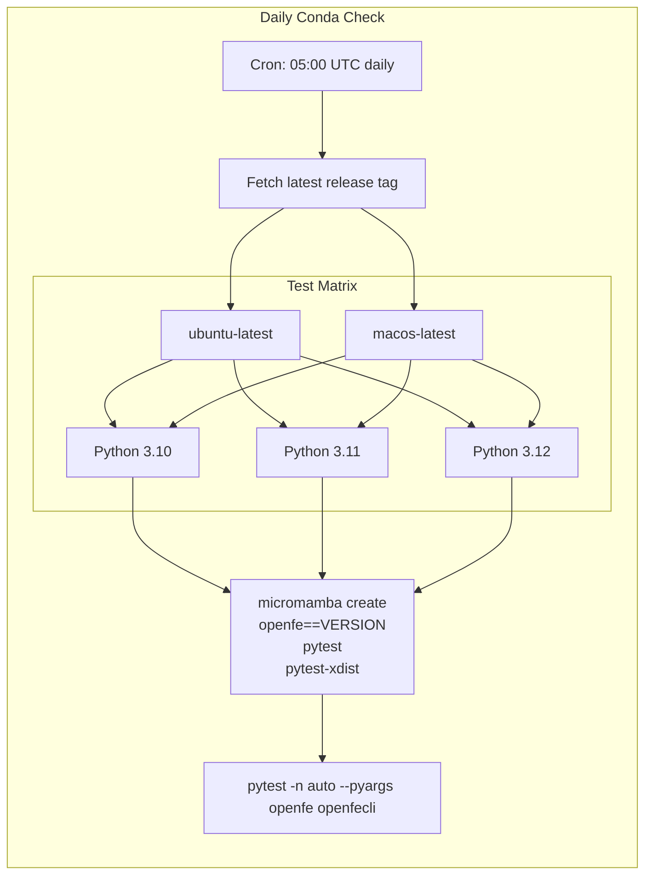

# Environment Management

<details>
<summary>Relevant source files</summary>

The following files were used as context for generating this wiki page:

- [.github/workflows/check_for_api_break.yaml](.github/workflows/check_for_api_break.yaml)
- [.github/workflows/ci.yaml](.github/workflows/ci.yaml)
- [.github/workflows/conda_cron.yaml](.github/workflows/conda_cron.yaml)
- [.github/workflows/cpu-long-tests.yaml](.github/workflows/cpu-long-tests.yaml)
- [.github/workflows/gen-lock-file.yaml](.github/workflows/gen-lock-file.yaml)
- [.github/workflows/gpu-integration-tests.yaml](.github/workflows/gpu-integration-tests.yaml)
- [.github/workflows/installer.yaml](.github/workflows/installer.yaml)
- [.github/workflows/mypy.yaml](.github/workflows/mypy.yaml)
- [docs/conf.py](docs/conf.py)
- [docs/environment.yaml](docs/environment.yaml)
- [environment.yml](environment.yml)

</details>


This document describes the development environment setup for OpenFE, including dependency management, reproducibility mechanisms, and troubleshooting procedures. It covers the conda-based environment specifications used in local development, CI/CD pipelines, and production deployments.

For information about the testing infrastructure that runs within these environments, see [Testing Framework](#6.1). For CI/CD pipeline details, see [CI/CD Pipeline](#6.2). For documentation builds, see [Documentation System](#6.3).

## Overview

OpenFE uses conda/mamba for environment management with explicit dependency version constraints to ensure reproducibility across development, testing, and production environments. The primary environment specification is [`environment.yml`](environment.yml:1-55)(), which defines all core dependencies and development tools.

## Main Development Environment

### Environment Specification Structure

The primary development environment is defined in [`environment.yml`](environment.yml:1-55)() and includes three categories of dependencies:

| Category | Purpose | Examples |
|----------|---------|----------|
| Core Scientific | Free energy calculations | `openmm`, `openmmtools`, `perses`, `pymbar` |
| OpenFreeEnergy Ecosystem | Network planning and abstractions | `gufe`, `kartograf`, `konnektor`, `lomap2`, `cinnabar` |
| Cheminformatics | Molecular representation | `rdkit`, `openff-toolkit-base`, `openff-nagl-base` |
| Development Tools | Testing and documentation | `pytest`, `coverage`, `sphinx`, `mypy` |



**Dependency Version Constraints and Rationale**

Sources: [environment.yml:1-55]()

### Critical Version Pins

Several dependencies have strict version constraints due to compatibility requirements:

```yaml
# Exact pin due to API changes
openff-units==0.3.1  # https://github.com/OpenFreeEnergy/openfe/pull/1374

# Upper bound due to downstream incompatibility
pydantic >= 2.0.0, <2.12.0  # https://github.com/openforcefield/openff-interchange/issues/1346

# Upper bound due to breaking changes
numpy<2.3

# Compatible range
openmm ~=8.3.0  # Allows 8.3.x patch versions
```

The `openff-units` pin at version 0.3.1 prevents API breakage, while `pydantic` is constrained below 2.12.0 due to issues in `openff-interchange`. OpenMM uses flexible versioning (`~=8.3.0`) to allow patch updates while preventing minor version changes.

Sources: [environment.yml:19-20](), [environment.yml:31](), [environment.yml:13](), [environment.yml:20]()

### GUFE Development Dependency

GUFE is installed from the `main` branch via pip to track the latest development:

```yaml
- pip:
  - git+https://github.com/OpenFreeEnergy/gufe@main
```

This allows OpenFE to use unreleased GUFE features but requires careful coordination between repositories. The CI system tests against this moving target daily to catch breaking changes early.

Sources: [environment.yml:53-54]()

### Setting Up the Development Environment

Create the development environment using micromamba (recommended) or conda:

```bash
# Using micromamba (faster)
micromamba create -f environment.yml
micromamba activate openfe_env

# Install openfe in development mode
python -m pip install --no-deps -e .
```

The `--no-deps` flag prevents pip from overriding conda-installed dependencies. This pattern is used throughout the CI workflows.

Sources: [.github/workflows/ci.yaml:107-108]()

## CI/CD Environment Matrix

### Test Matrix Strategy

The CI system tests against multiple environment configurations defined in [`.github/workflows/ci.yaml`](/.github/workflows/ci.yaml:33-51)():



The matrix excludes certain combinations, such as OpenEye with Python 3.13, due to upstream compatibility issues.

Sources: [.github/workflows/ci.yaml:34-51]()

### Environment Caching

CI environments are cached by date to balance freshness with build speed:

```yaml
cache-environment-key: environment-${{ steps.date.outputs.date }}
cache-downloads-key: downloads-${{ steps.date.outputs.date }}
```

This causes one cache miss per day, ensuring environments stay reasonably up-to-date while avoiding unnecessary rebuilds during a single day's development cycle.

Sources: [.github/workflows/ci.yaml:73-74]()

### Special CI Environments

Different workflows require specialized environments:

| Workflow | Python | Special Packages | Purpose |
|----------|--------|------------------|---------|
| `ci.yaml` | 3.11-3.13 | `espaloma=0.4.0` (3.11-3.12 only) | Standard test matrix |
| `mypy.yaml` | 3.12 | `mypy>=1.17.0`, `types-setuptools` | Static type checking |
| `cpu-long-tests.yaml` | 3.12 | `openeye-toolkits`, `espaloma_charge` | Extended CPU tests |
| `gpu-integration-tests.yaml` | 3.12 | `cuda-version=12.8` | GPU integration tests |

Sources: [.github/workflows/ci.yaml:76-77](), [.github/workflows/mypy.yaml:37-41](), [.github/workflows/cpu-long-tests.yaml:59-63](), [.github/workflows/gpu-integration-tests.yaml:62-67]()

### Python 3.13 Handling

Python 3.13 support is partial due to espaloma incompatibility. The CI workflow conditionally installs espaloma:

```yaml
- name: "Setup Micromamba"
  if: ${{ matrix.python-version == '3.13' }}
  uses: mamba-org/setup-micromamba@v2
  with:
    environment-file: environment.yml
    create-args: >-
      python=${{ matrix.python-version }}
      pydantic=${{ matrix.pydantic-version }}
    # Note: espaloma NOT included here
```

This allows testing core functionality on Python 3.13 while maintaining full feature support on 3.11-3.12.

Sources: [.github/workflows/ci.yaml:81-95]()

## Conda-Lock for Reproducibility

### Lock File Generation

The [`.github/workflows/gen-lock-file.yaml`](/.github/workflows/gen-lock-file.yaml:1-101)() workflow creates fully resolved environment lock files for reproducible installations:



The lock file generation process:

1. Fetches the latest release tag (e.g., `v1.5.0`)
2. Creates a minimal environment specification with only `openfe` and `python` version
3. Runs `conda lock --with-cuda 11.8` to resolve all transitive dependencies
4. Tests installation on both Linux and macOS
5. Uploads lock files as release artifacts

Sources: [.github/workflows/gen-lock-file.yaml:23-56]()

### Using Lock Files

Users can install exact package versions from lock files:

```bash
# Install from lock file
conda-lock install -p /path/to/env openfe-conda-lock.yml
micromamba activate /path/to/env

# Verify installation
openfe test
```

This guarantees identical package versions across installations, eliminating "works on my machine" issues.

Sources: [.github/workflows/gen-lock-file.yaml:58-62]()

## Documentation Build Environment

The documentation has a separate, minimal environment specification at [`docs/environment.yaml`](docs/environment.yaml:1-42)() to reduce build time:



Key differences from the main environment:

- **Exact Sphinx version** (`==7.2.6`) to avoid "duplicate object" warnings in newer versions
- **Exact OpenMM version** (`8.3.1`) instead of flexible `~=8.3.0`
- **No testing dependencies** (pytest, coverage)
- **Git dependencies** for ecosystem packages to build latest docs

The documentation environment also mocks expensive imports in [`docs/conf.py`](docs/conf.py:104-116)() to avoid requiring OpenMMTools, PyMBAR, and MDAnalysis during doc builds.

Sources: [docs/environment.yaml:1-42](), [docs/conf.py:104-116]()

## Platform-Specific Considerations

### CUDA Support

GPU-enabled environments require explicit CUDA version specification:

```yaml
create-args: >-
  cuda-version=12.8
```

The GPU integration test workflow uses `g4dn.xlarge` EC2 instances with CUDA 12.8 for testing GPU functionality.

Sources: [.github/workflows/gpu-integration-tests.yaml:67]()

### macOS ARM64 Support

Lock files explicitly support Apple Silicon:

```yaml
platforms:
  - linux-64
  - osx-arm64
```

Both platforms are tested in the lock file generation workflow to ensure compatibility.

Sources: [.github/workflows/gen-lock-file.yaml:45-47]()

## Daily Environment Validation

The [`.github/workflows/conda_cron.yaml`](/.github/workflows/conda_cron.yaml:1-70)() workflow validates that released versions can be installed from conda-forge:



This ensures:
- Released packages install cleanly from conda-forge
- No dependency conflicts in the conda ecosystem
- Fast tests pass with minimal dependencies

Sources: [.github/workflows/conda_cron.yaml:17-69]()

## Environment Troubleshooting

### Common Issues and Solutions

**Issue: Dependency Conflict During Installation**

Symptom:
```
Encountered problems while solving:
  - package pydantic-2.12.0 requires openff-interchange >=0.4, but...
```

Solution: Ensure you're using the exact version constraints from `environment.yml`. Clear your conda cache:
```bash
conda clean --all
micromamba create -f environment.yml -y
```

Sources: [environment.yml:31]()

**Issue: ImportError for OpenMMTools**

Symptom:
```python
ImportError: cannot import name 'MultistateSampler' from 'openmmtools'
```

Solution: Verify OpenMMTools version is at least 0.25.0:
```bash
micromamba list | grep openmmtools
# If outdated:
micromamba update openmmtools -c conda-forge
```

Sources: [environment.yml:22]()

**Issue: GUFE Version Mismatch**

Symptom:
```
AttributeError: 'ChemicalSystem' object has no attribute 'new_method'
```

Solution: GUFE is installed from git main. Update it:
```bash
python -m pip install --no-deps --upgrade git+https://github.com/OpenFreeEnergy/gufe@main
```

Sources: [environment.yml:54]()

### Verification Steps

After environment setup, verify the installation:

```bash
# Activate environment
micromamba activate openfe_env

# Check package versions
micromamba list

# Verify OpenFE imports
python -Ic "import openfe; print(openfe.__version__)"

# Test OpenMM platform detection
python -m openmm.testInstallation

# Run fast test suite
pytest -n auto --pyargs openfe openfecli
```

This sequence matches the CI validation steps.

Sources: [.github/workflows/ci.yaml:110-127]()

## Single-File Installer

For production deployments, OpenFE provides a single-file installer built with Constructor. The [`.github/workflows/installer.yaml`](/.github/workflows/installer.yaml:1-80)() workflow creates platform-specific installers:

```bash
# Installation
chmod +x OpenFEforge-0.7.2-Linux-x86_64.sh
./OpenFEforge-0.7.2-Linux-x86_64.sh -b

# Add to PATH
export PATH="$HOME/openfeforge/bin:$PATH"

# Verify
openfe --version
```

The installer bundles:
- Complete conda environment based on `environment.yml`
- OpenFE package at the specified version
- All dependencies pre-resolved

Sources: [.github/workflows/installer.yaml:44-63]()

## Environment Setup Workflow

The complete environment setup process for different use cases:

```mermaid
graph TB
    subgraph "Local Development"
        CloneRepo["git clone openfe"]
        CreateDevEnv["micromamba create -f environment.yml"]
        ActivateDev["micromamba activate openfe_env"]
        InstallDev["pip install --no-deps -e ."]
        RunTests["pytest -n auto"]
    end
    
    subgraph "Production Deployment"
        GetInstaller["Download OpenFEforge installer"]
        RunInstaller["./OpenFEforge-VERSION.sh -b"]
        AddPath["export PATH with openfeforge/bin"]
        Validate["openfe test"]
    end
    
    subgraph "Reproducible Research"
        GetLock["Download openfe-VERSION-conda-lock.yml"]
        InstallLock["conda-lock install"]
        ActivateLock["micromamba activate"]
        VerifyLock["openfe test"]
    end
    
    CloneRepo --> CreateDevEnv
    CreateDevEnv --> ActivateDev
    ActivateDev --> InstallDev
    InstallDev --> RunTests
    
    GetInstaller --> RunInstaller
    RunInstaller --> AddPath
    AddPath --> Validate
    
    GetLock --> InstallLock
    InstallLock --> ActivateLock
    ActivateLock --> VerifyLock
```



Sources: [.github/workflows/ci.yaml:65-127](), [.github/workflows/installer.yaml:56-60](), [.github/workflows/gen-lock-file.yaml:58-62]()

---