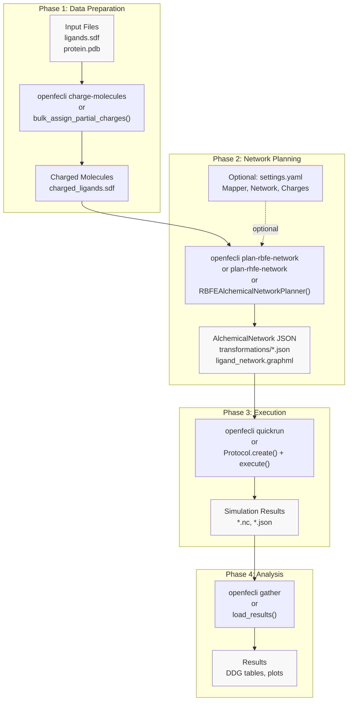
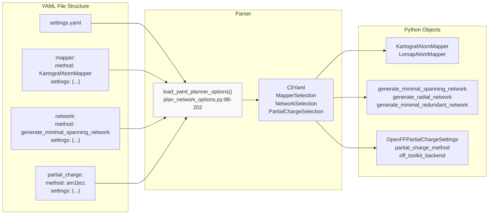

# Tutorials and Examples

<details>
<summary>Relevant source files</summary>

The following files were used as context for generating this wiki page:

- [docs/_static/OFE-color-icon.svg](docs/_static/OFE-color-icon.svg)
- [docs/guide/index.rst](docs/guide/index.rst)
- [docs/index.rst](docs/index.rst)
- [docs/installation.rst](docs/installation.rst)
- [openfecli/commands/generate_partial_charges.py](openfecli/commands/generate_partial_charges.py)
- [openfecli/commands/plan_rbfe_network.py](openfecli/commands/plan_rbfe_network.py)
- [openfecli/commands/plan_rhfe_network.py](openfecli/commands/plan_rhfe_network.py)
- [openfecli/parameters/__init__.py](openfecli/parameters/__init__.py)
- [openfecli/parameters/misc.py](openfecli/parameters/misc.py)
- [openfecli/parameters/plan_network_options.py](openfecli/parameters/plan_network_options.py)
- [openfecli/plan_alchemical_networks_utils.py](openfecli/plan_alchemical_networks_utils.py)
- [openfecli/tests/commands/test_plan_rbfe_network.py](openfecli/tests/commands/test_plan_rbfe_network.py)
- [openfecli/tests/commands/test_plan_rhfe_network.py](openfecli/tests/commands/test_plan_rhfe_network.py)

</details>


This page provides an overview of the tutorial materials available for learning OpenFE. The tutorials demonstrate both command-line interface (CLI) and Python API approaches for running alchemical free energy calculations, from simple relative binding free energy (RBFE) campaigns to advanced customization scenarios.

For detailed API documentation, see the Python API reference ([page 5](#5)). For conceptual explanations of protocols and network planning, see the User Guide ([page 1](#1)).

## Purpose and Scope

The tutorial collection is organized into three categories:

| Tutorial Section | Purpose | Target Audience |
|-----------------|---------|-----------------|
| Getting Started Tutorial ([7.1](#7.1)) | Step-by-step walkthrough of a complete RBFE or RHFE calculation | New users |
| Advanced Use Cases ([7.2](#7.2)) | Customization, troubleshooting, and HPC deployment | Experienced users |
| Python API Cookbook ([7.3](#7.3)) | Code recipes for programmatic workflows | Developers |

All tutorials assume OpenFE is properly installed (see Installation and Setup [1.1](#1.1)).

## Tutorial Workflow Overview

OpenFE calculations follow a consistent pattern across both CLI and Python API approaches:



**Tutorial Coverage by Phase:**

| Phase | CLI Tutorial | Python API Tutorial |
|-------|-------------|---------------------|
| Charge Generation | `charge-molecules` ([7.1](#7.1)) | `bulk_assign_partial_charges()` ([7.3](#7.3)) |
| Network Planning | `plan-rbfe-network` ([7.1](#7.1)) | `RBFEAlchemicalNetworkPlanner` ([7.3](#7.3)) |
| Execution | `quickrun` ([7.1](#7.1), [7.2](#7.2)) | `Protocol.create()` ([7.3](#7.3)) |
| Analysis | `gather` ([7.1](#7.1)) | Result parsing ([7.3](#7.3)) |

**Sources:**
- [openfecli/commands/plan_rbfe_network.py:19-118]()
- [openfecli/commands/plan_rhfe_network.py:21-94]()
- [openfecli/commands/generate_partial_charges.py:30-95]()

## Getting Tutorial Data

OpenFE provides a `fetch` command to download tutorial datasets:

```bash
openfe fetch <resource_name>
```

Common tutorial datasets are fetched automatically by the examples. The test suite uses example data from:
- `openfe.tests.data.openmm_rfe` - ligand pairs for testing
- `openfe.tests.data` - protein structures (e.g., `181l_only.pdb`)
- `openfe.tests.data.eg5` - EG5 system with ligands, protein, and cofactor
- `openfe.tests.data.cdk8` - CDK8 system for testing charge changes

**Sources:**
- [openfecli/tests/commands/test_plan_rbfe_network.py:22-48]()
- [openfecli/tests/commands/test_plan_rbfe_network.py:260-268]()
- [openfecli/tests/commands/test_plan_rbfe_network.py:308-315]()

## Tutorial Structure and Command Mapping

This diagram maps tutorial topics to specific CLI commands and Python classes:

```mermaid
graph TB
    subgraph "Getting Started [7.1]"
        BasicWorkflow["Basic RBFE Workflow"]
        BasicRHFE["Basic RHFE Workflow"]
    end
    
    subgraph "CLI Commands"
        ChargeMols["charge-molecules<br/>generate_partial_charges.py"]
        PlanRBFE["plan-rbfe-network<br/>plan_rbfe_network.py"]
        PlanRHFE["plan-rhfe-network<br/>plan_rhfe_network.py"]
        Quickrun["quickrun<br/>(execution)"]
        Gather["gather<br/>(analysis)"]
    end
    
    subgraph "Python Classes"
        BulkCharge["bulk_assign_partial_charges()<br/>charge_generation.py"]
        NetworkPlanner["RBFEAlchemicalNetworkPlanner<br/>RHFEAlchemicalNetworkPlanner"]
        Protocol["RelativeHybridTopologyProtocol<br/>Protocol.create()"]
        Results["ProtocolResult<br/>ProtocolDAGResult"]
    end
    
    subgraph "Advanced Use Cases [7.2]"
        YAMLCustom["YAML Customization<br/>plan_network_options.py"]
        RestConfig["Restraint Configuration"]
        HPCDeploy["HPC Deployment"]
        Convergence["Convergence Troubleshooting"]
    end
    
    subgraph "Python Cookbook [7.3]"
        CustomSettings["Custom Settings"]
        NetworkGen["Network Generation"]
        ResultParse["Result Parsing"]
        CustomProtocol["Custom Protocols"]
    end
    
    BasicWorkflow --> ChargeMols
    BasicWorkflow --> PlanRBFE
    BasicWorkflow --> Quickrun
    BasicWorkflow --> Gather
    
    BasicRHFE --> ChargeMols
    BasicRHFE --> PlanRHFE
    BasicRHFE --> Quickrun
    BasicRHFE --> Gather
    
    ChargeMols -.API.-> BulkCharge
    PlanRBFE -.API.-> NetworkPlanner
    PlanRHFE -.API.-> NetworkPlanner
    Quickrun -.API.-> Protocol
    Gather -.API.-> Results
    
    YAMLCustom --> PlanRBFE
    YAMLCustom --> PlanRHFE
    
    CustomSettings --> NetworkPlanner
    NetworkGen --> NetworkPlanner
    ResultParse --> Results
    CustomProtocol --> Protocol
    
    style BasicWorkflow fill:#f9f9f9
    style BasicRHFE fill:#f9f9f9
    style YAMLCustom fill:#f9f9f9
    style RestConfig fill:#f9f9f9
    style CustomSettings fill:#f9f9f9
```



**Sources:**
- [openfecli/commands/plan_rbfe_network.py:120-177]()
- [openfecli/commands/plan_rhfe_network.py:97-152]()
- [openfecli/commands/generate_partial_charges.py:40-95]()
- [openfecli/parameters/plan_network_options.py:88-202]()

## YAML Configuration System

The CLI commands support extensive customization through YAML settings files. The configuration structure maps to Python objects:



**Supported Options:**

| Section | Methods | Key Settings |
|---------|---------|--------------|
| `mapper` | `KartografAtomMapper`, `LomapAtomMapper` | `atom_max_distance`, `element_change`, `time` |
| `network` | `generate_minimal_spanning_network`, `generate_radial_network`, `generate_minimal_redundant_network`, `generate_maximal_network`, `generate_lomap_network` | `central_ligand`, `mst_num`, `max_path_length` |
| `partial_charge` | `am1bcc`, `am1bccelf10`, `nagl`, `espaloma` | `off_toolkit_backend`, `nagl_model`, `number_of_conformers` |

**Sources:**
- [openfecli/parameters/plan_network_options.py:26-53]()
- [openfecli/parameters/plan_network_options.py:88-202]()
- [openfecli/parameters/plan_network_options.py:226-267]()

## Common Tutorial Patterns

### Pattern 1: Basic RBFE Campaign

**CLI Approach:**
```bash
# Step 1: Charge molecules
openfe charge-molecules -M ligands/ -o charged_ligands.sdf

# Step 2: Plan network
openfe plan-rbfe-network -M ligands/ -p protein.pdb -o my_network

# Step 3: Execute transformations
openfe quickrun my_network/transformations/rbfe_ligA_complex_ligB_complex.json

# Step 4: Gather results
openfe gather my_network/ -o results.tsv --report=ddg
```

**Python API Equivalent (See [7.3](#7.3)):**
- Use `bulk_assign_partial_charges()` for charging
- Use `RBFEAlchemicalNetworkPlanner` for network planning
- Use `Protocol.create()` and unit execution for running
- Parse `ProtocolResult` objects for analysis

**Sources:**
- [openfecli/commands/plan_rbfe_network.py:145-177]()
- [openfecli/tests/commands/test_plan_rbfe_network.py:141-189]()

### Pattern 2: Custom Network with YAML

```yaml
# settings.yaml
mapper:
  method: LomapAtomMapper
  settings:
    time: 45
    element_change: false

network:
  method: generate_radial_network
  settings:
    central_ligand: lig_ref

partial_charge:
  method: nagl
  settings:
    nagl_model: openff-gnn-am1bcc-0.1.0-rc.3.pt
```

```bash
openfe plan-rbfe-network -M ligands/ -p protein.pdb -s settings.yaml
```

**Sources:**
- [openfecli/tests/commands/test_plan_rbfe_network.py:394-412]()
- [openfecli/tests/commands/test_plan_rbfe_network.py:418-433]()

### Pattern 3: RHFE (Hydration) Calculations

```bash
openfe plan-rhfe-network -M ligands/ -o rhfe_network
openfe quickrun rhfe_network/transformations/rhfe_ligA_vacuum_ligB_vacuum.json
openfe gather rhfe_network/ -o hydration_results.tsv
```

**Sources:**
- [openfecli/commands/plan_rhfe_network.py:111-217]()
- [openfecli/tests/commands/test_plan_rhfe_network.py:107-154]()

## Output Structure

The `plan-*-network` commands create a standardized directory structure:

```
alchemicalNetwork/
├── alchemicalNetwork.json          # Complete network definition
├── ligand_network.graphml          # Network topology for visualization
└── transformations/                # Individual transformation JSONs
    ├── rbfe_ligA_complex_ligB_complex.json
    ├── rbfe_ligA_solvent_ligB_solvent.json
    └── ...
```

Each transformation JSON contains:
- `ChemicalSystem` definitions (stateA, stateB)
- `LigandAtomMapping`
- `Protocol` with settings
- Metadata for execution

**Sources:**
- [openfecli/plan_alchemical_networks_utils.py:10-37]()
- [openfecli/commands/plan_rbfe_network.py:244-252]()

## Protocol Repeat Configuration

The `--n-protocol-repeats` parameter controls statistical robustness versus parallelization strategy:

| Setting | Use Case | Execution Pattern |
|---------|----------|-------------------|
| `--n-protocol-repeats=3` (default) | Serial execution of repeats | `quickrun` runs 3 repeats sequentially per transformation |
| `--n-protocol-repeats=1` | Parallel execution across jobs | Submit multiple `quickrun` jobs for same transformation JSON |

```bash
# Serial approach (3 repeats in one job)
openfe plan-rbfe-network -M ligands/ -p protein.pdb --n-protocol-repeats=3

# Parallel approach (1 repeat per job, submit 3x)
openfe plan-rbfe-network -M ligands/ -p protein.pdb --n-protocol-repeats=1
openfe quickrun transformation.json  # Submit 3 times as separate jobs
```

**Sources:**
- [openfecli/parameters/misc.py:4-11]()
- [openfecli/tests/commands/test_plan_rbfe_network.py:191-211]()

## Charge Overwrite Behavior

By default, OpenFE preserves existing partial charges on input molecules. Use `--overwrite-charges` to force regeneration:

```bash
# Preserve existing charges
openfe plan-rbfe-network -M charged_ligands.sdf -p protein.pdb

# Force charge regeneration
openfe plan-rbfe-network -M ligands.sdf -p protein.pdb --overwrite-charges
```

This is useful when:
- Input molecules have incorrect or dummy charges
- You want to ensure consistent charge method across all molecules
- Testing different charge generation methods

**Sources:**
- [openfecli/parameters/misc.py:15-20]()
- [openfecli/tests/commands/test_plan_rbfe_network.py:213-258]()

## Special System Considerations

### Systems with Cofactors

The `--cofactors` flag adds cofactors to complex (protein-bound) transformations:

```bash
openfe plan-rbfe-network -M ligands/ -p protein.pdb -C cofactor.sdf
```

Cofactors are:
- Present in complex leg transformations
- Absent from solvent leg transformations  
- Automatically charged alongside ligands

**Sources:**
- [openfecli/commands/plan_rbfe_network.py:128]()
- [openfecli/tests/commands/test_plan_rbfe_network.py:273-306]()

### Charge-Changing Transformations

When transformations involve net charge changes, OpenFE automatically adjusts protocol settings:

- Enables explicit charge correction
- Increases production length (5.0 ns → 20.0 ns)
- Increases replicas (11 → 22)
- Increases lambda windows (11 → 22)

Warning messages are logged when charge-changing edges are detected.

**Sources:**
- [openfecli/tests/commands/test_plan_rbfe_network.py:317-351]()

## Next Steps

- **For first-time users:** Start with Getting Started Tutorial ([7.1](#7.1)) for a complete walkthrough
- **For CLI users needing customization:** See Advanced Use Cases ([7.2](#7.2)) for YAML configuration, restraints, and HPC deployment
- **For Python developers:** Jump to Python API Cookbook ([7.3](#7.3)) for code recipes
- **For protocol details:** Review Core Protocols ([2](#2)) for theoretical background
- **For troubleshooting:** Consult Advanced Use Cases ([7.2](#7.2)) for convergence analysis and common issues

---