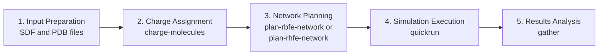
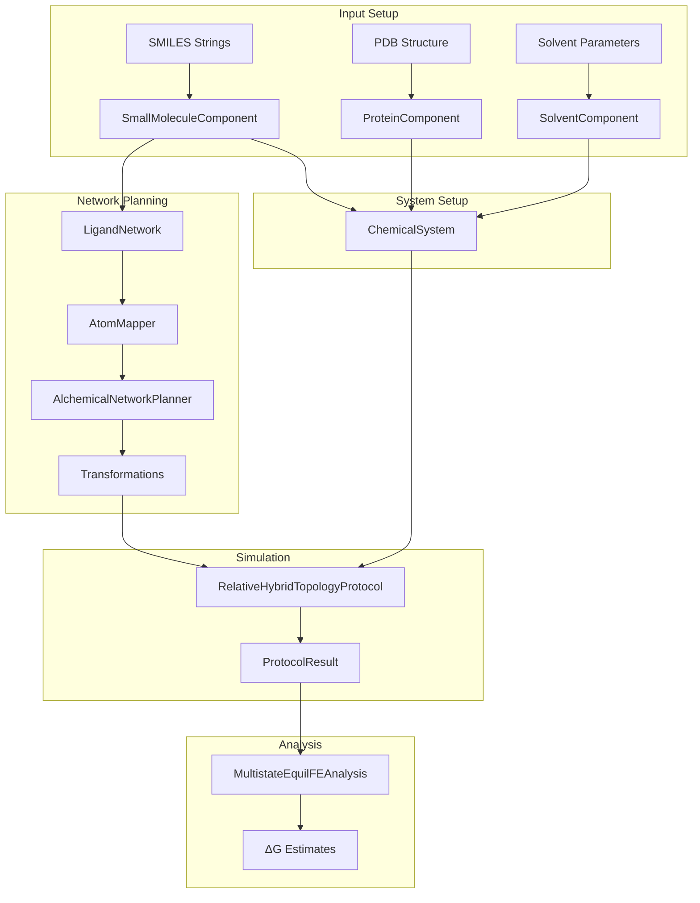
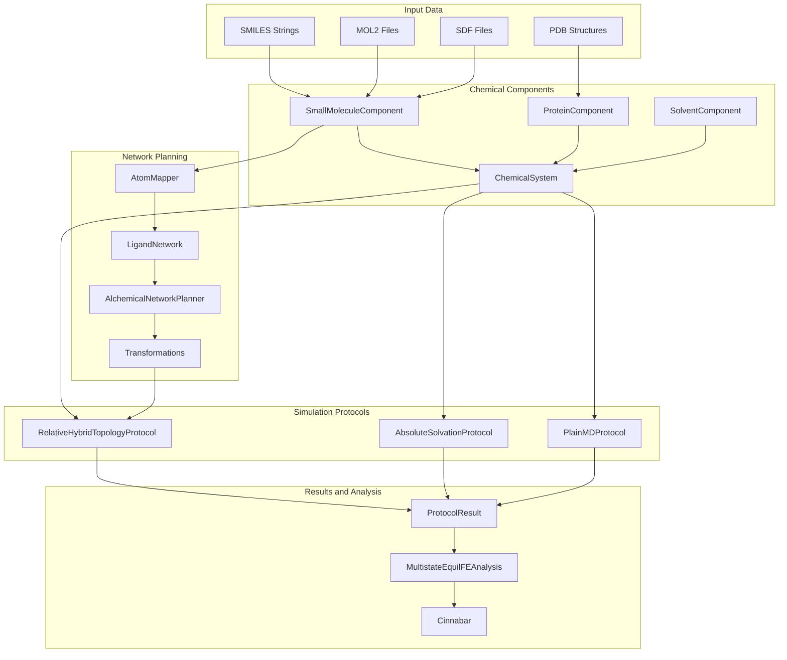
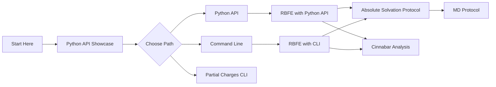

# Getting Started Tutorial

<details>
<summary>Relevant source files</summary>

The following files were used as context for generating this wiki page:

- [openfecli/clicktypes/__init__.py](openfecli/clicktypes/__init__.py)
- [openfecli/clicktypes/hyphenchoice.py](openfecli/clicktypes/hyphenchoice.py)
- [openfecli/commands/gather.py](openfecli/commands/gather.py)
- [openfecli/commands/generate_partial_charges.py](openfecli/commands/generate_partial_charges.py)
- [openfecli/commands/plan_rbfe_network.py](openfecli/commands/plan_rbfe_network.py)
- [openfecli/commands/plan_rhfe_network.py](openfecli/commands/plan_rhfe_network.py)
- [openfecli/parameters/__init__.py](openfecli/parameters/__init__.py)
- [openfecli/parameters/misc.py](openfecli/parameters/misc.py)
- [openfecli/parameters/plan_network_options.py](openfecli/parameters/plan_network_options.py)
- [openfecli/plan_alchemical_networks_utils.py](openfecli/plan_alchemical_networks_utils.py)
- [openfecli/tests/clicktypes/test_hyphenchoice.py](openfecli/tests/clicktypes/test_hyphenchoice.py)
- [openfecli/tests/commands/test_charge_generation.py](openfecli/tests/commands/test_charge_generation.py)
- [openfecli/tests/commands/test_gather.py](openfecli/tests/commands/test_gather.py)
- [openfecli/tests/commands/test_plan_rbfe_network.py](openfecli/tests/commands/test_plan_rbfe_network.py)
- [openfecli/tests/commands/test_plan_rhfe_network.py](openfecli/tests/commands/test_plan_rhfe_network.py)
- [openfecli/tests/test_rbfe_tutorial.py](openfecli/tests/test_rbfe_tutorial.py)
- [openfecli/tests/utils.py](openfecli/tests/utils.py)

</details>


This tutorial provides a complete walkthrough for running a relative binding free energy (RBFE) or relative hydration free energy (RHFE) calculation using OpenFE's command-line interface. The workflow covers molecule preparation, network planning, simulation execution, and result analysis.

## Overview of the Workflow

A complete free energy calculation involves five main phases:



**Phase 1: Input Preparation** - Prepare ligand structures (SDF files) and protein structure (PDB file, RBFE only)

**Phase 2: Charge Assignment** - Assign partial charges to all ligands using `charge-molecules`

**Phase 3: Network Planning** - Generate transformation network using `plan-rbfe-network` or `plan-rhfe-network`

**Phase 4: Simulation Execution** - Run individual transformations using `quickrun`

**Phase 5: Results Analysis** - Aggregate results and compute free energies using `gather`

Sources: [openfecli/tests/test_rbfe_tutorial.py:1-149](), [openfecli/commands/plan_rbfe_network.py:145-177](), [openfecli/commands/gather.py:593-663]()
</thinking>

## Prerequisites

Before starting, ensure you have:
- OpenFE installed (see page 1.1)
- Ligand structures in SDF format
- Protein structure in PDB format (for RBFE calculations)
- Access to computational resources (GPU recommended)

Sources: [openfecli/commands/plan_rbfe_network.py:120-177]()

## Tutorial Access

To access and use the tutorials:

1. Clone the repository:
   ```bash
   git clone https://github.com/OpenFreeEnergy/ExampleNotebooks.git
   ```

2. Install OpenFE if not already installed:
   ```bash
   pip install openfe
   ```

3. Navigate to the specific tutorial directory and open the notebook or markdown file.

Sources: [docs/tutorials/index.rst:7-8]()

## Relative Free Energy Tutorials

### Python API Showcase

**Purpose**: Introduction to OpenFE's Python API for relative binding free energy calculations.

**File**: `ExampleNotebooks/showcase_notebook` (Jupyter notebook)

**Key Components**:
- `SmallMoleculeComponent`: For representing ligand molecules
- `LigandNetwork`: For managing ligand relationships
- `AlchemicalNetworkPlanner`: For planning transformations
- `RelativeHybridTopologyProtocol`: For executing alchemical simulations

Sources: [docs/tutorials/index.rst:14]()

### RBFE with Python API

**Purpose**: Step-by-step tutorial for calculating relative binding free energies for TYK2 using the Python API.

**File**: `ExampleNotebooks/rbfe_tutorial/python_tutorial.ipynb` (Jupyter notebook)

**Key Workflow**:


Sources: [docs/tutorials/index.rst:15](), [docs/tutorials/rbfe_python_tutorial.nblink:1-3]()

### RBFE with CLI

**Purpose**: Step-by-step tutorial for calculating relative binding free energies for TYK2 using the command-line interface.

**File**: `ExampleNotebooks/rbfe_tutorial/cli_tutorial.md` (Markdown file)

**Key Commands**:
- `plan-rbfe-network`: Creates the alchemical network plan
- `quickrun`: Executes the planned transformations
- `gather`: Collects and analyzes results

Sources: [docs/tutorials/index.rst:16](), [docs/tutorials/rbfe_cli_tutorial.rst:1-4]()

## Absolute Free Energy Tutorials

### Absolute Solvation Free Energy Protocol

**Purpose**: Calculate the hydration free energy of a benzene ligand.

**File**: `ExampleNotebooks/ahfe_tutorial` (Jupyter notebook)

**Key Components**:
- `SmallMoleculeComponent`: For representing benzene
- `SolventComponent`: For representing water
- `AbsoluteSolvationProtocol`: For executing the calculation
- `AbsoluteSolvationProtocolResult`: For storing and analyzing results

Sources: [docs/tutorials/index.rst:21]()

## Molecular Dynamics Tutorials

### MD Protocol

**Purpose**: Run a conventional MD simulation of benzene bound to T4-lysozyme L99A.

**File**: `ExampleNotebooks/openmm_md/plain_md.ipynb` (Jupyter notebook)

**Key Components**:
- `SmallMoleculeComponent`: For representing benzene
- `ProteinComponent`: For representing T4-lysozyme
- `SolventComponent`: For representing water
- `PlainMDProtocol`: For executing the MD simulation
- `PlainMDProtocolResult`: For storing and analyzing results

Sources: [docs/tutorials/index.rst:26](), [docs/tutorials/md_tutorial.nblink:1-6]()

## Analysis Tutorials

### Cinnabar Tutorial

**Purpose**: Analyze and visualize networks of relative free energy results.

**File**: `ExampleNotebooks/plotting_with_cinnabar` (Jupyter notebook)

**Key Components**:
- `MultistateEquilFEAnalysis`: For analyzing simulation data
- Cinnabar: Python package for visualizing free energy networks

Sources: [docs/tutorials/index.rst:31]()

## Utility Tutorials

### Generating Partial Charges CLI Tutorial

**Purpose**: Assign and store partial charges for small molecules.

**File**: `ExampleNotebooks/cli_tutorials/cli_charge_molecules.md` (Markdown file)

**Key Commands**:
- `charge-molecules`: For assigning and storing partial charges

Sources: [docs/tutorials/index.rst:38](), [docs/tutorials/charge_molecules_cli_tutorial.rst:1-4]()

## OpenFE Components and Data Flow

The following diagram illustrates the key components of OpenFE and how they interact in the workflows demonstrated in the tutorials:



Sources: [docs/tutorials/index.rst:11-38]()

## Tutorial Learning Path

For newcomers to OpenFE, the following learning path is recommended:



Sources: [docs/tutorials/index.rst:14-38]()

---