# Advanced Use Cases

Relevant source files

The following files were used as context for generating this wiki page:

- [docs/_static/OFE-color-icon.svg](docs/_static/OFE-color-icon.svg)
- [docs/guide/index.rst](docs/guide/index.rst)
- [docs/index.rst](docs/index.rst)
- [docs/installation.rst](docs/installation.rst)
- [openfe/protocols/restraint_utils/geometry/__init__.py](openfe/protocols/restraint_utils/geometry/__init__.py)
- [openfe/protocols/restraint_utils/geometry/base.py](openfe/protocols/restraint_utils/geometry/base.py)
- [openfe/protocols/restraint_utils/geometry/boresch/__init__.py](openfe/protocols/restraint_utils/geometry/boresch/__init__.py)
- [openfe/protocols/restraint_utils/geometry/boresch/geometry.py](openfe/protocols/restraint_utils/geometry/boresch/geometry.py)
- [openfe/protocols/restraint_utils/geometry/boresch/guest.py](openfe/protocols/restraint_utils/geometry/boresch/guest.py)
- [openfe/protocols/restraint_utils/geometry/boresch/host.py](openfe/protocols/restraint_utils/geometry/boresch/host.py)
- [openfe/protocols/restraint_utils/geometry/flatbottom.py](openfe/protocols/restraint_utils/geometry/flatbottom.py)
- [openfe/protocols/restraint_utils/geometry/harmonic.py](openfe/protocols/restraint_utils/geometry/harmonic.py)
- [openfe/protocols/restraint_utils/geometry/utils.py](openfe/protocols/restraint_utils/geometry/utils.py)
- [openfe/protocols/restraint_utils/openmm/omm_forces.py](openfe/protocols/restraint_utils/openmm/omm_forces.py)
- [openfe/protocols/restraint_utils/openmm/omm_restraints.py](openfe/protocols/restraint_utils/openmm/omm_restraints.py)
- [openfe/protocols/restraint_utils/settings.py](openfe/protocols/restraint_utils/settings.py)

## Introduction

This document outlines advanced usage scenarios for the OpenFE framework that extend beyond the basic functionality covered in introductory tutorials. These techniques are intended for users who are already familiar with the fundamental concepts and standard workflows of OpenFE.

For beginners, please refer to [Getting Started Tutorials](#7.1) first. For specific API usage patterns, see the [API Cookbook](#7.3).

## Custom Protocol Workflows

OpenFE can be used to create sophisticated simulation workflows that combine multiple protocols to address complex modeling challenges.

### Sequential Protocol Execution

A common advanced workflow involves using the results from one protocol as input to another:

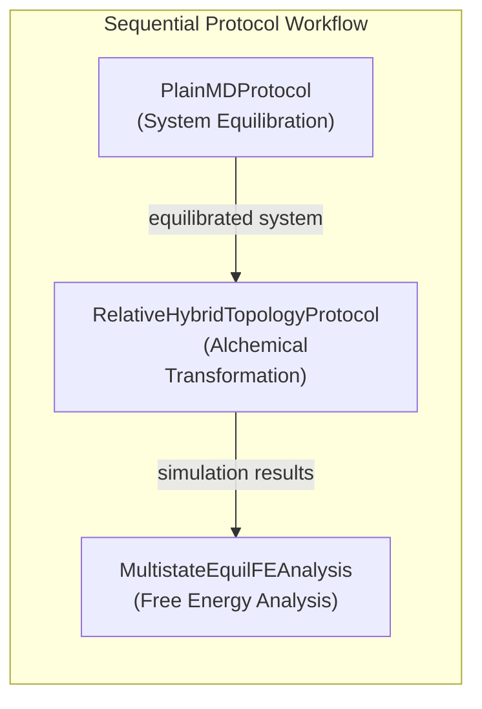

In this workflow, the `PlainMDProtocol` is first used to equilibrate a system before applying the `RelativeHybridTopologyProtocol` for alchemical transformations. This approach can provide more stable starting configurations for free energy calculations.

Sources: [docs/tutorials/index.rst:23-26]()

### Parallel Protocol Execution

For large-scale calculations involving multiple transformations, implementing a parallel execution strategy becomes important:

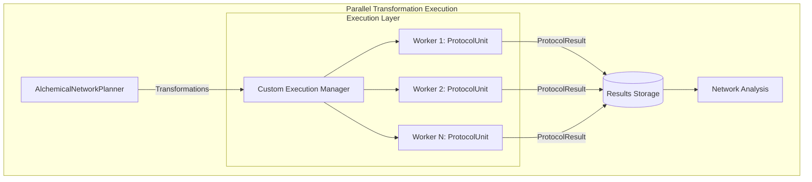

While OpenFE doesn't have a built-in distributed execution system, you can implement your own execution manager using Python's concurrent.futures or external tools like Dask or Ray to orchestrate multiple protocol runs in parallel.

## Custom Protocol Configuration

### Advanced Protocol Settings

Each OpenFE protocol has numerous configuration options that can be customized for specific use cases. The following table outlines some key advanced settings for the main protocols:

| Protocol | Setting Category | Advanced Options |
|----------|-----------------|------------------|
| RelativeHybridTopologyProtocol | LambdaSettings | Custom lambda schedules, non-linear spacing |
| RelativeHybridTopologyProtocol | AlchemicalSettings | Soft-core parameters, custom switching functions |
| RelativeHybridTopologyProtocol | MultiStateSimulationSettings | Hamiltonian replica exchange parameters |
| AbsoluteSolvationProtocol | SolventSettings | Custom solvent models, ion concentrations |
| PlainMDProtocol | MDSimulationSettings | Extended simulation times, specialized integrators |

### Custom Lambda Schedules

For complex transformations, the default lambda schedule may not be optimal. Advanced users can define custom lambda windows:

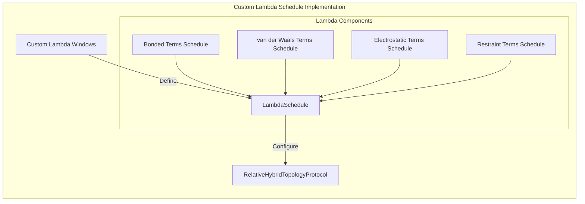

Carefully designed lambda schedules can significantly improve sampling efficiency, especially for challenging transformations involving large structural changes or complex charge distributions.

## Advanced Network Planning

### Optimized Network Topology

For large sets of compounds, optimizing the network topology can significantly impact efficiency and accuracy:

```mermaid
flowchart TD
    subgraph "Network Optimization Strategy"
        Compounds["Multiple SmallMoleculeComponent objects"] --> Mapper["AtomMapper"]
        Mapper --> Scores["Mapping Scores"]
        
        subgraph "Network Planning Algorithm"
            direction TB
            ScoreFiltering["Filter by score threshold"]
            TopologyOptimization["Optimize network topology"]
            CycleIdentification["Identify verification cycles"]
            
            ScoreFiltering --> TopologyOptimization --> CycleIdentification
        end
        
        Scores --> ScoreFiltering
        CycleIdentification --> OptimizedNetwork["Optimized LigandNetwork"]
        OptimizedNetwork --> Planner["AlchemicalNetworkPlanner"]
        Planner --> Transformations["Protocol Transformations"]
    end
```

Advanced network planning strategies include:

1. Minimum spanning tree networks for maximum efficiency
2. Cycle closure verification networks for error checking
3. Hub-and-spoke networks for reference compound approaches
4. Multi-path networks for uncertainty estimation

Sources: [docs/tutorials/index.rst:11-16]()

### Custom Atom Mapping Strategies

For complex chemical transformations, the default atom mapping strategies may not be optimal:

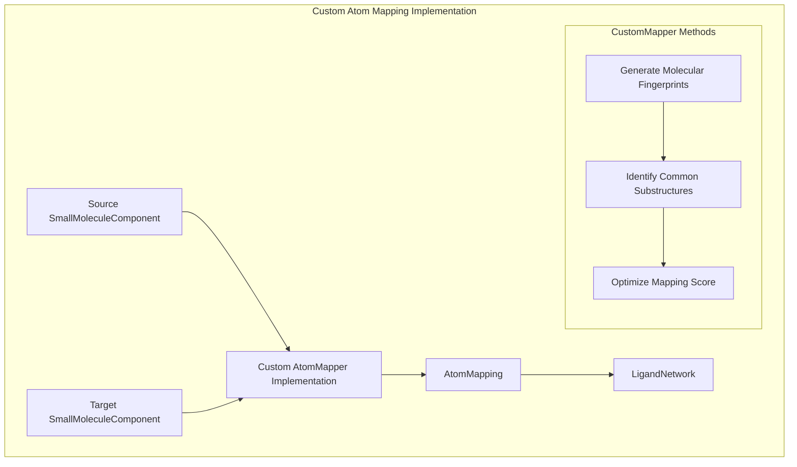

Creating a custom atom mapper involves implementing the abstract `AtomMapper` interface and providing specialized logic for challenging transformations such as scaffold hops or ring modifications.

Sources: [docs/tutorials/index.rst:11-16]()

## Handling Non-Standard Systems

### Proteins with Cofactors

Working with protein systems that contain non-standard cofactors requires special consideration:

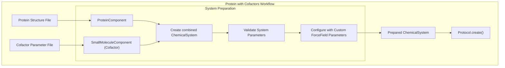

Special considerations for cofactor systems include:

1. Proper parameterization of metal-ligand interactions
2. Maintaining correct coordination geometry
3. Handling special bonded interactions
4. Ensuring stable solvation around cofactor sites

### Complex Ligand Transformations

Handling transformations involving complex ligands such as macrocycles:

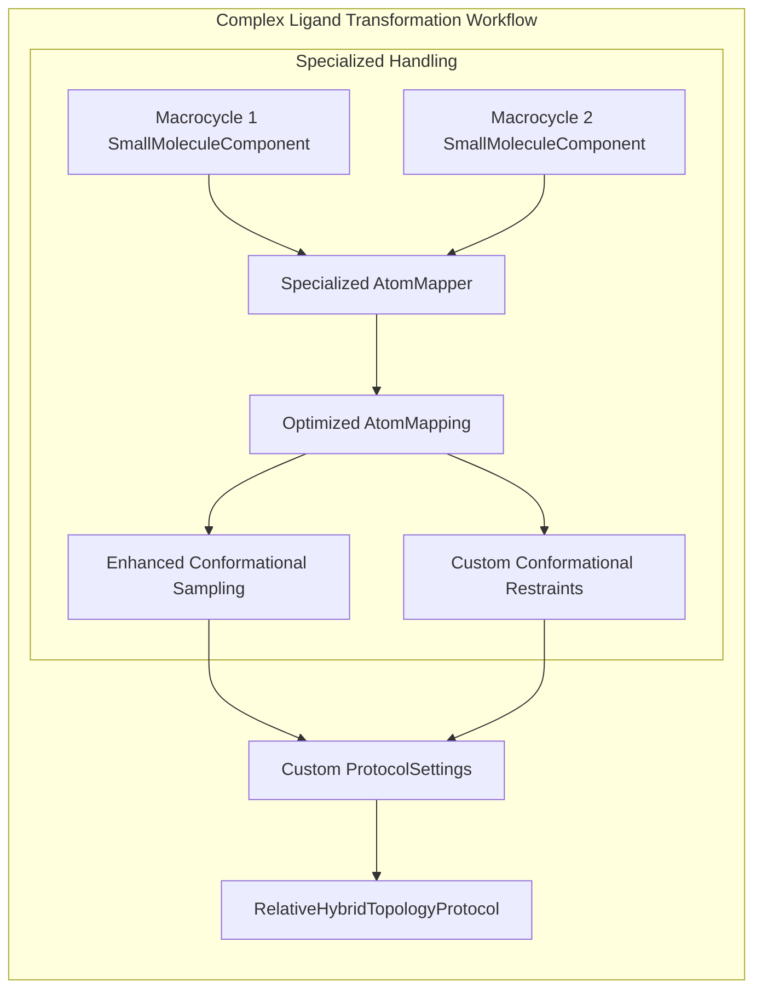

Macrocycles and other conformationally complex ligands often require specialized handling strategies, including custom atom mapping algorithms, enhanced sampling techniques, and specialized restraint schemes.

## Advanced Analysis Techniques

### Enhanced Uncertainty Quantification

Advanced methods for estimating uncertainty in free energy calculations:

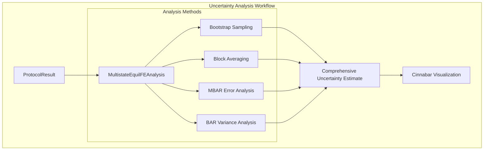

By applying multiple uncertainty estimation techniques, you can gain a more complete understanding of the statistical reliability of your free energy calculations.

Sources: [docs/tutorials/index.rst:28-31]()

### Convergence Assessment

Methods to assess and improve convergence of free energy calculations:

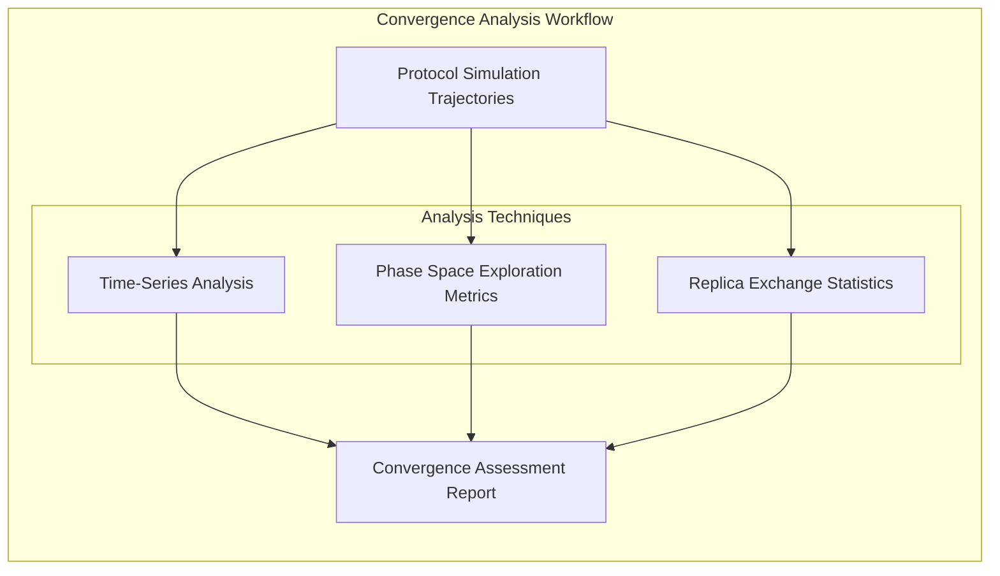

Thorough convergence analysis can help identify issues with sampling efficiency and provide guidance for improving simulation protocols.

Sources: [docs/tutorials/index.rst:28-31]()

## Integration with External Tools

### External Analysis Pipeline

The OpenFE ecosystem can be integrated with specialized external analysis tools:

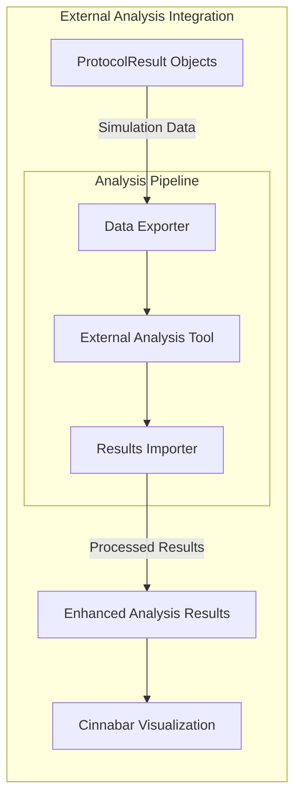

External analysis tools can provide specialized functionality not available in the core OpenFE framework, such as enhanced visualization, statistical analysis, or machine learning integration.

Sources: [docs/tutorials/index.rst:28-31]()

## Performance Optimization

### Resource Utilization Strategies

Optimizing resource usage for large-scale free energy calculations:

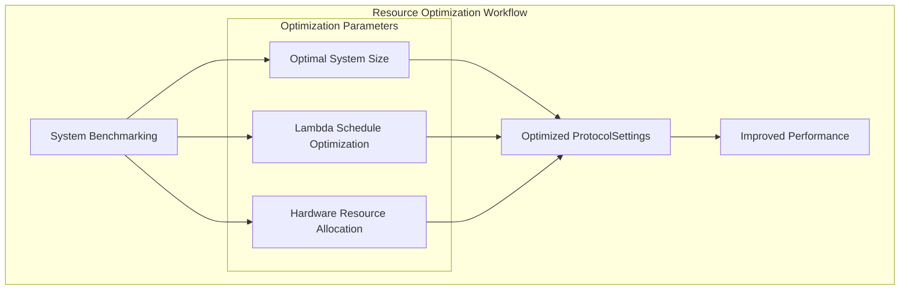

For large-scale free energy campaigns, performance optimization can significantly reduce computational costs and increase throughput. Key strategies include:

1. System size optimization (minimizing solvent box dimensions)
2. Lambda schedule optimization (focused lambda spacing)
3. Hardware-specific parameter tuning
4. Load balancing across multiple compute resources

This table summarizes key performance optimization strategies for different protocol types:

| Protocol | Optimization Technique | Potential Speedup |
|----------|------------------------|-------------------|
| RelativeHybridTopologyProtocol | Custom lambda schedules | 1.5-2x |
| RelativeHybridTopologyProtocol | Minimized solvent box | 1.2-1.5x |
| AbsoluteSolvationProtocol | Vacuum/solvent simulation balance | 1.3-1.8x |
| PlainMDProtocol | Enhanced sampling techniques | 2-5x |
| All Protocols | Hardware-specific parameter tuning | 1.2-2x |

---