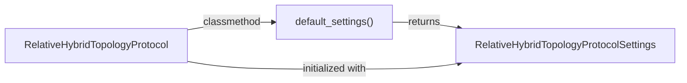
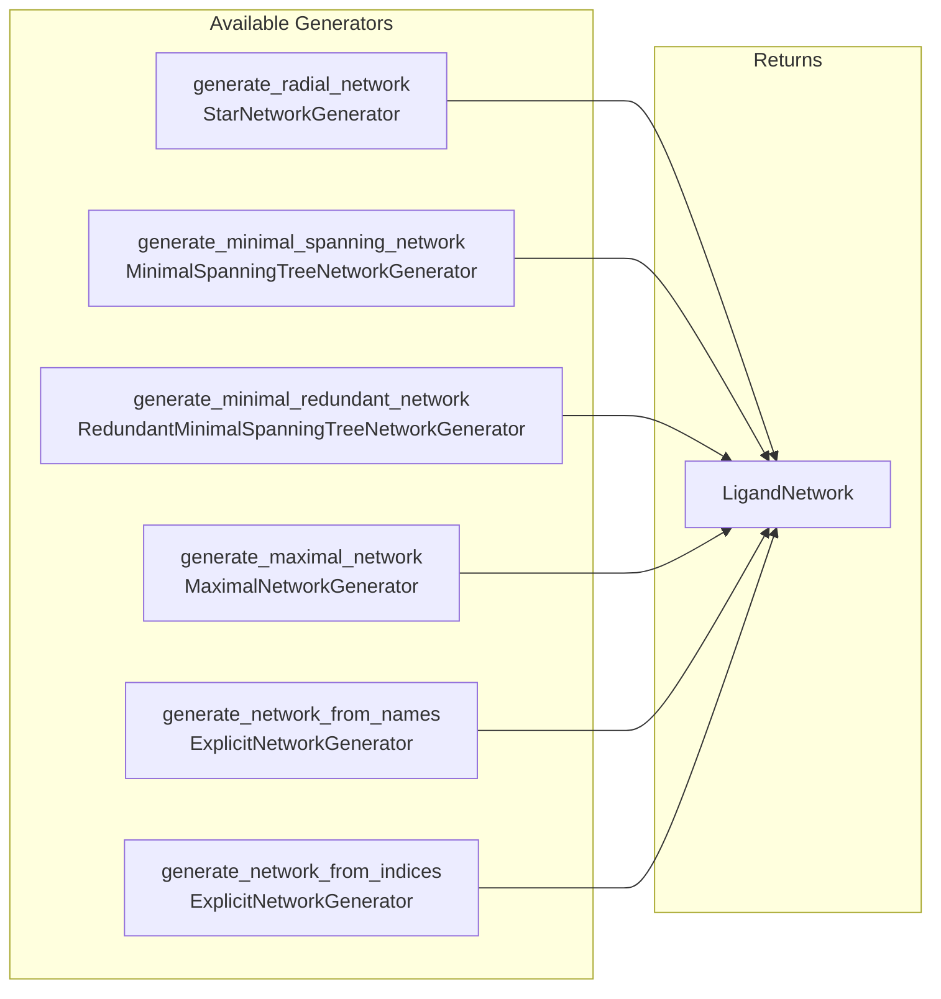
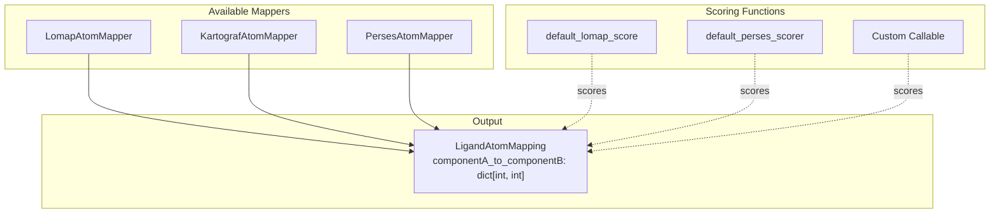
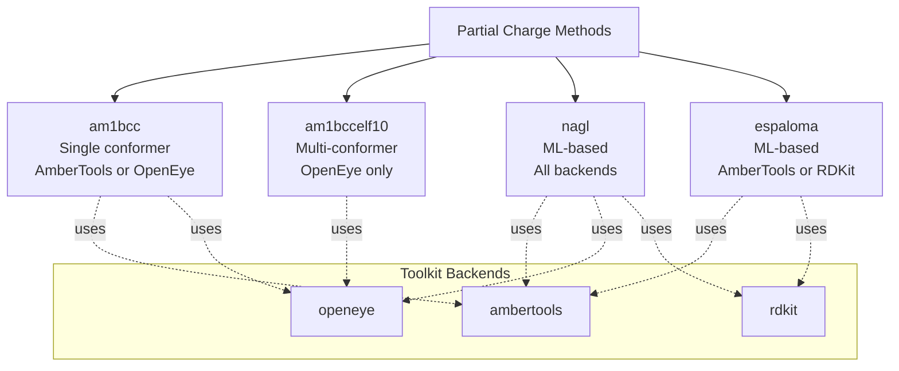
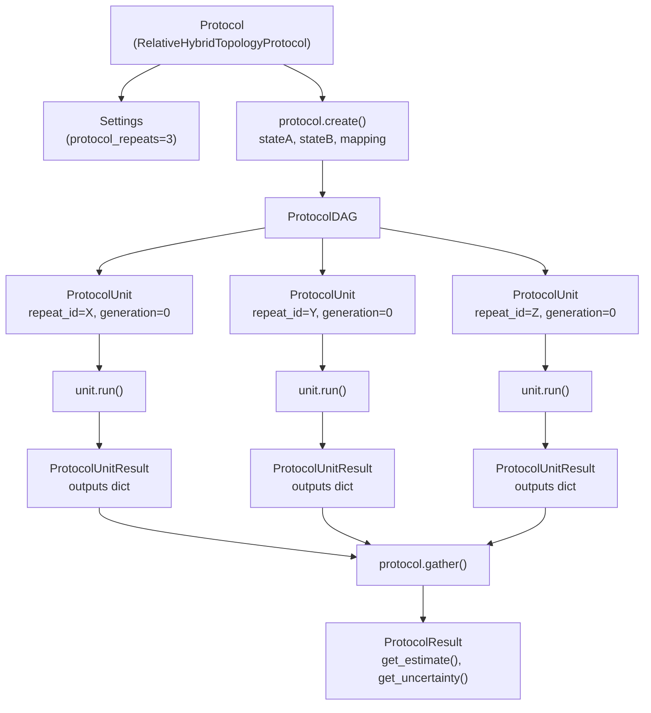
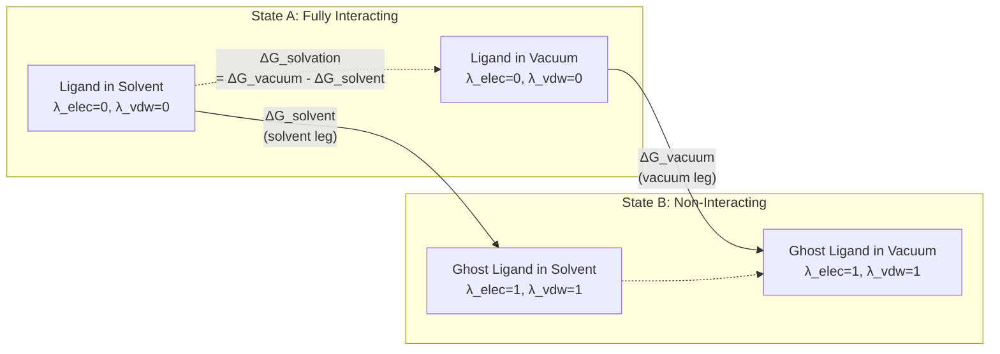

# Python API Cookbook

<details>
<summary>Relevant source files</summary>

The following files were used as context for generating this wiki page:

- [openfe/protocols/openmm_afe/base.py](openfe/protocols/openmm_afe/base.py)
- [openfe/protocols/openmm_afe/equil_afe_settings.py](openfe/protocols/openmm_afe/equil_afe_settings.py)
- [openfe/protocols/openmm_afe/equil_solvation_afe_method.py](openfe/protocols/openmm_afe/equil_solvation_afe_method.py)
- [openfe/protocols/openmm_md/plain_md_methods.py](openfe/protocols/openmm_md/plain_md_methods.py)
- [openfe/protocols/openmm_md/plain_md_settings.py](openfe/protocols/openmm_md/plain_md_settings.py)
- [openfe/protocols/openmm_rfe/equil_rfe_methods.py](openfe/protocols/openmm_rfe/equil_rfe_methods.py)
- [openfe/protocols/openmm_rfe/equil_rfe_settings.py](openfe/protocols/openmm_rfe/equil_rfe_settings.py)
- [openfe/protocols/openmm_utils/omm_settings.py](openfe/protocols/openmm_utils/omm_settings.py)
- [openfe/setup/atom_mapping/__init__.py](openfe/setup/atom_mapping/__init__.py)
- [openfe/setup/atom_mapping/ligandatommapper.py](openfe/setup/atom_mapping/ligandatommapper.py)
- [openfe/setup/atom_mapping/lomap_mapper.py](openfe/setup/atom_mapping/lomap_mapper.py)
- [openfe/setup/atom_mapping/lomap_scorers.py](openfe/setup/atom_mapping/lomap_scorers.py)
- [openfe/setup/atom_mapping/perses_mapper.py](openfe/setup/atom_mapping/perses_mapper.py)
- [openfe/setup/atom_mapping/perses_scorers.py](openfe/setup/atom_mapping/perses_scorers.py)
- [openfe/setup/ligand_network_planning.py](openfe/setup/ligand_network_planning.py)
- [openfe/utils/silence_root_logging.py](openfe/utils/silence_root_logging.py)

</details>


This page provides practical code recipes for common tasks when using OpenFE programmatically through its Python API. Each recipe is a self-contained example demonstrating a specific capability.

For step-by-step tutorials covering complete workflows from start to finish, see [Getting Started Tutorial](#7.1). For advanced scenarios like custom protocols and troubleshooting, see [Advanced Use Cases](#7.2).

---

## Creating Protocols with Custom Settings

### Recipe: Instantiate a Protocol with Default Settings

The simplest way to create a protocol is using the default settings factory method:

```python
from openfe.protocols.openmm_rfe import RelativeHybridTopologyProtocol

# Create protocol with defaults
protocol = RelativeHybridTopologyProtocol(
    settings=RelativeHybridTopologyProtocol.default_settings()
)
```

**Key Classes and Methods**


Sources: [openfe/protocols/openmm_rfe/equil_rfe_methods.py:514-545]()

---

### Recipe: Modify Settings Before Protocol Creation

Settings objects are pydantic models that can be modified before protocol instantiation:

```python
from openfe.protocols.openmm_rfe import RelativeHybridTopologyProtocol
from openff.units import unit

# Get default settings
settings = RelativeHybridTopologyProtocol.default_settings()

# Modify specific settings
settings.protocol_repeats = 5
settings.simulation_settings.production_length = 10.0 * unit.nanosecond
settings.simulation_settings.n_replicas = 15
settings.lambda_settings.lambda_windows = 15

# Create protocol with modified settings
protocol = RelativeHybridTopologyProtocol(settings=settings)
```

**Settings Hierarchy**

```mermaid
graph TB
    RootSettings["RelativeHybridTopologyProtocolSettings"]
    
    FF["forcefield_settings<br/>OpenMMSystemGeneratorFFSettings"]
    Thermo["thermo_settings<br/>ThermoSettings"]
    Solv["solvation_settings<br/>OpenMMSolvationSettings"]
    Alch["alchemical_settings<br/>AlchemicalSettings"]
    Lambda["lambda_settings<br/>LambdaSettings"]
    Sim["simulation_settings<br/>MultiStateSimulationSettings"]
    Integ["integrator_settings<br/>IntegratorSettings"]
    Engine["engine_settings<br/>OpenMMEngineSettings"]
    Out["output_settings<br/>MultiStateOutputSettings"]
    Charge["partial_charge_settings<br/>OpenFFPartialChargeSettings"]
    
    RootSettings --> FF
    RootSettings --> Thermo
    RootSettings --> Solv
    RootSettings --> Alch
    RootSettings --> Lambda
    RootSettings --> Sim
    RootSettings --> Integ
    RootSettings --> Engine
    RootSettings --> Out
    RootSettings --> Charge
```


Sources: [openfe/protocols/openmm_rfe/equil_rfe_settings.py:104-158](), [openfe/protocols/openmm_utils/omm_settings.py:1-710]()

---

### Recipe: Use Adaptive Settings for Charge-Changing Transformations

OpenFE provides adaptive settings that automatically adjust protocol parameters based on the transformation:

```python
from openfe.protocols.openmm_rfe import RelativeHybridTopologyProtocol
from gufe import SmallMoleculeComponent, ChemicalSystem
from openfe.setup import LigandAtomMapping

# Load your molecules and create systems
ligand_a = SmallMoleculeComponent.from_sdf_file("ligand_a.sdf")
ligand_b = SmallMoleculeComponent.from_sdf_file("ligand_b.sdf")

system_a = ChemicalSystem({'ligand': ligand_a, 'solvent': solvent})
system_b = ChemicalSystem({'ligand': ligand_b, 'solvent': solvent})

# Create mapping
mapper = KartografAtomMapper()
mapping = next(mapper.suggest_mappings(ligand_a, ligand_b))

# Get adaptive settings (automatically detects charge changes)
settings = RelativeHybridTopologyProtocol.adaptive_settings(
    stateA=system_a,
    stateB=system_b,
    mapping=mapping
)

protocol = RelativeHybridTopologyProtocol(settings=settings)
```

Sources: [openfe/protocols/openmm_rfe/equil_rfe_methods.py:547-614]()

---

## Building Ligand Networks Programmatically

### Recipe: Generate a Radial (Star) Network

Create a network where all ligands connect to a central hub ligand:

```python
from openfe.setup import SmallMoleculeComponent, LigandNetwork
from openfe.setup.ligand_network_planning import generate_radial_network
from openfe.setup.atom_mapping import LomapAtomMapper
from openfe.setup.atom_mapping.lomap_scorers import default_lomap_score

# Load ligands
ligands = [
    SmallMoleculeComponent.from_sdf_file(f"ligand_{i}.sdf")
    for i in range(10)
]

# Create mapper
mapper = LomapAtomMapper()

# Generate radial network with first ligand as center
network = generate_radial_network(
    ligands=ligands,
    central_ligand=0,  # Can be int, str (ligand name), or SmallMoleculeComponent
    mappers=mapper,
    scorer=default_lomap_score,
    progress=True
)
```

**Network Topology Types**


Sources: [openfe/setup/ligand_network_planning.py:49-154]()

---

### Recipe: Generate Minimal Spanning Tree Network

Create a network with minimum edges while maintaining connectivity and maximizing mapping scores:

```python
from openfe.setup.ligand_network_planning import generate_minimal_spanning_network
from openfe.setup.atom_mapping import KartografAtomMapper
from lomap.gufe_bindings.scorers import default_lomap_score

# Use multiple mappers for robustness
mappers = [KartografAtomMapper(), LomapAtomMapper()]

# Generate MST network
network = generate_minimal_spanning_network(
    ligands=ligands,
    mappers=mappers,
    scorer=default_lomap_score,
    progress=True,
    n_processes=4  # Parallel execution
)
```

Sources: [openfe/setup/ligand_network_planning.py:208-249]()

---

### Recipe: Build Custom Network from Edge List

Explicitly specify which ligands to connect:

```python
from openfe.setup.ligand_network_planning import generate_network_from_names

# Define edges as tuples of ligand names
edges = [
    ("benzene", "toluene"),
    ("toluene", "phenol"),
    ("phenol", "aniline"),
]

network = generate_network_from_names(
    ligands=ligands,
    mapper=mapper,
    names=edges
)
```

Or use indices instead of names:

```python
from openfe.setup.ligand_network_planning import generate_network_from_indices

# Define edges as tuples of indices
edges = [(0, 1), (1, 2), (2, 3)]

network = generate_network_from_indices(
    ligands=ligands,
    mapper=mapper,
    indices=edges
)
```

Sources: [openfe/setup/ligand_network_planning.py:306-378]()

---

### Recipe: Use Multiple Atom Mappers with Scoring

Provide multiple mappers and a scorer to select the best mapping for each edge:

```python
from openfe.setup.atom_mapping import (
    LomapAtomMapper,
    KartografAtomMapper,
    PersesAtomMapper
)
from openfe.setup.atom_mapping.lomap_scorers import default_lomap_score

# Create multiple mappers with different strategies
mappers = [
    LomapAtomMapper(element_change=False),
    KartografAtomMapper(atom_map_hydrogens=False),
    PersesAtomMapper(allow_ring_breaking=False)
]

# Generate network - will try all mappers and pick best scored mapping
network = generate_minimal_spanning_network(
    ligands=ligands,
    mappers=mappers,
    scorer=default_lomap_score
)
```

**Atom Mapper Options**


Sources: [openfe/setup/atom_mapping/__init__.py:1-9](), [openfe/setup/atom_mapping/lomap_scorers.py:1-16](), [openfe/setup/atom_mapping/perses_scorers.py:37-121]()

---

## Charge Generation and Molecule Preparation

### Recipe: Assign Partial Charges Using Different Methods

Control how partial charges are assigned to small molecules:

```python
from openfe.protocols.openmm_utils.omm_settings import OpenFFPartialChargeSettings
from openfe.protocols.openmm_rfe import RelativeHybridTopologyProtocol

# AM1-BCC using AmberTools (default)
settings = RelativeHybridTopologyProtocol.default_settings()
settings.partial_charge_settings = OpenFFPartialChargeSettings(
    partial_charge_method="am1bcc",
    off_toolkit_backend="ambertools"
)

# NAGL (neural network charges)
settings.partial_charge_settings = OpenFFPartialChargeSettings(
    partial_charge_method="nagl",
    off_toolkit_backend="rdkit",
    nagl_model=None  # Uses latest production model
)

# Espaloma charges
settings.partial_charge_settings = OpenFFPartialChargeSettings(
    partial_charge_method="espaloma",
    off_toolkit_backend="rdkit"
)

# AM1-BCC with ELF10 conformer selection (requires OpenEye)
settings.partial_charge_settings = OpenFFPartialChargeSettings(
    partial_charge_method="am1bccelf10",
    off_toolkit_backend="openeye",
    number_of_conformers=500
)
```

**Charge Assignment Methods**


Sources: [openfe/protocols/openmm_utils/omm_settings.py:231-311]()

---

## Running Transformations Programmatically

### Recipe: Execute a Protocol Unit Directly

For single transformation testing or debugging:

```python
from openfe.protocols.openmm_rfe import RelativeHybridTopologyProtocol
from gufe import ChemicalSystem
import pathlib

# Create protocol
protocol = RelativeHybridTopologyProtocol(
    settings=RelativeHybridTopologyProtocol.default_settings()
)

# Create ProtocolDAG
dag = protocol.create(
    stateA=system_a,
    stateB=system_b,
    mapping=mapping
)

# Execute first unit
unit = list(dag.protocol_units)[0]
unit_result = unit.run(
    scratch_basepath=pathlib.Path("./scratch"),
    shared_basepath=pathlib.Path("./shared"),
    verbose=True,
    dry=False  # Set to True to validate setup without running
)
```

Sources: [openfe/protocols/openmm_rfe/equil_rfe_methods.py:760-789]()

---

### Recipe: Create and Execute Multiple Protocol Units

Run a complete transformation with repeats:

```python
from openfe.protocols.openmm_rfe import RelativeHybridTopologyProtocol

# Create protocol with 3 repeats
settings = RelativeHybridTopologyProtocol.default_settings()
settings.protocol_repeats = 3

protocol = RelativeHybridTopologyProtocol(settings=settings)

# Create ProtocolDAG (generates 3 independent units)
dag = protocol.create(
    stateA=system_a,
    stateB=system_b,
    mapping=mapping
)

# Execute all units
results = []
for unit in dag.protocol_units:
    result = unit.run(
        scratch_basepath=pathlib.Path(f"./scratch_{unit.name}"),
        shared_basepath=pathlib.Path("./shared")
    )
    results.append(result)
```

**Protocol Execution Flow**


Sources: [openfe/protocols/openmm_rfe/equil_rfe_methods.py:616-680]()

---

## Working with Results

### Recipe: Extract Free Energy Estimates and Uncertainties

Parse results from a completed transformation:

```python
from openfe.protocols.openmm_rfe import RelativeHybridTopologyProtocolResult

# Gather results from ProtocolDAGResults
protocol_result = protocol.gather([dag_result])

# Get aggregated estimate
dG = protocol_result.get_estimate()  # Returns openff.units.Quantity
print(f"ΔG = {dG.to('kcal/mol'):.2f}")

# Get uncertainty (standard deviation across repeats)
uncertainty = protocol_result.get_uncertainty()
print(f"σ = {uncertainty.to('kcal/mol'):.2f}")

# Get individual repeat estimates
individual_estimates = protocol_result.get_individual_estimates()
for i, (estimate, mbar_error) in enumerate(individual_estimates):
    print(f"Repeat {i}: {estimate.to('kcal/mol'):.2f} ± {mbar_error.to('kcal/mol'):.2f}")
```

Sources: [openfe/protocols/openmm_rfe/equil_rfe_methods.py:295-340]()

---

### Recipe: Analyze Convergence with Forward and Reverse Analysis

Check simulation convergence by comparing forward and reverse trajectories:

```python
# Get forward and reverse analysis for each repeat
forward_reverse = protocol_result.get_forward_and_reverse_energy_analysis()

for repeat_idx, analysis in enumerate(forward_reverse):
    if analysis is None:
        print(f"Repeat {repeat_idx}: Analysis failed (insufficient samples)")
        continue
    
    fractions = analysis['fractions']
    forward_dGs = analysis['forward_DGs']
    reverse_dGs = analysis['reverse_DGs']
    forward_errors = analysis['forward_dDGs']
    reverse_errors = analysis['reverse_dDGs']
    
    # Check if forward and reverse agree at end
    final_diff = abs(forward_dGs[-1] - reverse_dGs[-1])
    print(f"Repeat {repeat_idx}: Forward-Reverse difference = {final_diff.to('kcal/mol'):.2f}")
```

Sources: [openfe/protocols/openmm_rfe/equil_rfe_methods.py:342-387]()

---

### Recipe: Examine MBAR Overlap Matrices

Assess lambda window sampling quality:

```python
# Get overlap matrices for all repeats
overlap_matrices = protocol_result.get_overlap_matrices()

for repeat_idx, overlap_stats in enumerate(overlap_matrices):
    scalar = overlap_stats['scalar']
    eigenvalues = overlap_stats['eigenvalues']
    matrix = overlap_stats['matrix']
    
    print(f"Repeat {repeat_idx}:")
    print(f"  Overlap scalar (1 - λ₁): {scalar:.3f}")
    print(f"  Best if > 0.03")
    
    # Check diagonal elements (self-overlap)
    diagonal = matrix.diagonal()
    min_overlap = diagonal.min()
    print(f"  Minimum self-overlap: {min_overlap:.3f}")
```

Sources: [openfe/protocols/openmm_rfe/equil_rfe_methods.py:389-407]()

---

### Recipe: Access Replica Exchange Statistics

For replica exchange simulations, examine state transition statistics:

```python
# Get replica exchange transition statistics
repex_stats = protocol_result.get_replica_transition_statistics()

for repeat_idx, stats in enumerate(repex_stats):
    eigenvalues = stats['eigenvalues']
    matrix = stats['matrix']
    
    print(f"Repeat {repeat_idx}:")
    print(f"  Largest eigenvalue: {eigenvalues[0]:.3f}")
    print(f"  Spectral gap: {eigenvalues[0] - eigenvalues[1]:.3f}")
    
    # Check acceptance rates
    off_diagonal = matrix - np.diag(matrix.diagonal())
    mean_acceptance = off_diagonal.sum() / (matrix.shape[0] * (matrix.shape[0] - 1))
    print(f"  Mean swap acceptance: {mean_acceptance:.2%}")
```

Sources: [openfe/protocols/openmm_rfe/equil_rfe_methods.py:409-434]()

---

### Recipe: Get Equilibration and Production Iterations

Retrieve timing information about simulations:

```python
# Equilibration iterations (after discarding)
equil_iterations = protocol_result.equilibration_iterations()
print(f"Equilibration iterations per repeat: {equil_iterations}")

# Production iterations (uncorrelated samples)
prod_iterations = protocol_result.production_iterations()
print(f"Production iterations per repeat: {prod_iterations}")

# Calculate effective sampling
total_time = sum(prod_iterations)
print(f"Total uncorrelated production samples: {total_time}")
```

Sources: [openfe/protocols/openmm_rfe/equil_rfe_methods.py:467-493]()

---

## Absolute Free Energy Protocols

### Recipe: Set Up Absolute Solvation Free Energy Calculation

Calculate the solvation free energy of a single ligand:

```python
from openfe.protocols.openmm_afe import AbsoluteSolvationProtocol
from gufe import ChemicalSystem, SmallMoleculeComponent, SolventComponent
from openff.units import unit

# Create chemical systems
ligand = SmallMoleculeComponent.from_sdf_file("ligand.sdf")
solvent = SolventComponent(positive_ion='Na+', negative_ion='Cl-')

# State A: ligand in solvent (fully interacting)
state_solvent = ChemicalSystem({'ligand': ligand, 'solvent': solvent})

# State B: ligand in vacuum
state_vacuum = ChemicalSystem({'ligand': ligand})

# Get default settings
settings = AbsoluteSolvationProtocol.default_settings()

# Customize lambda schedule if needed
settings.lambda_settings.lambda_elec = [0.0, 0.25, 0.5, 0.75, 1.0, 1.0, 1.0, 1.0, 1.0, 1.0, 1.0, 1.0, 1.0, 1.0]
settings.lambda_settings.lambda_vdw = [0.0, 0.0, 0.0, 0.0, 0.0, 0.12, 0.24, 0.36, 0.48, 0.6, 0.7, 0.77, 0.85, 1.0]

# Create protocol
protocol = AbsoluteSolvationProtocol(settings=settings)

# Create DAG (creates both solvent and vacuum legs)
dag = protocol.create(
    stateA=state_solvent,
    stateB=state_vacuum,
    mapping=None  # No mapping needed for absolute calculations
)
```

**Absolute Solvation Thermodynamic Cycle**


Sources: [openfe/protocols/openmm_afe/equil_solvation_afe_method.py:422-502]()

---

### Recipe: Parse Absolute Solvation Results

Extract results from both legs of the thermodynamic cycle:

```python
from openfe.protocols.openmm_afe import AbsoluteSolvationProtocolResult

# Gather results
result = protocol.gather([dag_result])

# Get overall solvation free energy (ΔG_vacuum - ΔG_solvent)
dG_solvation = result.get_estimate()
uncertainty = result.get_uncertainty()
print(f"ΔG_solvation = {dG_solvation.to('kcal/mol'):.2f} ± {uncertainty.to('kcal/mol'):.2f}")

# Get individual leg estimates
individual = result.get_individual_estimates()

print("Solvent leg repeats:")
for i, (estimate, error) in enumerate(individual['solvent']):
    print(f"  Repeat {i}: {estimate.to('kcal/mol'):.2f} ± {error.to('kcal/mol'):.2f}")

print("Vacuum leg repeats:")
for i, (estimate, error) in enumerate(individual['vacuum']):
    print(f"  Repeat {i}: {estimate.to('kcal/mol'):.2f} ± {error.to('kcal/mol'):.2f}")
```

Sources: [openfe/protocols/openmm_afe/equil_solvation_afe_method.py:120-193]()

---

## Plain MD Simulations

### Recipe: Set Up a Plain MD Simulation

Run standard molecular dynamics without alchemical transformations:

```python
from openfe.protocols.openmm_md import PlainMDProtocol
from openfe.protocols.openmm_md.plain_md_settings import PlainMDProtocolSettings
from openff.units import unit

# Get default settings
settings = PlainMDProtocol.default_settings()

# Customize simulation parameters
settings.simulation_settings.equilibration_length_nvt = 0.5 * unit.nanosecond
settings.simulation_settings.equilibration_length = 1.0 * unit.nanosecond
settings.simulation_settings.production_length = 10.0 * unit.nanosecond

# Set output options
settings.output_settings.trajectory_write_interval = 100.0 * unit.picosecond
settings.output_settings.output_indices = "not water"  # Save only non-water atoms

# Create protocol
protocol = PlainMDProtocol(settings=settings)

# Create system
system = ChemicalSystem({
    'ligand': ligand,
    'protein': protein,
    'solvent': solvent
})

# Create DAG
dag = protocol.create(
    stateA=system,
    stateB=system,  # Same state for MD
    mapping=None
)
```

Sources: [openfe/protocols/openmm_md/plain_md_methods.py:134-164]()

---

### Recipe: Access MD Simulation Outputs

Retrieve trajectory and structure files from completed MD simulations:

```python
from openfe.protocols.openmm_md import PlainMDProtocolResult

# Gather results
result = protocol.gather([dag_result])

# Get trajectory files
trajectories = result.get_traj_filename()
for traj_path in trajectories:
    print(f"Trajectory: {traj_path}")

# Get pre-minimized system PDB files
pdbs = result.get_pdb_filename()
for pdb_path in pdbs:
    print(f"System PDB: {pdb_path}")

# Load trajectory for analysis
import mdtraj as mdt
traj = mdt.load(str(trajectories[0]), top=str(pdbs[0]))
print(f"Loaded {traj.n_frames} frames")
```

Sources: [openfe/protocols/openmm_md/plain_md_methods.py:91-115]()

---

## Advanced Settings Customization

### Recipe: Configure Custom Lambda Schedules

Modify the lambda window schedule for alchemical transformations:

```python
from openfe.protocols.openmm_rfe import RelativeHybridTopologyProtocol

settings = RelativeHybridTopologyProtocol.default_settings()

# Define custom lambda schedule
# More windows near endpoints for better sampling
settings.lambda_settings.lambda_windows = 15
settings.lambda_settings.lambda_functions = "default"

# Or create protocol and modify after
protocol = RelativeHybridTopologyProtocol(settings=settings)
```

For absolute free energies, define separate electrostatic and vdw schedules:

```python
from openfe.protocols.openmm_afe import AbsoluteSolvationProtocol

settings = AbsoluteSolvationProtocol.default_settings()

# Custom electrostatics schedule (remove charges first)
settings.lambda_settings.lambda_elec = [
    0.0, 0.2, 0.4, 0.6, 0.8, 1.0,
    1.0, 1.0, 1.0, 1.0, 1.0, 1.0
]

# Custom vdw schedule (remove vdw last)
settings.lambda_settings.lambda_vdw = [
    0.0, 0.0, 0.0, 0.0, 0.0, 0.0,
    0.1, 0.2, 0.4, 0.6, 0.8, 1.0
]

# Restraints schedule (if using restraints)
settings.lambda_settings.lambda_restraints = [
    0.0, 0.0, 0.0, 0.0, 0.0, 0.0,
    0.0, 0.0, 0.0, 0.0, 0.0, 0.0
]

protocol = AbsoluteSolvationProtocol(settings=settings)
```

Sources: [openfe/protocols/openmm_rfe/equil_rfe_settings.py:33-48](), [openfe/protocols/openmm_afe/equil_afe_settings.py:52-130]()

---

### Recipe: Customize Solvation Settings

Control box size, shape, and water model:

```python
from openfe.protocols.openmm_utils.omm_settings import OpenMMSolvationSettings
from openff.units import unit
import numpy as np

# Option 1: Use padding distance
solvation_settings = OpenMMSolvationSettings(
    solvent_model="tip3p",
    solvent_padding=1.2 * unit.nanometer,
    box_shape="dodecahedron"  # or "cube", "octahedron"
)

# Option 2: Specify number of water molecules
solvation_settings = OpenMMSolvationSettings(
    solvent_model="tip3p",
    number_of_solvent_molecules=5000,
    box_shape="cube"
)

# Option 3: Define explicit box vectors (OpenMM reduced form)
box_vectors = np.array([
    [4.0, 0.0, 0.0],
    [0.0, 4.0, 0.0],
    [0.0, 0.0, 4.0]
]) * unit.nanometer
solvation_settings = OpenMMSolvationSettings(
    solvent_model="tip3p",
    box_vectors=box_vectors
)

# Option 4: Rectangular box dimensions
solvation_settings = OpenMMSolvationSettings(
    solvent_model="tip3p",
    box_size=np.array([4.0, 4.0, 5.0]) * unit.nanometer
)

# Apply to protocol settings
settings.solvation_settings = solvation_settings
```

Sources: [openfe/protocols/openmm_utils/omm_settings.py:50-221]()

---

### Recipe: Configure Integration and Sampling Parameters

Adjust timestep, collision rate, and barostat settings:

```python
from openfe.protocols.openmm_utils.omm_settings import IntegratorSettings
from openff.units import unit

integrator_settings = IntegratorSettings(
    timestep=4.0 * unit.femtosecond,
    langevin_collision_rate=1.0 / unit.picosecond,
    barostat_frequency=25.0 * unit.timestep,
    reassign_velocities=False,
    remove_com=False,
    constraint_tolerance=1e-6,
    n_restart_attempts=20
)

settings.integrator_settings = integrator_settings
```

For multistate sampling, configure replica exchange or SAMS:

```python
from openfe.protocols.openmm_utils.omm_settings import MultiStateSimulationSettings
from openff.units import unit

# Replica exchange settings
simulation_settings = MultiStateSimulationSettings(
    sampler_method="repex",
    n_replicas=11,
    equilibration_length=1.0 * unit.nanosecond,
    production_length=5.0 * unit.nanosecond,
    time_per_iteration=2.5 * unit.picosecond,
    real_time_analysis_interval=250.0 * unit.picosecond,
    early_termination_target_error=0.12 * unit.kilocalorie_per_mole
)

# SAMS settings
simulation_settings = MultiStateSimulationSettings(
    sampler_method="sams",
    sams_flatness_criteria="logZ-flatness",
    sams_gamma0=1.0,
    # ... other settings
)

settings.simulation_settings = simulation_settings
```

Sources: [openfe/protocols/openmm_utils/omm_settings.py:353-421](), [openfe/protocols/openmm_utils/omm_settings.py:544-663]()

---

### Recipe: Set GPU Platform and Device Selection

Configure OpenMM compute platform:

```python
from openfe.protocols.openmm_utils.omm_settings import OpenMMEngineSettings

# Use CUDA platform with specific GPU
engine_settings = OpenMMEngineSettings(
    compute_platform="cuda",
    gpu_device_index=[0]  # Use first GPU
)

# Use multiple GPUs
engine_settings = OpenMMEngineSettings(
    compute_platform="cuda",
    gpu_device_index=[0, 1]  # Use first two GPUs
)

# Use CPU platform
engine_settings = OpenMMEngineSettings(
    compute_platform="cpu",
    gpu_device_index=None
)

# Let OpenMM choose fastest available
engine_settings = OpenMMEngineSettings(
    compute_platform=None,
    gpu_device_index=None
)

settings.engine_settings = engine_settings
```

Sources: [openfe/protocols/openmm_utils/omm_settings.py:314-350]()

---

## Serialization and Persistence

### Recipe: Save and Load Protocol Settings

Settings objects can be serialized to JSON for reproducibility:

```python
import json
from openfe.protocols.openmm_rfe import RelativeHybridTopologyProtocol

# Create and customize settings
settings = RelativeHybridTopologyProtocol.default_settings()
settings.protocol_repeats = 5

# Serialize to JSON
settings_dict = settings.dict()
with open("protocol_settings.json", "w") as f:
    json.dump(settings_dict, f, indent=2)

# Load from JSON
with open("protocol_settings.json", "r") as f:
    settings_dict = json.load(f)

# Recreate settings object
from openfe.protocols.openmm_rfe.equil_rfe_settings import RelativeHybridTopologyProtocolSettings
loaded_settings = RelativeHybridTopologyProtocolSettings(**settings_dict)

# Create protocol with loaded settings
protocol = RelativeHybridTopologyProtocol(settings=loaded_settings)
```

---

### Recipe: Serialize Complete Transformation

Save transformation objects (protocol + systems + mapping) for later execution:

```python
from gufe import Transformation
import json

# Create transformation
transformation = Transformation(
    stateA=system_a,
    stateB=system_b,
    protocol=protocol,
    mapping=mapping,
    name="benzene_to_toluene"
)

# Serialize to dict
transformation_dict = transformation.to_dict()

# Save to JSON
with open("transformation.json", "w") as f:
    json.dump(transformation_dict, f)

# Load later
with open("transformation.json", "r") as f:
    loaded_dict = json.load(f)

transformation = Transformation.from_dict(loaded_dict)
```

---

This cookbook provides practical recipes for the most common programmatic tasks in OpenFE. For complete end-to-end workflows, see [Getting Started Tutorial](#7.1). For advanced topics like custom protocols and troubleshooting, see [Advanced Use Cases](#7.2).