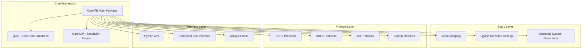

OpenFE is a comprehensive Python framework for alchemical free energy calculations in drug discovery. As the flagship project of the Open Free Energy consortium, it provides robust, permissively licensed open-source tools for molecular simulation workflows. The toolkit enables researchers to plan, execute, and analyze free energy calculations using various methods through both Python APIs and command-line interfaces.

## Architecture Overview

OpenFE follows a modular architecture built around three core pillars: **Setup**, **Protocols**, and **Analysis**. The framework leverages the `gufe` library for fundamental data structures and provides extensive OpenMM-based simulation protocols.



## Key Components

### Setup Module
The setup module provides tools for preparing molecular systems and planning calculations:

- **Atom Mapping**: Multiple mapping algorithms including LomapAtomMapper, PersesAtomMapper, and KartografAtomMapper for determining correspondences between molecular structures [openfe/setup/__init__.py](openfe/setup/__init__.py#L5-L15)
- **Network Planning**: Algorithms for optimizing ligand transformation networks to minimize computational cost while maximizing accuracy
- **Chemical System Generation**: Tools for creating and validating molecular systems with proper components

### Protocol System
OpenFE implements a sophisticated protocol system for different types of free energy calculations:

| Protocol Type | Description | Key Features |
|---------------|-------------|--------------|
| **RBFE** | Relative Binding Free Energy | Ligand binding comparisons, network-based optimization |
| **ABFE** | Absolute Binding Free Energy | Single molecule binding calculations |
| **MD** | Molecular Dynamics | System equilibration and production runs |
| **Septop** | Restraint Methods | Advanced restraint systems for binding calculations |

The protocols are organized in the [openfe/protocols](openfe/protocols/) directory with specialized modules for each calculation type, all built on OpenMM for high-performance molecular simulations.

### Analysis and Visualization
OpenFE provides comprehensive tools for analyzing and visualizing results:

- **Network Analysis**: Maximum likelihood estimation for free energy networks
- **3D Visualization**: Molecular structure and transformation visualization
- **Plotting Tools**: Network graphs and result visualization capabilities

## Interface Options

OpenFE offers multiple ways to interact with the framework:

### Python API
The primary interface provides programmatic access to all OpenFE functionality:

```python
from openfe import LigandNetwork, Transformation
from openfe.setup import LomapAtomMapper, ligand_network_planning
```

### Command Line Interface
A comprehensive CLI ([openfecli/cli.py](openfecli/cli.py#L18-L25)) provides access to common operations through organized command sections:
- **Network Planning**: Tools for creating optimal ligand networks
- **Quickrun Executor**: Direct execution of calculations
- **Miscellaneous**: Utility functions and data management

## Project Structure

The toolkit follows a well-organized structure that separates concerns and maintains modularity:


- **Core Package** ([openfe/](openfe/)): Main library with setup, protocols, analysis, and utilities
- **CLI Package** ([openfecli/](openfecli/)): Command-line interface and related tools
- **Documentation** ([docs/](docs/)): Comprehensive documentation with tutorials, guides, and API reference
- **Development Tools** ([devtools/](devtools/)): Scripts and utilities for development and testing

## Getting Started

OpenFE is designed to be accessible for beginners while providing advanced features for experts. The toolkit supports multiple installation methods including conda, Docker, and single-file installers. The project maintains high standards for code quality with comprehensive testing, documentation, and continuous integration.

**Next Steps**: For hands-on experience, proceed to [Quick Start](2-quick-start) to install OpenFE and run your first calculation, or visit [Installation and Environment Setup](3-installation-and-environment-setup) for detailed installation instructions.