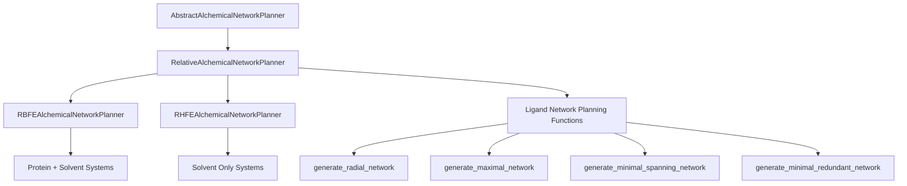

Ligand network planning algorithms are fundamental to OpenFE's approach to relative free energy calculations. These algorithms determine how ligands are connected in a network, directly impacting computational efficiency, accuracy, and statistical robustness of the calculations. The system provides multiple network planning strategies optimized for different use cases, from minimal computational footprint to maximum redundancy.

## Network Planning Architecture

The ligand network planning system follows a hierarchical architecture that separates concerns between network topology generation and alchemical transformation creation. At the core is the `AbstractAlchemicalNetworkPlanner` interface [openfe/setup/alchemical_network_planner/abstract_alchemical_network_planner.py#L9-L16], which defines the contract for all network planners. The concrete implementation `RelativeAlchemicalNetworkPlanner` [openfe/setup/alchemical_network_planner/relative_alchemical_network_planner.py#L46] serves as the base for specialized planners like `RBFEAlchemicalNetworkPlanner` and `RHFEAlchemicalNetworkPlanner`.

The planner orchestrates three key components: atom mappers for proposing molecular correspondences, scoring functions for evaluating mapping quality, and network planning algorithms for optimizing the graph topology [openfe/setup/alchemical_network_planner/relative_alchemical_network_planner.py#L49-L95].

## Core Network Planning Algorithms

### Minimal Spanning Network

The `generate_minimal_spanning_network` function creates the most computationally efficient network by connecting all ligands with the minimum number of edges while maximizing total mapping scores [openfe/setup/ligand_network_planning.py#L208-L235]. This approach uses a minimum spanning tree algorithm to ensure every ligand is reachable while minimizing computational cost.

**Key characteristics:**
- **Edge count**: N-1 edges for N ligands
- **Optimization**: Maximizes total mapping score
- **Use case**: Limited computational resources, initial screening

### Radial Network

The radial network (also known as hub-and-spoke or star-map) connects all ligands through a central reference ligand [openfe/setup/ligand_network_planning.py#L49-L120]. This topology is particularly useful when you have a well-characterized reference compound or want to minimize error propagation through the network.

**Key characteristics:**
- **Edge count**: N-1 edges (all connected to central hub)
- **Central ligand**: Can be specified by name, index, or molecule object
- **Advantage**: Reduces cumulative errors,便于结果解释

### Maximal Network

The `generate_maximal_network` function creates a complete network with all possible ligand-to-ligand connections [openfe/setup/ligand_network_planning.py#L157-L207]. This comprehensive approach generates up to N(N-1)/2 potential edges, making it ideal for debugging atom mappers or as a starting point for other optimization algorithms.

**Key characteristics:**
- **Edge count**: Up to N(N-1)/2 edges
- **Completeness**: Includes all possible mappings
- **Use case**: Mapper debugging, comprehensive analysis

### Minimal Redundant Network

The `generate_minimal_redundant_network` provides a balance between efficiency and statistical robustness by ensuring each node has multiple connections [openfe/setup/ligand_network_planning.py#L252-L295]. This algorithm generates multiple minimum spanning trees to provide redundancy while maintaining computational efficiency.

**Key characteristics:**
- **Redundancy level**: Controlled by `mst_num` parameter
- **Statistical robustness**: Multiple paths between ligands
- **Error estimation**: Enables uncertainty quantification

## Algorithm Selection Guidelines

| Algorithm | Computational Cost | Statistical Robustness | Error Propagation | Best Use Case |
|-----------|-------------------|------------------------|-------------------|---------------|
| Minimal Spanning | Lowest | Low | High | Resource-constrained screening |
| Radial | Low | Medium | Low | Reference-based studies |
| Maximal | Highest | High | Low | Mapper debugging, analysis |
| Minimal Redundant | Medium | High | Medium | Production calculations |

## Integration with Alchemical Planning

The network planning algorithms integrate seamlessly with the broader alchemical planning framework. The `RelativeAlchemicalNetworkPlanner` uses the specified network planner to generate ligand connections, then constructs full alchemical transformations by combining these with chemical systems and protocols [openfe/setup/alchemical_network_planner/relative_alchemical_network_planner.py#L121-L140].

> [!TIP]
> The choice of network planner significantly impacts both computational efficiency and result accuracy. For production calculations, consider using minimal redundant networks with mst_num=2 to balance cost and statistical robustness.

## Command Line Interface

OpenFE provides CLI commands for network planning, including `plan-rbfe-network` and `plan-rhfe-network` [openfecli/commands/plan_rbfe_network.py#L120-L144]. These commands expose the network planning functionality through a user-friendly interface, supporting various mappers, scorers, and network planning algorithms.

## Advanced Configuration

Network planners support advanced configuration through:
- **Multiple mappers**: Combine different mapping strategies
- **Custom scoring functions**: Implement domain-specific mapping evaluation
- **Parallel processing**: Leverage multiple cores for large ligand sets
- **Progress tracking**: Monitor network generation for large systems

The system's modular design allows easy extension with new network planning algorithms while maintaining compatibility with existing workflows. This flexibility enables researchers to tailor network topology to their specific computational constraints and accuracy requirements.

> [!TIP]
> When working with charged ligands, ensure your mapper supports element changes and charge variations. The default LomapAtomMapper configuration includes element_change=True for this purpose.

For understanding how these networks integrate with molecular transformations, see [Atom Mapping and Molecular Transformations](9-atom-mapping-and-molecular-transformations). To learn about executing calculations on planned networks, refer to [Protocol System and Execution Framework](8-protocol-system-and-execution-framework).