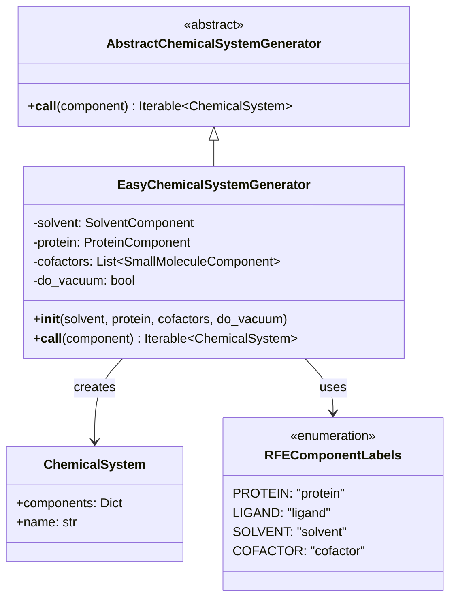

Chemical system generation and validation in OpenFE provides a systematic framework for creating consistent molecular environments for free energy calculations. This module ensures that ligands are properly prepared across different simulation scenarios including vacuum, solvent, and protein-bound states.

## Architecture Overview

The chemical system generation framework follows an abstract factory pattern with a concrete implementation for common use cases. The architecture is built around standardized component labels and a flexible generator system that can handle various molecular environments.



## Component Label System

The framework uses a standardized enumeration system for labeling molecular components within chemical systems [source](openfe/setup/chemicalsystem_generator/abstract_chemicalsystem_generator.py#L12-L18):

| Label | Value | Purpose |
|-------|-------|---------|
| `PROTEIN` | "protein" | Protein component in complex systems |
| `LIGAND` | "ligand" | Primary small molecule for transformation |
| `SOLVENT` | "solvent" | Solvent environment component |
| `COFACTOR` | "cofactor" | Additional small molecules in protein complexes |

These labels ensure consistent component identification across different chemical systems and enable automated validation of system composition.

## EasyChemicalSystemGenerator Implementation

The `EasyChemicalSystemGenerator` class provides a straightforward interface for generating chemical systems in multiple environments [source](openfe/setup/chemicalsystem_generator/easy_chemicalsystem_generator.py#L19-L120).

### Initialization Parameters

The generator accepts four key parameters that determine which types of systems will be created:

- **`solvent`** (SolventComponent, optional): Enables solvated system generation
- **`protein`** (ProteinComponent, optional): Enables complex system generation with protein
- **`cofactors`** (Iterable[SmallMoleculeComponent], optional): Additional molecules included in protein complexes
- **`do_vacuum`** (bool, optional): Controls vacuum system generation

> [!TIP]
> The generator enforces at least one valid environment configuration. If neither solvent nor protein is provided and `do_vacuum` is false, a `ValueError` is raised to prevent invalid system generation attempts.

### System Generation Order

The generator follows a deterministic order when creating systems [source](openfe/setup/chemicalsystem_generator/easy_chemicalsystem_generator.py#L71-L120):

1. **Vacuum system** (if `do_vacuum=True`): Contains only the ligand
2. **Solvent system** (if solvent provided): Ligand + solvent environment  
3. **Complex system** (if protein provided): Ligand + protein + optional cofactors + optional solvent

This ordered approach ensures predictable system naming and consistent preparation across different molecular environments.

## System Validation Framework

OpenFE includes a comprehensive validation system for verifying chemical system composition [source](openfe/tests/setup/chemicalsystem_generator/component_checks.py#L7-L21):

```python
def ligandC_in_chem_sys(chemical_system: ChemicalSystem) -> bool:
    return RFEComponentLabels.LIGAND in chemical_system.components

def solventC_in_chem_sys(chemical_system: ChemicalSystem) -> bool:
    return RFEComponentLabels.SOLVENT in chemical_system.components

def proteinC_in_chem_sys(chemical_system: ChemicalSystem) -> bool:
    return RFEComponentLabels.PROTEIN in chemical_system.components
```

These validation functions enable automated testing of system composition and ensure that generated systems contain the expected components for their intended simulation scenarios.

## Common Usage Patterns

### Hydration Scenario
For ligand hydration free energy calculations:
```python
generator = EasyChemicalSystemGenerator(do_vacuum=True, solvent=SolventComponent())
systems = list(generator(ligand_component))
# Result: [vacuum_system, solvent_system]
```

### Binding Scenario  
For protein-ligand binding calculations:
```python
generator = EasyChemicalSystemGenerator(
    solvent=SolventComponent(),
    protein=ProteinComponent()
)
systems = list(generator(ligand_component))
# Result: [solvent_system, complex_system]
```

### Complete Binding Cycle
For full thermodynamic cycle including vacuum:
```python
generator = EasyChemicalSystemGenerator(
    do_vacuum=True,
    solvent=SolventComponent(), 
    protein=ProteinComponent()
)
systems = list(generator(ligand_component))
# Result: [vacuum_system, solvent_system, complex_system]
```

> [!TIP]
> The generator uses systematic naming conventions: `{ligand_name}_{environment}` where environment is "vacuum", "solvent", or "complex". This enables easy identification and downstream processing of generated systems.

## Integration with Workflow

The chemical system generation integrates seamlessly with OpenFE's broader workflow for free energy calculations. Generated systems serve as the foundation for:

- **Alchemical network planning**: Systems provide the endpoints for molecular transformations
- **Protocol execution**: Each system type requires specific simulation protocols
- **Results analysis**: System labels enable organized result collection and comparison

For advanced users requiring custom system generation logic, the `AbstractChemicalSystemGenerator` interface provides the foundation for implementing specialized generators that can handle non-standard molecular environments or complex multi-component systems.

## Next Steps

To continue exploring OpenFE's molecular system setup capabilities, consider examining:

- [Atom Mapping and Molecular Transformations](9-atom-mapping-and-molecular-transformations) for understanding how molecules are connected in transformations
- [Ligand Network Planning Algorithms](10-ligand-network-planning-algorithms) for optimizing transformation pathways
- [Protocol System and Execution Framework](8-protocol-system-and-execution-framework) for running simulations on generated systems