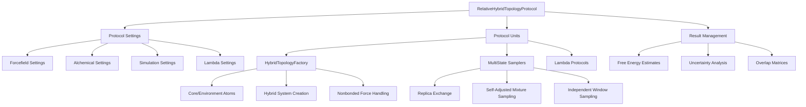

Relative Binding Free Energy (RBFE) protocols in OpenFE provide a comprehensive framework for calculating the free energy differences between ligand binding to a common receptor. These protocols implement hybrid topology approaches using OpenMM and are based on proven methodologies from the Perses toolkit, offering multiple sampling strategies and extensive configurability for accurate binding affinity predictions.

## Protocol Architecture Overview

The RBFE implementation follows a modular architecture that separates concerns between protocol definition, execution units, settings management, and utility functions. This design enables flexible configuration while maintaining computational efficiency and reproducibility.

## Core Protocol Components

### RelativeHybridTopologyProtocol

The main protocol class orchestrates the entire RBFE calculation workflow [openfe/protocols/openmm_rfe/equil_rfe_methods.py](openfe/protocols/openmm_rfe/equil_rfe_methods.py#L496-L508). This class serves as the entry point for defining RBFE calculations and manages the creation of protocol units, execution coordination, and result aggregation.

Key responsibilities include:
- Creating protocol units for each transformation
- Managing repeat calculations for statistical robustness
- Coordinating execution through the OpenFE framework
- Aggregating results from multiple independent runs

### RelativeHybridTopologyProtocolUnit

Each protocol unit represents a single execution of the RBFE calculation [openfe/protocols/openmm_rfe/equil_rfe_methods.py](openfe/protocols/openmm_rfe/equil_rfe_methods.py#L683-L710). These units encapsulate the complete simulation workflow including system preparation, minimization, equilibration, and production sampling.

The unit handles:
- Hybrid topology system creation
- Multi-state sampler initialization
- Simulation execution across lambda windows
- Data collection and analysis
- Structural and energetic analysis

## Hybrid Topology System Construction

The HybridTopologyFactory is responsible for creating the hybrid molecular system that enables smooth alchemical transformations between ligands [openfe/protocols/openmm_rfe/_rfe_utils/relative.py](openfe/protocols/openmm_rfe/_rfe_utils/relative.py#L23-L84).

### Atom Classification System

The factory categorizes atoms into four distinct classes:
- **Core atoms**: Common atoms present in both ligands
- **Environment atoms**: Receptor and solvent atoms
- **Unique old atoms**: Atoms only present in the initial ligand
- **Unique new atoms**: Atoms only present in the final ligand

This classification enables selective application of alchemical perturbations while maintaining the structural integrity of the receptor environment.

### Force Field Integration

The hybrid system construction handles all force field components:
- **Bonded forces**: Bonds, angles, and torsions with appropriate scaling
- **Nonbonded forces**: Electrostatic and van der Waals interactions with softcore potentials
- **Constraints**: Maintaining molecular geometry during transformation
- **Virtual sites**: Handling special cases like lone pairs

## Lambda Protocols and Alchemical Transformation

### Lambda Schedule Management

The LambdaProtocol class defines how different energy components are scaled during the alchemical transformation [openfe/protocols/openmm_rfe/_rfe_utils/lambdaprotocol.py](openfe/protocols/openmm_rfe/_rfe_utils/lambdaprotocol.py#L45-L80).

Multiple predefined protocols are available:

| Protocol | Description | Lambda Range |
|----------|-------------|--------------|
| **default** | Sequential turning off of old terms (0.0-0.5) and on of new terms (0.5-1.0) | 0.0 → 1.0 |
| **quarters** | Four distinct phases for each energy component | 0.0 → 1.0 |
| **namd** | Implementation following Jiang et al. J. Chem. Inf. Model. 2019 | 0.0 → 1.0 |
| **ele-scaled** | Electrostatics scaled with λ^0.5 for energy linearity | 0.0 → 1.0 |

The default protocol uses the following lambda functions [openfe/protocols/openmm_rfe/_rfe_utils/lambdaprotocol.py](openfe/protocols/openmm_rfe/_rfe_utils/lambdaprotocol.py#L25-L41):
- Core terms: Linear scaling (λ)
- Old sterics/electrostatics: Turn off between 0.0-0.5
- New sterics/electrostatics: Turn on between 0.5-1.0

### Alchemical State Management

The RelativeAlchemicalState class manages the lambda parameters for different energy components [openfe/protocols/openmm_rfe/_rfe_utils/lambdaprotocol.py](openfe/protocols/openmm_rfe/_rfe_utils/lambdaprotocol.py#L291-L340):
- `lambda_sterics_core`: Core steric interactions
- `lambda_electrostatics_core`: Core electrostatic interactions  
- `lambda_sterics_insert/delete`: New/old steric interactions
- `lambda_electrostatics_insert/delete`: New/old electrostatic interactions

> [!TIP]
> The lambda protocol choice significantly impacts sampling efficiency. The default protocol provides good balance for most systems, but the quarters protocol may be better for challenging transformations with large electrostatic differences.

## Multi-State Sampling Methods

OpenFE RBFE protocols support three advanced sampling strategies through the HybridCompatibilityMixin [openfe/protocols/openmm_rfe/_rfe_utils/multistate.py](openfe/protocols/openmm_rfe/_rfe_utils/multistate.py#L29-L43):

### 1. Hamiltonian Replica Exchange (HREX)

The HybridRepexSampler enables exchange between different lambda states to improve sampling efficiency [openfe/protocols/openmm_rfe/_rfe_utils/multistate.py](openfe/protocols/openmm_rfe/_rfe_utils/multistate.py#L155-L162). This method:
- Facilitates barrier crossing between lambda states
- Improves convergence for difficult transformations
- Provides natural error estimation through replica statistics

### 2. Self-Adjusted Mixture Sampling (SAMS)

The HybridSAMSSampler implements optimal weight adaptation for efficient free energy estimation [openfe/protocols/openmm_rfe/_rfe_utils/multistate.py](openfe/protocols/openmm_rfe/_rfe_utils/multistate.py#L168-L175). This approach:
- Automatically optimizes lambda state weights
- Minimizes variance in free energy estimates
- Particularly useful for large ligand networks

### 3. Independent Window Sampling

The HybridMultiStateSampler provides traditional independent sampling at each lambda window [openfe/protocols/openmm_rfe/_rfe_utils/multistate.py](openfe/protocols/openmm_rfe/_rfe_utils/multistate.py#L181-L188). This method:
- Offers simplicity and easy parallelization
- Provides straightforward error analysis
- Serves as a baseline for comparison

## Protocol Configuration

### Settings Hierarchy

The RelativeHybridTopologyProtocolSettings class provides comprehensive configuration options [openfe/protocols/openmm_rfe/equil_rfe_settings.py](openfe/protocols/openmm_rfe/equil_rfe_settings.py#L104-L158):

| Setting Category | Key Parameters | Description |
|-----------------|----------------|-------------|
| **Protocol Control** | `protocol_repeats` | Number of independent repeats for statistics |
| **Force Field** | `forcefield_settings` | OpenMM force field parameters |
| **Thermodynamics** | `thermo_settings` | Temperature, pressure conditions |
| **Solvation** | `solvation_settings` | Solvent model and box parameters |
| **Partial Charges** | `partial_charge_settings` | Charge calculation methods |
| **Lambda Protocol** | `lambda_settings` | Lambda windows and functions |
| **Alchemical** | `alchemical_settings` | Softcore parameters and corrections |
| **Simulation** | `simulation_settings` | Sampling method and duration |
| **Engine** | `engine_settings` | OpenMM platform and precision |
| **Integrator** | `integrator_settings` | Timestep and barostat settings |
| **Output** | `output_settings` | Data storage and analysis options |

### Lambda Configuration

The LambdaSettings class controls the alchemical transformation schedule [openfe/protocols/openmm_rfe/equil_rfe_settings.py](openfe/protocols/openmm_rfe/equil_rfe_settings.py#L33-L50):
- `lambda_functions`: Choice of predefined protocols ('default', 'namd', 'quarters')
- `lambda_windows`: Number of lambda states (default: 11)

### Alchemical Parameters

The AlchemicalSettings class manages softcore and correction parameters [openfe/protocols/openmm_rfe/equil_rfe_settings.py](openfe/protocols/openmm_rfe/equil_rfe_settings.py#L50-L103):
- `softcore_LJ`: Choice between 'gapsys' and 'beutler' softcore functions
- `softcore_alpha`: Softcore alpha parameter (default: 0.85)
- `use_dispersion_correction`: Apply long-range dispersion corrections
- `explicit_charge_correction`: Handle charge changes during transformation

> [!TIP]
> For systems with significant charge differences between ligands, enable `explicit_charge_correction` to avoid artifacts from net charge changes during the alchemical transformation.

## Results Analysis and Output

### Result Container

The RelativeHybridTopologyProtocolResult class provides comprehensive analysis tools [openfe/protocols/openmm_rfe/equil_rfe_methods.py](openfe/protocols/openmm_rfe/equil_rfe_methods.py#L276-L495):

Key methods include:
- `get_estimate()`: Mean free energy difference across repeats
- `get_uncertainty()`: Standard deviation between repeats
- `get_individual_estimates()`: Results from each independent repeat
- `get_overlap_matrices()`: Energy overlap analysis between lambda states
- `get_replica_transition_statistics()`: Exchange rates for replica methods
- `equilibration_iterations()` and `production_iterations()`: Sampling statistics

### Statistical Analysis

The protocol implements robust statistical analysis:
- **Mean estimation**: Average across independent repeats
- **Uncertainty quantification**: Standard deviation between repeats
- **Convergence assessment**: Overlap matrix analysis
- **Replica statistics**: Exchange rates and state distributions

## Integration with OpenFE Framework

The RBFE protocols seamlessly integrate with the broader OpenFE ecosystem:
- **Network planning**: Compatible with ligand network planning algorithms
- **Storage**: Results stored in OpenFE's standardized format
- **Visualization**: Integration with network plotting tools
- **CLI support**: Command-line interface for protocol execution

## Best Practices and Recommendations

### Protocol Selection

- **Standard transformations**: Use default lambda protocol with HREX sampling
- **Large electrostatic changes**: Consider quarters protocol or ele-scaled variant
- **High-throughput screening**: Independent window sampling for parallel efficiency
- **Challenging transformations**: SAMS for optimal weight adaptation

### Convergence Assessment

Monitor multiple convergence indicators:
- Overlap matrices should show good coverage (>0.1 overlap preferred)
- Replica exchange rates around 20-30% for HREX
- Consistent results across independent repeats
- Small statistical uncertainties (<0.5 kcal/mol preferred)

### Computational Resources

Balance accuracy and efficiency:
- **Production runs**: 1-5 ns per lambda window typical
- **Lambda windows**: 11-21 windows sufficient for most cases
- **Protocol repeats**: 3-5 repeats for reliable statistics
- **Parallel execution**: Utilize multiple replicas for efficiency

The RBFE protocols in OpenFE provide a robust, flexible foundation for accurate binding free energy calculations, with extensive customization options to address diverse molecular transformation challenges.