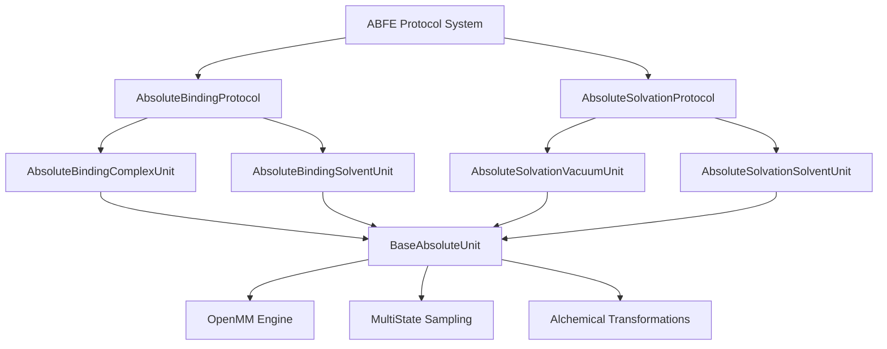

Absolute Binding Free Energy (ABFE) protocols in OpenFE provide a comprehensive framework for calculating the binding free energy of a single ligand to a target protein without requiring reference ligands. These protocols implement thermodynamically rigorous approaches based on alchemical transformations and leverage OpenMM's molecular dynamics capabilities for high-precision free energy calculations.

## Protocol Architecture Overview

The ABFE implementation follows a modular architecture that separates different phases of the calculation into specialized protocol units. The system is built around two main protocol types: Absolute Binding Protocol for protein-ligand binding calculations and Absolute Solvation Protocol for solvation free energy calculations.



## Core Protocol Types

### Absolute Binding Protocol

The `AbsoluteBindingProtocol` calculates the binding free energy by performing alchemical transformations in both complex and solvent environments [openfe/protocols/openmm_afe/equil_binding_afe_method.py](openfe/protocols/openmm_afe/equil_binding_afe_method.py#L517-L580). This protocol implements a thermodynamic cycle that includes:

- **Complex Phase**: Ligand is decoupled from the protein-ligand complex
- **Solvent Phase**: Ligand is decoupled from solution
- **Restraint System**: Boresch restraints maintain proper ligand orientation during complex calculations

The protocol supports multiple sampling methods including Hamiltonian Replica Exchange, Self-adjusted Mixture Sampling, and Independent Window sampling.

### Absolute Solvation Protocol

The `AbsoluteSolvationProtocol` calculates solvation free energies through vacuum-to-solvent alchemical transformations [openfe/protocols/openmm_afe/equil_solvation_afe_method.py](openfe/protocols/openmm_afe/equil_solvation_afe_method.py#L405-L470). This protocol consists of:

- **Vacuum Phase**: Ligand exists in vacuum environment
- **Solvent Phase**: Ligand is transferred to explicit solvent

## Protocol Units and Execution Flow

Each protocol is composed of specialized protocol units that handle different computational phases:

| Protocol Unit | Environment | Purpose | Key Features |
|---------------|-------------|---------|--------------|
| `AbsoluteBindingComplexUnit` | Protein-ligand complex | Decouple ligand from complex | Boresch restraints, standard state corrections |
| `AbsoluteBindingSolventUnit` | Solvent | Decouple ligand from solution | Solvent equilibration, alchemical sampling |
| `AbsoluteSolvationVacuumUnit` | Vacuum | Vacuum phase calculation | No cutoffs, gas phase dynamics |
| `AbsoluteSolvationSolventUnit` | Solvent | Solvent phase calculation | Explicit solvent, periodic boundaries |

All protocol units inherit from `BaseAbsoluteUnit` [openfe/protocols/openmm_afe/base.py](openfe/protocols/openmm_afe/base.py#L86-L89), which provides common functionality for system preparation, alchemical transformations, and simulation execution.

## Configuration and Settings

### Lambda Schedule Configuration

The alchemical transformation is controlled through lambda schedules that define how different interaction components are scaled:

```python
# Example lambda settings for binding protocol
lambda_settings = LambdaSettings(
    lambda_elec=[0.0, 0.25, 0.5, 0.75, 1.0, ...],  # Electrostatic scaling
    lambda_vdw=[0.0, 0.0, 0.0, 0.0, 0.0, ...],     # Van der Waals scaling  
    lambda_restraints=[0.0, 0.0, 0.0, 0.0, 0.0, ...] # Restraint scaling
)
```

The lambda schedules are carefully designed to ensure smooth alchemical transitions and adequate sampling at each state [openfe/protocols/openmm_afe/equil_afe_settings.py](openfe/protocols/openmm_afe/equil_afe_settings.py#L52-L120).

### Simulation Settings

ABFE protocols require extensive configuration including:

- **Force Field Settings**: OpenMM force field parameters for different environments
- **Thermodynamic Settings**: Temperature, pressure, and ensemble conditions
- **Engine Settings**: OpenMM compute platform and precision settings
- **Integrator Settings**: Langevin dynamics parameters and timestep
- **Output Settings**: Trajectory and energy output configuration

> [!TIP]
> The default settings provided with ABFE protocols are optimized for typical small molecule systems but should be carefully validated for specific use cases, particularly for charged or highly flexible ligands.

## Results Analysis

### Protocol Results Structure

Both ABFE protocols return specialized result objects that provide comprehensive analysis capabilities:

- **`AbsoluteBindingProtocolResult`**: Contains binding free energy estimates with uncertainties
- **`AbsoluteSolvationProtocolResult`**: Provides solvation free energy calculations

### Analysis Methods

The result objects offer multiple analysis methods [openfe/protocols/openmm_afe/equil_binding_afe_method.py](openfe/protocols/openmm_afe/equil_binding_afe_method.py#L105-L495):

- `get_estimate()`: Primary free energy estimate with statistical uncertainty
- `get_individual_estimates()`: Individual repeat estimates for convergence analysis
- `get_overlap_matrices()`: Energy overlap analysis between lambda states
- `get_replica_transition_statistics()`: Replica exchange efficiency metrics
- `get_forward_and_reverse_energy_analysis()`: Detailed energy decomposition

## Implementation Details

### Alchemical System Preparation

The protocols use OpenMM's `AbsoluteAlchemicalFactory` to create alchemical systems with proper lambda-dependent scaling of interactions [openfe/protocols/openmm_afe/base.py](openfe/protocols/openmm_afe/base.py#L620-L626). The system preparation includes:

1. **Component Identification**: Automatic detection of alchemical components
2. **Partial Charge Assignment**: Configurable charge generation methods
3. **System Generation**: OpenMM system creation with appropriate force fields
4. **Restraint Integration**: Boresch restraint geometry determination

### Multi-State Sampling

ABFE protocols implement multi-state sampling using OpenMMTools' `MultiStateSampler` framework [openfe/protocols/openmm_afe/base.py](openfe/protocols/openmm_afe/base.py#L898-L908). This provides:

- **Replica Exchange**: Efficient sampling across lambda states
- **Parallel Execution**: Multiple replica simulations running concurrently
- **Adaptive Sampling**: Dynamic adjustment of sampling parameters

## Current Limitations

The ABFE protocols have several important limitations that users should be aware of:

1. **Charge Restrictions**: Alchemical species with net charge are not currently supported [openfe/protocols/openmm_afe/equil_binding_afe_method.py](openfe/protocols/openmm_afe/equil_binding_afe_method.py#L16)
2. **Molecule Size**: Only small molecules are supported as alchemical species
3. **Transformation Direction**: Disappearing molecules are only allowed in state A
4. **Restraint Systems**: Limited to Boresch-style restraints for binding calculations

> [!TIP]
> For charged ligands or large molecules, consider using Relative Binding Free Energy (RBFE) protocols instead, which can handle a broader range of chemical transformations.

## Best Practices

### System Preparation

1. **Ligand Parameterization**: Ensure proper partial charges and force field parameters
2. **Protein Preparation**: Add missing residues, optimize protonation states
3. **Solvation**: Use appropriate box sizes and ion concentrations
4. **Minimization**: Perform thorough energy minimization before production runs

### Sampling Considerations

1. **Lambda Windows**: Use sufficient lambda windows for smooth transitions
2. **Simulation Length**: Ensure adequate sampling at each lambda state
3. **Convergence Monitoring**: Track free energy estimates across repeats
4. **Overlap Analysis**: Verify sufficient energy overlap between adjacent states

## Integration with OpenFE Ecosystem

ABFE protocols integrate seamlessly with the broader OpenFE framework:

- **Network Planning**: Can be incorporated into larger alchemical networks
- **Result Storage**: Compatible with OpenFE's storage and metadata systems
- **Visualization**: Results can be analyzed with OpenFE's plotting tools
- **CLI Support**: Available through OpenFE's command-line interface

For practical examples and tutorials, see the [ABFE tutorial notebook](docs/tutorials/abfe_tutorial.nblink) which demonstrates complete workflow implementation.

## Next Steps

To continue your exploration of OpenFE's capabilities:

- Learn about [Relative Binding Free Energy (RBFE) Protocols](12-relative-binding-free-energy-rbfe-protocols) for comparative ligand binding studies
- Explore [Molecular Dynamics and Thermodynamic Integration](14-molecular-dynamics-and-thermodynamic-integration) for deeper understanding of the underlying methods
- Review [Restraint Systems and Septop Methods](15-restraint-systems-and-septop-methods) for advanced restraint implementations
- Study [Custom Protocol Development](20-custom-protocol-development) to create specialized free energy calculations

The ABFE protocols provide a solid foundation for rigorous absolute free energy calculations while maintaining the flexibility and extensibility that characterize the OpenFE platform.