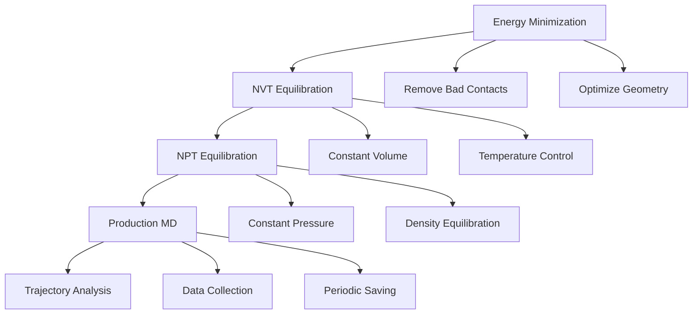
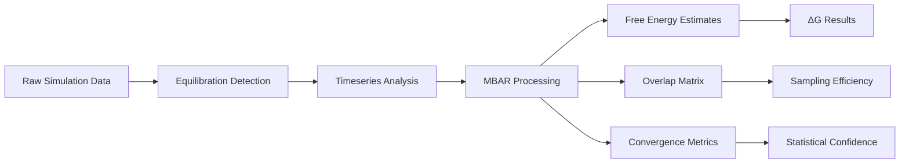

Molecular Dynamics (MD) and Thermodynamic Integration (TI) form the computational foundation for alchemical free energy calculations in OpenFE. This documentation explores the sophisticated implementation of MD protocols and TI methodologies that enable precise estimation of free energy differences between molecular states.

## Core MD Architecture

OpenFE implements a comprehensive MD framework through the `PlainMDProtocol` class, which provides the fundamental building blocks for molecular simulations [plain_md_methods.py](openfe/protocols/openmm_md/plain_md_methods.py#L118-L238). The protocol follows a structured approach with three distinct phases:



### MD Simulation Pipeline

The core MD execution is handled by the `_run_MD` static method, which orchestrates the complete simulation workflow [plain_md_methods.py](openfe/protocols/openmm_md/plain_md_methods.py#L281-L295). This method implements:

1. **Energy Minimization**: Removes steric clashes and optimizes molecular geometry using `simulation.minimizeEnergy()` with configurable iteration limits
2. **NVT Equilibration**: Constant volume equilibration to stabilize temperature, with optional barostat disabling
3. **NPT Equilibration**: Constant pressure equilibration to achieve proper density using Monte Carlo barostat
4. **Production MD**: Extended sampling phase with configurable trajectory output and checkpointing

> [!TIP]
> The MD pipeline supports flexible trajectory output through MDTraj integration, allowing selective atom subset saving and multiple format support (PDB, XTC) for efficient storage and analysis.

## Thermodynamic Integration Framework

Thermodynamic Integration in OpenFE is implemented through sophisticated lambda coupling protocols that control the gradual transformation between molecular states. The `LambdaProtocol` class provides the mathematical foundation for these alchemical transformations [lambdaprotocol.py](openfe/protocols/openmm_rfe/_rfe_utils/lambdaprotocol.py#L14-L21).

### Lambda Coupling Strategies

OpenFE offers multiple pre-defined lambda protocols tailored for different transformation scenarios:

| Protocol | Description | Lambda Range | Key Features |
|----------|-------------|--------------|--------------|
| **default** | Standard dual-topology approach | 0.0 → 1.0 | Linear core terms, staggered electrostatics/sterics |
| **namd** | NAMD-compatible protocol | 0.0 → 1.0 | Optimized for NAMD, smooth transitions |
| **quarters** | Sequential component transformation | 0.0 → 1.0 | Individual component control in 0.25 increments |
| **ele-scaled** | Electrostatic scaling | 0.0 → 1.0 | √λ scaling for linear energy behavior |

The lambda functions control different energetic components:

```python
# Example from default protocol
lambda_functions = {
    'lambda_sterics_core': lambda x: x,
    'lambda_electrostatics_core': lambda x: x,
    'lambda_sterics_insert': lambda x: 0.0 if x < 0.5 else 2.0 * (x - 0.5),
    'lambda_sterics_delete': lambda x: 2.0 * x if x < 0.5 else 1.0,
    'lambda_electrostatics_insert': lambda x: 0.0 if x < 0.5 else 2.0 * (x - 0.5),
    'lambda_electrostatics_delete': lambda x: 2.0 * x if x < 0.5 else 1.0
}
```

> [!TIP]
> The lambda protocols include built-in validation to prevent singularities from naked charges, ensuring numerical stability throughout the alchemical transformation.

## Multi-State Sampling and Analysis

OpenFE implements advanced multi-state sampling methods through hybrid samplers that support replica exchange and self-adjusted mixture sampling [multistate.py](openfe/protocols/openmm_rfe/_rfe_utils/multistate.py#L155-L187).

### Hybrid Sampler Architecture

The framework provides three specialized sampler classes:

1. **HybridRepexSampler**: Replica exchange for enhanced sampling across lambda windows
2. **HybridSAMSSampler**: Self-adjusted mixture sampling for optimal lambda state distribution  
3. **HybridMultiStateSampler**: General multi-state sampling with hybrid topology support

These samplers handle the complexity of endpoint states with different numbers of degrees of freedom through the `HybridCompatibilityMixin` [multistate.py](openfe/protocols/openmm_rfe/_rfe_utils/multistate.py#L29-L42).

### Free Energy Analysis

The `MultistateAnalyzer` class provides comprehensive analysis tools for extracting thermodynamic information from multi-state simulations [multistate_analysis.py](openfe/protocols/openmm_utils/multistate_analysis.py#L1-L50). Key capabilities include:

- **MBAR Analysis**: Bennett Acceptance Ratio for optimal free energy estimation
- **Overlap Matrix**: Assessment of sampling efficiency between lambda states
- **Convergence Analysis**: Forward/reverse integration for statistical validation
- **Replica Exchange Statistics**: Transition matrix analysis for exchange efficiency



## Hybrid Topology Generation

The `HybridTopologyFactory` class creates the molecular systems required for alchemical transformations [relative.py](openfe/protocols/openmm_rfe/_rfe_utils/relative.py#L1-L50). This sophisticated system handles:

### Atom Classification

The hybrid system categorizes atoms into four types:

| Atom Type | Lambda=0 State | Lambda=1 State | Description |
|-----------|----------------|----------------|-------------|
| **unique_old_atom** | Active | Inactive | Atoms only in initial state |
| **unique_new_atom** | Inactive | Active | Atoms only in final state |
| **core_atom** | Old parameters | New parameters | Mapped atoms in changing regions |
| **environment_atom** | Active | Active | Unchanged environmental atoms |

### System Integration

The hybrid topology factory ensures proper coordinate consistency between end states and manages the complex bookkeeping required for dual-topology alchemical transformations. This includes handling of:

- Custom nonbonded forces for alchemical interactions
- Proper mass and parameter inheritance
- Consistent topology mapping across lambda states

## Integration with OpenFE Ecosystem

The MD and TI components integrate seamlessly with the broader OpenFE framework:

### Protocol Composition
MD protocols can be combined with free energy protocols for comprehensive workflows:
- **RBFE**: Relative binding free energy calculations [Relative Binding Free Energy (RBFE) Protocols](12-relative-binding-free-energy-rbfe-protocols)
- **ABFE**: Absolute binding free energy calculations [Absolute Binding Free Energy (ABFE) Protocols](13-absolute-binding-free-energy-abfe-protocols)
- **Restraint Systems**: Septop and other restraint methods [Restraint Systems and Septop Methods](15-restraint-systems-and-septop-methods)

### Results Analysis
The MD output integrates with OpenFE's analysis tools:
- Individual calculation results [Working with Individual Calculation Results](16-working-with-individual-calculation-results)
- Network-based analysis [Network-Based Results Analysis](17-network-based-results-analysis)
- Maximum likelihood estimation [Maximum Likelihood Estimation for Free Energy Networks](18-maximum-likelihood-estimation-for-free-energy-networks)

## Performance and Optimization

OpenFE's MD implementation includes several performance optimizations:

### Platform Selection
The `get_openmm_platform` function provides intelligent platform selection for optimal performance [omm_compute.py](openfe/protocols/openmm_utils/omm_compute.py#L13-L17):

- GPU acceleration for production simulations
- CPU fallback for compatibility
- Multi-GPU support for parallel execution

### Memory Management
- Efficient trajectory storage through selective atom saving
- Checkpoint/restart capabilities for long simulations
- Optimized data structures for large molecular systems

### Validation and Quality Control
The framework includes comprehensive validation:

- **Parameter Validation**: Ensures physical consistency of simulation parameters
- **System Validation**: Checks for proper topology and coordinate consistency
- **Energy Validation**: Verifies energy conservation and reasonable values

## Advanced Configuration

For users requiring specialized functionality, OpenFE supports:

### Custom Lambda Protocols
User-defined lambda functions can be implemented for specific transformation requirements:

```python
custom_protocol = LambdaProtocol(
    functions={
        'lambda_sterics_core': lambda x: x**2,
        'lambda_electrostatics_core': lambda x: x**3,
        # Custom functions for specific use cases
    },
    windows=20
)
```

### Protocol Extension
The modular architecture allows for protocol customization and extension for specialized applications.

## Best Practices

When implementing MD and TI calculations in OpenFE:

1. **System Preparation**: Ensure proper minimization and equilibration before production runs
2. **Lambda Schedule Selection**: Choose appropriate lambda protocols for your specific transformation
3. **Convergence Monitoring**: Utilize built-in analysis tools to verify simulation convergence
4. **Performance Optimization**: Select appropriate hardware platforms and simulation parameters
5. **Validation**: Always validate results through multiple independent runs

The combination of robust MD protocols, sophisticated thermodynamic integration methods, and comprehensive analysis tools makes OpenFE a powerful platform for accurate free energy calculations in molecular design and drug discovery applications.