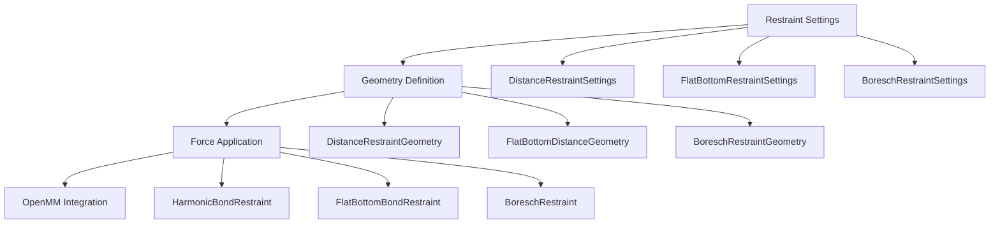
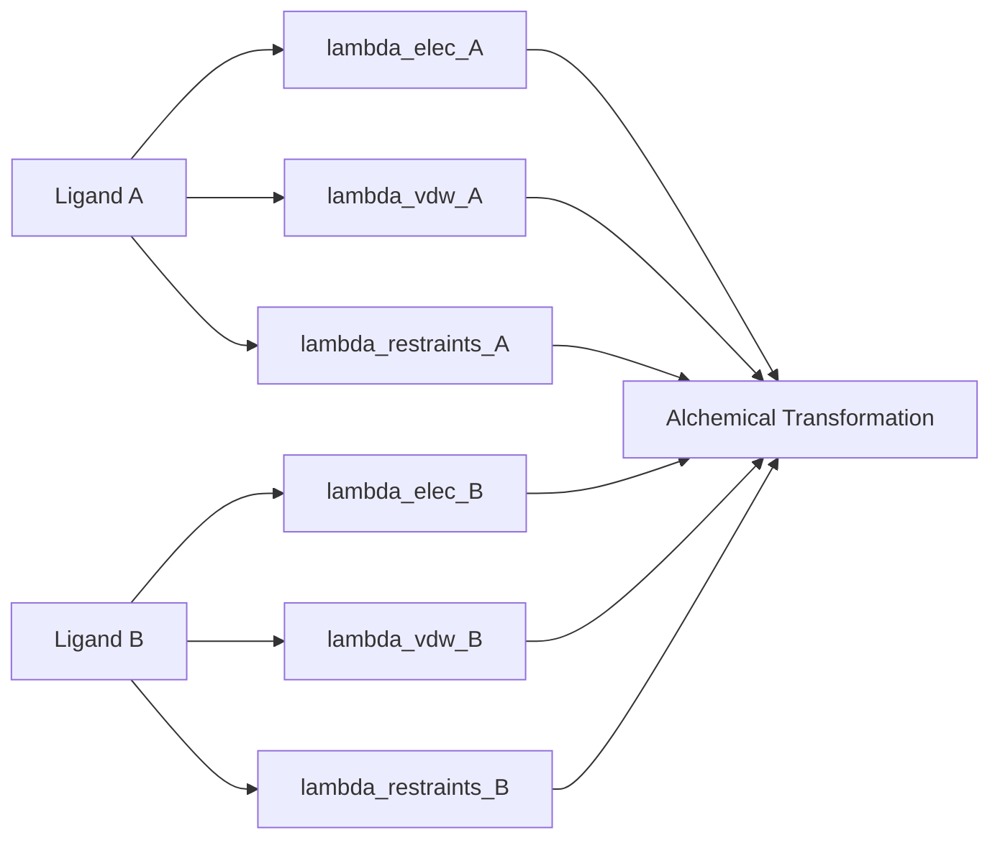

The OpenFE framework provides sophisticated restraint systems and Separated Topologies (SepTop) methods for accurate binding free energy calculations. This documentation covers the architectural design, implementation details, and practical applications of these advanced features.

## Restraint Architecture Overview

Restraint systems in OpenFE are built on a modular architecture that separates geometry definition from force application. The system supports multiple restraint types including harmonic bonds, flat-bottom potentials, and the sophisticated Boresch restraint system for maintaining ligand orientation during binding calculations.



## Restraint Types and Configuration

### Distance-Based Restraints

Distance restraints provide simple harmonic or flat-bottom potentials between atom groups:

- **HarmonicBondRestraint**: Standard harmonic potential with configurable spring constant
- **FlatBottomBondRestraint**: Harmonic potential with a flat-bottom well region
- **CentroidRestraints**: Apply forces to center-of-mass of atom groups rather than individual atoms

The distance restraint settings are defined through `DistanceRestraintSettings` [source](openfe/protocols/restraint_utils/settings.py#L35-L71), which includes parameters for spring constants and atom selection strategies.

### Boresch Restraint System

The Boresch restraint is the most sophisticated option, maintaining ligand orientation through six geometric parameters:

| Parameter | Description | Default Force Constant |
|-----------|-------------|----------------------|
| r_aA0 | H0-G0 bond distance | 4184.0 kJ/mol/nm² |
| θ_A0 | H1-H0-G0 angle | 334.72 kJ/mol/rad² |
| θ_B0 | H0-G0-G1 angle | 334.72 kJ/mol/rad² |
| φ_A0 | H2-H1-H0-G0 dihedral | 334.72 kJ/mol/rad² |
| φ_B0 | H1-H0-G0-G1 dihedral | 334.72 kJ/mol/rad² |
| φ_C0 | H0-G0-G1-G2 dihedral | 334.72 kJ/mol/rad² |

> [!TIP]
> The Boresch restraint geometry is automatically detected using RMSF filtering and distance criteria. The system searches for optimal anchor atoms in the host protein based on flexibility and spatial proximity to the ligand.

## SepTop Method Architecture

The Separated Topologies (SepTop) method implements a dual-ligand approach where both ligands are present simultaneously in the simulation, with one being decoupled while the other is coupled. This approach offers several advantages over traditional single-topology methods.

### Core Components

The SepTop implementation consists of several key classes:

- **SepTopProtocol**: Main protocol class orchestrating the entire calculation [source](openfe/protocols/openmm_septop/equil_septop_method.py#L857-L1385)
- **SepTopComplexSetupUnit**: Handles complex phase system preparation [source](openfe/protocols/openmm_septop/equil_septop_method.py#L1429-L2030)
- **SepTopSolventSetupUnit**: Manages solvent phase system setup [source](openfe/protocols/openmm_septop/equil_septop_method.py#L2043-L2296)
- **SepTopComplexRunUnit/SepTopSolventRunUnit**: Execute the actual simulations

### Lambda Schedule Management

SepTop requires careful management of multiple lambda parameters for each ligand:



The lambda schedules are defined through `LambdaSettings` [source](openfe/protocols/openmm_septop/equil_septop_settings.py#L46-L276), ensuring proper coupling/decoupling sequences for each ligand component.

## Restraint Integration in SepTop

### Complex Phase Restraints

In the complex phase, SepTop applies Boresch restraints to maintain ligand orientation relative to the protein. The restraint geometry is automatically detected using MDAnalysis and RMSF filtering:

1. **Anchor Detection**: Identifies suitable protein atoms based on flexibility criteria
2. **Geometry Optimization**: Finds optimal restraint parameters through trajectory analysis  
3. **Force Application**: Applies CustomCompoundBondForce with lambda-dependent scaling

The restraint detection algorithm uses configurable parameters like `rmsf_cutoff` (default 0.1 nm) and `host_min_distance`/`host_max_distance` for spatial filtering [source](openfe/protocols/restraint_utils/geometry/boresch/geometry.py#L135-L150).

### Solvent Phase Restraints

In the solvent phase, simpler harmonic restraints are applied to prevent ligand drift. The `solvent_restraint_settings` in `SepTopSettings` control this behavior [source](openfe/protocols/openmm_septop/equil_septop_settings.py#L441-L441).

## Standard State Corrections

Both restraint systems provide automatic standard state correction calculations:

- **Distance Restraints**: Analytical corrections based on harmonic potential volume
- **Boresch Restraints**: Full 6-dimensional correction including angular and dihedral contributions

The `get_standard_state_correction` method in each restraint class handles these calculations [source](openfe/protocols/restraint_utils/openmm/omm_restraints.py#L153-L158).

## Practical Implementation

### Settings Configuration

SepTop requires comprehensive settings configuration through `SepTopSettings` [source](openfe/protocols/openmm_septop/equil_septop_settings.py#L336-L445):

```python
settings = SepTopSettings(
    protocol_repeats=3,
    complex_restraint_settings=BoreschRestraintSettings(
        host_selection="backbone",
        rmsf_cutoff=0.1 * unit.nanometer
    ),
    solvent_restraint_settings=DistanceRestraintSettings(
        spring_constant=4184.0 * unit.kilojoule_per_mole / unit.nm**2
    )
)
```

### Validation and Error Handling

The system includes extensive validation:

- Charge difference checking for alchemical compatibility
- Lambda schedule monotonicity validation
- Geometry constraint verification
- Force field compatibility checks

> [!TIP]
> SepTop currently requires ligands to have identical net charges. Transformations involving charge changes are not supported due to the complexity of handling electrostatic discontinuities in the separated topology framework.

## Advanced Features

### Multi-State Sampling

SepTop supports advanced sampling methods through integration with OpenMMTools:

- **Hamiltonian Replica Exchange**: Multiple lambda states with exchange attempts
- **Self-Adjusted Mixture Sampling**: Adaptive lambda state weighting
- **Independent Window Sampling**: Parallel execution of lambda windows

### Output and Analysis

The `SepTopProtocolResult` class provides comprehensive analysis capabilities [source](openfe/protocols/openmm_septop/equil_septop_method.py#L365-L835):

- Individual lambda window estimates with uncertainties
- Overlap matrix analysis for sampling efficiency
- Replica transition statistics
- Restraint geometry validation data

## Integration with OpenFE Ecosystem

SepTop and restraint systems integrate seamlessly with the broader OpenFE framework:

- **Network Planning**: Compatible with ligand network planning algorithms
- **Storage Systems**: Results stored in standardized format for later analysis
- **Visualization**: Restraint geometries can be visualized using built-in tools

The restraint architecture provides a foundation for extending the system with new restraint types and sampling methods, making OpenFE a flexible platform for advanced free energy calculations.

## Next Steps

For practical implementation guidance, see the [SepTop Tutorial](14-septop-tutorial) which provides step-by-step examples of setting up and running SepTop calculations. For understanding how these methods fit into the broader calculation workflow, review the [Protocol System and Execution Framework](8-protocol-system-and-execution-framework).