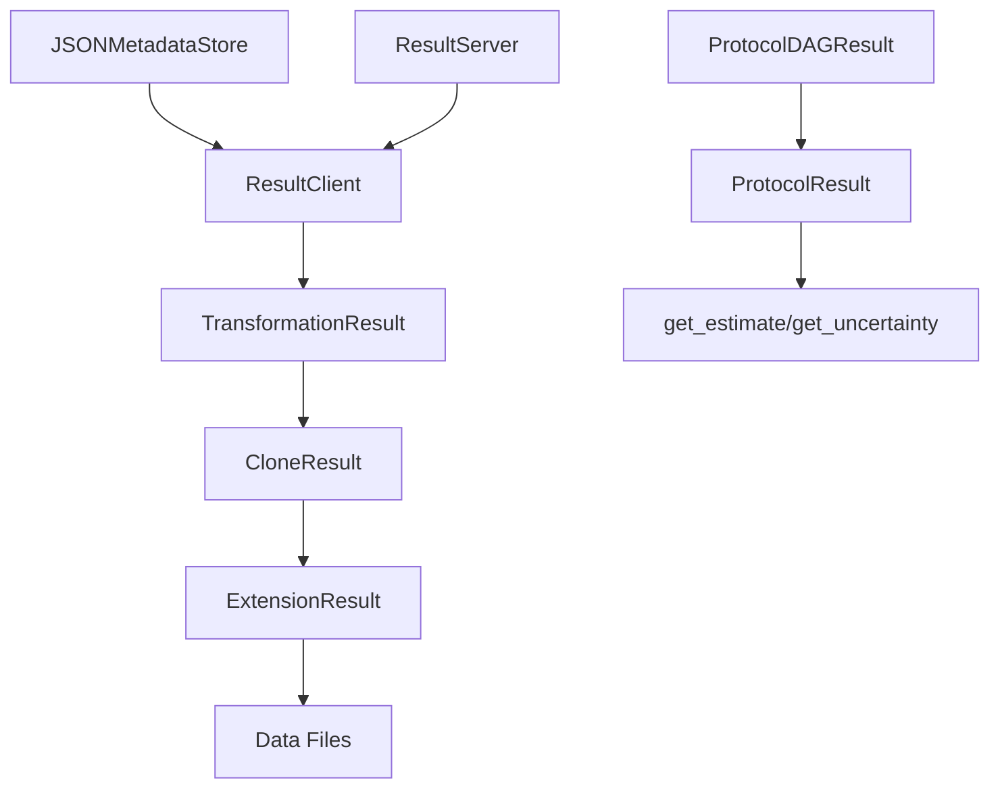

This page focuses on accessing and analyzing results from individual free energy calculations in OpenFE. After executing your calculations, you'll need to understand how to retrieve, interpret, and visualize the data produced by different protocols.

## Result Storage Architecture

OpenFE uses a hierarchical storage system for calculation results, organized through several key classes that provide different levels of access to your data:



### Core Result Classes

The result system is built around four main container classes [openfe/storage/resultclient.py](openfe/storage/resultclient.py#L22-L288):

- **`ResultClient`**: The main entry point for accessing stored results, connecting to external storage via `JSONMetadataStore` and `ResultServer` [openfe/storage/resultclient.py](openfe/storage/resultclient.py#L93-L249)
- **`TransformationResult`**: Represents results for a specific transformation, containing multiple clones [openfe/storage/resultclient.py](openfe/storage/resultclient.py#L252-L258)
- **`CloneResult`**: Contains results from individual simulation clones/repeats [openfe/storage/resultclient.py](openfe/storage/resultclient.py#L261-L270)
- **`ExtensionResult`**: Provides access to individual data files within a clone's results [openfe/storage/resultclient.py](openfe/storage/resultclient.py#L274-L288)

## Accessing Results

### From Command Line Execution

When using the `quickrun` command, results are stored as JSON files alongside data directories. The JSON file contains essential summary information:

```python
import gufe
import json

with open('./Transformation-97d7223f918bbdb0570edc2a49bbc43e_results.json', 'r') as f:
    results = json.load(f, cls=gufe.tokenization.JSON_HANDLER.decoder)

results['estimate']      # Free energy estimate
results['uncertainty']   # Statistical uncertainty
```

### From Python Execution

When executing protocols programmatically, you work with `ProtocolDAGResult` objects that can be aggregated into `ProtocolResult` objects:

```python
# Execute a ProtocolDAG
dag_result = openfe.execute_DAG(protocol_dag)

# Gather multiple results
protocol_result = protocol.gather([dag_result1, dag_result2, ...])

# Get final estimates
estimate = protocol_result.get_estimate()
uncertainty = protocol_result.get_uncertainty()
```

> [!TIP]
> The `ProtocolResult.gather()` method automatically handles averaging and concatenation of multiple iterations, providing statistically robust estimates through proper error propagation.

## Data Access Patterns

### Hierarchical Navigation

Results are accessed through a path-like interface that mirrors the storage hierarchy:

```python
# Access transformation results
transformation_result = result_client.load_transformation(transformation_key)

# Navigate to clone results
clone_result = transformation_result[clone_id]

# Access specific data files
trajectory_data = clone_result['trajectory.dcd']
energies_data = clone_result['energies.npy']
```

### File Loading Methods

The `_ResultContainer` base class provides flexible file access methods [openfe/storage/resultclient.py](openfe/storage/resultclient.py#L71-L79):

- **`load_stream()`**: Returns a file-like object for streaming large files
- **`load_bytes()`**: Loads entire file contents into memory as bytes

```python
# Stream large trajectory files
with clone_result.load_stream('trajectory.dcd') as f:
    trajectory_data = f.read()

# Load small configuration files directly
config_bytes = clone_result.load_bytes('settings.json')
```

## Analysis and Visualization

### Multistate Analysis

For protocols using multistate sampling (like RBFE calculations), OpenFE provides comprehensive analysis tools through the `MultistateEquilFEAnalysis` class [openfe/protocols/openmm_utils/multistate_analysis.py](openfe/protocols/openmm_utils/multistate_analysis.py#L62-L494):

```python
from openfe.protocols.openmm_utils import MultistateEquilFEAnalysis

# Initialize analysis with reporter and sampling method
analysis = MultistateEquilFEAnalysis(
    reporter=reporter,
    sampling_method="repex",  # or "sams"
    result_units=unit.kilocalorie_per_mole
)

# Get equilibrated free energy estimates
fe_estimate, fe_error = analysis.get_equil_free_energy()

# Access convergence analysis
forward_reverse = analysis.get_forward_and_reverse_analysis(num_samples=10)
```

### Key Analysis Properties

The `MultistateEquilFEAnalysis` class provides rich analysis capabilities:

| Property | Description |
|----------|-------------|
| `free_energy` | Final equilibrated free energy estimate |
| `free_energy_error` | MBAR uncertainty estimate |
| `equilibration_iterations` | Number of iterations discarded as equilibration |
| `production_iterations` | Number of iterations used for analysis |
| `replica_states` | Timeseries of states for each replica |
| `free_energy_overlaps` | Overlap matrix and eigenvalues |
| `replica_exchange_statistics` | Exchange acceptance rates |

### Plotting Capabilities

OpenFE includes specialized plotting functions for result visualization [openfe/analysis/plotting.py](openfe/analysis/plotting.py#L12-L361):

```python
from openfe.analysis.plotting import plot_convergence, plot_lambda_transition_matrix

# Plot convergence analysis
ax = plot_convergence(
    forward_and_reverse=convergence_data,
    units=unit.kilocalorie_per_mole
)

# Plot lambda transition matrix
ax = plot_lambda_transition_matrix(transition_matrix)
```

> [!TIP]
> All plotting functions return matplotlib Axes objects, allowing for further customization and integration into larger figure layouts.

## Protocol-Specific Results

Different protocols produce different types of results:

| Protocol Type | Typical Outputs | Analysis Methods |
|---------------|------------------|------------------|
| **RelativeHybridTopologyProtocol** | Free energies, overlap matrices, convergence plots, trajectories | MultistateEquilFEAnalysis |
| **AbsoluteHybridTopologyProtocol** | Binding free energies, restraint data, convergence analysis | Custom binding analysis |
| **PlainMDProtocol** | Trajectories, energy timeseries, structural analysis | Standard MD analysis tools |

## Result Validation

### Quality Assessment

When working with individual results, consider these validation steps:

1. **Convergence Checking**: Examine forward/reverse convergence plots
2. **Overlap Analysis**: Review state overlap matrices for sufficient sampling
3. **Equilibration Detection**: Verify proper equilibration period identification
4. **Statistical Uncertainty**: Ensure uncertainties are within acceptable ranges

### Troubleshooting Common Issues

| Issue | Symptoms | Solutions |
|-------|----------|-----------|
| **Poor Convergence** | Large uncertainties, divergent forward/reverse | Increase simulation time, check lambda scheduling |
| **Low Overlap** | High overlap matrix eigenvalues | Add intermediate lambda states, adjust softcore parameters |
| **Insufficient Equilibration** | Systematic bias in estimates | Increase equilibration time, use automatic detection |

## Integration with Network Analysis

Individual calculation results form the foundation for network-based analysis. After mastering individual result handling, you can proceed to [Network-Based Results Analysis](17-network-based-results-analysis) to understand how multiple calculations combine into comprehensive free energy networks.

The hierarchical result storage system ensures that individual results remain accessible even when incorporated into larger network analyses, maintaining traceability and enabling detailed investigation of problematic transformations.

## Best Practices

1. **Systematic Organization**: Use consistent naming conventions for result directories
2. **Metadata Preservation**: Store simulation parameters alongside results for reproducibility
3. **Automated Validation**: Implement automated quality checks before accepting results
4. **Backup Strategies**: Maintain backups of critical calculation results
5. **Documentation**: Keep detailed records of analysis parameters and decisions

By following these guidelines and leveraging OpenFE's comprehensive result access and analysis tools, you can effectively work with individual calculation results to extract reliable free energy estimates and identify potential issues in your simulations.