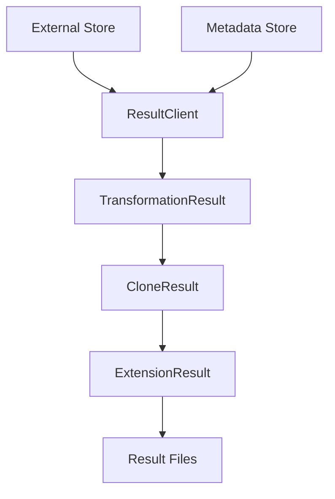
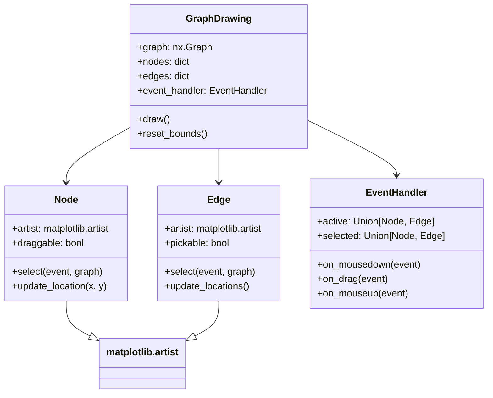
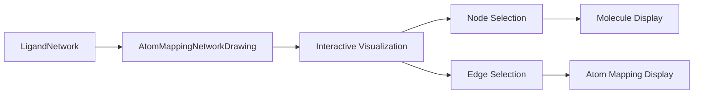
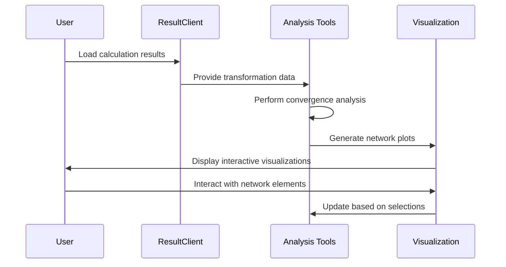

Network-based results analysis in OpenFE provides powerful tools for visualizing, analyzing, and interpreting free energy calculations performed across molecular transformation networks. This approach enables researchers to examine the interconnected nature of alchemical calculations, identify patterns, and extract meaningful insights from complex datasets.

## Core Analysis Infrastructure

### Results Storage and Access

OpenFE implements a hierarchical storage system through the `ResultClient` class [openfe/storage/resultclient.py](openfe/storage/resultclient.py#L50-L289), which manages access to calculation results with the following structure:



The storage system organizes results by:
- **Transformations**: Individual alchemical calculations between molecular states
- **Clones**: Multiple independent runs of the same transformation
- **Extensions**: Different types of output files (trajectories, energies, etc.)

### Network Visualization Framework

The network visualization system is built on a flexible matplotlib-based architecture [openfe/utils/network_plotting.py](openfe/utils/network_plotting.py#L1-L426):



## Specialized Analysis Tools

### Convergence Analysis

The `plot_convergence` function [openfe/analysis/plotting.py](openfe/analysis/plotting.py#L85-L200) provides visual analysis of calculation convergence by comparing forward and reverse free energy estimates:

```python
def plot_convergence(
    forward_and_reverse: dict[str, Union[npt.NDArray, Quantity]], 
    units: Quantity
) -> Axes:
```

This function generates convergence plots showing:
- Forward and reverse free energy estimates over increasing sample fractions
- Error bars indicating statistical uncertainty
- Final value confidence regions

### Lambda Transition Matrix Visualization

For multi-state calculations, the `plot_lambda_transition_matrix` function [openfe/analysis/plotting.py](openfe/analysis/plotting.py#L14-L83) visualizes state transition probabilities:

```python
def plot_lambda_transition_matrix(matrix: npt.NDArray) -> Axes:
```

The visualization displays:
- Heat map of transition probabilities between lambda states
- Color-coded intensity representing transition likelihood
- Numerical annotations for specific probability values

### Molecular Network Analysis

OpenFE provides specialized tools for ligand network visualization through the `AtomMappingNetworkDrawing` class [openfe/utils/atommapping_network_plotting.py](openfe/utils/atommapping_network_plotting.py#L140-L172):



Key features include:
- **Interactive node selection**: Click on ligand nodes to highlight connections
- **Edge mapping visualization**: Select edges to display detailed atom mappings between molecules
- **Dynamic layout**: Draggable nodes for custom network arrangement

## Advanced Analysis Capabilities

### Replica Exchange Analysis

The `plot_replica_timeseries` function [openfe/analysis/plotting.py](openfe/analysis/plotting.py#L202-L230) tracks replica state evolution in replica exchange simulations:

```python
def plot_replica_timeseries(
    state_timeseries: npt.NDArray,
    equilibration_iterations: Optional[int] = None,
) -> Axes:
```

This analysis reveals:
- Replica state transitions over simulation time
- Equilibration period identification
- Exchange frequency patterns

### Structural Analysis Tools

OpenFE includes structural analysis capabilities for monitoring molecular behavior:

#### 2D RMSD Analysis
The `plot_2D_rmsd` function [openfe/analysis/plotting.py](openfe/analysis/plotting.py#L232-L275) generates multi-state RMSD heat maps:

```python
def plot_2D_rmsd(data: list[list[float]], vmax:5.0) -> plt.Figure:
```

#### Ligand Behavior Monitoring
Additional tools track ligand dynamics:
- `plot_ligand_COM_drift`: Center of mass movement over time
- `plot_ligand_RMSD`: Ligand structural stability analysis

## Integration with Workflow

Network-based analysis integrates seamlessly with OpenFE's calculation workflow:



## Best Practices

### Data Organization
- Store results using the hierarchical `ResultClient` system
- Maintain consistent naming conventions for transformations and clones
- Utilize metadata storage for efficient result retrieval

### Visualization Optimization
- Use interactive network plots for exploring complex transformation networks
- Leverage convergence analysis to identify calculation issues early
- Combine multiple visualization types for comprehensive analysis

### Performance Considerations
- Cache frequently accessed results using the built-in caching mechanism
- Use selective loading for large datasets to minimize memory usage
- Consider batch processing for systematic network analyses

Network-based results analysis in OpenFE provides a comprehensive framework for understanding the interconnected nature of free energy calculations, enabling researchers to extract maximum insight from their computational experiments.

## Next Steps

For deeper understanding of the mathematical foundations behind network analysis, explore [Maximum Likelihood Estimation for Free Energy Networks](18-maximum-likelihood-estimation-for-free-energy-networks). To learn about visualizing molecular structures in 3D, see [3D Molecular Visualization and Network Plotting](19-3d-molecular-visualization-and-network-plotting).