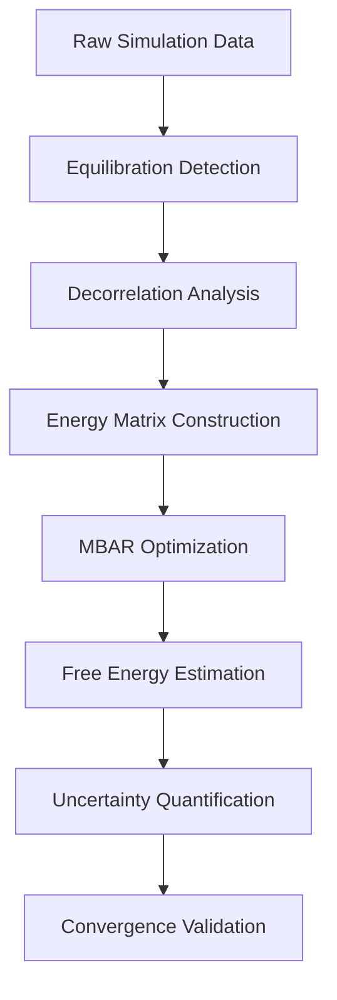

Maximum Likelihood Estimation (MLE) forms the statistical foundation for analyzing free energy calculations in OpenFE, particularly through the implementation of the Multistate Bennett Acceptance Ratio (MBAR) method. This approach provides optimal estimates of free energy differences by leveraging data from multiple thermodynamic states simultaneously.

## MBAR Implementation in OpenFE

OpenFE implements MLE through the `MultistateEquilFEAnalysis` class, which provides comprehensive analysis capabilities for multistate free energy calculations [openfe/protocols/openmm_utils/multistate_analysis.py](openfe/protocols/openmm_utils/multistate_analysis.py#L62-L495). The class integrates with OpenMMTools' multistate sampling infrastructure and utilizes the pyMBAR library for statistical analysis.

### Core Statistical Framework

The implementation follows the MBAR methodology as described in the foundational papers by Shirts and Chodera [openfe/protocols/openmm_utils/multistate_analysis.py](openfe/protocols/openmm_utils/multistate_analysis.py#L30-L35). The key components include:

- **Energy Matrix Analysis**: The method processes reduced energy matrices `u_ln` where rows represent thermodynamic states and columns contain energy samples [openfe/protocols/openmm_utils/multistate_analysis.py](openfe/protocols/openmm_utils/multistate_analysis.py#L199-L205)
- **Sample Counting**: Proper handling of sample counts `N_l` for each state ensures unbiased estimates
- **Bootstrap Uncertainty**: Implementation supports both analytical and bootstrap-based uncertainty quantification

```python
def _get_free_energy(
    analyzer: multistate.MultiStateSamplerAnalyzer,
    u_ln: npt.NDArray,
    N_l: npt.NDArray,
    bootstraps: int = 1000,
    return_units: Quantity = unit.kilocalorie_per_mole,
) -> tuple[Quantity, Quantity]:
```

### Data Processing Pipeline

The MLE analysis follows a systematic approach to ensure reliable results:



## Advanced Analysis Features

### Forward-Reverse Convergence Analysis

OpenFE implements sophisticated convergence diagnostics through forward-reverse analysis [openfe/protocols/openmm_utils/multistate_analysis.py](openfe/protocols/openmm_utils/multistate_analysis.py#L284-L352). This method progressively analyzes subsets of the data from both temporal directions to assess convergence stability:

- **Fractional Sampling**: Data is analyzed in increasing fractions (10% to 100%)
- **Bidirectional Validation**: Forward and reverse analyses provide convergence confidence
- **Error Propagation**: Analytical uncertainties are computed for each subset

### Overlap Matrix Analysis

The overlap matrix provides critical insights into state sampling efficiency [openfe/protocols/openmm_utils/multistate_analysis.py](openfe/protocols/openmm_utils/multistate_analysis.py#L373-L388):

- **Matrix Computation**: `mbar.compute_overlap()` generates the probability overlap between states
- **Eigenvalue Analysis**: Largest nontrivial eigenvalue indicates overall mixing quality
- **Visual Diagnostics**: Overlap matrices can be visualized to identify problematic state transitions

> [!TIP]
> The overlap matrix scalar value (one minus the largest nontrivial eigenvalue) serves as a key diagnostic - values closer to 1.0 indicate better state overlap and more reliable free energy estimates.

## Statistical Quality Assurance

### Equilibration Detection

Automatic equilibration detection follows the statistical methods described by Shirts and Chodera [openfe/protocols/openmm_utils/multistate_analysis.py](openfe/protocols/openmm_utils/multistate_analysis.py#L46-L50). The implementation:

- Identifies and discards equilibration periods
- Ensures only production data contributes to final estimates
- Provides transparent reporting of discarded iterations

### Decorrelation and Uncorrelated Sampling

The analysis pipeline includes sophisticated decorrelation methods:

- **Timeseries Analysis**: Statistical methods identify correlation lengths
- **Thinning**: Data is thinned to ensure statistical independence
- **Sample Validation**: Equal sample counts across states are verified

> [!TIP]
> Bootstrap analysis with 1000 iterations provides robust uncertainty estimates, though analytical errors are used for forward-reverse analysis due to convergence issues with limited data points.

## Integration with Network Analysis

### Multi-Protocol Support

The MLE framework supports various sampling methods:

| Sampling Method | Description | MLE Compatibility |
|-----------------|-------------|-------------------|
| `repex` | Replica Exchange | Full support with exchange matrix analysis |
| `sams` | Self-Adjusted Mixture Sampling | Basic MLE support |
| `independent` | Independent Simulations | Standard MLE application |

### Visualization and Diagnostics

OpenFE provides comprehensive visualization tools for MLE results [openfe/analysis/plotting.py](openfe/analysis/plotting.py#L12-L143):

- **Transition Matrices**: Visual representation of state transition probabilities
- **Convergence Plots**: Forward-reverse analysis visualization
- **Overlap Heatmaps**: Matrix visualization of state overlaps

```python
def plot_lambda_transition_matrix(matrix: npt.NDArray) -> Axes:
    """Plot out a transition matrix with validation warnings"""
```

## Best Practices for MLE Analysis

### Data Quality Requirements

For reliable MLE results, ensure:

- **Sufficient Sampling**: Each state should have adequate decorrelated samples
- **State Overlap**: Adjacent states should have reasonable overlap (evidenced by overlap matrix)
- **Convergence**: Forward-reverse analysis should show consistent estimates

### Error Interpretation

Understanding uncertainty estimates is crucial:

- **Bootstrap Errors**: Provide robust uncertainty quantification with 1000 bootstrap samples
- **Analytical Errors**: Used when bootstrap computation is impractical
- **Convergence Indicators**: Consistency between forward and reverse analyses validates results

## Integration with OpenFE Workflow

The MLE analysis integrates seamlessly with OpenFE's protocol system:

1. **Protocol Execution**: Standard OpenFE protocols generate multistate data
2. **Result Collection**: Data is stored using OpenFE's storage system
3. **Analysis Application**: `MultistateEquilFEAnalysis` processes collected results
4. **Reporting**: Comprehensive analysis results are generated with visualizations

This integration ensures that MLE analysis is accessible within the standard OpenFE workflow while maintaining methodological rigor and statistical validity.

For practical implementation details and examples, refer to the [Network-Based Results Analysis](17-network-based-results-analysis) page, which demonstrates how to apply these methods in real-world scenarios.