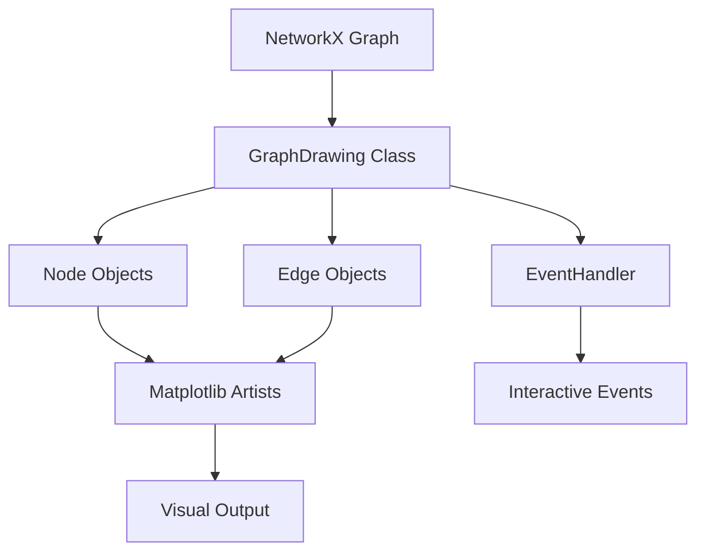

OpenFE provides comprehensive visualization capabilities for both 3D molecular structures and network-based free energy calculations. These tools enable researchers to inspect molecular transformations, analyze network topology, and gain insights into calculation workflows through interactive visual representations.

## 3D Molecular Visualization

The 3D visualization functionality in OpenFE leverages the `py3Dmol` library to create interactive molecular displays that help researchers understand molecular alignments and transformations.

### Core Visualization Functions

OpenFE provides two main 3D visualization functions, though both are deprecated in favor of class methods:

1. **`view_components_3d()`** - Visualizes multiple molecular components in a single interactive view [openfe/utils/visualization_3D.py](openfe/utils/visualization_3D.py#L111-L158)
2. **`view_mapping_3d()`** - Renders relative transformation edges with atom mapping annotations [openfe/utils/visualization_3D.py](openfe/utils/visualization_3D.py#L159-L210)

> [!TIP]
> Both functions are deprecated. Use `LigandAtomMapping.view_3d()` class method instead for current implementations.

### Visualization Features

The 3D visualization system supports:

- **Interactive molecular displays** using py3Dmol with customizable styles (stick, sphere, line, cartoon)
- **Automatic molecular positioning** with intelligent shift calculations to prevent overlap [openfe/utils/visualization_3D.py](openfe/utils/visualization_3D.py#L22-L31)
- **Atom mapping annotations** with colored spheres highlighting corresponding atoms between molecules [openfe/utils/visualization_3D.py](openfe/utils/visualization_3D.py#L72-L110)
- **Flexible view management** allowing existing views to be passed and extended

### Installation Requirements

3D visualization requires the optional py3Dmol dependency:
```bash
pip install py3Dmol
```

## Network Plotting Architecture

OpenFE's network plotting system provides a sophisticated framework for visualizing molecular transformation networks with interactive capabilities. The architecture is built on matplotlib and NetworkX, offering extensible components for custom visualization needs.

### Core Architecture Components

The network plotting system consists of three main architectural layers:



#### GraphDrawing Framework

The `GraphDrawing` class serves as the central orchestrator [openfe/utils/network_plotting.py](openfe/utils/network_plotting.py#L326-L426):

- **Node Management**: Creates and manages node positions using graphviz layout algorithms
- **Edge Registration**: Handles edge creation and visual representation
- **Event Handling**: Integrates interactive mouse events for node dragging and edge selection
- **Canvas Management**: Controls matplotlib figure creation and rendering

#### Interactive Node System

Nodes in the network are represented by the `Node` class [openfe/utils/network_plotting.py](openfe/utils/network_plotting.py#L25-L137), providing:

- **Draggable functionality** with real-time position updates
- **Visual state management** for selection and highlighting
- **Event handling** for mouse interactions (mousedown, drag, mouseup)
- **Extensible artist system** allowing custom visual representations

#### Edge Visualization

The `Edge` class manages molecular transformation visualizations [openfe/utils/network_plotting.py](openfe/utils/network_plotting.py#L138-L217):

- **Dynamic line drawing** connecting network nodes
- **Interactive selection** with visual feedback
- **Data association** linking edges to molecular transformations
- **Position synchronization** maintaining connections during node movement

### Atom Mapping Network Specialization

OpenFE provides specialized classes for ligand network visualization that extend the base framework:

#### AtomMappingEdge Class

The `AtomMappingEdge` class enhances edge visualization with molecular structure rendering [openfe/utils/atommapping_network_plotting.py](openfe/utils/atommapping_network_plotting.py#L16-L121):

- **Molecular image generation** using RDKit drawing capabilities
- **Automatic layout calculation** for left/right molecule positioning
- **Interactive mapping display** showing atom correspondences on edge selection
- **Transparent background rendering** for clean visualization integration

> [!TIP]
> The edge selection automatically displays detailed atom mappings with highlighted correspondences between ligand pairs.

#### LigandNode Class

Specialized node representation for ligands in the network [openfe/utils/atommapping_network_plotting.py](openfe/utils/atommapping_network_plotting.py#L122-L141):

- **Compact visual design** optimized for network density
- **Efficient extent calculation** for proper spacing
- **Integration with edge visualization** for seamless interaction

### Usage Patterns

#### Basic Network Visualization

The simplest way to visualize a ligand network:

```python
from openfe.utils import plot_atommapping_network

# Create network visualization
figure = plot_atommapping_network(ligand_network)
```

This convenience function creates an `AtomMappingNetworkDrawing` instance [openfe/utils/atommapping_network_plotting.py](openfe/utils/atommapping_network_plotting.py#L158-L172) with default styling and interaction capabilities.

#### Advanced Customization

For specialized visualization needs, the framework supports:

- **Custom node classes** extending the base `Node` functionality
- **Specialized edge rendering** for different data types
- **Custom event handlers** for domain-specific interactions
- **Layout algorithm selection** through NetworkX integration

### Analysis Plotting Integration

Beyond network visualization, OpenFE provides analysis plotting functions for free energy calculation results:

#### Lambda Transition Matrices

Visualize state transition probabilities in thermodynamic calculations [openfe/analysis/plotting.py](openfe/analysis/plotting.py#L12-L140):

- **Heat map representation** of transition probabilities
- **Automatic validation** checking matrix consistency
- **Color-coded intensity** showing transition likelihoods
- **Grid layout** with clear state boundaries

#### Convergence and Time Series

Monitor calculation progress and stability:

- **Convergence plots** showing forward/reverse integration [openfe/analysis/plotting.py](openfe/analysis/plotting.py#L140-L238)
- **Replica time series** for replica exchange simulations [openfe/analysis/plotting.py](openfe/analysis/plotting.py#L238-L278)
- **RMSD analysis** for structural stability assessment [openfe/analysis/plotting.py](openfe/analysis/plotting.py#L278-L350)

## Integration with Workflow

The visualization tools integrate seamlessly with the broader OpenFE ecosystem:

### Protocol Integration

Visualization functions work with results from all protocol types:
- **RBFE calculations** for ligand binding studies
- **ABFE calculations** for absolute binding free energies
- **Molecular dynamics** simulations for structural analysis

### Storage and Metadata

Visualizations can be combined with storage systems for:
- **Result archiving** with visual documentation
- **Metadata association** linking plots to calculation parameters
- **Reproducible reporting** for publication-quality figures

## Best Practices

### Performance Considerations

- **Large networks**: Consider layout simplification for networks with >50 nodes
- **Molecular complexity**: Use simplified rendering for complex molecules in dense networks
- **Interactive performance**: Disable automatic redrawing during extensive manipulations

### Visual Design Guidelines

- **Color consistency**: Maintain consistent color schemes across related visualizations
- **Label clarity**: Ensure node labels remain readable at different zoom levels
- **Edge density**: Manage edge visual weight in highly connected networks

### Export and Sharing

- **Publication quality**: Use vector formats (SVG, PDF) for high-resolution outputs
- **Interactive notebooks**: Leverage Jupyter integration for exploratory analysis
- **Web deployment**: Export HTML formats for interactive web sharing

The visualization capabilities in OpenFE provide researchers with powerful tools for understanding molecular transformations, analyzing calculation networks, and communicating results effectively. The extensible architecture allows for customization while maintaining ease of use for common visualization tasks.

For more detailed analysis of calculation results, see [Network-Based Results Analysis](17-network-based-results-analysis) and [Working with Individual Calculation Results](16-working-with-individual-calculation-results).