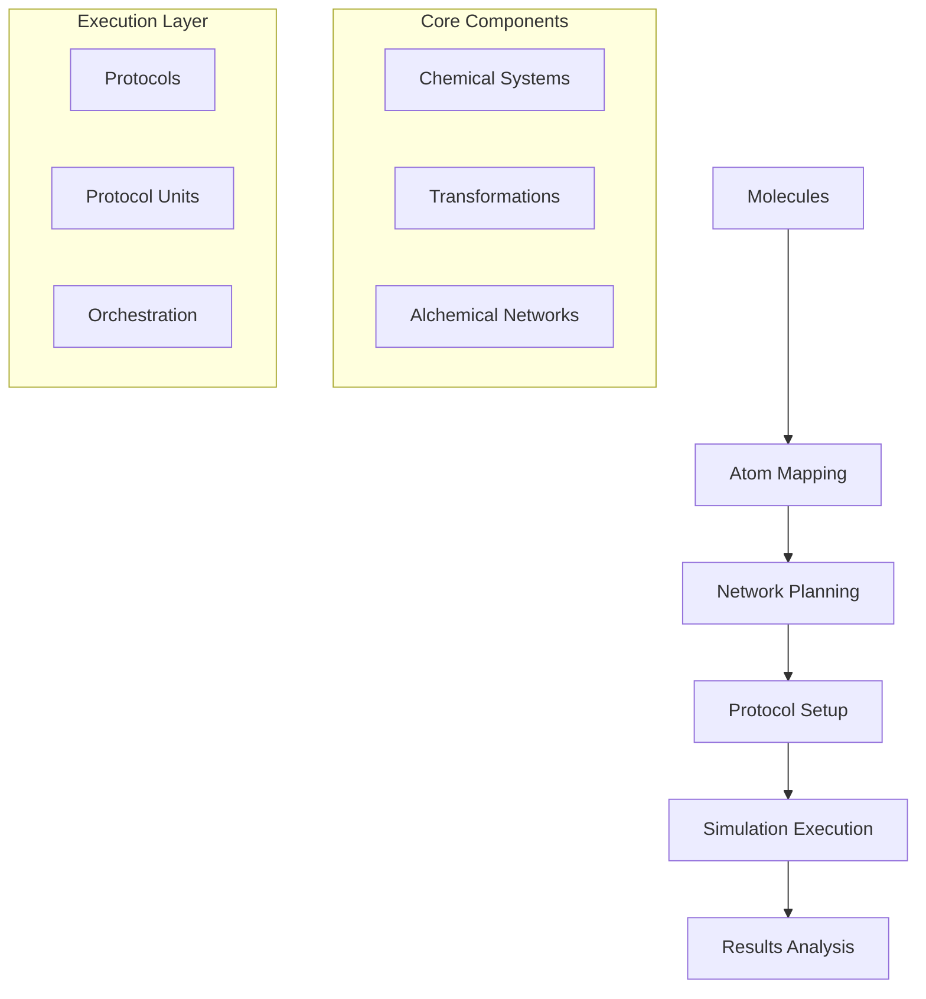

Welcome to OpenFE! This quick start guide will get you up and running with alchemical free energy calculations in minutes. OpenFE is a powerful, open-source toolkit for planning, executing, and analyzing molecular free energy calculations for drug discovery and computational chemistry.

## What You'll Accomplish

In this quick start, you will:
- Install OpenFE using the recommended method
- Verify your installation works correctly  
- Plan your first relative binding free energy (RBFE) network
- Execute a basic free energy calculation
- Understand the core OpenFE workflow

## System Requirements

Before we begin, ensure you have:
- **POSIX system** (macOS or Linux/Unix) - OpenFE is not currently compatible with Windows
- **Python 3.10+** (Python 3.11+ recommended for full functionality)
- **GPU support** (optional but recommended for performance)

## Installation

### The Recommended Way: Miniforge

We strongly recommend installing OpenFE with **Miniforge**, which provides easy installation of required dependencies like OpenMM and AmberTools.

```bash
# Install Miniforge (select your OS and architecture)
curl -OL https://github.com/conda-forge/miniforge/releases/latest/download/Miniforge3-Linux-x86_64.sh
sh Miniforge3-Linux-x86_64.sh -b
~/miniforge3/bin/mamba init bash
```

After installation, restart your shell and create the OpenFE environment:

```bash
# Create and activate the OpenFE environment
mamba create -n openfe_env openfe
mamba activate openfe_env
```

### Verify Your Installation

Test that everything is working correctly:

```bash
# Quick test (takes a few seconds)
openfe test

# Comprehensive test (takes up to an hour, tests GPU features)
openfe test --long
```

> [!TIP]
> The first `openfe test` run may take longer due to code compilation, but this only happens once per installation.

## Core Architecture Overview

OpenFE follows a modular, network-based approach to free energy calculations:



The toolkit is built around these key concepts from the `gufe` library [openfe/__init__.py](openfe/__init__.py#L18-L30):
- **Chemical Systems**: Molecular representations (proteins, ligands, solvent)
- **Transformations**: Alchemical pathways between molecular states
- **Alchemical Networks**: Collections of interconnected transformations
- **Protocols**: Simulation execution methods (RBFE, ABFE, MD, etc.)

## Your First Calculation: CLI Workflow

Let's walk through a complete RBFE calculation using the command line interface.

### Step 1: Plan the Network

Create a relative binding free energy network for a set of ligands:

```bash
openfe plan-rbfe-network \
  --mol-dir path/to/ligands/ \
  --protein path/to/protein.pdb \
  --output-dir my_rbfe_network \
  --mapper lomap \
  --network-planner minimal-spanning-tree
```

This command:
- Reads ligands from the specified directory
- Maps atom correspondences using Lomap
- Plans an efficient network using minimal spanning tree algorithm
- Outputs the network configuration files

### Step 2: Execute the Calculation

Run the planned network using the quickrun executor:

```bash
openfe quickrun my_rbfe_network/transformation.json \
  --work-dir my_rbfe_results \
  --output results.json
```

The quickrun command [openfecli/commands/quickrun.py](openfecli/commands/quickrun.py#L25-L42) executes the transformation defined in the JSON file, creating directories for each simulation task and storing the results.

### Step 3: Analyze Results

While detailed analysis is covered in later tutorials, you can quickly check your results:

```python
import json

# Load and examine results
with open('results.json', 'r') as f:
    results = json.load(f)
    
print(f"Free energy change: {results['free_energy']:.2f} kcal/mol")
```

## Your First Calculation: Python API Workflow

For more flexibility and customization, use the Python API:

```python
from openfe import SmallMoleculeComponent, ProteinComponent, SolventComponent
from openfe import LigandAtomMapper, LigandNetwork
from openfe.setup import lomap_scorers, ligand_network_planning
from openfe.protocols import OpenMM_RBFEProtocol

# Load molecular components
ligands = [SmallMoleculeComponent.from_file(f'ligand{i}.mol2') for i in range(5)]
protein = ProteinComponent.from_file('protein.pdb')
solvent = SolventComponent.from_file('solvent.xml')

# Create atom mapper and plan network
mapper = LigandAtomMapper()
scorer = lomap_scorers.default
network = ligand_network_planning.minimal_spanning_tree(ligands, mapper, scorer)

# Set up and execute protocol
protocol = OpenMM_RBFEProtocol(
    settings={'forcefield': 'openff-2.0.0', 'temperature': 300.0}
)

# Execute the first transformation
transformation = list(network.edges)[0]
results = protocol.execute(transformation)
print(f"ΔG = {results.get_free_energy():.2f} kcal/mol")
```

## Key Features at a Glance

| Feature | CLI | Python API | Use Case |
|---------|-----|------------|----------|
| **Network Planning** | ✅ | ✅ | Quick setup vs. custom control |
| **Protocol Selection** | ✅ | ✅ | Standard vs. custom protocols |
| **Batch Execution** | ✅ | ✅ | Simple scripts vs. orchestration |
| **Visualization** | Limited | ✅ | Basic vs. advanced plotting |
| **Customization** | Limited | ✅ | Standard workflows vs. research |

> [!TIP]
> Start with the CLI for quick calculations, then transition to the Python API for complex workflows and custom protocols.

## Installation Directory Structure

When you install OpenFE, you get both the core library and command line tools:

```
openfe/                    # Core Python library
├── protocols/             # Simulation protocols
├── setup/                # System setup tools
├── analysis/             # Results analysis
└── utils/                # Utility functions

openfecli/                 # Command line interface
├── commands/             # CLI commands
│   ├── plan_rbfe_network.py
│   ├── quickrun.py
│   └── ...
└── parameters/           # CLI parameter handling
```

## Next Steps

Now that you have OpenFE running, we recommend exploring these resources:

1. **[Installation and Environment Setup](3-installation-and-environment-setup)** - Detailed installation options and troubleshooting
2. **[Running Your First Free Energy Calculation](4-running-your-first-free-energy-calculation)** - Complete tutorial with real data
3. **[CLI Overview and Common Commands](5-cli-overview-and-common-commands)** - Master the command line interface
4. **[Python API Showcase](https://github.com/OpenFreeEnergy/ExampleNotebooks)** - Interactive Jupyter notebooks

## Common Quick Start Issues

| Issue | Solution |
|-------|----------|
| **Import errors** | Ensure you've activated the conda environment: `mamba activate openfe_env` |
| **GPU not detected** | Install CUDA toolkit and check OpenMM GPU support: `python -c "from openmm import platform; print(platform.Platform.getPlatformByName('CUDA').getName())"` |
| **Memory issues** | Reduce system size or use fewer parallel processes in your protocol settings |
| **Slow calculations** | Enable GPU acceleration and use appropriate sampling settings |

## Resources and Support

- **Documentation**: [https://docs.openfree.energy](https://docs.openfree.energy)
- **Example Notebooks**: [GitHub Repository](https://github.com/OpenFreeEnergy/ExampleNotebooks)
- **Issues & Support**: [GitHub Issues](https://github.com/OpenFreeEnergy/openfe/issues)
- **Community**: [Open Free Energy Website](https://openfree.energy)

You're now ready to explore the powerful world of alchemical free energy calculations with OpenFE! The toolkit provides both simplicity for beginners and flexibility for experts, making it an ideal choice for computational chemistry research and drug discovery applications.