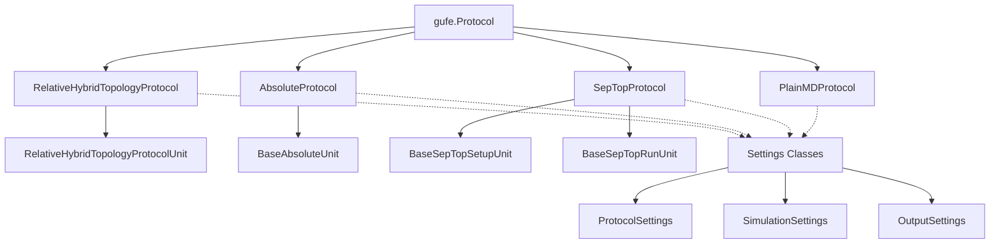

This guide provides comprehensive information for developing custom protocols in OpenFE, enabling you to extend the framework's capabilities for specialized free energy calculations.

## Protocol Architecture Overview

OpenFE follows a modular protocol architecture built on the `gufe.Protocol` base class, with specialized implementations for different types of free energy calculations. The framework separates protocol definitions, settings management, and execution units to maximize code reusability and maintainability.



## Core Protocol Components

### Protocol Classes

Protocol classes serve as the main entry points for defining free energy calculations. They inherit from `gufe.Protocol` and implement the following key methods:

- **`_create()`**: Generates protocol units for execution
- **`_gather()`**: Collects and processes results from protocol units
- **`_default_settings()`**: Provides default configuration
- **`_adaptive_settings()`**: Creates settings adapted to specific systems

The `RelativeHybridTopologyProtocol` in [openmm_rfe/equil_rfe_methods.py](openfe/protocols/openmm_rfe/equil_rfe_methods.py#L496-L682) exemplifies this structure, implementing relative binding free energy calculations using hybrid topologies.

### Protocol Units

Protocol units (`gufe.ProtocolUnit`) represent individual computational tasks that can be executed independently. OpenFE provides several base classes:

- **`BaseAbsoluteUnit`**: For absolute free energy calculations [openmm_afe/base.py](openfe/protocols/openmm_afe/base.py#L86-L1250)
- **`RelativeHybridTopologyProtocolUnit`**: For relative transformations with hybrid topologies [openmm_rfe/equil_rfe_methods.py](openfe/protocols/openmm_rfe/equil_rfe_methods.py#L683-L1318)
- **`BaseSepTopSetupUnit`** and **`BaseSepTopRunUnit`**: For separate topology calculations [openmm_septop/base.py](openfe/protocols/openmm_septop/base.py#L233-L706)

### Settings Management

Settings classes inherit from `SettingsBaseModel` and provide structured configuration management:

| Settings Class | Purpose | Key Features |
|---------------|---------|--------------|
| `MultiStateSimulationSettings` | Multi-state simulation control | Sampling methods, replica configuration |
| `OpenMMEngineSettings` | OpenMM-specific engine configuration | Platform selection, GPU indexing |
| `IntegratorSettings` | MD integrator parameters | Timestep, collision rate, constraints |
| `OutputSettings` | Output and reporting configuration | Checkpointing, trajectory writing |

The comprehensive settings hierarchy is defined in [openmm_utils/omm_settings.py](openfe/protocols/openmm_utils/omm_settings.py#L42-L705).

## Creating Custom Protocols

### Step 1: Define Protocol Settings

Create a settings class that inherits from the appropriate base settings:

```python
from openfe.protocols.openmm_utils import MultiStateSimulationSettings, SettingsBaseModel

class CustomProtocolSettings(Settings):
    """Settings for custom free energy protocol"""
    
    # Core simulation settings
    simulation_settings: MultiStateSimulationSettings
    engine_settings: OpenMMEngineSettings
    output_settings: MultiStateOutputSettings
    
    # Protocol-specific parameters
    custom_parameter: float = 1.0
    enable_custom_feature: bool = True
    
    @field_validator("custom_parameter")
    def validate_custom_parameter(cls, v):
        if v <= 0:
            raise ValueError("custom_parameter must be positive")
        return v
```

### Step 2: Implement Protocol Unit

Create a protocol unit that performs the actual calculation:

```python
class CustomProtocolUnit(gufe.ProtocolUnit):
    """Protocol unit for custom free energy calculation"""
    
    def __init__(self, *, protocol, stateA, stateB, generation=0, repeat_id=0, name=None):
        super().__init__(
            protocol=protocol,
            stateA=stateA,
            stateB=stateB,
            generation=generation,
            repeat_id=repeat_id,
            name=name
        )
    
    def _execute(self, ctx, **kwargs):
        """Execute the custom calculation"""
        # Implement your custom algorithm here
        # Access settings via self.protocol._settings
        
        results = {
            'free_energy': self._calculate_free_energy(),
            'uncertainty': self._estimate_uncertainty(),
            'metadata': self._generate_metadata()
        }
        
        return results
    
    def _calculate_free_energy(self):
        """Implement your free energy calculation method"""
        pass
    
    def _estimate_uncertainty(self):
        """Implement uncertainty estimation"""
        pass
```

### Step 3: Create Protocol Class

Implement the main protocol class that coordinates the units:

```python
class CustomProtocol(gufe.Protocol):
    """Custom free energy protocol"""
    
    result_cls = CustomProtocolResult
    _settings_cls = CustomProtocolSettings
    
    @classmethod
    def _default_settings(cls):
        """Provide default settings"""
        return CustomProtocolSettings(
            simulation_settings=MultiStateSimulationSettings(),
            engine_settings=OpenMMEngineSettings(),
            output_settings=MultiStateOutputSettings()
        )
    
    def _create(self, stateA, stateB, mapping=None, extends=None):
        """Create protocol units for execution"""
        units = []
        
        for repeat_id in range(self._settings.protocol_repeats):
            unit = CustomProtocolUnit(
                protocol=self,
                stateA=stateA,
                stateB=stateB,
                repeat_id=repeat_id,
                name=f"{self.name}_repeat_{repeat_id}"
            )
            units.append(unit)
        
        return units
    
    def _gather(self, protocol_dag_results):
        """Gather and process results from all units"""
        results = []
        
        for dag_result in protocol_dag_results:
            for unit_result in dag_result:
                results.append(unit_result)
        
        return self.result_cls(results=results)
```

## Lambda Protocol System

For alchemical transformations, OpenFE provides a sophisticated lambda protocol system defined in [openmm_rfe/_rfe_utils/lambdaprotocol.py](openfe/protocols/openmm_rfe/_rfe_utils/lambdaprotocol.py#L14-L340):

```python
from openfe.protocols.openmm_rfe._rfe_utils.lambdaprotocol import LambdaProtocol

# Create custom lambda schedule
lambda_protocol = LambdaProtocol(
    functions='custom',  # or 'default'
    windows=20,
    lambda_schedule=[0.0, 0.1, 0.2, ..., 1.0]
)

# Access lambda parameters
state = RelativeAlchemicalState()
state.set_alchemical_parameters(0.5, lambda_protocol)
```

The lambda protocol supports multiple switching functions and provides validation for alchemical transformations.

## Validation and Testing

OpenFE includes comprehensive validation utilities in [openmm_utils/settings_validation.py](openfe/protocols/openmm_utils/settings_validation.py#L17-L313):

```python
from openfe.protocols.openmm_utils.settings_validation import (
    validate_openmm_solvation_settings,
    validate_timestep,
    get_simsteps,
    divmod_time_and_check
)

# Validate settings
validate_openmm_solvation_settings(your_settings)
validate_timestep(hmass=4.0, timestep=2.0 * unit.femtosecond)

# Calculate simulation parameters
n_steps = get_simsteps(
    sim_length=5.0 * unit.nanosecond,
    timestep=2.0 * unit.femtosecond,
    mc_steps=1000
)
```

## Integration with OpenMM Ecosystem

Custom protocols can leverage the full OpenMM ecosystem through OpenFE's utilities:

- **System Generation**: Use `SystemGenerator` for consistent force field application
- **Multi-state Sampling**: Access `MultiStateSampler` for replica exchange and SAMS
- **Analysis Tools**: Integrate with MBAR and other analysis methods
- **Restraint Systems**: Implement custom restraints using the geometry framework

> [!TIP]
> When developing custom protocols, always inherit from the appropriate base classes rather than implementing everything from scratch. This ensures compatibility with OpenFE's orchestration and storage systems while providing access to validated utilities and settings management.

## Best Practices

1. **Settings Validation**: Always implement proper field validators for custom settings
2. **Error Handling**: Include comprehensive error handling and informative error messages
3. **Documentation**: Provide detailed docstrings for all public methods and classes
4. **Testing**: Create unit tests following the patterns in [openfe/tests/protocols/](openfe/tests/protocols/)
5. **Reproducibility**: Ensure deterministic behavior through proper random seed handling

> [!TIP]
> Consider implementing adaptive settings that can automatically adjust parameters based on system properties, similar to the `_adaptive_settings` method in existing protocols. This can significantly improve robustness for diverse molecular systems.

For further guidance on specific implementation details, examine the existing protocols in the [openfe/protocols/](openfe/protocols/) directory and their corresponding tests. The [Protocol System and Execution Framework](8-protocol-system-and-execution-framework) page provides additional architectural context for understanding how custom protocols integrate with the broader OpenFE ecosystem.