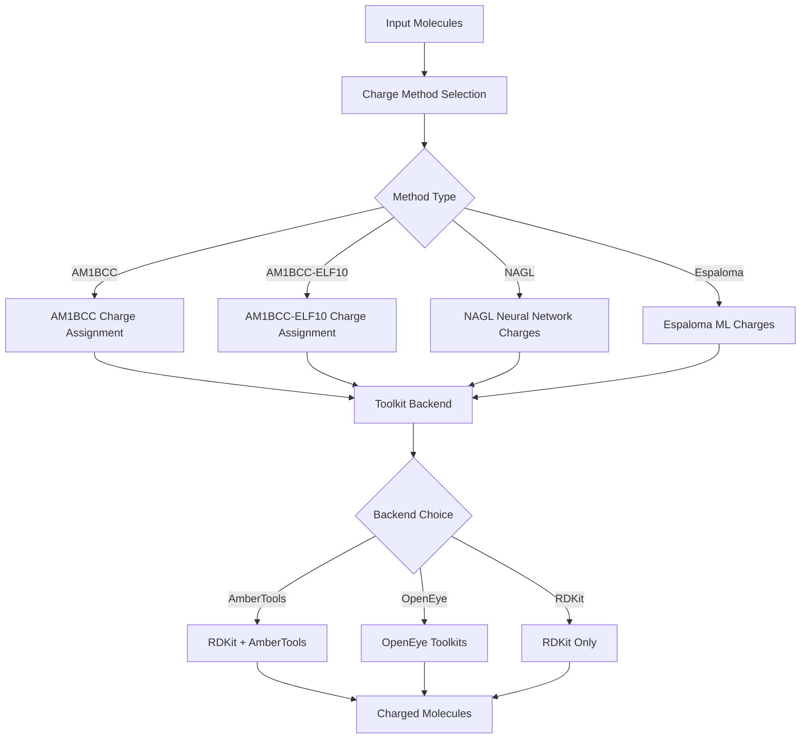

OpenFE provides a comprehensive system for generating partial charges on molecules, essential for accurate free energy calculations. The framework supports multiple charge generation methods and toolkit backends, allowing flexibility based on available software and computational requirements.

## Overview of Charge Generation Architecture

The partial charge generation system is built around a modular architecture that separates charge methods from toolkit backends, enabling users to choose the optimal combination for their specific needs. The system supports both single-molecule and bulk processing with parallelization capabilities.



## Supported Charge Methods

OpenFE supports four distinct partial charge generation methods, each with different computational characteristics and accuracy profiles:

| Method | Description | Supported Backends | Max Conformers | Use Case |
|--------|-------------|-------------------|----------------|----------|
| **am1bcc** | Standard AM1-BCC charges with ELF population analysis | AmberTools, OpenEye | 1 | Traditional, well-tested method |
| **am1bccelf10** | AM1-BCC with ELF10 population analysis (10 conformers) | OpenEye only | Unlimited | Higher accuracy for flexible molecules |
| **nagl** | Neural network assisted graph learning charges | All backends | 1 | Fast, ML-based approach |
| **espaloma** | Espaloma machine learning charges | RDKit, AmberTools | 1 | Alternative ML method |

> [!TIP]
> The **am1bccelf10** method requires OpenEye toolkits and can handle multiple conformers, making it particularly suitable for flexible molecules where conformational averaging improves charge accuracy. However, it's computationally more expensive than standard am1bcc.

## Toolkit Backend Options

The charge generation system supports three primary toolkit backends, each with different capabilities and dependencies:

### AmberTools Backend
- **Components**: RDKitToolkitWrapper + AmberToolsToolkitWrapper
- **Methods Supported**: am1bcc, nagl, espaloma
- **Advantages**: Open-source, widely available
- **Limitations**: Cannot use am1bccelf10

### OpenEye Backend
- **Components**: OpenEyeToolkitWrapper only
- **Methods Supported**: am1bcc, am1bccelf10, nagl
- **Advantages**: Commercial-grade performance, supports all methods
- **Limitations**: Requires OpenEye license

### RDKit Backend
- **Components**: RDKitToolkitWrapper only
- **Methods Supported**: nagl, espaloma
- **Advantages**: Lightweight, fast for ML methods
- **Limitations**: Cannot perform quantum mechanical charge calculations

## Command Line Interface

The primary interface for charge generation is through the `charge-molecules` command:

```bash
openfe charge-molecules -M input_directory -o charged_molecules.sdf --yaml-settings config.yaml
```

### YAML Configuration Structure

The charge generation process is controlled through a YAML configuration file with the following structure:

```yaml
partial_charge:
  method: am1bcc  # or am1bccelf10, nagl, espaloma
  settings:
    off_toolkit_backend: ambertools  # or openeye, rdkit
    number_of_conformers: 1  # for am1bccelf10 only
    nagl_model: null  # auto-select latest production model
```

> [!TIP]
> When using the **nagl** method without specifying a model, the system automatically selects the latest production AM1BCC model. For reproducible results, explicitly specify the model version in your configuration.

## Implementation Details

### Core Charge Assignment Function

The main charge assignment logic is implemented in `assign_offmol_partial_charges()` [openfe/protocols/openmm_utils/charge_generation.py#L285-L292], which orchestrates the method-specific charge assignment functions:

- **AM1BCC Methods**: `assign_offmol_am1bcc_charges()` [openfe/protocols/openmm_utils/charge_generation.py#L163-L167]
- **NAGL Method**: `assign_offmol_nagl_charges()` [openfe/protocols/openmm_utils/charge_generation.py#L111-L115]
- **Espaloma Method**: `assign_offmol_espaloma_charges()` [openfe/protocols/openmm_utils/charge_generation.py#L73-L74]

### Bulk Processing with Parallelization

For large molecule sets, the system provides `bulk_assign_partial_charges()` [openfe/protocols/openmm_utils/charge_generation.py#L434-L442] which supports multiprocessed charge generation:

```python
charged_molecules = bulk_assign_partial_charges(
    molecules=small_molecules,
    overwrite=True,
    method="am1bcc",
    toolkit_backend="ambertools",
    generate_n_conformers=1,
    nagl_model=None,
    processors=4  # Parallel processing
)
```

### Conformer Generation

The system includes intelligent conformer generation through `_generate_offmol_conformers()` [openfe/protocols/openmm_utils/charge_generation.py#L206-L211], which is essential for QM-based charge methods that require 3D molecular structures.

## Method-Specific Considerations

### AM1BCC vs AM1BCC-ELF10

The key difference lies in population analysis and conformer handling:
- **AM1BCC**: Uses standard ELF population analysis with single conformer
- **AM1BCC-ELF10**: Uses ELF10 analysis with multiple conformers (default 10), providing better conformational averaging

### NAGL Neural Network Charges

NAGL (Neural Network Assisted Graph Learning) represents a modern approach to charge generation:
- **Speed**: Significantly faster than QM methods
- **Accuracy**: Comparable to AM1BCC for many drug-like molecules
- **Flexibility**: Works with any toolkit backend
- **Model Management**: Automatic selection of latest production models

### Espaloma Integration

Espaloma provides an alternative machine learning approach:
- **Integration**: Uses `espaloma_charge` package
- **Warning**: Currently marked as experimental with runtime warnings [openfe/protocols/openmm_utils/charge_generation.py#L85]
- **Compatibility**: Limited to RDKit and AmberTools backends

## Error Handling and Validation

The system includes comprehensive error handling for common scenarios:

1. **Missing Dependencies**: Clear error messages when required packages are unavailable
2. **Backend Compatibility**: Validation that selected methods work with chosen backends
3. **Conformer Requirements**: Automatic conformer generation when needed
4. **File I/O**: Robust handling of input/output file operations

## Integration with OpenFE Workflows

Partial charge generation integrates seamlessly with other OpenFE components:

- **Ligand Networks**: Charged molecules are automatically used in network planning
- **Protocol Setup**: Charges are preserved throughout protocol execution
- **Result Storage**: Charged molecules are stored with complete metadata

The charge generation system is designed to be a foundational step in any free energy calculation workflow, ensuring that subsequent simulations start with properly parameterized molecular systems.

## Next Steps

For practical implementation guidance, see the [CLI Overview and Common Commands](5-cli-overview-and-common-commands) for command-line usage patterns, or refer to [Custom Protocol Development](20-custom-protocol-development) for integrating charge generation into custom workflows.