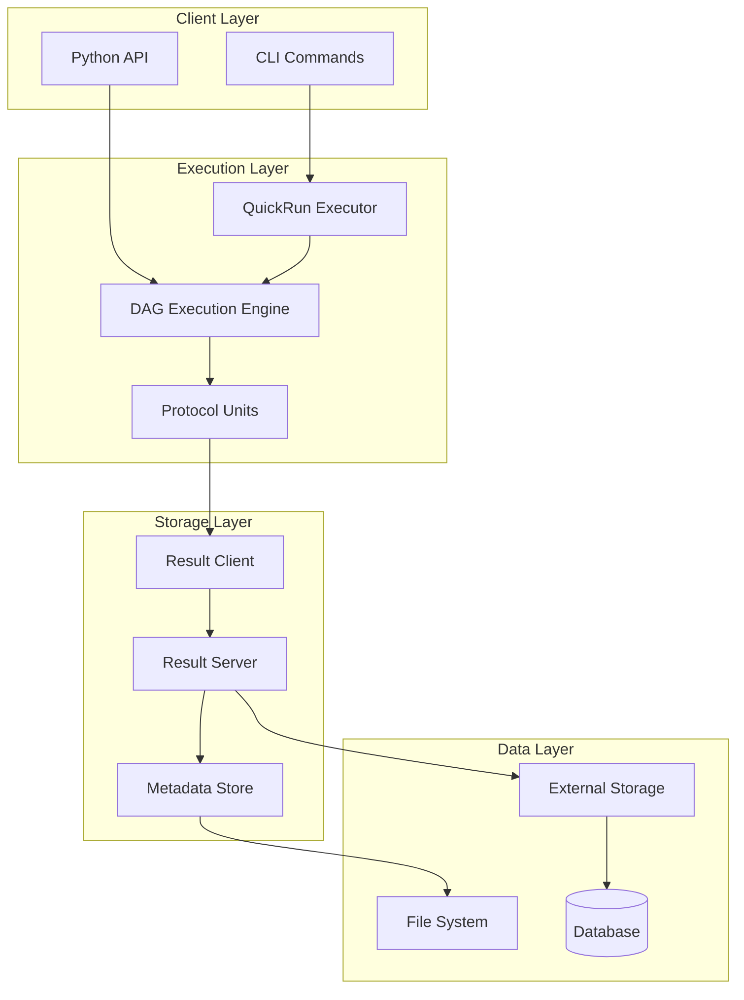
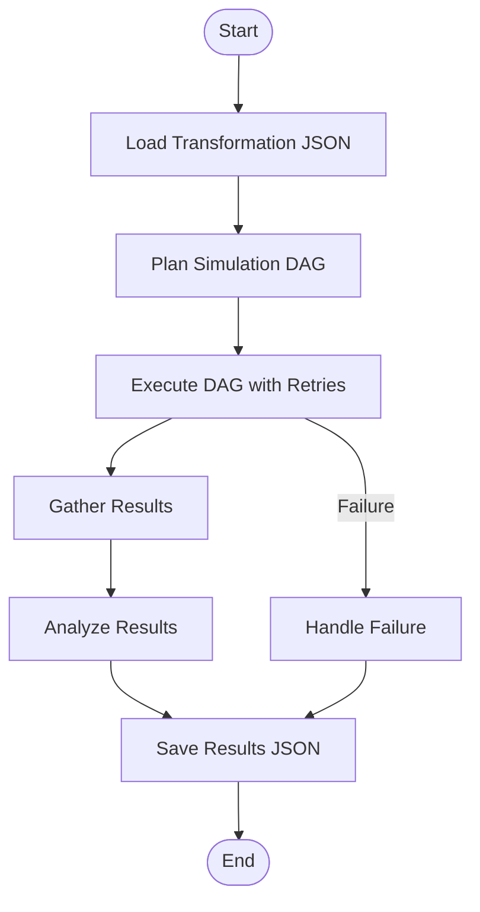

The OpenFE framework provides a robust orchestration system designed for high-throughput free energy calculations, enabling scalable execution of complex alchemical networks across distributed computing environments. This documentation explores the architectural components and execution patterns that facilitate efficient large-scale molecular simulations.

## Orchestration Architecture Overview

OpenFE's orchestration system follows a layered architecture that separates concerns between simulation execution, result management, and data persistence. The design enables both single-machine workflows and distributed computing scenarios while maintaining consistent interfaces and data handling patterns.



## Core Storage and Result Management

The storage subsystem provides the foundation for high-throughput execution by managing simulation results, metadata, and intermediate data efficiently. The architecture uses a hierarchical container system that enables scalable data organization and retrieval.

### Result Container Hierarchy

The storage system employs a nested container pattern that mirrors the logical structure of free energy calculations:

- **ResultClient**: Top-level container for accessing stored calculation results and networks [openfe/storage/resultclient.py#L93-L98]  
- **TransformationResult**: Container for individual transformation calculations [openfe/storage/resultclient.py#L252-L257]
- **CloneResult**: Container for protocol unit clones (repeated simulations) [openfe/storage/resultclient.py#L261-L270]  
- **ExtensionResult**: Container for individual output files and data [openfe/storage/resultclient.py#L274-L287]

Each container implements the `_ResultContainer` abstract base class, providing consistent navigation and data access patterns throughout the hierarchy [openfe/storage/resultclient.py#L22-L90].

### Metadata Management

The system includes flexible metadata storage implementations:

| Store Type | Characteristics | Use Case |
|------------|----------------|----------|
| **JSONMetadataStore** | Single JSON file storage, simple implementation | Small-scale projects, development |
| **PerFileJSONMetadataStore** | Individual metadata files per result | Large-scale distributed computing |

The metadata stores implement a mapping interface that abstracts storage details while maintaining efficient access to calculation metadata [openfe/storage/metadatastore.py#L14-L38].

## High-Throughput Execution Patterns

### QuickRun Executor

The `quickrun` command provides the primary interface for executing individual transformations at scale. It handles the complete workflow from transformation loading through execution and result aggregation:



The executor supports key high-throughput features:
- **Retry Logic**: Automatic retry mechanism for failed protocol units (`n_retries=2`) [openfecli/commands/quickrun.py#L76-L82]
- **Workspace Management**: Configurable working directories with automatic creation [openfecli/commands/quickrun.py#L58-L65]
- **Result Aggregation**: Automatic collection and analysis of simulation results [openfecli/commands/quickrun.py#L83-L92]

### Network Planning and Batch Execution

For large-scale calculations, the `plan-rbfe-network` command enables batch generation of transformation definitions that can be executed in parallel:

```python
# Example: Plan a network for high-throughput execution
openfe plan-rbfe-network \
    --molecules ligands.sdf \
    --protein protein.pdb \
    --output-dir network_definitions \
    --n-protocol-repeats 3 \
    --n-cores 8
```

This creates individual JSON files for each transformation edge, which can then be distributed across computing resources using the quickrun executor [openfecli/commands/plan_rbfe_network.py#L120-L144].

## Result Collection and Analysis

### Gather Command for Network Analysis

The `gather` command provides sophisticated result collection capabilities for high-throughput scenarios:

| Report Type | Description | Output Format |
|-------------|-------------|---------------|
| **dg** | Maximum likelihood estimates of absolute ΔG values | Ligand, ΔG, uncertainty |
| **ddg** | Relative free energy differences between ligand pairs | Ligand_i, Ligand_j, ΔΔG, uncertainty |
| **raw** | Individual simulation results without aggregation | All raw simulation data |

The gather command supports recursive directory traversal, making it ideal for collecting results from distributed execution environments [openfecli/commands/gather.py#L634-L693].

### Advanced Features

- **Partial Result Handling**: `--allow-partial` flag enables processing incomplete networks [openfecli/commands/gather.py#L626-L632]
- **Flexible Output**: Support for both human-readable tables and TSV format for downstream processing
- **Error Resilience**: Robust handling of failed simulations and missing data

## Scalability and Performance Considerations

### Memory Management

The storage system employs lazy loading and streaming interfaces to handle large datasets efficiently:

```python
# Stream large result files without loading entirely into memory
result_client.load_stream(location, allow_changed=False)

# Access specific files within extensions without full container loading
extension_result["output_file.dat"]
```

### Concurrent Execution

The architecture supports concurrent execution through:
- **Protocol Unit Independence**: Each unit can execute independently
- **DAG Parallelization**: Directed acyclic graph execution enables natural parallelization
- **Resource Management**: Configurable processor allocation for network planning

### Data Deduplication

The ResultClient includes built-in deduplication for gufe tokenizable objects, reducing storage overhead for repeated molecular structures and protocols [openfe/storage/resultclient.py#L131-L143].

> [!TIP]
> For optimal performance in high-throughput scenarios, consider using the PerFileJSONMetadataStore for large networks (>1000 transformations) to avoid memory bottlenecks associated with single-file metadata storage.

> [!TIP]
> When executing on HPC systems, combine the quickrun executor with job array scheduling. Each transformation JSON file becomes an independent job, enabling massive parallelization while maintaining centralized result collection through the gather command.

## Integration with External Systems

### Storage Abstraction

The ResultServer provides a clean abstraction between metadata management and data storage, enabling integration with various storage backends:

- **Local File Systems**: Default for single-machine workflows
- **Network Storage**: NFS, Lustre, or other distributed file systems
- **Cloud Storage**: S3, Google Cloud Storage, or Azure Blob Storage
- **Object Databases**: MongoDB or other NoSQL solutions

### Plugin Architecture

The CLI system supports extensible command plugins, allowing custom orchestration workflows to be integrated seamlessly with the core framework [openfecli/cli.py#L16-L26].

## Best Practices for High-Throughput Workflows

1. **Network Design**: Plan networks with appropriate redundancy (3+ repeats) for statistical robustness
2. **Resource Allocation**: Match protocol repeat counts to available computing resources
3. **Result Management**: Use hierarchical directory structures to organize large result sets
4. **Monitoring**: Leverage the logging system to track execution progress across distributed jobs
5. **Error Handling**: Implement retry logic and partial result processing for robust workflows

The orchestration system in OpenFE provides a comprehensive foundation for high-throughput free energy calculations, balancing flexibility with performance to enable research at molecular discovery scales.

## Next Steps

For comprehensive understanding of the complete workflow, explore:
- [Protocol System and Execution Framework](8-protocol-system-and-execution-framework) for detailed execution patterns
- [Network-Based Results Analysis](17-network-based-results-analysis) for advanced analysis techniques  
- [Storage and Metadata Management](23-storage-and-metadata-management) for deeper storage architecture details