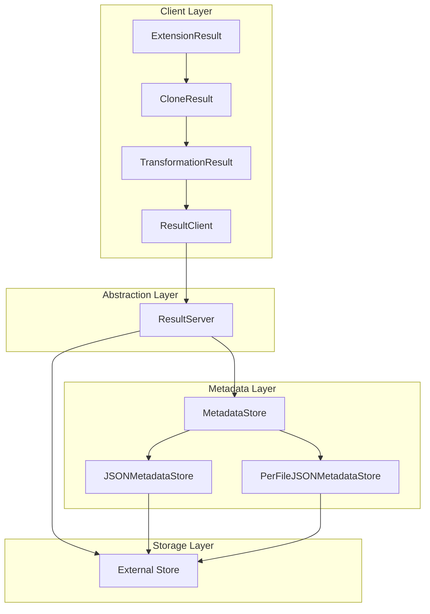

OpenFE provides a comprehensive storage and metadata management system designed to handle the complex data structures generated by free energy calculations. This system abstracts the underlying storage mechanisms while maintaining rich metadata for validation, deduplication, and efficient retrieval of computational results.

## Architecture Overview

The storage system follows a layered architecture that separates concerns between data storage, metadata management, and client access:



## Core Components

### ResultServer: The Central Abstraction

The `ResultServer` class serves as the primary interface between client code and the underlying storage systems [resultserver.py#L11-L15]. It manages the coordination between metadata and data storage, providing a unified abstraction that hides the complexity of metadata management from users.

Key responsibilities include:
- **Metadata Validation**: Ensuring data integrity through metadata comparison [resultserver.py#L37-L51]
- **Storage Operations**: Coordinating storage of both data and associated metadata [resultserver.py#L25-L30]
- **Missing File Detection**: Identifying inconsistencies between metadata and actual storage [resultserver.py#L55-L57]

> [!TIP]
> The ResultServer implements a critical validation pattern that checks metadata consistency before data access, preventing silent corruption in long-running free energy calculations.

### Metadata Management Strategies

OpenFE provides two distinct metadata storage approaches, each optimized for different use cases:

#### JSONMetadataStore: Centralized Metadata

The `JSONMetadataStore` maintains all metadata in a single `metadata.json` file [metadatastore.py#L41-L44]. This approach is simple to implement but has scalability limitations for large datasets.

**Characteristics:**
- Single file metadata storage
- Atomic updates through complete file rewriting
- Simple dependency-free implementation
- Suitable for small to medium-scale calculations

#### PerFileJSONMetadataStore: Distributed Metadata

The `PerFileJSONMetadataStore` stores metadata in individual JSON files within a `metadata/` directory [metadatastore.py#L70-L74]. This provides better scalability and concurrent access patterns.

**Characteristics:**
- Individual metadata files per data object
- Granular access and modification
- Better performance for large datasets
- Supports concurrent operations

### ResultClient: Hierarchical Data Access

The `ResultClient` implements a hierarchical navigation system for accessing stored results [resultclient.py#L93-L100]. It uses a path-like interface to organize results by transformation, clone, and extension:

```python
# Access pattern example
client = ResultClient(external_store)
transformation_result = client[transformation_key]
clone_result = transformation_result[clone_id]
extension_file = clone_result[extension_id]["output_file.dat"]
```

The client supports:
- **GufeTokenizable Deduplication**: Objects are stored using content-based keys to avoid duplication [resultclient.py#L131-L143]
- **Hierarchical Navigation**: Natural path-like access to nested results [resultclient.py#L46-L48]
- **Lazy Loading**: Data is loaded only when accessed to minimize memory usage

## Data Organization Patterns

### Storage Key Structure

The system uses a structured key format for organizing stored objects [resultclient.py#L106-L125]:

```
{prefix}/{class_name}/{token}.json
```

Where:
- `prefix`: Organizational category (e.g., "setup", "results")
- `class_name`: Type of stored object
- `token`: Unique content-based identifier

### Result Hierarchy

Results are organized in a three-level hierarchy:

1. **Transformation Level**: Individual transformations between molecular states
2. **Clone Level**: Multiple executions of the same transformation
3. **Extension Level**: Specific output files and data products

## Advanced Features

### Content-Based Deduplication

The system implements sophisticated deduplication for GufeTokenizable objects [resultclient.py#L131-L143]. Objects with identical content share storage, reducing disk usage and ensuring consistency:

```python
def _store_gufe_tokenizable(self, prefix, obj):
    for o in get_all_gufe_objs(obj):
        key = self._gufe_key_to_storage_key(prefix, o.key)
        if key not in self.result_server:  # Only store if not present
            data = json.dumps(o.to_keyed_dict(), cls=JSON_HANDLER.encoder, sort_keys=True)
            self.result_server.store_bytes(key, data)
```

### Dependency Resolution

Loading complex objects requires recursive dependency resolution to reconstruct object graphs [resultclient.py#L164-L200]. The system performs depth-first traversal to rebuild object hierarchies while maintaining object identity.

### Validation and Integrity

The storage system provides robust validation mechanisms:

- **Metadata Consistency**: Automatic validation of metadata against stored data [resultserver.py#L37-L51]
- **Change Detection**: Identification of modified or corrupted files
- **Missing File Detection**: Identification of orphaned metadata entries [resultserver.py#L55-L57]

> [!TIP]
> The validation system uses metadata comparison rather than content hashing for efficiency, allowing fast integrity checks while maintaining detection of unauthorized modifications.

## Implementation Considerations

### Performance Optimizations

- **Metadata Caching**: In-memory caching of metadata for rapid access [metadatastore.py#L16]
- **Lazy Loading**: Data loaded only when explicitly requested
- **Path Optimization**: Efficient string-based path construction and traversal

### Extensibility

The architecture supports extension through:
- **Custom Metadata Stores**: Abstract base class enables alternative metadata backends [metadatastore.py#L14-L38]
- **Pluggable Storage**: External store abstraction supports various storage systems
- **Custom Result Containers**: Extensible hierarchy for specialized result types

### Error Handling

The system provides comprehensive error handling for:
- **Missing Resources**: Clear error messages for unavailable data
- **Corrupted Data**: Detection and reporting of metadata inconsistencies
- **Storage Failures**: Graceful handling of underlying storage issues

## Best Practices

### Choosing Metadata Storage

- **Small Projects**: Use `JSONMetadataStore` for simplicity
- **Large-Scale Calculations**: Use `PerFileJSONMetadataStore` for better performance
- **Concurrent Access**: Prefer distributed metadata for multi-process workflows

### Data Organization

- Use consistent naming conventions for transformations and clones
- Organize results by calculation type and date
- Implement cleanup strategies for old or failed calculations

### Performance Optimization

- Batch metadata operations when possible
- Use lazy loading for large result sets
- Consider memory requirements when loading complex networks

## Integration Points

The storage system integrates with other OpenFE components:

- **Protocol System**: Stores transformation results and intermediate data
- **Network Planning**: Persists alchemical networks and planning metadata
- **Analysis Tools**: Provides data access for results analysis and visualization

For detailed information on related components, see [Protocol System and Execution Framework](8-protocol-system-and-execution-framework) and [Network-Based Results Analysis](17-network-based-results-analysis).

## Next Steps

To effectively utilize the storage and metadata management system:

1. **Choose Storage Strategy**: Select appropriate metadata store based on project scale
2. **Implement Data Access Patterns**: Use hierarchical navigation for result access
3. **Set Up Validation**: Configure appropriate validation levels for your workflow
4. **Monitor Storage Usage**: Implement monitoring for storage growth and performance

For practical examples, refer to the [Working with Individual Calculation Results](16-working-with-individual-calculation-results) documentation.