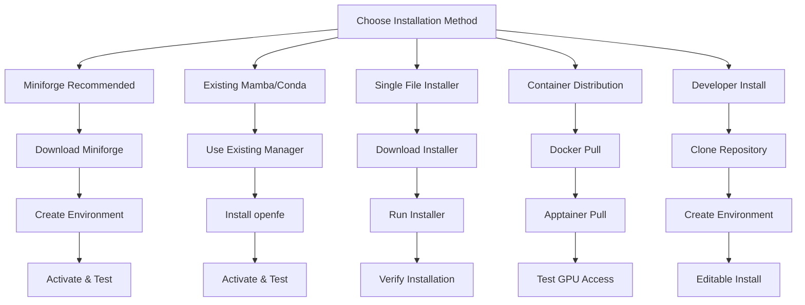

OpenFE is a comprehensive Python package for executing alchemical free energy calculations, designed for both beginners and advanced users in computational chemistry and molecular modeling. This guide covers multiple installation approaches to suit different environments and use cases.

## System Requirements and Compatibility

OpenFE is currently compatible with POSIX systems (macOS and UNIX/Linux) and follows Scientific Python SPEC0 standards with specific considerations:

- **Python versions**: 3.10-3.14 supported (Python 3.10 no longer actively maintained as of openfe 1.6.0)
- **OpenMM versions**: 8.0, 8.1.2, 8.2.0 (OpenMM v8.3.0 not yet supported)
- **NAGL partial charges**: Requires Python ≥3.11
- **OpenEye Toolkits**: Not compatible with Python 3.13

## Supported Hardware Platforms

| Platform | Architecture | GPU Support | Recommendation |
|----------|--------------|-------------|----------------|
| Linux | x86_64, aarch64, ppc64le | NVIDIA CUDA | Production use |
| macOS | arm64 (Apple Silicon) | None | Development/testing |

For optimal performance, we recommend Linux x86_64 with NVIDIA GPUs and driver version 525.60.13 or greater.

## Installation Methods Overview



## Installation with Miniforge (Recommended)

Miniforge provides the easiest installation experience with pre-configured conda-forge access and faster package resolution than conda.

### Step 1: Install Miniforge

Select your operating system, architecture, and shell from the interactive tool below, then run the generated commands:

```bash
# Example for Linux x86_64 with bash
curl -OL https://github.com/conda-forge/miniforge/releases/latest/download/Miniforge3-Linux-x86_64.sh
sh Miniforge3-Linux-x86_64.sh -b
~/miniforge3/bin/mamba init bash
rm -f Miniforge3-Linux-x86_64.sh
```

### Step 2: Create OpenFE Environment

```bash
mamba create -n openfe_env openfe
mamba activate openfe_env
```

### Step 3: Verify Installation

```bash
# Quick test
openfe test

# Comprehensive test suite (recommended for production)
openfe test --long
```

> [!TIP]
> The first test run may take longer due to code compilation, but this only happens once per installation.

## Installation with Existing Mamba/Conda

If you already have mamba or micromamba installed:

```bash
mamba create -c conda-forge -n openfe_env openfe
mamba activate openfe_env
```

## Reproducible Builds with Conda-Lock

For cross-platform reproducible environments, use conda-lock files:

```bash
# Install conda-lock in separate environment
conda create -n conda-lock -c conda-lock
conda activate conda-lock

# Download latest lock file
curl -LOJ https://github.com/OpenFreeEnergy/openfe/releases/latest/download/openfe-conda-lock.yml

# Create environment from lock file
conda-lock install -n openfe openfe-conda-lock.yml
conda activate openfe

# Verify installation
pytest --pyargs openfe openfecli
```

## Single File Installer

For offline installations or when internet access is limited:

```bash
# Download installer (Linux x86_64 example)
curl -LOJ https://github.com/OpenFreeEnergy/openfe/releases/latest/download/OpenFEforge-Linux-x86_64.sh

# Make executable and run
chmod +x ./OpenFEforge-Linux-x86_64.sh
./OpenFEforge-Linux-x86_64.sh

# Verify installation
which python  # Should show openfeforge/bin/python
openfe --help
pytest --pyargs openfe openfecli
```

> [!TIP]
> The single file installer may modify your `.bashrc` and could require manual intervention to access previous conda installations.

## Containerized Distributions

### Docker

```bash
# Pull latest image
docker pull ghcr.io/openfreeenergy/openfe:latest

# For production, use specific version
docker pull ghcr.io/openfreeenergy/openfe:1.0.1
```

### Apptainer (Singularity)

```bash
# Pull image
singularity pull oras://ghcr.io/openfreeenergy/openfe:latest-apptainer

# Test GPU access
singularity run --nv openfe_latest-apptainer.sif python -m openmm.testInstallation

# Access CLI
singularity run --nv openfe_latest-apptainer.sif openfe --help
```

## HPC Environment Considerations

High Performance Computing environments present unique challenges due to differences between login and compute nodes. We recommend using containers for HPC deployments.

### CUDA Version Management

For conda-based installations in HPC environments:

```bash
# Check CUDA version on compute node
nvidia-smi  # Look for "CUDA Version" in output

# Override CUDA detection on login node
CONDA_OVERRIDE_CUDA=11.7 mamba create -n openfe_env openfe
```

### Virtual Package Detection

Conda uses virtual packages to detect system capabilities. The difference between login and compute nodes can cause issues:

```bash
# On login node (no GPU)
mamba info  # Shows: __archspec=1=x86_64, __glibc=2.17=0, __linux=3.10.0=0

# On compute node (with GPU)  
mamba info  # Shows: __archspec=1=x86_64, __cuda=11.7=0, __glibc=2.17=0
```

## Developer Installation

For contributing to OpenFE:

```bash
# Clone repository
git clone https://github.com/OpenFreeEnergy/openfe.git
cd openfe

# Create environment from specification
mamba create -f environment.yml
mamba activate openfe_env

# Install in editable mode
python -m pip install --no-deps -e .
```

## Optional Dependencies

Certain advanced features require additional packages:

```bash
# For perses tools (requires OpenEye license)
mamba install -c openeye perses openeye-toolkits
```

## Troubleshooting

### Debug Script

Run the debug script to diagnose installation issues:

```bash
bash -c "$(curl -Ls https://raw.githubusercontent.com/OpenFreeEnergy/openfe/main/devtools/debug_openmm.sh)" | tee -a debug.log
```

### Common Error: CUDA PTX Version Mismatch

```
openmm.OpenMMException: Error loading CUDA module: CUDA_ERROR_UNSUPPORTED_PTX_VERSION (222)
```

**Solution**: Re-create environment with correct CUDA toolkit version for your hardware/driver combination.

### Custom Docker Build Issues

When building custom Docker images, you may need to increase file descriptor limits:

```bash
docker build --ulimit nofile=262144:262144 .
```

## Environment Specification

The standard OpenFE environment includes these key dependencies:

- **Core**: OpenMM 8.2.0, OpenFF Toolkit, RDKit
- **Analysis**: pymbar, cinnabar, pandas  
- **Visualization**: py3dmol, networkx, pygraphviz
- **Testing**: pytest with parallel execution support
- **Documentation**: sphinx with pydata theme

For production deployments, the [production/environment.yml](production/environment.yml) provides a streamlined specification optimized for HPC environments.

## Next Steps

After successful installation, proceed to [Running Your First Free Energy Calculation](4-running-your-first-free-energy-calculation) to learn the basics of using OpenFE, or explore the [CLI Overview and Common Commands](5-cli-overview-and-common-commands) for command-line interface usage.

