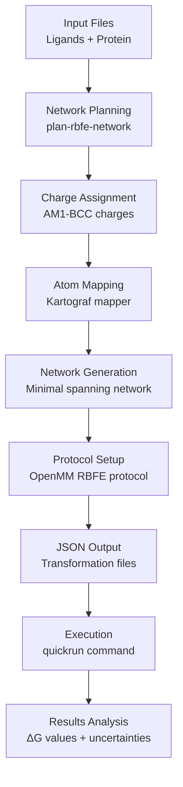

Welcome to your first free energy calculation with OpenFE! This guide will walk you through the complete process of setting up and running a relative binding free energy (RBFE) calculation using the command-line interface. RBFE calculations are fundamental in drug discovery for predicting how small modifications to ligands affect their binding affinity to a target protein.

## Understanding the OpenFE Workflow

Before diving into the practical steps, let's understand the high-level architecture of how OpenFE handles free energy calculations:



The workflow consists of two main phases: **planning** and **execution**. During planning, OpenFE analyzes your molecular system, generates atom mappings between ligands, and creates an optimized network of transformations. During execution, each transformation is simulated using molecular dynamics to calculate free energy differences.

## Prerequisites and Setup

Before running your first calculation, ensure you have:

1. **OpenFE installed** - Follow the [Installation and Environment Setup](3-installation-and-environment-setup) guide
2. **Molecular structure files**:
   - Ligand files in SDF format (or SMILES strings)
   - Protein structure in PDB or PDBx/mmCIF format
3. **Basic understanding** of free energy calculations (covered in [Alchemical Free Energy Calculations Fundamentals](6-alchemical-free-energy-calculations-fundamentals))

## Step 1: Prepare Your Input Files

### Ligand Files
OpenFE accepts ligands in multiple formats through the molecule loading system [openfecli/parameters/mol.py](openfecli/parameters/mol.py#L7-67):

- **SDF files** (recommended): Contains 3D coordinates and connectivity
- **MOL2 files**: Alternative format with partial charge information
- **SMILES strings**: Simple text representation for quick testing

```bash
# Example ligand files
ligands/
├── benzene.sdf
├── toluene.sdf
├── phenol.sdf
└── chlorobenzene.sdf
```

### Protein Files
Protein structures are loaded via the protein parameter system [openfecli/parameters/protein.py](openfecli/parameters/protein.py#L7-47):

- **PDB files**: Standard protein structure format
- **PDBx/mmCIF files**: Modern format with better handling of large structures

```bash
# Example protein file
protein/
└── tyrosine_kinase.pdb
```

> [!TIP]
> Ensure your protein structure is properly prepared: remove alternate conformations, add missing residues, and include all necessary cofactors. The quality of your input structures directly impacts calculation accuracy.

## Step 2: Plan Your RBFE Network

The `plan-rbfe-network` command is your gateway to setting up a complete free energy calculation campaign. This command handles all the complex setup automatically [openfecli/commands/plan_rbfe_network.py](openfecli/commands/plan_rbfe_network.py#L75-257).

### Basic Command Structure

```bash
openfe plan-rbfe-network \
  --mol-dir ligands/ \
  --protein protein/tyrosine_kinase.pdb \
  --output-dir rbfe_network
```

### Key Parameters Explained

| Parameter | Required | Description | Default |
|-----------|----------|-------------|---------|
| `--mol-dir` | Yes | Directory containing ligand files | - |
| `--protein` | Yes | Protein structure file | - |
| `--cofactors` | No | Additional cofactor molecules | None |
| `--output-dir` | No | Output directory for network | `alchemicalNetwork` |
| `--n-protocol-repeats` | No | Number of simulation repeats | 3 |
| `--n-cores` | No | CPU cores for charge generation | 1 |

### What Happens During Planning?

1. **Charge Assignment**: OpenFE automatically generates AM1-BCC partial charges for all ligands using the OpenFF toolkit [openfecli/commands/plan_rbfe_network.py](openfecli/commands/plan_rbfe_network.py#L85-95)

2. **Atom Mapping**: The KartografAtomMapper creates optimal correspondences between ligand atoms [openfecli/commands/plan_rbfe_network.py](openfecli/commands/plan_rbfe_network.py#L25-27)

3. **Network Optimization**: A minimal spanning network is generated to minimize the total number of required transformations [openfecli/commands/plan_rbfe_network.py](openfecli/commands/plan_rbfe_network.py#L27-29)

4. **Protocol Setup**: The OpenMM Relative Hybrid Topology Protocol is configured with default settings [openfecli/commands/plan_rbfe_network.py](openfecli/commands/plan_rbfe_network.py#L70-75)

### Output Structure

After planning completes, you'll have:

```
rbfe_network/
├── transformation_1.json
├── transformation_2.json
├── transformation_3.json
└── ligand_network.json
```

Each JSON file contains a complete transformation ready for execution, including all simulation parameters and molecular system information.

## Step 3: Execute Your First Calculation

With your network planned, it's time to run the actual simulations using the `quickrun` command [openfecli/commands/quickrun.py](openfecli/commands/quickrun.py#L25-142).

### Running a Single Transformation

```bash
openfe quickrun rbfe_network/transformation_1.json \
  --work-dir simulation_results \
  --output results_1.json
```

### Understanding the Execution Process

The `quickrun` command performs several key steps:

1. **DAG Creation**: Creates a directed acyclic graph of simulation tasks [openfecli/commands/quickrun.py](openfecli/commands/quickrun.py#L85-87)
2. **Simulation Execution**: Runs molecular dynamics simulations for each lambda window [openfecli/commands/quickrun.py](openfecli/commands/quickrun.py#L89-95)
3. **Result Analysis**: Processes simulation data to calculate free energy estimates [openfecli/commands/quickrun.py](openfecli/commands/quickrun.py#L97-101)
4. **Error Handling**: Provides detailed error reporting if simulations fail [openfecli/commands/quickrun.py](openfecli/commands/quickrun.py#L127-133)

### Expected Output

A successful calculation produces:

```json
{
  "estimate": -2.34,
  "uncertainty": 0.15,
  "protocol_result": {...},
  "unit_results": {...}
}
```

Where `estimate` is the ΔG value in kcal/mol and `uncertainty` represents the statistical error.

## Step 4: Analyze Your Results

### Understanding the Output

- **ΔG (estimate)**: Free energy difference between the two ligand states
- **Uncertainty**: Statistical confidence in the estimate
- **Protocol Result**: Detailed simulation metadata and convergence metrics

### Convergence Assessment

Good calculations typically show:
- Uncertainty < 0.5 kcal/mol for well-converged results
- Consistent results across multiple protocol repeats
- No large fluctuations in energy terms during simulation

### Troubleshooting Common Issues

| Issue | Likely Cause | Solution |
|-------|--------------|----------|
| High uncertainty (>1.0 kcal/mol) | Insufficient sampling time | Increase simulation length or protocol repeats |
| Simulation crashes | Poor atomic clashes in input | Check and prepare molecular structures |
| Large ΔG values (>10 kcal/mol) | Incorrect atom mapping | Verify ligand similarity and mapping quality |

## Advanced Options and Customization

### Custom Settings with YAML

For more control over your calculations, create a YAML settings file:

```yaml
mapper:
  type: KartografAtomMapper
  settings:
    atom_max_distance: 0.95
    map_hydrogens: true

scorer:
  type: default_lomap_scorer

network_planner:
  type: minimal_spanning_network

solvent:
  type: water
  ionic_strength: 0.15 M

partial_charge:
  partial_charge_method: am1bcc
  off_toolkit_backend: openeye
```

Use it with: `--settings custom_settings.yaml`

### High-Throughput Execution

For large ligand sets, consider:
- Using more CPU cores: `--n-cores 8`
- Parallel execution of multiple transformations
- Batch processing with job schedulers

## Next Steps

Congratulations! You've successfully run your first free energy calculation. To expand your knowledge:

1. **Explore different calculation types**: Learn about [Absolute Binding Free Energy (ABFE) Protocols](13-absolute-binding-free-energy-abfe-protocols)
2. **Deepen your understanding**: Study [Alchemical Free Energy Calculations Fundamentals](6-alchemical-free-energy-calculations-fundamentals)
3. **Master the CLI**: Read [CLI Overview and Common Commands](5-cli-overview-and-common-commands)
4. **Try Python interface**: Progress to the [RBFE Python Tutorial](tutorials/rbfe_python_tutorial.nblink) for programmatic control

> [!TIP]
> The command-line interface is perfect for getting started and routine calculations. As your needs grow, consider the Python API for greater flexibility and custom protocol development.

## Summary

You've now experienced the complete OpenFE workflow:

1. ✅ **Prepared** molecular input files
2. ✅ **Planned** an optimized RBFE network
3. ✅ **Executed** free energy simulations
4. ✅ **Analyzed** results and understood uncertainties

The OpenFE framework handles the complexity of free energy calculations while providing you with control over key parameters. This foundation enables you to tackle increasingly sophisticated molecular design challenges in drug discovery and computational chemistry.